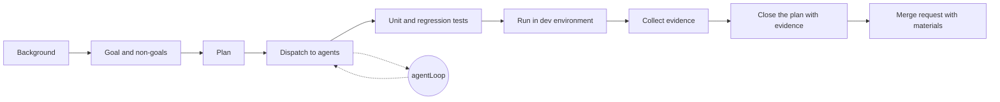

Proof of Work rests on one asymmetry: the proof is expensive to produce and cheap to verify. Code review used to rest on the same asymmetry without anyone saying so. Agents reversed it, and a reviewer's attention now pays for work its author never checked.

## TL;DR

Before agents, a long merge request was weak evidence that someone had thought hard. Now it costs a prompt to write and an afternoon to review, so the effort of verification lands on whoever approves it. In a team with one tech lead approving features and breaking changes for about ten people, that person became the place where the whole team's unchecked work piled up. I answer it with a work loop around the agent loop: background, goal and non-goals, plan, dispatch, tests, a dev-environment run, evidence collected against the plan, and a merge request that carries all of it, with a TL;DR on top for readers with less time. Real effort is the verification you absorb before handing work to someone else, and you can see it by checking which stages of that loop left an artifact.

<!-- more -->

## The asymmetry flipped

Hashcash, the 1997 anti-spam scheme that Bitcoin later borrowed, asked every sender to burn a little CPU before an email was accepted. Generating the stamp took seconds. Checking it took microseconds. The cost sat with the sender, and the receiver's attention stayed protected.

Software teams ran on an informal version of this. A 500-line merge request, a design document or a detailed bug report took hours to produce, and those hours were a rough signal that someone had understood the problem. Reviewers spent trust accordingly. A large, tidy change from a careful colleague deserved a lighter read than a hasty one.

That signal is gone. An agent produces the 500 lines, the design document and the test suite in one session, and they all look tidy. Reviewing them costs exactly what it did before. Daniel Stenberg has written about curl's bug bounty filling up with AI-generated reports that read convincingly and describe vulnerabilities that do not exist; each still takes a maintainer's time to dismiss. Polish and length used to count as evidence. Today a long, polished change with no proof attached is the most expensive thing a reviewer can receive.

## Where the effort went

In my team, one tech lead looks after roughly ten engineers. He does not write code anymore, and nobody expects him to. What he does is approve: new features and breaking changes need his acknowledgement before they reach the mainline branch, and again before they ship to production. Routine fixes do not go through him. The rule is reasonable, and it is the kind of gate I would keep.

We all use Claude Code. Documents, source, tests, MR descriptions and status updates come out of agent sessions. The output did not arrive evenly, though, because people bring different knowledge and different amounts of attention to the same tool. Some colleagues use the agent to go further than they could alone. Others found that the agent would carry them, and settled into pressing "continue" until something green appeared. I started calling it continue-enjoying, partly as a joke and partly because I have done it myself on a tired evening.

A continue-enjoyer does not make the verification disappear. Someone still has to read the diff, wonder whether the migration is reversible, and ask what happens to old clients. If the author did not do it, the reviewer does. Our tech lead became the person doing that checking for ten people's agent output, and his queue became the slowest part of every feature.

That also broke how we judge each other. By the old visible measures (MRs opened, documents written, tickets closed), a continue-enjoyer looks at least as productive as a careful engineer, often more. The difference only shows up in how much each one costs the reviewer, and nobody tracks that.

## agentLoop and workLoop

The agent harnesses I learned from make their inner loop explicit. Pi-coding-agent's agent loop observes, calls a tool, reads the result and continues until the model decides it is done. Matt Pocock's skills (grilling a plan, test-first development) push structure into the parts of a session where agents tend to drift. Reading them, I noticed that the agent has a loop and I did not. I was the unstructured part.

So I wrote myself an outer loop, and I run it for every task that will reach review:

The agent loop is good at reaching a plausible result. The work loop exists for the two things it cannot own: what "done" means before anything is written, and proof that it happened afterwards.

Background comes first because an agent will happily solve the problem it imagines. I read the ticket, the code it touches and any earlier decision, and write down what I found. Goals and non-goals come next. The non-goals do more work than they appear to. They stop the agent from "improving" adjacent code, and they tell the reviewer what he does not need to worry about.

The plan turns the goal into slices small enough that each one can be checked. Then I dispatch the slices to agents, and this is the only stage where most of the typing happens. Tests follow: unit tests for the new behaviour and regression tests for what must not change. A run in the dev environment shows that the change works outside the test harness. I collect the evidence as I go (commands, outputs, logs, screenshots) and close each plan item against it. The merge request carries the background, the goal, the plan and the evidence, with a TL;DR at the top.

Everything goes into a document anyone on the team can read. The expectation and the result should be clear to a reader who was never in my session. A reader with little time still deserves the conclusion, which is what the TL;DR is for. A reader who cares can follow the links down to the evidence.

## What the reviewer actually needs

Running this loop for a while taught me that more material does not mean less review. A merge request with a plan, forty test logs and a gallery of screenshots is still expensive to read. Evidence can become its own slop.

What helps is an index that maps each acceptance criterion to its evidence and says where the risk sits:

| Criterion                         | Evidence                                         | Risk                 |
| --------------------------------- | ------------------------------------------------ | -------------------- |
| Old clients still parse responses | regression test `test_v1_compat`, dev-env log    | medium               |
| Migration can be rolled back      | rollback run on dev, link to output              | high, please look    |
| No change to the public CLI flags | non-goal; diff touches no CLI module             | low                  |

The reviewer reads the table, checks the high-risk rows himself and samples the rest. His time goes where judgement is needed.

Tests need their own proof. An agent that writes both the implementation and its tests can produce tests that pass because they mirror the code. The part of the testing I do by hand is deciding what to test, especially the regression cases, and showing that each new test fails without the fix. A test that went from red to green says much more than a test that was only ever green.

For breaking changes, the best place for the tech lead's approval is before the work starts. A one-page goal, non-goal and plan costs him minutes to read. A finished merge request costs an hour. If he approves the intent early, the final review shrinks to whether the evidence matches what he approved, and disagreements surface before any code exists.

The loop should also learn. When a change bounces, the reason belongs in the loop: a new line in the MR template, a check I now run before asking. Otherwise the reviewer catches the same class of mistake twice.

## Where it goes wrong

The loop fails in predictable ways. When I am tired, the evidence step turns into pasting whatever the agent printed. The plan sometimes gets written after the code, which makes it a summary of what happened rather than an intent. And any of these signals, once someone counts them, can be gamed. A team that rewards "MRs with evidence tables" will get evidence tables, some of them empty.

I am also not claiming continue-enjoying is wrong by itself. If someone presses continue all afternoon and then verifies the result properly, the reviewer gets the same proof either way. The problem is handing over output that nobody checked.

## Measuring real effort

Typing is free now, so counting what someone produced tells me almost nothing. A more useful measure is how much verification someone absorbed before passing work to the next person.

Much of that is visible without surveillance. A change that went through the work loop has a non-goals section, a test that fails without the fix, a dev-environment run and an evidence index. A change that skipped the loop is missing those stages, and you can see the gaps in the merge request itself. Other signals take longer to see: how often someone's changes bounce, how long the reviewer spends on them, whether defects escape later, whether the author can explain the change in five minutes without reopening the agent, and how useful their reviews of other people's work are.

None of this should become a scoreboard. It is material for an honest conversation about who is carrying the verification, and it gives credit to the person whose work no longer shows up as code: the reviewer, who now does the most important work on the team and has the least visible output.

Agents took the typing away. The checking is still there, and someone does it in every change that ships. I would rather it be me, in my own loop, before I ask anyone to approve my work.
