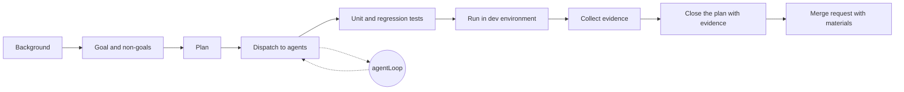

Proof of Work rests on one asymmetry: the proof is expensive to produce and cheap to verify. Code review has never had that guarantee. Agents made producing reviewable-looking work much cheaper, and a reviewer's attention now pays for work its author never checked.

## TL;DR

Agents lowered the cost of producing a large, tidy merge request without removing the work of checking it. In a team with one tech lead approving features and breaking changes for about ten people, unchecked output piles up at his desk. I propose proof of effort (POE): a checkable record of the verification an author performed before handing work over for review. It connects acceptance claims to a specific revision, reproducible checks and their results, and states what remains unverified. An outer work loop helps collect that evidence around the agent loop. The developer carries the complexity of establishing the result and makes the remaining decisions clear to the tech lead, reviewer and stakeholders. Approval becomes easier because they can assess the work without reconstructing the investigation; a filled-in template alone establishes nothing.

<!-- more -->

## The cost of producing a signal

Hashcash, the 1997 anti-spam scheme that Bitcoin later borrowed, asked every sender to burn a little CPU before an email was accepted. The sender searched for a stamp that met a chosen difficulty; the receiver could check it with a hash. The cost sat with the sender, and the receiver's attention stayed protected.

Software teams relied on a looser signal. A 500-line merge request, a design document or a detailed bug report took hours to produce, and those hours were a rough signal that someone had understood the problem. Reviewers spent trust accordingly. A careful colleague's track record could make a tidy change feel safer to review, even though its size established little about correctness.

That signal was never the strong evidence, though. The strong evidence was what a good reviewer asked for even then: a reproduction of the bug, a test that failed before the fix, a dev-environment run, a design that named its alternatives, and an author who could answer "why not X?" in the review thread. Behind all of those sat a track record, months of changes from the same person that had held up in production. Size and polish were a proxy that let reviewers skip some of that checking for people they trusted. Producing that appearance of care used to take more work.

An agent can now produce the 500 lines, the design document and the test suite in one session, and they all look tidy. Checking them still takes work. Daniel Stenberg describes the cost in [Death by a thousand slops](https://daniel.haxx.se/blog/2025/07/14/death-by-a-thousand-slops/): convincing but invalid vulnerability reports consume the curl security team's limited time. A long, polished change with no verification attached asks the reviewer to reconstruct the investigation.

An agent can write the explanation and the evidence table too. What helps is a check the reviewer can reproduce against the submitted revision, with a clear reason why its result supports the requirement. Even a genuine failing test can test the wrong thing. Someone still has to judge whether the check asks the right question.

## What proof of effort establishes

Proof of effort (POE) is a checkable record of the verification an author performed before handing work over for review. It connects each acceptance claim to the relevant revision, a reproducible check and its result, and states what remains unverified.

Here, effort means taking responsibility for checking the work. An agent can run the commands. The author remains responsible for choosing relevant checks, examining the results and limiting the claims made from them.

| Property | Proof of Work | Proof of effort |
| --- | --- | --- |
| What it establishes | A proof satisfies a specified computational condition | Particular checks support particular acceptance claims |
| Production cost | Deliberately expensive computation | Investigation and verification; cost varies |
| Verification | A cheap, deterministic predicate | Reproduction plus judgement; sometimes expensive |
| Binding | A challenge or block | The tested revision and relevant environment |
| Limit | Does not establish usefulness | Does not establish complete correctness, author understanding or hours spent |
| Benefit | Makes submitting work costly | Reduces uncertainty and investigation passed to the reviewer |

POE cannot guarantee PoW's cost asymmetry. A good engineer might produce strong evidence quickly; a difficult migration might still need hours of independent review. The useful ambition is to make checking a claim cheaper than reconstructing the investigation from scratch.

## The developer carries the complexity

More of the developer's work becomes defining acceptance and checking results, work we often associate with QA. Design and implementation remain part of the job, along with understanding how the result behaves. An agent producing the code leaves the developer responsible for establishing whether it solves the problem.

That complexity has to be taken on somewhere. If the author leaves it unresolved, it reaches the tech lead as unanswered design questions, the reviewer as an investigation, or the stakeholders as uncertainty about whether the feature meets their needs. The author's job is to resolve what they reasonably can and make the remaining decisions clear, including who needs to make them. The tech lead still owns the technical decisions that require their approval; stakeholders still need to settle unclear product expectations.

Each reader needs a different view of the same result. The tech lead needs the design tradeoffs, compatibility risks and rollout plan. The reviewer needs a comprehensible diff and checks tied to its claims. Stakeholders need to see the agreed behaviour demonstrated against their acceptance criteria, with the limitations stated. Test logs alone will not answer all of those questions.

A good merge request lets each person find what they need to approve, inspect the supporting evidence and challenge the unresolved parts. Approval becomes easier because the author has already done the investigation and exposed the remaining uncertainty. A risky change can still deserve a long review or a rejection.

The acceptance claims need scrutiny too. An expired-token check might correctly return `401` while nobody has agreed what should happen when a token is revoked or the identity provider is unavailable. The developer should raise those gaps with the relevant owners before treating passing tests as sufficient. Evidence can establish a narrow contract faithfully and still miss what users need.

## Where the effort went

In my team, one tech lead looks after roughly ten engineers. He does not write code anymore, and nobody expects him to. What he does is approve: new features and breaking changes need his acknowledgement before they reach the mainline branch, and again before they ship to production. Routine fixes do not go through him. The rule is reasonable, and it is the kind of gate I would keep.

We all use Claude Code. Documents, source, tests, MR descriptions and status updates come out of agent sessions. The output did not arrive evenly, though, because people bring different knowledge and different amounts of attention to the same tool. Some colleagues use the agent to go further than they could alone. Others found that the agent would carry them, and settled into pressing "continue" until something green appeared. I call that continue-enjoying.

A continue-enjoyer does not make the verification disappear. Someone still has to read the diff, wonder whether the migration is reversible, and ask what happens to old clients. If the author did not do it, the reviewer does. Our tech lead became the person doing that checking for ten people's agent output, and his queue became the slowest part of every feature.

That also broke how we judge each other. By the old visible measures (MRs opened, documents written, tickets closed), a continue-enjoyer looks at least as productive as a careful engineer, often more. The difference only shows up in how much each one costs the reviewer, and nobody tracks that.

## agentLoop and workLoop

The agent harnesses I learned from make their inner loop explicit. Pi-coding-agent's agent loop observes, calls a tool, reads the result and continues until the model decides it is done. Matt Pocock's skills (grilling a plan, test-first development) push structure into the parts of a session where agents tend to drift. Reading them, I noticed that the agent has a loop and I did not. I was the unstructured part.

The outer loop I propose for work that will reach review looks like this:



The agent loop is good at reaching a plausible result. The work loop gives the author explicit responsibility for deciding what "done" means and checking the result, even when agents help with both.

Background comes first because an agent will happily solve the problem it imagines. The author reads the ticket, the code it touches and any earlier decision, and records the relevant background. Goals and non-goals come next. The non-goals do more work than they appear to. They set a boundary for the agent's changes and tell the reviewer the intended scope. The diff and checks still have to establish that the boundary held.

The plan turns the goal into slices small enough that each one can be checked. The author can then dispatch slices to agents. Tests follow: unit tests for the new behaviour and regression tests for what must not change. A run in the dev environment shows that the change works outside the test harness. Evidence collection happens throughout (commands, outputs, logs, screenshots), so each plan item can close against an actual result. The merge request carries the background, the goal, the plan and the evidence, with a TL;DR at the top.

Everything goes into a document anyone on the team can read. The expectation and the result should be clear to a reader who was never in my session. A reader with little time still deserves the conclusion, which is what the TL;DR is for. A reader who cares can follow the links down to the evidence.

## What the reviewer actually needs

More material does not necessarily mean less review. A merge request with a plan, forty test logs and a gallery of screenshots is still expensive to read. Evidence can become its own slop.

What helps is an index that maps each acceptance claim to a check and its limitations. Record the tested commit and relevant environment once, then link the exact commands and actual outputs for each row. If the revision or environment changes, revalidate the affected evidence.

These rows illustrate the shape; they are not results from an actual change:

| Claim | Check and result to attach | Risk and limitation |
| --- | --- | --- |
| Supported v1 clients parse the response fixtures | Run the v1 compatibility suite against the proposed revision; link command and passing output | Medium; fixtures do not cover every client |
| Migration can be rolled back on the dev dataset | Apply and roll back the migration; link commands and before/after data comparisons | High, please look; production data and scale remain unverified |
| Previously supported CLI flags remain accepted | Run a flag compatibility suite against base and proposed revisions; link both results | Low; does not establish unchanged behaviour for every flag combination |

Calling CLI changes a non-goal, or observing that no CLI module changed, would not establish the last claim. Shared configuration or dependencies can still affect flag parsing.

Risk labels need a reason. The author should explain the potential impact, affected users and assumptions behind the label. A rollback that succeeds on a small dev dataset leaves production volume, locks and concurrent writes unresolved; those may determine whether the release is safe.

The reviewer can sample routine checks where that judgement is justified. Critical assumptions need direct scrutiny regardless of the row's label. The evidence index helps locate that work; it cannot decide which risks are acceptable.

Tests need their own proof. An agent that writes both the implementation and its tests can produce tests that pass because they mirror the code. The author needs to decide what to test, especially the regression cases. For a bug fix, show the relevant test failing on the base revision for the expected reason and passing on the proposed revision. That establishes that the check detects the reproduced bug; the reviewer still needs to assess its assertions and coverage. Other changes may need different evidence.

For breaking changes, the best place for the tech lead's approval is before the work starts. A one-page goal, non-goal and plan costs him minutes to read. A finished merge request costs an hour. Approving the intent early can surface disagreements before implementation. Final review still needs to consider implementation risks and anything the plan missed, alongside the evidence for the agreed goal.

The loop should also learn. When a change bounces, the reason belongs in the loop: a new line in the MR template, a check to run before asking again. Otherwise the reviewer catches the same class of mistake twice.

## Where it goes wrong

The loop can fail in predictable ways. The evidence step can collapse into copying the agent's summary without checking the underlying result. A plan written after implementation can make an accidental outcome look intentional. And any of these signals, once someone counts them, can be gamed. A team that rewards "MRs with evidence tables" will get evidence tables, some of them empty.

Someone can press continue all afternoon and still verify the result properly. The reviewer gets the same evidence either way. The problem is handing over output that nobody checked.

## Measuring real effort

Typing became much cheaper, so counting output tells me less about someone's contribution. A more useful question is how much uncertainty and investigation they resolved before passing work to the next person.

A filled-in template cannot answer that. POE earns its place when the reviewer can assess the claims with less reconstruction and see the remaining uncertainty early. Fewer clarification rounds and less repeated investigation would be signs that it helps; counting evidence tables would reward the appearance of checking. Other signals take longer to see: how often someone's changes bounce, how long the reviewer spends on them, whether defects escape later, whether the author can explain the change in five minutes without reopening the agent, and how useful their reviews of other people's work are.

None of this should become a scoreboard. It is material for an honest conversation about who is carrying the verification, and it gives credit to the person whose work no longer shows up as code: the reviewer, whose contribution is easy to miss when we count only delivered code.

## What I would ask for

The author should carry verification far enough that the reviewer can assess explicit claims without rebuilding the investigation. Some checks will take minutes. Others will need substantial independent work, and the handoff should say so.

On my side, I would start by asking whether I can explain the change in five minutes with the agent closed. That is a useful understanding check, although a fluent explanation alone proves little. I would write the goal and non-goals where the team can read them, put a TL;DR on top, and attach checks appropriate to the change. The unverified parts need their own space: a stated gap gives the reviewer a concrete place to investigate. I would also describe how I supervised the agents and which decisions or results I checked myself.

I would start with a short merge request template:

```markdown
## TL;DR

## Goal / non-goals

## Tested revision and environment

## Evidence

| Acceptance claim | Reproducible check and result | Risk, basis and limitation |
| ---------------- | ----------------------------- | -------------------------- |

## Not verified

## Author decisions and checks / agent assistance
```

For routine work, once the team shares the expectations, I would return a change that makes unsupported claims and ask for the missing checks before a full review. A new colleague may need help choosing those checks. Exploratory work may produce a reproduction or an unanswered question as its result. During an incident, the team may need to act with limited evidence; the handoff should record what was checked, who accepted the remaining risk and who will follow up.

For features and breaking changes I would ask to see the one-page plan before implementation, then review the evidence and the basis for its risk labels. Sampling a routine row can catch careless claims, while critical assumptions deserve direct inspection. Asking "why this and not X?" can expose assumptions worth examining. A polished answer still needs to hold up against the code and the requirements.

For judging people, I would put a peer reviewer in front of the tech lead. It spreads the load and gives people practice evaluating changes. Peer reviews need the same scrutiny: an agent can generate a convincing review too. I would use bounce rates and escaped defects to look for recurring process problems, with the difficulty of the assignments and the review conditions alongside them. A person handling risky migrations will face different outcomes from someone making routine changes; even a long observation period does not make those counts a fair ranking. And I would want reviews and approvals to count in performance conversations as real work. If verification earns no credit, the people who do it will eventually stop, and the queue will only grow.

Agents took the typing away. The checking is still there, and someone does it in every change that ships. I would rather it be me, in my own loop, before I ask anyone to approve my work.
