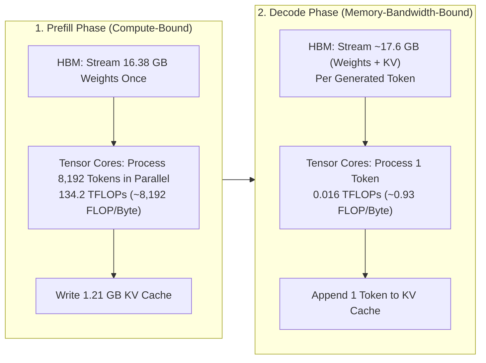
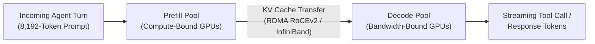

Designing reliable coding agents or inference clusters without calculating the underlying hardware arithmetic leads to predictable production failures: unexpected GPU out-of-memory (OOM) crashes at long contexts, severe latency spikes when concurrent sessions overlap, and runaway token costs across multi-turn trajectories.

Before we write a single line of agent harness code, this opening chapter establishes the physical laws governing every Large Language Model (LLM) forward pass: why **Prefill is compute-bound** while **Decode is memory-bandwidth-bound**, how **Multi-Head Latent Attention (MLA)** compresses the KV cache by roughly `40x` or more (depending on head count) relative to an equivalent MHA layout, and when **Prefill-Decode (PD) disaggregation** helps or hurts cluster latency.

## Series Navigation

| Chapter | Title | Focus |
| --- | --- | --- |
| **01** | **Forward-Pass Arithmetic, Roofline Limits & KV Cache Architecture** | **Prefill vs decode roofline, MHA/GQA/MLA, matrix absorption, and PD disaggregation** |
| 02 | [Provider Abstraction, Streaming Accumulation & The Bounded ReAct Loop](/tech/series/ai-engineering/02.providers-streaming-and-react-loop/) | Type-safe wire contracts, dialect stripping, byte-buffered SSE, and context ablation |
| 03 | [Tool Engineering, Model Context Protocol (MCP) & Permission Gating](/tech/series/ai-engineering/03.tool-engineering-and-mcp/) | ACI design, parameter fidelity, dynamic discovery, JSON-RPC MCP, and two-phase dispatch |
| 04 | [Code as the Meta-Tool: Tree-sitter Incremental Parsing & AST Call-Graph Indexing](/tech/series/ai-engineering/04.code-intelligence-and-ast-indexing/) | Two-phase AST extraction, global symbol resolution in `ochna`, and call-graph queries |
| 05 | [Context Engineering, Compaction Strategies & Shared Graph Memory](/tech/series/ai-engineering/05.context-compaction-and-memory/) | Attention sinks, turn-boundary compaction, session integrity, and `asobi` knowledge graphs |
| 06 | [Execution Sandboxing, Capability Boundaries & Agent Security Models](/tech/series/ai-engineering/06.sandboxing-and-agent-security/) | Ancestor canonicalization, Landlock, gVisor vs microVMs, and hardened Kubernetes Jobs |
| 07 | [Rigorous Agent Evaluation, Harnesses & Multi-Agent Coordination](/tech/series/ai-engineering/07.evaluation-and-continual-evolution/) | Model vs harness ablation, unbiased `pass@k`, New Information Criterion, and evolution |

---

## 1. The Five Governing Questions of Data Movement

Every token generated by a Transformer is bounded by three physical hardware ceilings: **HBM capacity** (how many bytes fit in GPU memory), **HBM bandwidth** (how fast bytes move between High Bandwidth Memory and on-chip SRAM registers), and **Tensor Core throughput** (how many matrix floating-point operations execute per second).

Across the memory hierarchy, performance reduces to five questions of **data movement**:

1. **What moves?** Model weights, Key-Value (KV) cache tensors, intermediate activations, and output logits.
2. **How much moves?** Total bytes transferred across the memory bus versus floating-point operations (FLOPs) executed.
3. **How many times?** Streaming weights once per prompt batch versus re-streaming the entire model on every autoregressive decode step.
4. **Through which interconnect?** On-chip SRAM $\leftrightarrow$ HBM $\leftrightarrow$ NVLink / PCIe $\leftrightarrow$ RDMA (RoCEv2 / InfiniBand) $\leftrightarrow$ Ethernet.
5. **Who waits on the barrier?** Sequential token dependencies during autoregressive decoding and all-reduce synchronization across tensor-parallel ranks.

---

## 2. The Fundamental Asymmetry: Prefill vs. Decode

Consider an 8-billion-parameter dense Transformer such as **Qwen3-8B** ($P = 8.19 \times 10^9$ parameters) stored in `BF16` precision ($2\text{ bytes}$ per parameter), processing an input prompt of $T = 8,192\text{ tokens}$.



### Exact Arithmetic Breakdown

For every matrix projection containing $P$ parameters, a forward pass performs one multiply and one accumulate ($2\text{ FLOPs}$) per parameter per token:

$$\text{Matrix FLOPs}(T) \approx 2 \cdot P \cdot T$$

Let us compare the two phases side by side at batch size $B = 1$:

| Metric | Formula | Qwen3-8B Result ($T = 8,192$, BF16) | Hardware Regime |
| --- | --- | --- | --- |
| **Resident Model Weights** | $P \times 2\text{ bytes}$ | $\approx 16.38\text{ GB}$ ($16,381,470,720\text{ B}$) | Static HBM footprint |
| **Resident KV Cache ($8,192$ tokens)** | $2 \cdot L \cdot H_{kv} \cdot D_h \cdot T \cdot 2\text{ bytes}$ | $\approx 1.21\text{ GB}$ ($1,207,959,552\text{ B}$) | Dynamic HBM footprint |
| **Prefill Matrix Compute** | $2 \cdot P \cdot T + \text{Attention}$ | $134.2\text{ TFLOPs}$ | Saturated Tensor Cores |
| **Prefill Arithmetic Intensity** | $\text{FLOPs} / \text{Bytes}_{\text{streamed}}$ | $\approx \mathbf{8,192\text{ FLOP/Byte}}$ (weight traffic only) | **Massively Compute-Bound** |
| **Single-Token Decode Compute** | $2 \cdot P \cdot 1$ | $\approx 16.4\text{ GFLOPs}$ | Starved Tensor Cores |
| **Decode Bytes Streamed** | $\text{Weights} + \text{KV Cache}$ | $\approx 17.6\text{ GB}$ per step (16.38 GB weights + 1.21 GB KV) | Saturated HBM bus |
| **Decode Arithmetic Intensity** | $16.4\text{ GFLOPs} / 17.6\text{ GB}$ | $\approx \mathbf{0.93\text{ FLOP/Byte}}$ | **Memory-Bandwidth-Bound** |

### The Roofline Consequences for Agent Builders

An NVIDIA H100 SXM GPU delivers roughly $989\text{ TFLOPs}$ of dense `BF16` compute and $3.35\text{ TB/s}$ of HBM3 memory bandwidth. Its **ridge point** (the minimum arithmetic intensity required to saturate compute) is:

$$\text{I}_{\text{ridge}} = \frac{989 \times 10^{12}\text{ FLOP/s}}{3.35 \times 10^{12}\text{ Byte/s}} \approx 295\text{ FLOP/Byte}$$

1. **During Prefill ($8,192\text{ FLOP/Byte} \gg 295\text{ FLOP/Byte}$)**: Every weight byte loaded from HBM participates in thousands of multiply-accumulates across the $8,192$ prompt tokens. Latency scales linearly with prompt length (and quadratically in attention at ultra-long contexts). **Prefix caching** is therefore mandatory for multi-turn agents: reusing the precomputed KV blocks for the system prompt, tool schemas, and prior turns skips the $O(T)$ prefill forward pass entirely.
2. **During Decode ($0.93\text{ FLOP/Byte} \ll 295\text{ FLOP/Byte}$)**: At batch size $1$, the GPU hauls over $17\text{ GB}$ of weights and KV history from HBM into registers just to perform a single multiply-add per weight. Over $99\%$ of the GPU's arithmetic units sit idle waiting on memory buses. Increasing concurrent batch size $B$ reuses the streamed weights across $B$ requests simultaneously, raising arithmetic intensity linearly ($I \approx 0.93 \times B$) until it approaches the ridge point.

---

## 3. Breaking the KV Cache Memory Wall: MHA, GQA, and MLA

While model weights remain fixed regardless of traffic, the KV cache grows linearly with both **sequence length $T$** and **batch concurrency $B$**:

$$\text{KV Bytes} = B \times T \times L \times \text{Bytes per Token per Layer}$$

When coding agents inspect whole repositories or accumulate 50-turn debugging trajectories ($T \in [32\text{k}, 128\text{k}]$), the KV cache rapidly overtakes the model weights and exhausts GPU memory. Three generations of attention architectures evolved specifically to crush this per-token footprint:

### Generation 1: Multi-Head Attention (MHA)

In standard MHA (e.g., Llama-1), every query head $h \in [1, H]$ maintains its own dedicated Key and Value projection of dimension $D_h$:

$$\text{KV}_{\text{MHA}} = 2 \cdot L \cdot H \cdot D_h \cdot 2\text{ bytes}$$

For a 24-layer model with $H = 96$ heads and $D_h = 128$, each token consumes $2 \times 96 \times 128 \times 2 = 49,152\text{ bytes}$ per layer ($1.18\text{ MB}$ per token across 24 layers).

### Generation 2: Grouped-Query Attention (GQA)

In GQA (e.g., Llama-3, Qwen3), $H_q$ query heads are partitioned into $H_{kv}$ groups that share a single Key and Value head ($H_{kv} \ll H_q$, typically $4\times$ to $8\times$ smaller):

$$\text{KV}_{\text{GQA}} = 2 \cdot L \cdot H_{kv} \cdot D_h \cdot 2\text{ bytes}$$

Mapping $32$ query heads onto $8$ KV heads immediately cuts KV cache memory and HBM bandwidth traffic by $4\times$ while preserving multi-head query expressiveness.

### Generation 3: Multi-Head Latent Attention (MLA)

<Archify src="./diagrams/kv-cache-mla-prefill-decode.workflow.json" />

Introduced in DeepSeek-V2/V3 (and adopted by Kimi K2), **Multi-Head Latent Attention (MLA)** abandons storing explicit Key and Value heads altogether. Instead, the hidden state $h_t$ is projected down into a shared low-rank **compressed latent vector** $c_t^{KV} \in \mathbb{R}^{d_c}$ (e.g., $d_c = 512$) plus a small decoupled Rotary Position Embedding (RoPE) key $k_t^R \in \mathbb{R}^{d_r}$ (e.g., $d_r = 64$):

$$\text{KV}_{\text{MLA}} = L \cdot (d_c + d_r) \cdot 2\text{ bytes}$$

Notice that the number of attention heads $H$ **completely disappears** from the storage formula. Whether the model has $64$, $96$, or $128$ heads, each layer stores only $512 + 64 = 576$ `BF16` floats ($1,152\text{ bytes}$) per token:

| Architecture (24 Layers, $H=96, D_h=128$) | Stored Floats / Token / Layer | KV Cache at $8,192$ Tokens | KV Cache at $128,000$ Tokens |
| --- | --- | --- | --- |
| **Expanded MHA Equivalent** | $2 \times 96 \times 128 = 24,576$ | $\mathbf{9.00\text{ GiB}}$ ($9,663,676,416\text{ B}$) | $\mathbf{140.6\text{ GiB}}$ (Multi-GPU OOM) |
| **Compact MLA Latent Path** | $512 + 64 = 576$ | $\mathbf{216.0\text{ MiB}}$ ($226,492,416\text{ B}$) | $\mathbf{3.30\text{ GiB}}$ (Fits on a single card) |

MLA achieves a **$42.7\times$ memory reduction** ($24{,}576 / 576$) over the expanded representation.

### The Matrix Absorption Trick

A natural question arises: if we only store the compressed latent vector $c_t^{KV}$ in HBM and have an up-projection matrix $W^{UK}$ that reconstructs the keys $K = c^{KV} W^{UK}$, wouldn't decompressing $K$ on every decode step recreate the massive HBM memory-bandwidth bottleneck?

MLA avoids materializing $K$ in HBM by exploiting the **associativity of matrix multiplication**:

$$Q \cdot K^\top = Q \cdot \left(c^{KV} \cdot W^{UK}\right)^\top = Q \cdot \left(\left(W^{UK}\right)^\top \cdot \left(c^{KV}\right)^\top\right) = \underbrace{\left(Q \cdot \left(W^{UK}\right)^\top\right)}_{Q_{\text{absorbed}}} \cdot \left(c^{KV}\right)^\top$$

Instead of multiplying the entire historical cache $c^{KV}$ (length $T$) by $W^{UK}$, the engine absorbs $(W^{UK})^\top$ into the current token's Query vector $Q$ (length $1$ during decode), projecting the query into the $512$-dimensional latent space. Attention scores are then computed directly against the compressed $c^{KV}$ cache streamed from HBM. Similarly, the Value up-projection matrix $W^{UV}$ is absorbed into the output projection $W^O$ after the weighted sum over $c^{KV}$.

### Runnable Verification: Token Economics & Matrix Absorption

The following self-contained Python script verifies both the prefill/decode roofline arithmetic and the exact numerical equivalence of MLA matrix absorption using only the Python standard library:

```python
"""Verify LLM forward-pass roofline arithmetic and MLA matrix absorption."""

from __future__ import annotations


def dot(v1: list[float], v2: list[float]) -> float:
    return sum(x * y for x, y in zip(v1, v2))


def transpose(matrix: list[list[float]]) -> list[list[float]]:
    return [[matrix[r][c] for r in range(len(matrix))] for c in range(len(matrix[0]))]


def matmul(a: list[list[float]], b: list[list[float]]) -> list[list[float]]:
    b_t = transpose(b)
    return [[dot(row_a, col_b) for col_b in b_t] for row_a in a]


def verify_roofline_and_mla() -> None:
    # 1. Roofline arithmetic for an 8.19B model in BF16 (2 bytes/weight)
    params = 8.19e9
    bytes_per_weight = 2
    prompt_tokens = 8192

    weights_bytes = params * bytes_per_weight
    prefill_flops = 2.0 * params * prompt_tokens
    prefill_intensity = prefill_flops / weights_bytes

    decode_flops = 2.0 * params * 1
    decode_intensity = decode_flops / weights_bytes

    print("=== 1. Forward-Pass Arithmetic Intensity (Qwen3-8B, BF16) ===")
    print(f"Model weight footprint      : {weights_bytes / (1024**3):.2f} GiB")
    print(f"Prefill intensity (T=8192)  : {prefill_intensity:,.1f} FLOP/Byte (compute-bound)")
    print(f"Decode intensity  (B=1)     : {decode_intensity:.2f} FLOP/Byte (memory-bound)\n")

    # 2. Verify MLA Matrix Absorption: Q @ (C @ W_K)^T == (Q @ W_K^T) @ C^T
    q = [[1.0, 2.0]]              # Query token, shape [1, head_dim=2]
    c_latent = [[3.0, 4.0, 5.0]]  # Cached latent vector, shape [1, latent_dim=3]
    w_uk = [                      # Key up-projection matrix, shape [3, 2]
        [0.5, 1.5],
        [2.0, 0.5],
        [1.0, 1.0],
    ]

    # Path A: Decompress C -> K, then compute Q @ K^T
    k_expanded = matmul(c_latent, w_uk)
    score_expanded = matmul(q, transpose(k_expanded))[0][0]

    # Path B: Absorb W_UK^T into Q, then compute Q_absorbed @ C^T directly
    q_absorbed = matmul(q, transpose(w_uk))
    score_compact = matmul(q_absorbed, transpose(c_latent))[0][0]

    err = abs(score_expanded - score_compact)
    print("=== 2. MLA Matrix Absorption Verification ===")
    print(f"Expanded MHA-style score    : {score_expanded:.4f}")
    print(f"Compact absorbed MLA score  : {score_compact:.4f}")
    print(f"Numerical divergence        : {err:.6e}")
    assert err < 1e-9, "Matrix absorption diverged!"


if __name__ == "__main__":
    verify_roofline_and_mla()
```

Running this script produces:

```text
=== 1. Forward-Pass Arithmetic Intensity (Qwen3-8B, BF16) ===
Model weight footprint      : 15.26 GiB
Prefill intensity (T=8192)  : 8,192.0 FLOP/Byte (compute-bound)
Decode intensity  (B=1)     : 1.00 FLOP/Byte (memory-bound)

=== 2. MLA Matrix Absorption Verification ===
Expanded MHA-style score    : 37.5000
Compact absorbed MLA score  : 37.5000
Numerical divergence        : 0.000000e+00
```

---

## 4. Prefill-Decode (PD) Disaggregation & Interconnect Limits

When an inference engine colocates Prefill and Decode on the same GPU pool, the two phases fight over conflicting hardware objectives:

- **Head-of-Line (HoL) Blocking**: A single incoming request with a $16\text{k}$-token prompt occupies the GPU's Tensor Cores for hundreds of milliseconds. Every active streaming user on that node experiences an immediate freeze in **Time Between Tokens (TBT)**.
- **Batching Conflict**: Prefill wants large token batches to maximize matrix throughput; Decode wants minimal per-step latency to keep streaming under $20\text{ ms/token}$.

**Prefill-Decode (PD) Disaggregation** splits the serving cluster into a compute-optimized **Prefill Pool** and a bandwidth-optimized **Decode Pool**:



### Cluster Sizing & The RDMA Requirement

Suppose each request processes an $8,192$-token prompt and generates $1,024$ output tokens on an 8B GQA model ($L = 32$, $H_{kv} = 8$, $D_h = 128$):

1. **Prefill Time ($d_P$)**: At $150\text{ TFLOP/s}$ effective compute, $2 \times 8 \times 10^9 \times 8192 / (150 \times 10^{12}) \approx \mathbf{0.874\text{ s}}$.
2. **Decode Time ($d_D$)**: At $3.2\text{ TB/s}$ effective HBM bandwidth, streaming $16\text{ GB}$ per token takes $5.0\text{ ms/token}$, or $\mathbf{5.12\text{ s}}$ across $1,024$ output tokens.
3. **Optimal Worker Ratio ($R_{PD}$)**: To balance cluster queues without starvation, the ratio of Prefill workers ($N_P$) to Decode workers ($N_D$) must match their service times:
   $$R_{PD} = \frac{N_P}{N_D} \approx \frac{d_P}{d_D} = \frac{0.874\text{ s}}{5.12\text{ s}} \approx \mathbf{0.171} \quad (\approx 1\text{ Prefill node per } 6\text{ Decode nodes})$$
4. **The KV Transfer Bottleneck**: The $8,192$-token prompt produces $2 \times 32 \times 8 \times 128 \times 8192 \times 2\text{ B} = \mathbf{1,024\text{ MiB}}$ ($1.074\text{ GB}$) of KV state that must cross the network before the first decode token can be emitted:

| Interconnect | Effective Bandwidth | KV Transfer Latency ($1\text{ GiB}$) | Overhead vs. Prefill ($874\text{ ms}$) | Verdict |
| --- | --- | --- | --- | --- |
| **400 Gbps RDMA (RoCEv2 / IB)** | $50.0\text{ GB/s}$ | **$21.47\text{ ms}$** | **$2.46\%$** | Disaggregation succeeds cleanly |
| **10 GbE Standard Ethernet** | $1.25\text{ GB/s}$ | **$858.99\text{ ms}$** | **$98.31\%$** | Doubles TTFT; worse than colocation |

> **Architectural Rule**: Never deploy Prefill-Decode disaggregation across commodity Ethernet or slow PCIe links unless your model uses extreme KV compression (such as MLA, which would shrink this 32-layer example to about $288\text{ MiB}$).

---

## Key Takeaways

1. **Prefill is FLOP-bound; Decode is HBM-bandwidth-bound.** Single-stream decoding achieves barely $\sim 1\text{ FLOP/Byte}$ against a GPU ridge point of $\sim 300\text{ FLOP/Byte}$.
2. **Prefix caching is the highest-leverage optimization in agent engineering.** Keeping system instructions and tool definitions byte-for-byte static at the start of the message list allows the inference engine to skip the $O(T)$ prefill phase on every subsequent turn.
3. **MLA rewrites the economics of long-context agents.** By projecting Keys and Values into a shared low-rank latent vector and absorbing the up-projection matrix into Query weights, MLA slashes KV memory by $>40\times$ against an equivalent MHA layout, with no HBM decompression traffic (quality is a separate question that DeepSeek reports as on par with MHA).

In [Chapter 02: Provider Abstraction, Streaming Accumulation & The Bounded ReAct Loop](/tech/series/ai-engineering/02.providers-streaming-and-react-loop/), we move from the GPU hardware up into the software harness—designing a clean provider layer, a UTF-8-safe streaming SSE accumulator, and a bounded ReAct loop tested via context ablation.
