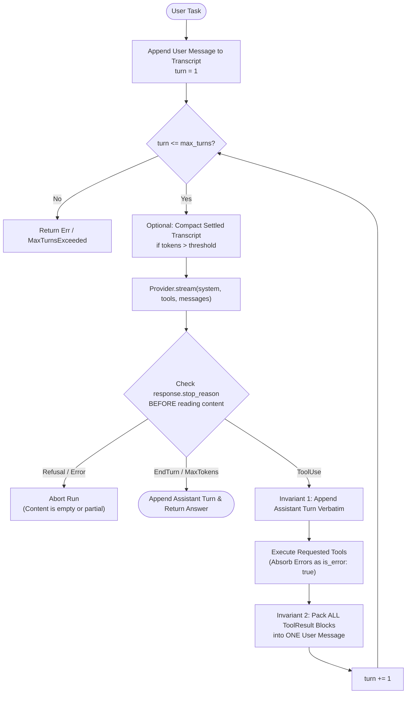

Read enough production coding-agent repositories and a striking structural truth emerges: **the part that decides what happens next—send the transcript, read the response, execute tools if requested, and repeat—is genuinely small**, often under a few hundred lines of code. Everything that makes an agent codebase large sits *around* that loop: provider wire adapters, dialect compatibility layers, Server-Sent Events (SSE) byte framing, cancellation points, and session persistence.

In this second chapter, we distill the architecture of [`azusachino/nahida`](https://github.com/azusachino/nahida) and the ReAct loop experiments into a rigorous blueprint for the provider layer, the streaming accumulator, and the bounded agent loop.

## Series Navigation

| Chapter | Title | Focus |
| --- | --- | --- |
| 01 | [Forward-Pass Arithmetic, Roofline Limits & KV Cache Architecture](/tech/series/ai-engineering/01.inference-arithmetic-and-kv-cache/) | Prefill vs decode roofline, MHA/GQA/MLA, matrix absorption, and PD disaggregation |
| **02** | **Provider Abstraction, Streaming Accumulation & The Bounded ReAct Loop** | **Type-safe wire contracts, dialect stripping, byte-buffered SSE, and context ablation** |
| 03 | [Tool Engineering, Model Context Protocol (MCP) & Permission Gating](/tech/series/ai-engineering/03.tool-engineering-and-mcp/) | ACI design, parameter fidelity, dynamic discovery, JSON-RPC MCP, and two-phase dispatch |
| 04 | [Code as the Meta-Tool: Tree-sitter Incremental Parsing & AST Call-Graph Indexing](/tech/series/ai-engineering/04.code-intelligence-and-ast-indexing/) | Two-phase AST extraction, global symbol resolution in `ochna`, and call-graph queries |
| 05 | [Context Engineering, Compaction Strategies & Shared Graph Memory](/tech/series/ai-engineering/05.context-compaction-and-memory/) | Attention sinks, turn-boundary compaction, session integrity, and `asobi` knowledge graphs |
| 06 | [Execution Sandboxing, Capability Boundaries & Agent Security Models](/tech/series/ai-engineering/06.sandboxing-and-agent-security/) | Ancestor canonicalization, Landlock, gVisor vs microVMs, and hardened Kubernetes Jobs |
| 07 | [Rigorous Agent Evaluation, Harnesses & Multi-Agent Coordination](/tech/series/ai-engineering/07.evaluation-and-continual-evolution/) | Model vs harness ablation, unbiased `pass@k`, New Information Criterion, and evolution |

---

## Before you start

An agent is a loop. You send the model the conversation, it replies with text or a request to run a tool, your program runs the tool and appends the result, and you send everything back. The loop stops when the model answers without asking for a tool, or when a limit you set is reached. This chapter covers the pieces around that loop: talking to different model providers, reading their streaming responses, and keeping the loop bounded.

Streaming is where beginners get hurt. The reply arrives in small fragments over a long-lived HTTP response, and a fragment can end in the middle of a JSON string or a multi-byte character, so you must buffer and assemble before parsing.

An example of a bounded loop: stop after 25 steps, whatever the model wants.

Read [chapter 1](/tech/series/ai-engineering/01.inference-arithmetic-and-kv-cache/) first if you want to know why tokens arrive one at a time and why long context costs more.

Terms used in this chapter:

- **provider**: a company or gateway serving a model through an API, each with its own request format.
- **wire type**: the exact JSON structure sent to or received from a provider's API.
- **SSE**: server-sent events, a streaming format where the server sends a series of text events over one HTTP response.
- **ReAct loop**: the cycle of the model reasoning, requesting a tool (acting), and receiving the observation.
- **tool call**: a structured request from the model asking your program to run a named function with arguments.
- **context window**: the maximum number of tokens the model can take in one request.
- **dialect**: a provider's variation of a common API, such as fields it accepts or rejects.
- **ablation**: removing one part of a system to measure how much it contributed.

## 1. Strict Layering: One Module, One Concept

If an agent's core loop reaches directly into HTTP headers, filesystem paths, or terminal ANSI escape codes, you can no longer verify the loop's invariants in isolation. In [`nahida`](https://github.com/azusachino/nahida), the architecture enforces a strict upward-only dependency rule:

> **One module, one concept. A lower layer may never know what the layer above it does.**

| Layer | Knows About | Deliberately Ignorant Of |
| --- | --- | --- |
| **Provider (`llm`)** | Canonical `Request` $\leftrightarrow$ wire bytes (Anthropic Messages, OpenAI Chat Completions), auth headers, SSE framing, gateway dialects | Turns, loops, tools, filesystems, or terminals |
| **Loop (`agent`)** | Turn budgets, `stop_reason` routing, concurrent tool dispatch, cooperative cancellation, compaction triggers | Concrete HTTP clients, disk paths, or interactive TTYs |
| **Tools (`tools` / `packs`)** | Workspace path sandboxing, file edits, subprocess execution | Terminal rendering or provider wire formats |
| **Front End (`cli`)** | CLI flags, profiles, session locking, TTY confirmation prompts, streaming output | Nothing above it—it is the composition root |

---

## 2. The Provider Layer: Wire Types, Auth, and Gateway Dialects

### Make Invalid Wire Requests Unrepresentable

When defining your canonical `Request` type, **a constraint enforced by a field not existing beats a runtime check every time**. For example, some recent frontier reasoning models reject legacy sampling parameters (`temperature`, `top_p`, `top_k`) and fixed `budget_tokens` thinking configs with an HTTP `400 Bad Request`, controlling reasoning depth via `Effort` instead. By omitting `temperature`, `top_p`, and `top_k` from the `Request` struct entirely, no caller or plugin can accidentally break a production model call.

Similarly, authentication on the Anthropic Messages wire uses two incompatible headers:

- First-party API keys must be sent as `x-api-key: <key>`.
- OAuth or gateway bearer tokens must be sent as `Authorization: Bearer <token>`.

Sending a bearer token on `x-api-key` produces a silent `401 Unauthorized`. Encoding `Auth::ApiKey(String)` and `Auth::Bearer(String)` as distinct sum-type variants makes header confusion impossible by construction.

### The `Dialect` Trap on Compatible Gateways

Many third-party gateways expose an Anthropic Messages-compatible endpoint, yet only implement the core Messages schema—silently ignoring or hard-rejecting newer first-party fields like `output_config.effort`, adaptive `thinking`, or `cache_control` breakpoints.

Rather than gambling on how a third-party proxy reacts to unknown JSON keys, a robust provider layer associates each endpoint profile with a `Dialect` (`Anthropic` vs. `Compat`) and strips unsupported fields right before serialization:

```rust
impl Dialect {
    pub fn adapt(self, req: &mut Request) {
        if self == Self::Anthropic {
            return;
        }
        req.output_config = None;
        req.thinking = None;
        for block in &mut req.system {
            block.cache_control = None;
        }
        for tool in &mut req.tools {
            tool.cache_control = None;
        }
        for message in &mut req.messages {
            for block in &mut message.content {
                if let ContentBlock::Text { cache_control, .. }
                | ContentBlock::ToolResult { cache_control, .. } = block
                {
                    *cache_control = None;
                }
            }
        }
    }
}
```

> **Operational Pitfall**: Notice the third loop over `req.messages`. When you add a moving prompt-cache breakpoint to the growing conversation transcript (to cache prior turns, not just the system prompt and tool list), `Dialect::adapt` *must* strip `cache_control` from message content blocks too—otherwise a `Compat` gateway will suddenly fail mid-conversation on turn 2.

---

## 3. Streaming & Accumulation: Three Classic Traps

<Archify src="./diagrams/bounded-react-agent-loop.sequence.json" />

Model APIs do not return a monolithic JSON object; they stream Server-Sent Events (SSE) where text, reasoning traces, and tool arguments arrive as fine-grained deltas. Folding those deltas back into a complete `Response` requires defending against three subtle bugs:

```mermaid
sequenceDiagram
    participant Wire as HTTP Chunk Stream (Raw Bytes)
    participant SSE as SseDecoder (Byte Buffer)
    participant Acc as Response Accumulator
    participant Loop as Agent ReAct Loop

    Wire->>SSE: Chunk 1 (ends mid-UTF-8 multibyte char)
    Note over SSE: Buffer raw bytes until \n\n boundary<br/>Never decode partial chunks as UTF-8!
    Wire->>SSE: Chunk 2 (completes char + \n\n)
    SSE->>Acc: Event: content_block_delta (InputJsonDelta: '{"path": ')
    SSE->>Acc: Event: content_block_delta (InputJsonDelta: '"src/main.rs"}')
    SSE->>Acc: Event: message_delta (stop_reason: tool_use, output_tokens: 42)
    Note over Acc: Parse concatenated tool JSON once in finish()<br/>Merge MessageStart + MessageDelta usage
    Acc->>Loop: Canonical Response (stop_reason: ToolUse)
```

1. **Buffer Raw Bytes, Never Strings, in the SSE Framer**: An HTTP TCP chunk can split right in the middle of a 3- or 4-byte UTF-8 character (for example, a CJK character or emoji). Calling `.decode("utf-8")` on each arriving HTTP chunk corrupts multibyte text with `U+FFFD` replacement characters or throws decoding errors. Because UTF-8 continuation bytes always have their high bits set (`0x80..0xBF`), they can **never** collide with ASCII `\n` (`0x0A`) or `\r` (`0x0D`). Therefore, scanning for `\n\n` or `\r\n\r\n` frame boundaries in raw byte slices (`&[u8]`) is 100% safe, and UTF-8 decoding happens only once a complete SSE frame is extracted.
2. **Accumulate Streamed Tool JSON as a Raw String Until `finish()`**: Streamed tool calls do not arrive as valid JSON objects; they arrive as a sequence of `InputJsonDelta { partial_json }` fragments (`{"pa`, `th": "src/`, `lib.rs"}`). Hold a growing `String` buffer per active tool-use block and invoke `serde_json::from_str` (or `JSON.parse`) **exactly once** when the block finishes.
3. **Merge Split `Usage` Counters**: In streaming protocols, `input_tokens` and `cache_read_input_tokens` arrive at the very beginning in `MessageStart`, whereas `output_tokens` arrive incrementally at the end in `MessageDelta`. Overwriting the usage struct instead of merging the two events causes your harness to report `0` input tokens or `0` output tokens.

---

## 4. The Bounded ReAct Loop & Its Two Invariants

An agent is defined by the equation:

$$\text{Agent} = \text{LLM} + \text{Context Lifecycle} + \text{Tools}$$

The model itself is a stateless function mapping a message array to a single assistant turn. The **harness** is the stateful loop that drives multi-step execution:



### The Five Non-Negotiable Rules of the Loop

1. **Always Check `stop_reason` Before Reading `content`**: On an API refusal, safety block, or mid-stream abort, `content` is empty or truncated—never treat it as a valid answer.
2. **Invariant 1 — Replay the Assistant Turn Verbatim**: When `stop_reason == ToolUse`, append the assistant's exact `content` blocks (including thinking blocks and `tool_use` IDs) to the transcript unmodified. Every subsequent `tool_result` block references its originating `tool_use_id`; dropping or mutating an assistant block wedges the conversation permanently.
3. **Invariant 2 — Pack All Tool Results into a Single User Message**: When the model requests 3 tools in one turn (`read("a.rs")`, `read("b.rs")`, `grep("foo")`), all 3 `tool_result` blocks **must** ride back inside a single `user`-role message. Splitting 3 tool results across 3 consecutive user messages at best gets merged by the API (alternating-role contract) and at worst teaches the model via in-context pattern matching to stop calling tools in parallel!
4. **A Tool Failure Is a Result, Never an Exception**: If a model requests a nonexistent file, passes bad regex syntax, or calls a hallucinated tool name, `dispatch()` must never throw an unhandled exception or drop the call. It returns a normal `ToolResult` with `is_error: true` and a diagnostic message so the model can self-correct on the next turn.
5. **Cooperative Cancellation at Settled Boundaries**: Check a cancellation flag between SSE events and between turns, never while mutating the session log—ensuring an interrupted session always leaves a valid transcript on disk.

---

## 5. Context Ablation: Proving Why Context Visibility Governs Survival

When an agent fails to complete a task, engineers often blame the model or tweak adjectives in the system prompt. In reality, most loop failures stem from broken **context visibility**. We can prove this empirically with a deterministic **Context Ablation Harness** that compares three visibility regimes under a hard turn ceiling (`max_iters = 5`):

- **`FULL`**: The baseline—full conversation history, assistant tool calls, and tool outputs are preserved.
- **`NO_HISTORY`**: Only the static system prompt and initial user task are sent on each turn; prior assistant actions are discarded.
- **`NO_TOOL_RESULTS`**: Tool calls are recorded, but tool observation payloads are masked as empty strings `""`.

```python
"""Deterministic ReAct Context Ablation Harness."""

from __future__ import annotations
import json
from enum import Enum
from typing import Any


class ContextMode(Enum):
    FULL = "full"
    NO_HISTORY = "no_history"
    NO_TOOL_RESULTS = "no_tool_results"


class BoundedReActAgent:
    def __init__(self, mode: ContextMode = ContextMode.FULL, max_iters: int = 5) -> None:
        self.mode = mode
        self.max_iters = max_iters
        self.history: list[dict[str, Any]] = [
            {"role": "system", "content": "Compute total equity purchase cost using get_price."}
        ]

    def _execute_tool(self, name: str, args: dict[str, Any]) -> str:
        if name == "get_price":
            prices = {"AAPL": 220.0, "GOOGL": 175.0}
            ticker = str(args.get("ticker", ""))
            if ticker not in prices:
                return json.dumps({"is_error": True, "error": f"Unknown ticker: {ticker}"})
            return json.dumps({"ticker": ticker, "price": prices[ticker]})
        return json.dumps({"is_error": True, "error": f"Unknown tool: {name}"})

    def run(self, user_task: str) -> dict[str, Any]:
        self.history.append({"role": "user", "content": user_task})
        for turn in range(1, self.max_iters + 1):
            # 1. Construct visible context window under ablation policy
            visible = self.history[:2] if self.mode == ContextMode.NO_HISTORY else self.history

            # 2. Condition model decision strictly on visible messages
            observed_tickers: dict[str, float] = {}
            for msg in visible:
                if msg.get("role") == "tool" and msg.get("content"):
                    data = json.loads(msg["content"])
                    if "ticker" in data:
                        observed_tickers[data["ticker"]] = data["price"]

            if "AAPL" not in observed_tickers:
                call = {"name": "get_price", "args": {"ticker": "AAPL"}}
            elif "GOOGL" not in observed_tickers:
                call = {"name": "get_price", "args": {"ticker": "GOOGL"}}
            else:
                total = observed_tickers["AAPL"] + observed_tickers["GOOGL"]
                answer = f"FINAL ANSWER: Total cost is ${total:.2f}"
                self.history.append({"role": "assistant", "content": answer})
                return {"completed": True, "turns": turn, "answer": answer}

            self.history.append({"role": "assistant", "tool_call": call})
            raw_result = self._execute_tool(call["name"], call["args"])
            obs = "" if self.mode == ContextMode.NO_TOOL_RESULTS else raw_result
            self.history.append({"role": "tool", "content": obs})

        return {"completed": False, "turns": self.max_iters, "reason": "max_iters_exceeded"}


if __name__ == "__main__":
    for mode in ContextMode:
        res = BoundedReActAgent(mode=mode, max_iters=5).run("Cost of 1 AAPL + 1 GOOGL?")
        print(f"Mode={mode.value:16s} | Completed={str(res['completed']):5s} | Turns={res['turns']}")
```

Running the ablation experiment yields:

```text
Mode=full             | Completed=True  | Turns=3
Mode=no_history       | Completed=False | Turns=5
Mode=no_tool_results  | Completed=False | Turns=5
```

- Under **`NO_HISTORY`**, the agent suffers from total amnesia: on every turn it sees only the initial prompt, re-requests `AAPL` indefinitely, and hits `max_iters = 5`.
- Under **`NO_TOOL_RESULTS`**, the agent suffers from environmental blindness: it issues the tool call, receives a blank observation, and spins until budget exhaustion.

---

## Key Takeaways

1. **Isolate the loop from the wire and the terminal.** When `agent` depends only on a two-method `Provider` trait and a `Tool` trait, you can test every loop invariant deterministically at zero network cost.
2. **Buffer bytes in SSE, and coalesce `tool_result` blocks.** Never decode UTF-8 before finding `\n\n` frame boundaries, and always return parallel tool results inside a single `user` message.
3. **Never let a tool exception kill the loop.** Convert missing files, bad arguments, and unknown tool names into structured error observations (`is_error: true`) so the model can recover in-context.

In [Chapter 03: Tool Engineering, Model Context Protocol (MCP) & Permission Gating](/tech/series/ai-engineering/03.tool-engineering-and-mcp/), we examine what happens inside `dispatch()`—designing high-signal Agent-Computer Interfaces (ACI), building a JSON-RPC 2.0 MCP server, and wiring two-phase confirmation gates.
