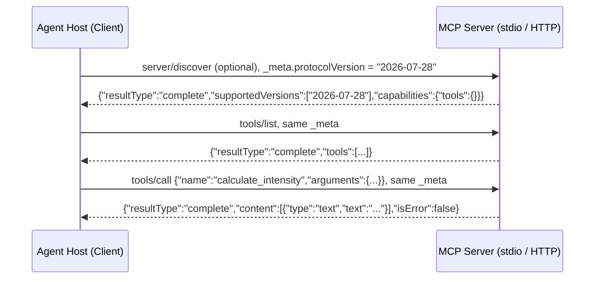
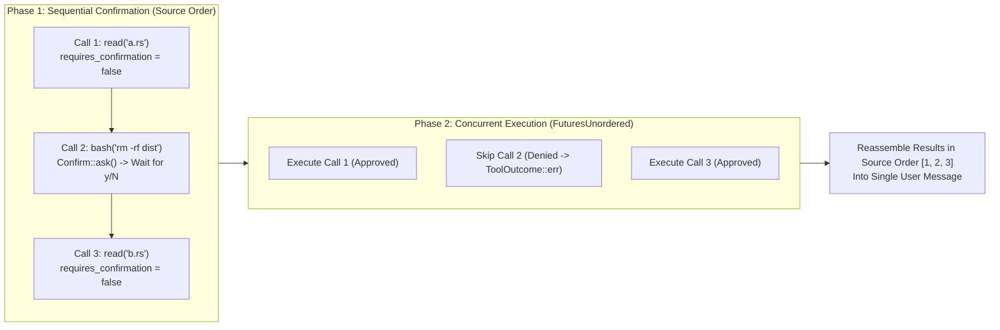

In traditional software systems, interfaces are designed for deterministic compilers or human programmers (**HCI**: Human-Computer Interface). In AI engineering, tools must be designed for non-deterministic language models (**ACI**: Agent-Computer Interface). Poorly engineered tools cause hallucinated parameters, silent file corruption, and context-window exhaustion when tool catalogs grow past a few dozen schemas.

This third chapter covers the taxonomy of agent tools, why tool descriptions are load-bearing prompts, how to scale past 50 tools without blowing up prefill tokens, how the **Model Context Protocol (MCP)** works on the wire, and how [`azusachino/nahida`](https://github.com/azusachino/nahida) implements two-phase permission gating.

## Series Navigation

| Chapter | Title | Focus |
| --- | --- | --- |
| 01 | [Forward-Pass Arithmetic, Roofline Limits & KV Cache Architecture](/tech/series/ai-engineering/01.inference-arithmetic-and-kv-cache/) | Prefill vs decode roofline, MHA/GQA/MLA, matrix absorption, and PD disaggregation |
| 02 | [Provider Abstraction, Streaming Accumulation & The Bounded ReAct Loop](/tech/series/ai-engineering/02.providers-streaming-and-react-loop/) | Type-safe wire contracts, dialect stripping, byte-buffered SSE, and context ablation |
| **03** | **Tool Engineering, Model Context Protocol (MCP) & Permission Gating** | **ACI design, parameter fidelity, dynamic discovery, JSON-RPC MCP, and two-phase dispatch** |
| 04 | [Code as the Meta-Tool: Tree-sitter Incremental Parsing & AST Call-Graph Indexing](/tech/series/ai-engineering/04.code-intelligence-and-ast-indexing/) | Two-phase AST extraction, global symbol resolution in `ochna`, and call-graph queries |
| 05 | [Context Engineering, Compaction Strategies & Shared Graph Memory](/tech/series/ai-engineering/05.context-compaction-and-memory/) | Attention sinks, turn-boundary compaction, session integrity, and `asobi` knowledge graphs |
| 06 | [Execution Sandboxing, Capability Boundaries & Agent Security Models](/tech/series/ai-engineering/06.sandboxing-and-agent-security/) | Ancestor canonicalization, Landlock, gVisor vs microVMs, and hardened Kubernetes Jobs |
| 07 | [Rigorous Agent Evaluation, Harnesses & Multi-Agent Coordination](/tech/series/ai-engineering/07.evaluation-and-continual-evolution/) | Model vs harness ablation, unbiased `pass@k`, New Information Criterion, and evolution |

---

## Before you start

A model can only produce text. To read a file, run a test or search a codebase, it asks your program to do so by emitting a tool call, and the quality of that exchange depends heavily on how you describe the tools. A tool's name, description and parameter schema are read by the model as instructions, so a vague description gets misused much as an unclear function name would confuse a new colleague.

The chapter covers which tools a coding agent actually needs, what to do when you have dozens of them and the prompt fills up with their descriptions, and the Model Context Protocol (MCP), a standard way for a tool server to describe its tools to any agent. It ends with permission checks before a tool runs.

A tool definition is short: a name such as `read_file`, a sentence saying what it does, and a JSON schema saying it takes a `path` string.

Read [chapter 2](/tech/series/ai-engineering/02.providers-streaming-and-react-loop/) first for the agent loop that calls these tools.

Terms used in this chapter:

- **tool**: a function the agent can ask the harness to run, described to the model by a name, a description and a schema.
- **harness**: the program around the model that runs the loop, executes tools and enforces rules.
- **JSON schema**: a format for describing the shape of JSON, used here to define a tool's parameters.
- **MCP**: the Model Context Protocol, a JSON-RPC based standard for exposing tools and data to agents.
- **JSON-RPC**: a simple request and response format using JSON messages.
- **stdio transport**: running an MCP server as a child process and exchanging messages over its standard input and output.
- **permission gating**: asking a user or a policy for approval before a risky tool call runs.

## 1. The Five Tool Classes & The Minimal Coding Set

Across autonomous agent harnesses, every tool falls into one of five functional categories based on its initiator and side-effect boundary:

| Tool Class | Initiator | Target | Representative Primitives |
| --- | --- | --- | --- |
| **1. Perception** | Agent | Observe environment (read-only) | `read`, `grep`, `find`, `ls`, `ochna search` |
| **2. Execution** | Agent | Mutate environment (stateful) | `edit`, `write`, `bash` / `run_command` |
| **3. Collaboration** | Agent | Peer or child subagents | `invoke_subagent`, `send_message` |
| **4. User Communication** | Agent | Human operator | `ask_question`, `confirm` |
| **5. Event Triggers** | Environment | Asynchronous agent wakeup | `schedule` (timers, cron, webhook triggers) |

### Why Seven Core Primitives Close the Coding Loop

In [`nahida`](https://github.com/azusachino/nahida), the built-in coding toolset is intentionally capped at **seven tools**: `read`, `write`, `edit`, `bash`, `find`, `grep`, and `ls`. Together they form a closed perception-action-verification loop: inspect the workspace (`ls`, `find`, `grep`, `read`), modify it (`edit`, `write`), and verify the change (`bash`).

Notice the critical distinction between `write` and `edit`:

- **`write(path, content)`** overwrites an entire file. On a 1,000-line file, whole-file overwrite forces the model to emit 1,000 lines of output tokens (slow, memory-bandwidth-bound decode) and risks silently clobbering concurrent changes.
- **`edit(path, old_string, new_string)`** performs a targeted replacement and enforces a **built-in staleness and ambiguity check**: if `old_string` does not appear in the file (because the file changed or the model hallucinated lines) or appears *more than once* (ambiguous context), `edit` refuses and returns an `is_error: true` observation instead of guessing.

### Tool Descriptions Are Prompts, Not Docstrings

A tool's `description` field is injected verbatim into the model's context prefix. It must prescribe **when and when not** to call the tool—for example, instructing the model to prefer `grep` and `edit` over spawning `bash` with `sed` or `cat`. In `nahida`, every tool description lives in a dedicated `.md` file right beside the implementation (`src/packs/*.md` or `crates/nahida-tools/src/*.md`) and is loaded at compile/boot time, ensuring prose is reviewed and edited as first-class prompt engineering.

> **The Principle of Parameter Fidelity**: Never silently mutate model-supplied parameters before execution (such as silently normalizing curly quotes `“”` to straight quotes `""` or injecting hidden CLI flags). When the execution layer alters inputs behind the model's back, any resulting failure becomes impossible for the model to diagnose in-context.

---

## 2. Scaling Past 50 Tools: Packs, Skills & Dynamic Discovery

As an agent platform integrates with Kubernetes, databases, issue trackers, and observability stacks, a naive harness injects every tool's JSON Schema into `Request.tools` on every turn.

- **The Token Tax**: Each structured tool schema consumes $200\text{–}500\text{ tokens}$. Registering $60$ tools burns $12,000\text{–}30,000\text{ tokens}$ of context before the user says a word, and tool-selection accuracy tends to degrade as the active catalog grows (reports put the knee somewhere in the tens of tools).

Production harnesses solve this with three complementary patterns:

1. **Profile-Scoped Packs (`nahida` `Pack` Contract)**: Group cohesive tools and their prompt fragments into named packs (`writing`, `reading`, `science`) with boot-time collision checks:

   ```typescript
   export function collectTools(packs: readonly Pack[]): PackTool[] {
     const owners = new Map<string, string>();
     const tools: PackTool[] = [];
     for (const pack of packs) {
       for (const tool of pack.tools ?? []) {
         const owner = owners.get(tool.name);
         if (owner !== undefined) {
           throw new BootError(
             `tool "${tool.name}" is registered by both pack "${owner}" and pack "${pack.id}"`,
           );
         }
         owners.set(tool.name, pack.id);
         tools.push(tool);
       }
     }
     return tools;
   }
   ```

2. **Filesystem Skills (`SKILL.md` + General Executor)**: Instead of registering a dedicated JSON Schema tool for every CLI utility (`git`, `gh`, `kubectl`, `dasel`), keep a lightweight 1-line index of available skills in the system prompt and let the agent `read` the relevant `.agents/skills/<name>/SKILL.md` file on demand. Idle schema cost: **zero tokens**.
3. **Two-Stage Dynamic Tool Discovery**: Expose a single meta-tool `search_tools(query: string)` in active context; when called, inject the full JSON Schemas of only the top-$k$ matching tools for the subsequent turns.

---

## 3. Model Context Protocol (MCP) Under the Hood

The **Model Context Protocol (MCP)** standardizes how an AI host discovers and invokes external tools, resources, and prompts over **JSON-RPC 2.0** (using `stdio` pipes for local child processes or Streamable HTTP for remote servers).

The current revision, [`2026-07-28`](https://modelcontextprotocol.io/specification/versioning), made the protocol **stateless**. There is no `initialize` handshake any more: every request carries its protocol version and the client's capabilities in `params._meta`, and the server accepts or rejects each request on its own. A client that wants the server's versions and capabilities up front can call `server/discover`, but it may also send any request directly and retry if the server answers `UnsupportedProtocolVersion` (`-32022`) with its `supported` list. Results now carry a `resultType` (`"complete"` for a finished call).



Servers and clients written against `2025-11-25` and earlier still open with an `initialize` handshake. The spec calls those revisions *legacy*: a client that must talk to both kinds probes with `server/discover` on stdio and falls back to `initialize` when the reply is not a recognized modern error.

### Runnable MCP `stdio` Server in Pure Python

Below is a zero-dependency MCP server over `stdio` following the `2026-07-28` per-request model. It demonstrates `server/discover`, `tools/list`, and `tools/call` with structured `isError: true` recovery, and rejects requests that omit or mismatch the protocol version:

```python
"""Minimal JSON-RPC 2.0 Model Context Protocol (MCP) stdio server."""

from __future__ import annotations
import io
import json
from typing import Any

TOOLS: list[dict[str, Any]] = [
    {
        "name": "calculate_intensity",
        "description": "Compute arithmetic intensity (FLOP/Byte) and classify roofline regime. Use when sizing inference workloads.",
        "inputSchema": {
            "type": "object",
            "properties": {
                "flops": {"type": "number", "description": "Total floating-point operations"},
                "bytes_moved": {"type": "number", "description": "Total bytes transferred across HBM"},
            },
            "required": ["flops", "bytes_moved"],
            "additionalProperties": False,
        },
    }
]


def dispatch_tool(name: str, args: dict[str, Any]) -> dict[str, Any]:
    if name == "calculate_intensity":
        flops = float(args["flops"])
        bytes_moved = float(args["bytes_moved"])
        if bytes_moved <= 0:
            raise ValueError("bytes_moved must be strictly positive")
        intensity = round(flops / bytes_moved, 2)
        regime = "compute-bound" if intensity >= 295.0 else "memory-bandwidth-bound"
        return {"arithmetic_intensity": intensity, "regime": regime}
    raise ValueError(f"Unknown tool: {name}")


SUPPORTED_VERSIONS = ["2026-07-28"]
SERVER_INFO = {"name": "roofline-mcp", "version": "1.0.0"}
VERSION_KEY = "io.modelcontextprotocol/protocolVersion"
CAPS_KEY = "io.modelcontextprotocol/clientCapabilities"


def error(req_id: Any, code: int, message: str, data: Any = None) -> dict[str, Any]:
    err: dict[str, Any] = {"code": code, "message": message}
    if data is not None:
        err["data"] = data
    return {"jsonrpc": "2.0", "id": req_id, "error": err}


def result(req_id: Any, body: dict[str, Any]) -> dict[str, Any]:
    return {
        "jsonrpc": "2.0",
        "id": req_id,
        "result": {
            "resultType": "complete",
            **body,
            "_meta": {"io.modelcontextprotocol/serverInfo": SERVER_INFO},
        },
    }


def handle_rpc(req: dict[str, Any]) -> dict[str, Any]:
    req_id = req.get("id")
    method = req.get("method")
    params = req.get("params", {})
    meta = params.get("_meta", {})

    # Stateless: every request must say which version it speaks and what the client supports.
    if VERSION_KEY not in meta or CAPS_KEY not in meta:
        return error(req_id, -32602, "Invalid params: missing required _meta fields")
    if meta[VERSION_KEY] not in SUPPORTED_VERSIONS:
        return error(
            req_id,
            -32022,
            "Unsupported protocol version",
            {"supported": SUPPORTED_VERSIONS, "requested": meta[VERSION_KEY]},
        )

    if method == "server/discover":
        return result(req_id, {"supportedVersions": SUPPORTED_VERSIONS, "capabilities": {"tools": {}}})
    if method == "tools/list":
        return result(req_id, {"tools": TOOLS})
    if method == "tools/call":
        try:
            payload = dispatch_tool(params.get("name", ""), params.get("arguments", {}))
            return result(req_id, {"content": [{"type": "text", "text": json.dumps(payload)}], "isError": False})
        except Exception as exc:
            return result(req_id, {"content": [{"type": "text", "text": f"Error: {exc}"}], "isError": True})
    return error(req_id, -32601, f"Method not found: {method}")


if __name__ == "__main__":
    meta = '"_meta":{"io.modelcontextprotocol/protocolVersion":"2026-07-28","io.modelcontextprotocol/clientCapabilities":{}}'
    old = '"_meta":{"io.modelcontextprotocol/protocolVersion":"2025-06-18","io.modelcontextprotocol/clientCapabilities":{}}'
    sample_stream = io.StringIO(
        '{"jsonrpc":"2.0","id":1,"method":"tools/call","params":{"name":"calculate_intensity","arguments":{"flops":134200000000000,"bytes_moved":16380000000},' + meta + '}}\n'
        '{"jsonrpc":"2.0","id":2,"method":"tools/call","params":{"name":"calculate_intensity","arguments":{"flops":1000,"bytes_moved":0},' + meta + '}}\n'
        '{"jsonrpc":"2.0","id":3,"method":"tools/list","params":{' + old + '}}\n'
    )
    for line in sample_stream:
        resp = handle_rpc(json.loads(line))
        print(json.dumps(resp))
```

Output:

```json
{"jsonrpc": "2.0", "id": 1, "result": {"resultType": "complete", "content": [{"type": "text", "text": "{\"arithmetic_intensity\": 8192.92, \"regime\": \"compute-bound\"}"}], "isError": false, "_meta": {"io.modelcontextprotocol/serverInfo": {"name": "roofline-mcp", "version": "1.0.0"}}}}
{"jsonrpc": "2.0", "id": 2, "result": {"resultType": "complete", "content": [{"type": "text", "text": "Error: bytes_moved must be strictly positive"}], "isError": true, "_meta": {"io.modelcontextprotocol/serverInfo": {"name": "roofline-mcp", "version": "1.0.0"}}}}
{"jsonrpc": "2.0", "id": 3, "error": {"code": -32022, "message": "Unsupported protocol version", "data": {"supported": ["2026-07-28"], "requested": "2025-06-18"}}}
```

Notice the two kinds of failure. Invalid arguments (`bytes_moved: 0`) return a normal `result` with `"isError": true` rather than a protocol-level crash, feeding the domain error cleanly back into the model's next reasoning step. A request speaking an older version gets a protocol `error` naming the versions the server does accept, so the client can retry instead of guessing.

---

## 4. Two-Phase Dispatch & Permission Gating

What happens when a model asks to run `bash` alongside two `read` calls in the same turn?

In [`nahida`](https://github.com/azusachino/nahida), the core `agent` crate is forbidden from knowing whether a terminal exists. Yet high-consequence tools (`bash` overriding `Tool::requires_confirmation() -> true`) require operator approval before execution. `nahida` solves this by splitting `dispatch()` into **two distinct phases** using an asynchronous `Confirm` trait:



1. **Phase 1 — Sequential Confirmation in Source Order**: Terminal prompts (`Allow bash? [y/N]`) cannot run in parallel—printing two interactive prompts at the same time scrambles `stdin`. Therefore, `dispatch()` iterates through the requested tool calls sequentially in source order and resolves `Confirm::ask` for any tool where `requires_confirmation()` is `true`.
2. **Phase 2 — Concurrent Execution via `FuturesUnordered`**: Every approved tool call is launched concurrently, firing a real-time `ToolResult` progress event the instant each individual tool finishes (without waiting for the slowest tool in the batch). Denied calls immediately produce a `ToolOutcome::err("Tool execution denied by user")`. Finally, all outcomes are reassembled back into their original source indices so the persisted transcript stays deterministic.
3. **TTY Detection vs. Headless Containment**: When `stdin` is not a TTY (e.g., CI pipelines or headless batch runs), wiring an interactive prompt would hang the process forever. Instead, non-interactive runs must rely on **hard containment boundaries**—workspace path sandboxing, Landlock filesystem rules, or ephemeral containers—which we will build in Chapter 06.

---

## Key Takeaways

1. **Design tools for the model's failure modes.** Prefer surgical `edit(old_string, new_string)` over whole-file `write`, keep tool descriptions in adjacent Markdown files, and never silently mutate tool arguments.
2. **Avoid schema bloat.** Compose tools via profile-scoped packs, on-demand `SKILL.md` guides, or two-stage `search_tools` discovery so idle tools consume zero prefix tokens.
3. **Separate confirmation from execution.** Resolve human approvals sequentially in source order, execute approved tools concurrently, and return denials as `is_error: true` tool results.

In [Chapter 04: Code as the Meta-Tool: Tree-sitter Incremental Parsing & AST Call-Graph Indexing](/tech/series/ai-engineering/04.code-intelligence-and-ast-indexing/), we explore how coding agents navigate 100k+ line codebases in milliseconds using Tree-sitter and SQLite call graphs in [`azusachino/ochna`](https://github.com/azusachino/ochna).
