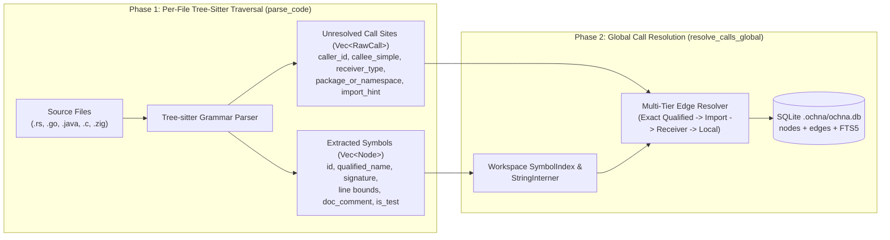

When an autonomous agent operates on a production codebase with hundreds of thousands of lines of Rust, Go, Java, or C++, naive text primitives (`cat`, raw `grep`) quickly break down. Dumping entire files floods the context window with irrelevant boilerplate, while substring searches match comments, string literals, and identically named methods on unrelated types.

In this fourth chapter, we examine two structural upgrades that separate toy chatbots from production coding agents: treating **code execution as the universal meta-tool**, and indexing source trees into a queryable **Abstract Syntax Tree (AST) call graph** as implemented in [`azusachino/ochna`](https://github.com/azusachino/ochna).

## Series Navigation

| Chapter | Title | Focus |
| --- | --- | --- |
| 01 | [Forward-Pass Arithmetic, Roofline Limits & KV Cache Architecture](/tech/series/ai-engineering/01.inference-arithmetic-and-kv-cache/) | Prefill vs decode roofline, MHA/GQA/MLA, matrix absorption, and PD disaggregation |
| 02 | [Provider Abstraction, Streaming Accumulation & The Bounded ReAct Loop](/tech/series/ai-engineering/02.providers-streaming-and-react-loop/) | Type-safe wire contracts, dialect stripping, byte-buffered SSE, and context ablation |
| 03 | [Tool Engineering, Model Context Protocol (MCP) & Permission Gating](/tech/series/ai-engineering/03.tool-engineering-and-mcp/) | ACI design, parameter fidelity, dynamic discovery, JSON-RPC MCP, and two-phase dispatch |
| **04** | **Code as the Meta-Tool: Tree-sitter Incremental Parsing & AST Call-Graph Indexing** | **Two-phase AST extraction, global symbol resolution in `ochna`, and call-graph queries** |
| 05 | [Context Engineering, Compaction Strategies & Shared Graph Memory](/tech/series/ai-engineering/05.context-compaction-and-memory/) | Attention sinks, turn-boundary compaction, session integrity, and `asobi` knowledge graphs |
| 06 | [Execution Sandboxing, Capability Boundaries & Agent Security Models](/tech/series/ai-engineering/06.sandboxing-and-agent-security/) | Ancestor canonicalization, Landlock, gVisor vs microVMs, and hardened Kubernetes Jobs |
| 07 | [Rigorous Agent Evaluation, Harnesses & Multi-Agent Coordination](/tech/series/ai-engineering/07.evaluation-and-continual-evolution/) | Model vs harness ablation, unbiased `pass@k`, New Information Criterion, and evolution |

---

## Before you start

When an agent has to understand a large codebase, the simple approach is to print files into the prompt or run `grep`. That uses many tokens and returns noise, such as every comment that mentions the word you searched for. This chapter looks at a better approach: parse the code into a tree that reflects its structure, extract the definitions and the calls between them into a small database, and let the agent query that instead.

A concrete question this makes cheap: "which functions call `parse_config`?" Text search finds every occurrence of the string; a call graph finds only the actual calls, across files.

The chapter also argues that letting the agent write and run code is more flexible than adding a separate tool for every need.

Read [chapter 3](/tech/series/ai-engineering/03.tool-engineering-and-mcp/) first, since the index is exposed to the agent as tools.

Terms used in this chapter:

- **AST**: an abstract syntax tree, the tree a parser builds from source code that shows its structure (functions, calls, blocks) without the whitespace.
- **Tree-sitter**: a parser library that supports many languages and can build the tree for incomplete or edited code.
- **symbol**: a named thing in code, such as a function, class or variable.
- **call graph**: a map of which functions call which others.
- **call resolution**: working out which actual definition a call like `foo()` refers to, often across files.
- **index**: a precomputed lookup structure, here stored in SQLite, that makes queries fast.
- **meta-tool**: one general tool, such as code execution, that can stand in for many specialized ones.

## 1. Code as the Universal Meta-Tool

Suppose a user asks an agent: *"Inspect all 340 Markdown files in this repository, verify which frontmatter dates disagree with the earliest Git commit touching each file, and output the mismatched paths."*

Compare two ways an agent can solve this:

1. **The Tool-Sprawl Approach**: The agent calls `find_files`, then loops across 340 turns calling `read_file` and `git_log`, stuffing hundreds of kilobytes of raw frontmatter and commit histories into the LLM context window. It burns hundreds of thousands of tokens and hits `max_turns` before finishing.
2. **The Code-as-Meta-Tool Approach**: The agent synthesizes and runs a 15-line Python or shell one-liner inside its sandbox. All 340 file reads and Git lookups happen inside local process memory at native CPU speed; **only the final 5 lines of mismatched paths enter the LLM's context window**.

By treating a sandboxed interpreter as a **meta-tool**—a tool that synthesizes, runs, and discards task-specific tools on the fly—you compress intermediate context consumption by up to $98\%$ and eliminate the need to maintain dozens of rigid, single-purpose JSON Schema tools.

---

## 2. The Complementary Code-Search Triad

When navigating an unfamiliar repository, no single search tool wins every query. High-performing coding agents combine three complementary tools:

| Tool | Underlying Mechanism | Best Used For | Failure Mode When Misused |
| --- | --- | --- | --- |
| **`rg` (ripgrep)** | SIMD-accelerated regex over raw text | Exact string literals, error messages, config keys, comments | Returns dozens of false positives when searching common method names like `run` or `worker` |
| **`ast-grep` (`sg`)** | Structural pattern matching over syntax trees | Refactoring idioms, finding specific AST shapes (e.g., `unwrap()` inside `async fn`) | Does not maintain a cross-file persistent call graph |
| **[`ochna`](https://github.com/azusachino/ochna)** | Tree-sitter AST indexing into SQLite + FTS5 | Symbol lookup (`Type::method`), incoming `callers`, outgoing `callees`, surgical code slicing | Not intended for free-text log or Markdown prose search |

---

## 3. Inside `ochna`: Two-Phase Tree-Sitter Indexing & Call Resolution

[`azusachino/ochna`](https://github.com/azusachino/ochna) is a local codebase intelligence CLI written in Rust that parses Rust, Go, Java, C, C++, and Zig repositories via **Tree-sitter** and persists a structural symbol and call graph into `.ochna/ochna.db` (SQLite + FTS5). Its benchmark suite indexes real-world giants—including `tokio`, `netty`, `kubernetes`, `linux`, `zig`, `ghostty`, and `flink`.

Why can't an indexer emit call-graph edges in a single pass while parsing a file? Because when file `a.rs` calls `runtime.spawn()`, the target symbol `Runtime::spawn` may be defined in `b.rs`, which hasn't been parsed yet!

`ochna` solves this with a **two-phase pipeline** (`src/parser.rs` and `src/db.rs`):



### Phase 1: Per-Language AST Traversal (`parse_code`)

For each changed file (tracked via content hash in `FileMetadata`), `parse_code` invokes the language's compiled Tree-sitter grammar and walks the concrete syntax tree to produce two collections:

1. **`Vec<Node>` (Symbol Definitions)**: Functions, methods, structs, classes, traits, and interfaces, complete with exact `start_line` / `end_line` coordinates, receiver-qualified names (`CacheCluster::evict_stale`), extracted type signatures, doc comments, and an automatic `is_test` classification.
2. **`Vec<RawCall>` (Unresolved Call Sites)**: Every invocation expression inside a symbol's body is captured with its surrounding lexical context:

   ```rust
   pub struct RawCall {
       pub caller_id: String,
       pub callee_name: String,
       pub callee_simple: String,
       pub callee_scope: Option<String>,
       pub call_kind: Option<String>,
       pub receiver_expr: Option<String>,
       pub receiver_type: Option<String>,
       pub package_or_namespace: Option<String>,
       pub import_hint: Option<String>,
       pub relationship_kind: String,
       pub reverse_edge: bool,
       pub target_qualified_hint: Option<String>,
       pub resolution_hint: Option<i64>,
       pub line: i64,
       pub column: i64,
   }
   ```

### Phase 2: Whole-Workspace Call Resolution (`resolve_calls_global`)

<Archify src="./diagrams/treesitter-hybrid-retrieval.workflow.json" />

Once all files are parsed into the in-memory `SymbolIndex` (backed by a compact `StringInterner`), `resolve_calls_global` matches each `RawCall` against candidate target symbols across the entire workspace, recording an `Edge` (`source_id -> target_id`) tagged with its `resolution_kind` and `confidence` score (or recording an `UnresolvedRef` when a call targets an external standard-library or third-party crate).

### The Agent Investigation Workflow

Instead of reading five 800-line files to trace a bug, an agent queries the SQLite graph in three sub-millisecond steps:

```bash
# 1. Rank-matched symbol discovery (exact -> prefix -> substring)
ochna search evict_stale

# 2. Inspect incoming callers and outgoing callees (scoped by path prefix if needed)
ochna callers CacheCluster::evict_stale
ochna callees worker --in pkg/controller/podautoscaler

# 3. Fetch only the exact AST line slice and signature of the target symbol
ochna node --symbol CacheCluster::evict_stale --include-code
```

---

## 4. Hands-On: Building a Two-Phase AST Symbol & Call-Graph Indexer

To see how two-phase AST extraction and call resolution work in code, here is a self-contained Python implementation using the standard library `ast` module. It extracts class/method definitions (`SymbolNode`), collects raw call expressions (`RawCallSite`), resolves call edges across scopes, and completely ignores decoy symbol names inside comments and string literals:

```python
"""Two-phase AST Symbol & Call-Graph Extractor for Coding Agents."""

from __future__ import annotations
import ast
import dataclasses
from typing import Optional


@dataclasses.dataclass
class SymbolNode:
    qualified_name: str
    name: str
    kind: str  # "class" | "function" | "method"
    line_start: int
    line_end: int
    signature: str
    docstring: Optional[str]


@dataclasses.dataclass
class RawCallSite:
    caller: str
    callee_simple: str
    receiver: Optional[str]
    line: int


class AstGraphExtractor(ast.NodeVisitor):
    def __init__(self) -> None:
        self.nodes: list[SymbolNode] = []
        self.raw_calls: list[RawCallSite] = []
        self._class_stack: list[str] = []
        self._scope_stack: list[str] = []

    def _format_params(self, args: ast.arguments) -> str:
        parts = []
        for a in args.args:
            ann = f": {ast.unparse(a.annotation)}" if a.annotation else ""
            parts.append(f"{a.arg}{ann}")
        return ", ".join(parts)

    def visit_ClassDef(self, node: ast.ClassDef) -> None:
        bases = ", ".join(ast.unparse(b) for b in node.bases)
        sig = f"class {node.name}({bases})" if bases else f"class {node.name}"
        doc = ast.get_docstring(node)
        self.nodes.append(
            SymbolNode(
                qualified_name=node.name,
                name=node.name,
                kind="class",
                line_start=node.lineno,
                line_end=node.end_lineno or node.lineno,
                signature=sig,
                docstring=doc.splitlines()[0] if doc else None,
            )
        )
        self._class_stack.append(node.name)
        self.generic_visit(node)
        self._class_stack.pop()

    def visit_FunctionDef(self, node: ast.FunctionDef) -> None:
        self._visit_callable(node, is_async=False)

    def visit_AsyncFunctionDef(self, node: ast.AsyncFunctionDef) -> None:
        self._visit_callable(node, is_async=True)

    def _visit_callable(
        self, node: ast.FunctionDef | ast.AsyncFunctionDef, is_async: bool
    ) -> None:
        cls = self._class_stack[-1] if self._class_stack else None
        qname = f"{cls}::{node.name}" if cls else node.name
        prefix = "async def" if is_async else "def"
        ret = f" -> {ast.unparse(node.returns)}" if node.returns else ""
        doc = ast.get_docstring(node)

        self.nodes.append(
            SymbolNode(
                qualified_name=qname,
                name=node.name,
                kind="method" if cls else "function",
                line_start=node.lineno,
                line_end=node.end_lineno or node.lineno,
                signature=f"{prefix} {node.name}({self._format_params(node.args)}){ret}",
                docstring=doc.splitlines()[0] if doc else None,
            )
        )
        self._scope_stack.append(qname)
        self.generic_visit(node)
        self._scope_stack.pop()

    def visit_Call(self, node: ast.Call) -> None:
        if self._scope_stack:
            caller = self._scope_stack[-1]
            if isinstance(node.func, ast.Name):
                self.raw_calls.append(
                    RawCallSite(caller, node.func.id, None, node.lineno)
                )
            elif isinstance(node.func, ast.Attribute):
                recv = ast.unparse(node.func.value)
                self.raw_calls.append(
                    RawCallSite(caller, node.func.attr, recv, node.lineno)
                )
        self.generic_visit(node)


def resolve_edges(
    nodes: list[SymbolNode], raw_calls: list[RawCallSite]
) -> list[tuple[str, str, int]]:
    by_qname = {n.qualified_name: n for n in nodes}
    by_simple: dict[str, list[SymbolNode]] = {}
    for n in nodes:
        by_simple.setdefault(n.name, []).append(n)

    edges: list[tuple[str, str, int]] = []
    for call in raw_calls:
        caller_cls = call.caller.split("::")[0] if "::" in call.caller else None
        # 1. Self receiver resolution (self.method -> Class::method)
        if call.receiver == "self" and caller_cls:
            candidate = f"{caller_cls}::{call.callee_simple}"
            if candidate in by_qname:
                edges.append((call.caller, candidate, call.line))
                continue
        # 2. Unique simple-name match across workspace index
        matches = by_simple.get(call.callee_simple, [])
        if len(matches) == 1:
            edges.append((call.caller, matches[0].qualified_name, call.line))
    return edges


if __name__ == "__main__":
    sample_repo = '''
def compute_slot(key: str) -> int:
    """Hash a key into a cluster slot."""
    # Decoy comment: evict_stale(key) and CacheCluster should never be indexed!
    literal_decoy = "CacheCluster::evict_stale"
    return len(key) % 1024

class CacheCluster:
    """Manages partitioned cache storage."""
    def route(self, key: str) -> int:
        slot = compute_slot(key)
        self.evict_stale(30.0)
        return slot

    async def evict_stale(self, ttl: float) -> int:
        """Evict entries older than ttl seconds."""
        return 1
'''
    extractor = AstGraphExtractor()
    extractor.visit(ast.parse(sample_repo))
    edges = resolve_edges(extractor.nodes, extractor.raw_calls)

    print("=== Indexed AST Symbols ===")
    for n in extractor.nodes:
        print(f"L{n.line_start:02d}-L{n.line_end:02d} | {n.kind.upper():8s} | {n.qualified_name:26s} | {n.signature}")

    print("\n=== Resolved Call-Graph Edges ===")
    for src, dst, line in edges:
        print(f"L{line:02d}: {src}  -->  {dst}")
```

Running this script produces:

```text
=== Indexed AST Symbols ===
L02-L06 | FUNCTION | compute_slot               | def compute_slot(key: str) -> int
L08-L17 | CLASS    | CacheCluster               | class CacheCluster
L10-L13 | METHOD   | CacheCluster::route        | def route(self, key: str) -> int
L15-L17 | METHOD   | CacheCluster::evict_stale  | async def evict_stale(self, ttl: float) -> int

=== Resolved Call-Graph Edges ===
L11: CacheCluster::route  -->  compute_slot
L12: CacheCluster::route  -->  CacheCluster::evict_stale
```

Notice that both the comment (`# Decoy comment: evict_stale(key)`) and the string literal (`"CacheCluster::evict_stale"`) are ignored by the syntax tree walker, while `self.evict_stale(30.0)` resolves cleanly to `CacheCluster::evict_stale`.

---

## Key Takeaways

1. **Use code execution to keep intermediate data out of the context window.** When a task involves filtering, aggregating, or cross-referencing dozens of files, a sandboxed script compresses token usage by orders of magnitude.
2. **Separate AST extraction from call resolution.** Parsing per-file `Node` definitions and `RawCall` sites first, then resolving edges globally against an interned workspace symbol index, enables fast incremental re-indexing per modified file.
3. **Pair `ochna`, `ast-grep`, and `ripgrep`.** Reach for `ochna` to walk symbol definitions and call graphs, `ast-grep` to match syntactic idioms, and `rg` to search literals and logs.

In [Chapter 05: Context Engineering, Compaction Strategies & Shared Graph Memory](/tech/series/ai-engineering/05.context-compaction-and-memory/), we examine how to manage an agent's memory over long trajectories—preserving attention sinks, compacting settled turns without violating role-alternation contracts, and persisting cross-session knowledge in [`azusachino/asobi`](https://github.com/azusachino/asobi).
