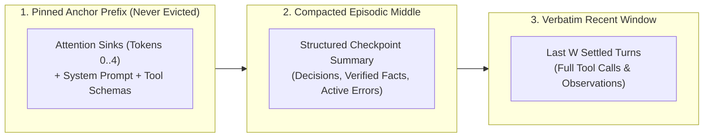
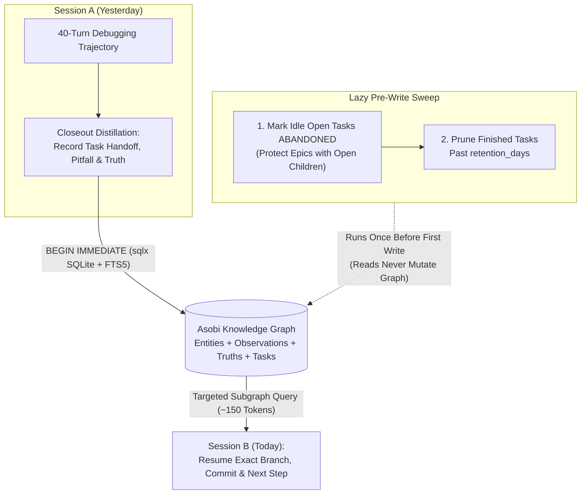

Even with Grouped-Query Attention (GQA), Multi-Head Latent Attention (MLA), and prompt prefix caching, an autonomous agent's transcript cannot grow forever. Prompt caching makes a growing prefix *cheaper* to prefill, not *smaller*. As a 40-turn debugging or refactoring trajectory accumulates raw grep outputs, compiler stack traces, and superseded file reads, the agent hits three walls: **attention dilution** ("lost in the middle"), **linear/quadratic prefill latency**, and **hard context-window limits**.

In this fifth chapter, we dissect the mechanics of active context engineering: why **attention sinks** forbid naive FIFO eviction, how [`azusachino/nahida`](https://github.com/azusachino/nahida) compacts transcripts strictly at settled turn boundaries and validates JSONL session logs, and how [`azusachino/asobi`](https://github.com/azusachino/asobi) provides durable, cross-session knowledge-graph recall.

## Series Navigation

| Chapter | Title | Focus |
| --- | --- | --- |
| 01 | [Forward-Pass Arithmetic, Roofline Limits & KV Cache Architecture](/tech/series/ai-engineering/01.inference-arithmetic-and-kv-cache/) | Prefill vs decode roofline, MHA/GQA/MLA, matrix absorption, and PD disaggregation |
| 02 | [Provider Abstraction, Streaming Accumulation & The Bounded ReAct Loop](/tech/series/ai-engineering/02.providers-streaming-and-react-loop/) | Type-safe wire contracts, dialect stripping, byte-buffered SSE, and context ablation |
| 03 | [Tool Engineering, Model Context Protocol (MCP) & Permission Gating](/tech/series/ai-engineering/03.tool-engineering-and-mcp/) | ACI design, parameter fidelity, dynamic discovery, JSON-RPC MCP, and two-phase dispatch |
| 04 | [Code as the Meta-Tool: Tree-sitter Incremental Parsing & AST Call-Graph Indexing](/tech/series/ai-engineering/04.code-intelligence-and-ast-indexing/) | Two-phase AST extraction, global symbol resolution in `ochna`, and call-graph queries |
| **05** | **Context Engineering, Compaction Strategies & Shared Graph Memory** | **Attention sinks, turn-boundary compaction, session integrity, and `asobi` knowledge graphs** |
| 06 | [Execution Sandboxing, Capability Boundaries & Agent Security Models](/tech/series/ai-engineering/06.sandboxing-and-agent-security/) | Ancestor canonicalization, Landlock, gVisor vs microVMs, and hardened Kubernetes Jobs |
| 07 | [Rigorous Agent Evaluation, Harnesses & Multi-Agent Coordination](/tech/series/ai-engineering/07.evaluation-and-continual-evolution/) | Model vs harness ablation, unbiased `pass@k`, New Information Criterion, and evolution |

---

## Before you start

A model can read only a limited number of tokens per request, and a long agent session, with file contents and command output piling up, will eventually hit that limit. Something has to be dropped or summarized. The first idea, deleting the oldest messages, is more dangerous than it looks, and this chapter explains why and what to do instead.

Compaction means replacing old parts of the conversation with a shorter summary while keeping the structure the API requires. Some real mistakes follow: compacting in the middle of a tool call so that a result has no matching request, or producing two user messages in a row, which some providers reject.

The last part is memory that outlives a session. Instead of re-reading everything, the agent stores facts and decisions in a graph it can search in a later session.

Read [chapter 2](/tech/series/ai-engineering/02.providers-streaming-and-react-loop/) first for how the conversation and the agent loop are structured.

Terms used in this chapter:

- **context window**: the maximum tokens the model accepts in one request.
- **compaction**: replacing older conversation content with a shorter summary to free space.
- **transcript**: the recorded sequence of messages and tool results in a session.
- **sliding window**: keeping only the most recent tokens and dropping the oldest.
- **attention sink**: the first few tokens of a sequence, which the model uses as a place to park attention weight and which must not be dropped.
- **turn boundary**: the point between a complete user request and the agent's complete reply, the safe place to cut.
- **session log**: a file recording a session so it can be resumed after a crash.
- **knowledge graph**: stored facts as nodes and links between them, queryable across sessions.

## 1. Attention Sinks vs. Naive Sliding-Window Eviction

When a conversation approaches a token ceiling $L_{\max}$, the most obvious idea is a First-In-First-Out (FIFO) sliding window: drop the oldest tokens `[0 .. k]` and keep the most recent window `[k+1 .. L]`.

At the KV-cache level, naive FIFO eviction causes model perplexity to explode immediately. Why? As Xiao et al. demonstrated in **StreamingLLM**, autoregressive Transformers learn to allocate a disproportionate fraction of their attention score mass to the initial $2\text{–}4$ tokens of a sequence—even when those tokens have zero semantic significance.

$$\text{Softmax}(z_i) = \frac{e^{z_i}}{\sum_{j=0}^{t} e^{z_j}}$$

Because Softmax probabilities must sum to $1.0$, when a head has nothing relevant to attend to in the current context, it dumps its spare probability mass into the earliest tokens (**Attention Sinks**). Evicting token `0` removes the largest term in the Softmax denominator, corrupting attention distributions across every layer.

Therefore, every sound context layout partitions the window into three zones:



---

## 2. Transcript Compaction in `nahida`: Three Real-World Traps

When compacting at the message-transcript level (by asking the model to summarize older turns when token usage exceeds `compact_at(tokens)`), three subtle engineering bugs arise in production harnesses:

### Trap 1: Compacting Mid-Tool-Exchange

Never trigger compaction inside `dispatch()` while a `tool_use` turn is still waiting for its matching `tool_result`. Replacing the transcript mid-exchange leaves orphaned `tool_result` blocks whose `tool_use_id` no longer exists in the preceding assistant message, causing the provider API to reject the next request.

- **The Fix**: Check the token threshold strictly **at the top of the `run()` loop, between turns**, when every prior `tool_use` is guaranteed to have its settled `tool_result`.

### Trap 2: The Consecutive User-Role Trap

How do you ask the model to summarize the current transcript? A naive implementation appends a synthetic user message—`{"role": "user", "content": "Please summarize the conversation so far."}`—to the end of `messages` and calls the provider.

- **Why It Breaks**: At the top of turn $N$ (immediately after a tool round finishes), the last message in `messages` is **already a `user`-role message** containing the `tool_result` blocks from turn $N-1$! Appending a second `user` message creates two consecutive `user` turns, which strict Messages-style APIs may reject with an HTTP `400` (others silently merge them, changing what the model sees).
- **The Fix (`nahida` `compact.md`)**: Place the summarization instructions inside the **system prompt** (`compact.md`) of the compaction request, and pass the existing `messages` transcript unmodified—regardless of which role it ends on. Then replace the old transcript with a **single `user`-role summary message** (because the main loop's very next step will generate an `assistant` response, and the transcript must start with `user`).

### Trap 3: Dropping Compaction Token Accounting

A summarization call is a real LLM invocation that consumes input and output tokens. Always fold the compaction response's `Usage` into the run's cumulative `Outcome.usage` so cost and token telemetry remain exact.

---

## 3. Session Continuation & Crash-Safe Log Validation

When an agent persists transcripts to disk so a user can resume with `--continue`, the session log itself becomes a security and reliability boundary. In [`nahida`](https://github.com/azusachino/nahida) (`src/session.ts`), three invariants protect session continuation:

1. **Canonical Path Hashing (`SHA-256` of `realpathSync(cwd)`)**: Symlinked directories or relative path aliases must never collide or split session state. `nahida` resolves `realpathSync(cwd)` and hashes it with SHA-256 to derive the session storage directory.
2. **Fail-Closed JSONL Validation (`validateLog`)**: Generic log readers often silently skip corrupt JSONL lines. If a crash truncated a line mid-write, silently skipping an assistant `toolCall` line corrupts the parent-child DAG of the transcript. `nahida` verifies that every JSONL entry parses cleanly, forms a contiguous `parentId` chain from the versioned `"session"` header, and satisfies role/schema invariants before opening the session.
3. **Refusing Unsettled Side Effects (`assertSettledTools`)**: If the previous process crashed *after* the model emitted a `toolCall` (e.g., `bash` or `write`) but *before* the `toolResult` was recorded, the harness cannot know whether the side effect partially executed on disk. Rather than blindly re-running a potentially destructive tool on `--continue`, `nahida` refuses continuation when trailing `toolCall` IDs lack settled `toolResult` entries.

---

## 4. Cross-Session Graph Memory with `asobi`

In-memory compaction keeps a single session within its context budget, but what happens across days, weeks, and multiple repositories? Dumping last week's 50,000-token chat transcript into today's session wastes tokens and buries actionable constraints.

[`azusachino/asobi`](https://github.com/azusachino/asobi) solves cross-session recall by storing **entities, observations, truths, relations, and task state** in a structured SQLite + FTS5 knowledge graph (`asobi-core`, `asobi-storage`, `asobi`, and `asobi-server`).



### Three Architectural Lessons from `asobi`

1. **Dependency-Enforced Storage Boundary**: Only `asobi-storage` is allowed to depend on `sqlx` (enforced by `make check`). All CLI commands in `asobi` program against async capability traits in `asobi-core`, keeping domain logic completely decoupled from SQLite query plans.
2. **Implicit Sweeps Run Before the First Write, Never on Read**: Asobi automatically marks stale open tasks as `ABANDONED` and garbage-collects finished tasks past `retention_days`. Crucially, this sweep runs lazily **once per process before the first mutation (`BEGIN IMMEDIATE`)**, never on `open()`—guaranteeing that read-only inspection queries never mutate the database or contend for write locks. Furthermore, abandonment runs *before* retention and appends a transition observation, refreshing the task's activity timestamp so a newly abandoned task cannot be deleted in the same sweep.
3. **Remote Outages Fail Closed (ADR-0005)**: When configured against a shared `asobi-server` over the tailnet, if the server is unreachable or returns HTTP `502`/`503`/`504`, `asobi` exits non-zero immediately rather than silently falling back to a stale local SQLite file—preventing split-brain task claims across machines.

---

## 5. Runnable Bounded Context Compactor & Episodic Store

The following standalone Python script implements a bounded context manager that preserves the pinned system prompt and recent verbatim turns while distilling evicted intermediate turns into compact episodic memory nodes—with a priority rule that never drops error observations:

```python
"""Bounded Context Compactor with Attention-Sink Pinning and Error Preservation."""

from __future__ import annotations
import dataclasses
from typing import Any


@dataclasses.dataclass
class EpisodicNode:
    node_id: str
    turn_range: tuple[int, int]
    summary: str
    preserved_errors: list[str]


class BoundedContextCompactor:
    def __init__(self, max_tokens: int = 110, trigger_ratio: float = 0.75, recent_keep: int = 2) -> None:
        self.max_tokens = max_tokens
        self.trigger_tokens = int(max_tokens * trigger_ratio)
        self.recent_keep = recent_keep
        self.system_prompt = ""
        self.messages: list[dict[str, Any]] = []
        self.episodic_graph: list[EpisodicNode] = []
        self._turn_seq = 0

    @staticmethod
    def estimate_tokens(text: str) -> int:
        return max(1, len(text) // 4)

    def total_tokens(self) -> int:
        return self.estimate_tokens(self.system_prompt) + sum(
            self.estimate_tokens(m["content"]) for m in self.messages
        )

    def append_settled_turn(self, role: str, content: str) -> None:
        self._turn_seq += 1
        self.messages.append({"turn": self._turn_seq, "role": role, "content": content})
        self._maybe_compact()

    def _maybe_compact(self) -> None:
        if self.total_tokens() <= self.trigger_tokens or len(self.messages) <= self.recent_keep + 1:
            return

        evictable = self.messages[: -self.recent_keep]
        recent = self.messages[-self.recent_keep :]

        facts: list[str] = []
        errors: list[str] = []
        for m in evictable:
            snippet = m["content"].strip().splitlines()[0][:70]
            if "ERROR:" in m["content"] or "failed" in m["content"].lower():
                errors.append(f"[turn #{m['turn']}] {snippet}")
            else:
                facts.append(f"[#{m['turn']} {m['role']}] {snippet}")

        node_id = f"ep-{len(self.episodic_graph) + 1}"
        err_Clause = f" | CRITICAL ERRORS: {'; '.join(errors)}" if errors else ""
        summary = f"[Memory {node_id}] {'; '.join(facts)}{err_Clause}"

        self.episodic_graph.append(
            EpisodicNode(
                node_id=node_id,
                turn_range=(evictable[0]["turn"], evictable[-1]["turn"]),
                summary=summary,
                preserved_errors=errors,
            )
        )
        # Replace evicted prefix with a single user-role checkpoint message
        self.messages = [{"turn": 0, "role": "user", "content": summary}] + recent


if __name__ == "__main__":
    ctx = BoundedContextCompactor(max_tokens=110, trigger_ratio=0.75, recent_keep=2)
    ctx.system_prompt = "You are a surgical coding agent. Respect workspace boundaries."

    trajectory = [
        ("user", "Inspect schema in crates/asobi-storage/src/storage/sqlite.rs"),
        ("assistant", "Found tables: entities, observations, truths, relations."),
        ("user", "Run cargo test on storage crate"),
        ("assistant", "ERROR: test_abandonment_sweep failed: unpinned ASOBI_ABANDON_DAYS"),
        ("user", "Pin ASOBI_ABANDON_DAYS=7 in test fixture and re-run"),
        ("assistant", "All 24 storage tests passed in 0.42s."),
    ]
    for role, text in trajectory:
        ctx.append_settled_turn(role, text)

    print(f"=== Active Context Window ({ctx.total_tokens()} tokens) ===")
    print(f"[SYSTEM] {ctx.system_prompt}")
    for m in ctx.messages:
        print(f"[{m['role'].upper():9s} turn={m['turn']}] {m['content']}")
```

Output:

```text
=== Active Context Window (109 tokens) ===
[SYSTEM] You are a surgical coding agent. Respect workspace boundaries.
[USER      turn=0] [Memory ep-1] [#1 user] Inspect schema in crates/asobi-storage/src/storage/sqlite.rs; [#2 assistant] Found tables: entities, observations, truths, relations.; [#3 user] Run cargo test on storage crate | CRITICAL ERRORS: [turn #4] ERROR: test_abandonment_sweep failed: unpinned ASOBI_ABANDON_DAYS
[USER      turn=5] Pin ASOBI_ABANDON_DAYS=7 in test fixture and re-run
[ASSISTANT turn=6] All 24 storage tests passed in 0.42s.
```

---

## Key Takeaways

1. **Never evict token 0.** Keep the system prompt, tool schemas, and initial attention sinks permanently anchored at the top of the context window.
2. **Compact only between settled turns, using system-prompt instructions.** Placing the summarization prompt in `system` and replacing history with a single `user` summary message avoids consecutive user-role API rejections.
3. **Promote durable truths out of chat logs into a knowledge graph.** Use an external graph like `asobi` so future sessions query 150-token subgraphs of verified decisions and pitfalls rather than re-reading 50,000-token transcripts.

In [Chapter 06: Execution Sandboxing, Capability Boundaries & Agent Security Models](/tech/series/ai-engineering/06.sandboxing-and-agent-security/), we tackle the security boundary of autonomous agents—defending against path traversal and symlink escapes, scrubbing secrets, and isolating untrusted execution with Landlock, gVisor, and hardened Kubernetes Jobs.
