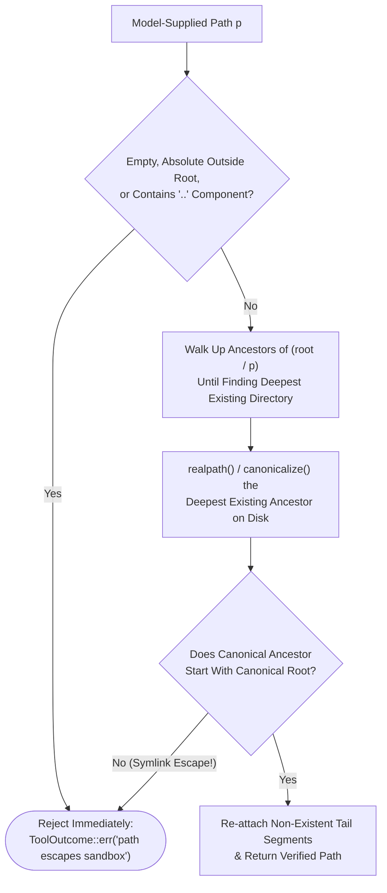

The moment you grant an autonomous agent filesystem write access (`write`, `edit`) or shell execution (`bash`, `code_interpreter`), your threat model changes fundamentally. **Every path, command, and script generated by the model is untrusted input**, indistinguishable from external user input in a web application. A single indirect prompt injection hidden inside a third-party README, an issue comment, or an MCP resource can instruct the model to traverse outside the workspace, exfiltrate `~/.ssh` or API keys, or launch a fork bomb.

In this sixth chapter, we build a defense-in-depth security architecture for coding agents—starting with workspace path canonicalization in [`azusachino/nahida`](https://github.com/azusachino/nahida), moving through local subprocess supervisors and Linux kernel primitives (Landlock, namespaces), and culminating in hardened ephemeral Kubernetes sandbox Jobs.

## Series Navigation

| Chapter | Title | Focus |
| --- | --- | --- |
| 01 | [Forward-Pass Arithmetic, Roofline Limits & KV Cache Architecture](/tech/series/ai-engineering/01.inference-arithmetic-and-kv-cache/) | Prefill vs decode roofline, MHA/GQA/MLA, matrix absorption, and PD disaggregation |
| 02 | [Provider Abstraction, Streaming Accumulation & The Bounded ReAct Loop](/tech/series/ai-engineering/02.providers-streaming-and-react-loop/) | Type-safe wire contracts, dialect stripping, byte-buffered SSE, and context ablation |
| 03 | [Tool Engineering, Model Context Protocol (MCP) & Permission Gating](/tech/series/ai-engineering/03.tool-engineering-and-mcp/) | ACI design, parameter fidelity, dynamic discovery, JSON-RPC MCP, and two-phase dispatch |
| 04 | [Code as the Meta-Tool: Tree-sitter Incremental Parsing & AST Call-Graph Indexing](/tech/series/ai-engineering/04.code-intelligence-and-ast-indexing/) | Two-phase AST extraction, global symbol resolution in `ochna`, and call-graph queries |
| 05 | [Context Engineering, Compaction Strategies & Shared Graph Memory](/tech/series/ai-engineering/05.context-compaction-and-memory/) | Attention sinks, turn-boundary compaction, session integrity, and `asobi` knowledge graphs |
| **06** | **Execution Sandboxing, Capability Boundaries & Agent Security Models** | **Ancestor canonicalization, Landlock, gVisor vs microVMs, and hardened Kubernetes Jobs** |
| 07 | [Rigorous Agent Evaluation, Harnesses & Multi-Agent Coordination](/tech/series/ai-engineering/07.evaluation-and-continual-evolution/) | Model vs harness ablation, unbiased `pass@k`, New Information Criterion, and evolution |

---

## 1. The Four Threat Vectors of Autonomous Execution

When an agent executes tool calls or generated scripts, the host environment faces four primary attack vectors:

1. **Workspace Escape via Path Traversal or Symlinks**: Model-supplied paths like `../../etc/passwd` or writes through a benign-looking interior symlink (`workspace/docs/link -> /root/.ssh`) that resolve outside the project root.
2. **Secret & Credential Exfiltration**: Scripts reading environment variables (`ANTHROPIC_API_KEY`, `AWS_SECRET_ACCESS_KEY`, `GITHUB_TOKEN`), local credential stores, or cloud instance metadata endpoints (`169.254.169.254`).
3. **Resource Starvation & Context Bombs**: Infinite `while True` loops, fork bombs, disk-filling temporary files, or commands dumping 500 MB of `stdout` to crash the harness or bankrupt the token budget.
4. **Kernel Exploit & Lateral Network Movement**: Untrusted dependency hooks (`setup.py`, `postinstall`) exploiting shared-kernel vulnerabilities or probing internal cluster services (`10.43.0.1`).

---

## 2. Workspace Path Confinement: Why Textual Normalization Fails

How should a file tool (`read`, `write`, `edit`) validate a model-supplied path?

A common mistake is using purely lexical path normalization (like `os.path.normpath` or Rust's `Path::components`) to check whether the normalized string starts with the workspace root. **Lexical normalization is unsound in the presence of symlinks**: if `workspace/sub` is a symlink pointing to `/etc`, lexically normalizing `workspace/sub/passwd` yields `workspace/sub/passwd` (which looks safe!), while the OS kernel opens `/etc/passwd`.

Conversely, calling `realpath()` (or `std::fs::canonicalize`) directly on the target path fails whenever the `write` tool is creating a **new file or directory** that does not exist on disk yet!

### `Sandbox::resolve` in `nahida`: Deepest-Existing-Ancestor Canonicalization

[`azusachino/nahida`](https://github.com/azusachino/nahida) solves both traps in `Sandbox::resolve` with a strict three-step algorithm:



1. **Reject `..` Outright**: Never normalize `..` components—reject any path containing `Component::ParentDir` immediately.
2. **Canonicalize the Deepest Existing Ancestor**: Because `write("new_dir/new_file.txt")` targets a path that does not exist yet, walk up the path's parent chain until reaching the **deepest ancestor that currently exists on disk**. Call `canonicalize()` (`realpath`) on that ancestor, and verify that the resolved physical path starts with the canonical workspace root. Checking only the immediate parent would fail when creating nested directories, and skipping canonicalization would miss a symlinked grandparent!
3. **Relative `display()` Output**: Whenever the tool reports a path back to the model in a `ToolResult`, `Sandbox::display()` strips the workspace root prefix—ensuring the conversation transcript never leaks the host machine's username or filesystem layout.

---

## 3. Defense-in-Depth Isolation Tiers

When moving from file tools to arbitrary command execution (`bash` / `code_interpreter`), path checking is no longer enough—the spawned process itself must be confined:

| Isolation Tier | Technology | Startup Latency | Syscall & Filesystem Boundary | Primary Use Case |
| --- | --- | --- | --- | --- |
| **L0: Process Supervisor** | Subprocess wrapper | $< 5\text{ ms}$ | Env scrubbing, wall-clock timeout, `stdout` byte cap | Trusted local dev with safety rails |
| **L1: OS Kernel Sandboxing** | Linux Namespaces, `cgroups`, `seccomp`, **Landlock LSM** | $10\text{–}100\text{ ms}$ | Unprivileged kernel enforcement of read/write paths; shared kernel | Headless CLI agents (`nahida`, Codex, Claude Code) |
| **L2: User-Space Kernel** | **gVisor (`runsc`)** | $100\text{–}300\text{ ms}$ | Sentry intercepts & emulates Linux syscalls in memory-safe Go | Multi-tenant Kubernetes agent runners |
| **L3: Hardware MicroVM** | **Firecracker / Kata** | $150\text{–}500\text{ ms}$ | KVM hardware virtualization with dedicated guest kernel | High-risk untrusted code execution at cloud scale |

---

## 4. Hardened Ephemeral Kubernetes Sandbox Jobs

On a Kubernetes cluster (such as `harus-k3s`), untrusted agent evaluations should run as one-shot ephemeral `batch/v1` `Job` pods with zero host privileges, a read-only root filesystem, and an in-memory `emptyDir` quota:

```yaml
apiVersion: batch/v1
kind: Job
metadata:
  name: agent-sandbox-eval
  namespace: agent-sandboxes
  labels:
    app.kubernetes.io/managed-by: agent-orchestrator
    security.harus.io/tier: untrusted-eval
spec:
  ttlSecondsAfterFinished: 60
  backoffLimit: 0
  template:
    spec:
      restartPolicy: Never
      automountServiceAccountToken: false
      securityContext:
        runAsNonRoot: true
        runAsUser: 65534
        runAsGroup: 65534
        fsGroup: 65534
        seccompProfile:
          type: RuntimeDefault
      containers:
        - name: executor
          image: python:3.12-slim
          imagePullPolicy: IfNotPresent
          command: ["python3", "-I", "-c"]
          args:
            - |
              print("Executing inside isolated ephemeral pod...")
          resources:
            requests:
              cpu: "250m"
              memory: "256Mi"
            limits:
              cpu: "1000m"
              memory: "512Mi"
          securityContext:
            allowPrivilegeEscalation: false
            readOnlyRootFilesystem: true
            capabilities:
              drop: ["ALL"]
          volumeMounts:
            - name: scratch
              mountPath: /tmp
      volumes:
        - name: scratch
          emptyDir:
            medium: Memory
            sizeLimit: 128Mi
```

Notice five interlocking controls in this manifest:

- **`automountServiceAccountToken: false`**: Prevents the pod from reading a Kubernetes bearer token at `/var/run/secrets/kubernetes.io/serviceaccount/token` to query the cluster API server.
- **`runAsNonRoot: true` + `runAsUser: 65534` (`nobody`) + `capabilities.drop: ["ALL"]`**: Eliminates root escalation and raw socket creation (`CAP_NET_RAW`).
- **`readOnlyRootFilesystem: true`**: Prevents tampering with `/usr` or installing persistent backdoors.
- **`emptyDir` with `medium: Memory` and `sizeLimit: 128Mi`**: Bounds `/tmp` writes in RAM; runaway disk writes fail immediately with `ENOSPC` ( or pod eviction) without touching physical NVMe drives.
- **`ttlSecondsAfterFinished: 60`**: Automatically garbage-collects finished pods and logs.

---

## 5. Runnable Sandbox Verifier: Deepest-Ancestor Path Resolution & Subprocess Supervisor

The following self-contained Python script implements and tests both `Sandbox.resolve` (verifying protection against `..` traversal and interior symlink escapes even for non-existent target files) and a hardened local subprocess supervisor (enforcing secret scrubbing, wall-clock timeouts, and `stdout` truncation):

```python
"""Workspace Path Sandbox & Subprocess Execution Supervisor."""

from __future__ import annotations
import os
from pathlib import Path
import subprocess
import sys
import tempfile
from typing import Any


class SandboxEscapeError(PermissionError):
    pass


class WorkspaceSandbox:
    def __init__(self, root: Path) -> None:
        self.root = root.resolve(strict=True)

    def resolve(self, untrusted_path: str) -> Path:
        if not untrusted_path or not untrusted_path.strip():
            raise SandboxEscapeError("Empty path is not allowed")

        raw = Path(untrusted_path)
        if ".." in raw.parts:
            raise SandboxEscapeError(f"Parent traversal '..' rejected: {untrusted_path}")

        candidate = raw if raw.is_absolute() else (self.root / raw)

        # Walk up to find the deepest existing ancestor on disk
        ancestor = candidate
        tail_parts: list[str] = []
        while not ancestor.exists():
            if ancestor.parent == ancestor:
                raise SandboxEscapeError(f"No existing ancestor for: {untrusted_path}")
            tail_parts.append(ancestor.name)
            ancestor = ancestor.parent

        canonical_ancestor = ancestor.resolve(strict=True)
        if not canonical_ancestor.is_relative_to(self.root):
            raise SandboxEscapeError(
                f"Path escapes sandbox via symlink or root: {untrusted_path} -> {canonical_ancestor}"
            )

        resolved = canonical_ancestor
        for part in reversed(tail_parts):
            resolved = resolved / part
        return resolved


def scrubbed_env() -> dict[str, str]:
    sensitive = ("SECRET", "TOKEN", "KEY", "PASSWORD", "CREDENTIAL", "DATABASE_URL")
    return {
        k: v
        for k, v in os.environ.items()
        if not any(marker in k.upper() for marker in sensitive)
    } | {"PYTHONUNBUFFERED": "1", "TMPDIR": "/tmp"}


def run_supervised(
    code: str, timeout_sec: float = 1.0, max_output_bytes: int = 64
) -> dict[str, Any]:
    try:
        proc = subprocess.run(
            [sys.executable, "-I", "-c", code],
            stdout=subprocess.PIPE,
            stderr=subprocess.PIPE,
            timeout=timeout_sec,
            env=scrubbed_env(),
            check=False,
        )
        out = proc.stdout[:max_output_bytes].decode("utf-8", errors="replace")
        truncated = len(proc.stdout) > max_output_bytes
        return {
            "exit_code": proc.returncode,
            "stdout": out + ("...[TRUNCATED]" if truncated else ""),
            "timeout": False,
        }
    except subprocess.TimeoutExpired:
        return {"exit_code": -1, "stdout": "", "timeout": True}


if __name__ == "__main__":
    with tempfile.TemporaryDirectory() as tmp:
        ws = Path(tmp) / "workspace"
        ws.mkdir()
        outside = Path(tmp) / "outside_secret"
        outside.mkdir()
        (ws / "escape_link").symlink_to(outside)

        sandbox = WorkspaceSandbox(ws)
        print("=== 1. Workspace Path Confinement Tests ===")
        safe = sandbox.resolve("src/new_module/handler.py")
        print(f"Safe non-existent write path : {safe.relative_to(sandbox.root)}")

        for attack in ("../../etc/passwd", "escape_link/stolen_key.txt", "/etc/hosts"):
            try:
                sandbox.resolve(attack)
            except SandboxEscapeError as exc:
                print(f"Blocked attack [{attack:26s}] -> {exc}")

    print("\n=== 2. Subprocess Supervisor Tests ===")
    os.environ["ANTHROPIC_API_KEY"] = "sk-ant-secret-do-not-leak"
    r_env = run_supervised("import os; print(os.environ.get('ANTHROPIC_API_KEY', 'SCRUBBED'))")
    r_flood = run_supervised("print('X' * 5000)", max_output_bytes=32)
    r_hang = run_supervised("while True: pass", timeout_sec=0.3)
    print(f"Secret scrubbing check       : {r_env['stdout'].strip()}")
    print(f"Stdout flood cap check       : {r_flood['stdout'].strip()}")
    print(f"Infinite loop timeout check  : timeout={r_hang['timeout']}, exit={r_hang['exit_code']}")
```

Running this verification produces:

```text
=== 1. Workspace Path Confinement Tests ===
Safe non-existent write path : src/new_module/handler.py
Blocked attack [../../etc/passwd          ] -> Parent traversal '..' rejected: ../../etc/passwd
Blocked attack [escape_link/stolen_key.txt] -> Path escapes sandbox via symlink or root: escape_link/stolen_key.txt -> /tmp/.../outside_secret
Blocked attack [/etc/hosts                ] -> Path escapes sandbox via symlink or root: /etc/hosts -> /etc/hosts

=== 2. Subprocess Supervisor Tests ===
Secret scrubbing check       : SCRUBBED
Stdout flood cap check       : XXXXXXXXXXXXXXXXXXXXXXXXXXXXXXXX...[TRUNCATED]
Infinite loop timeout check  : timeout=True, exit=-1
```

---

## Key Takeaways

1. **Treat every model-supplied path and command as untrusted user input.** Reject `..` outright and canonicalize the deepest existing ancestor on disk so symlinks inside the workspace can never point outside it.
2. **Scrub secrets, cap `stdout`, and enforce timeouts at L0.** Even in local development, stripping `*KEY*`/`*TOKEN*`/`*SECRET*` from child environments and truncating runaway output prevents accidental secret leaks and context-window bombs.
3. **Match isolation depth to execution trust.** Use Landlock and workspace sandboxing for interactive local coding agents, and ephemeral non-root Kubernetes Jobs (`automountServiceAccountToken: false`, `readOnlyRootFilesystem: true`) or gVisor/microVMs for untrusted remote runs.

In the final chapter of this series, [Chapter 07: Rigorous Agent Evaluation, Harnesses & Multi-Agent Coordination](/tech/series/ai-engineering/07.evaluation-and-continual-evolution/), we close the loop: evaluating `Model × Harness` scientifically, computing unbiased `pass@k`, orchestrating multi-agent workflows under the New Information Criterion, and distilling trajectory post-mortems into continual evolution.
