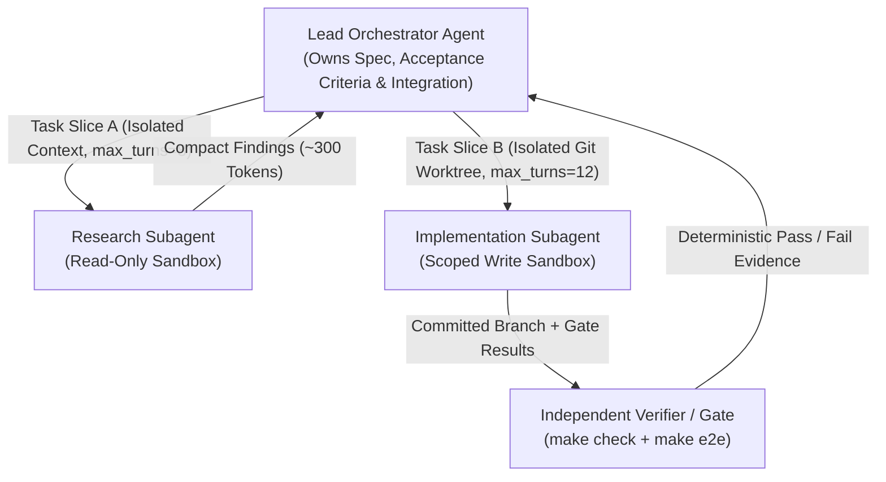

In traditional software engineering, untested code is broken code. In AI engineering, an unevaluated agent is an unpredictable liability. Because language models are stochastic, relying on conversational "vibes" or subjective LLM-as-a-judge ratings introduces severe confirmation bias: an LLM judge frequently applauds a plausible-sounding explanation even when the agent's patch broke the build or corrupted a database migration.

In this concluding chapter, we synthesize how production teams evaluate, coordinate, and evolve coding agents: separating **Model capability** from **Harness design**, combining zero-network deterministic loop tests with objective environment assertions, computing the unbiased **`pass@k`** estimator, applying the **New Information Criterion** to multi-agent topologies, and practicing disciplined harness pruning.

## Series Navigation

| Chapter | Title | Focus |
| --- | --- | --- |
| 01 | [Forward-Pass Arithmetic, Roofline Limits & KV Cache Architecture](/tech/series/ai-engineering/01.inference-arithmetic-and-kv-cache/) | Prefill vs decode roofline, MHA/GQA/MLA, matrix absorption, and PD disaggregation |
| 02 | [Provider Abstraction, Streaming Accumulation & The Bounded ReAct Loop](/tech/series/ai-engineering/02.providers-streaming-and-react-loop/) | Type-safe wire contracts, dialect stripping, byte-buffered SSE, and context ablation |
| 03 | [Tool Engineering, Model Context Protocol (MCP) & Permission Gating](/tech/series/ai-engineering/03.tool-engineering-and-mcp/) | ACI design, parameter fidelity, dynamic discovery, JSON-RPC MCP, and two-phase dispatch |
| 04 | [Code as the Meta-Tool: Tree-sitter Incremental Parsing & AST Call-Graph Indexing](/tech/series/ai-engineering/04.code-intelligence-and-ast-indexing/) | Two-phase AST extraction, global symbol resolution in `ochna`, and call-graph queries |
| 05 | [Context Engineering, Compaction Strategies & Shared Graph Memory](/tech/series/ai-engineering/05.context-compaction-and-memory/) | Attention sinks, turn-boundary compaction, session integrity, and `asobi` knowledge graphs |
| 06 | [Execution Sandboxing, Capability Boundaries & Agent Security Models](/tech/series/ai-engineering/06.sandboxing-and-agent-security/) | Ancestor canonicalization, Landlock, gVisor vs microVMs, and hardened Kubernetes Jobs |
| **07** | **Rigorous Agent Evaluation, Harnesses & Multi-Agent Coordination** | **Model vs harness ablation, unbiased `pass@k`, New Information Criterion, and evolution** |

---

## 1. Evaluating the Compound System: `Agent = Model × Harness`

When an agent fails a task, the reflex reaction is to blame the model weights. In reality, an agent is a multiplicative system:

$$\text{Capability}(\text{Agent}) = \text{Model Weights} \times \text{Harness}(\text{Prompts, Tool ACI, Loop, Context, Gates})$$

To isolate whether a failure lives in the model or the harness, run two controlled experiments:

1. **Harness Ablation (Fixed Model, Vary Harness)**: Hold the model checkpoint constant and toggle one harness mechanism at a time (e.g., replace whole-file `write` with surgical `edit`, add `ochna` AST symbol search, or enable error-preserving context compaction). If resolution jumps from $28\%$ to $64\%$, the harness—not the model—was the bottleneck.
2. **Model Swap (Fixed Harness, Vary Model)**: Hold the harness constant and swap an 8B model for a 70B or frontier model. If both models fail at the exact same step (for instance, passing a malformed parameter to an ambiguous tool schema), upgrading the model wastes money until the tool ACI is fixed.

---

## 2. Two-Tier Verification: Faux-Provider Unit Tests vs. Live Evals

In [`azusachino/nahida`](https://github.com/azusachino/nahida), verification is split strictly into two tiers so CI stays fast, deterministic, and free while real-model accuracy remains measurable:

| Verification Tier | Provider & Network | Execution Cadence | What It Proves |
| --- | --- | --- | --- |
| **Tier 1: Loop & Contract Tests** (`make check`) | Scripted Faux Provider / split-frame SSE mock (`0` network calls, `.tmp/` fixtures) | Every commit & CI push (\$0 cost, $< 2\text{ s}$) | SSE byte-chunk reassembly, tool JSON accumulation, verbatim assistant replay, single-message `tool_result` packing, sandbox confinement, session log integrity |
| **Tier 2: Live End-to-End Evals** (`make eval` / `#[ignore]`) | Real provider resolved from environment credentials | On-demand before releases or prompt/tool changes | End-to-end task resolution against real models in a disposable `tempdir` workspace |

### Objective Environment Assertions Over "LLM-as-a-Judge"

Benchmarks like **SWE-bench** and **$\tau^2$-bench** never ask an LLM whether a patch "looks good." Instead, `run_eval(prompt, setup, check)` evaluates **deterministic environment ground truth**:

- **`setup()`**: Seeds an isolated temporary workspace (Git commit, SQLite database, config fixture).
- **Agent Run**: The agent interacts with the environment until `EndTurn` or `max_turns`.
- **`check()`**: Runs deterministic assertions outside the LLM—did the unit test suite transition from `FAIL` to `PASS`? Does the SQLite table contain the expected row? Did headless Chromium (`make e2e`) render the route with zero console or page errors?

---

## 3. Statistical Benchmark Math: Unbiased `pass@k` Estimation

Because language models sample tokens probabilistically, evaluating a single run (`pass@1`) on a benchmark task exhibits high variance. Furthermore, when your harness includes a deterministic verifier (like `make check`), you can sample $k$ candidate trajectories and select the one that passes verification!

To measure **`pass@k`** (the probability that at least $1$ out of $k$ attempts resolves the task) without the high variance of generating exactly $k$ samples, Chen et al. (HumanEval) introduced the **unbiased estimator**: generate $n \ge k$ total runs per task, count the number of successful runs $c$, and compute:

$$\text{pass@}k = 1 - \frac{\binom{n - c}{k}}{\binom{n}{k}} = 1 - \prod_{i=0}^{k-1} \frac{n - c - i}{n - i}$$

Notice the product form on the right: multiplying $\frac{n - c - i}{n - i}$ for $i = 0 \dots k-1$ avoids computing giant factorials that overflow 64-bit integers.

---

## 4. Multi-Agent Coordination & The "New Information" Criterion

When does splitting work across multiple agents actually outperform a single agent?

Empirical research across multi-agent benchmarks reveals a sharp dividing line known as the **New Information Criterion**:

| Multi-Agent Pattern | Introduces New Ground-Truth Information? | Empirical Effect |
| --- | --- | --- |
| **Unanchored Self-Reflection** ("Are you sure?") | **No** (Model re-reads its own text) | Often degrades accuracy or reinforces initial hallucination |
| **Pure LLM-vs-LLM Debate** (Text-only chat circle) | **No** (Same training distribution) | Often no better than single-agent majority voting at $3\times\text{–}5\times$ token cost |
| **Implementer + Deterministic Test Verifier** | **Yes** (Compiler diagnostics, test failures) | **Large, consistent capability gain** |
| **Implementer + Independent Browser Verifier** | **Yes** (Headless Chromium DOM / layout checks) | **Catches visual & runtime bugs invisible in source text** |
| **Isolated Subagent Research / Parallel Worktrees** | **Yes** (Keeps 50k tokens of file search out of lead context) | **Prevents lead-agent context dilution** |

> **The Golden Rule of Multi-Agent Systems**: Multi-agent collaboration is worth its token and latency overhead **if and only if** the secondary agent either (a) introduces independent ground-truth evidence (compiler errors, test execution, browser rendering, fresh context inspection against written acceptance criteria) or (b) isolates high-volume search/implementation in a separate context window so the lead orchestrator's context stays clean.



---

## 5. Continual Evolution & Disciplined Harness Pruning

A production agent workflow is never static; it evolves alongside both your codebase and new model generations through two opposing loops:

### Loop A: Post-Mortem Distillation (Adding High-Signal Constraints)

Whenever an agent hits a subtle repository trap (for example, forgetting to strip `cache_control` on `Compat` gateways, or running `astro dev` without clearing `node_modules/.astro` after changing a Markdown plugin), capture the failure at session closeout and distill a concise, testable rule into the owning repository's `AGENTS.md` or `asobi` pitfall record. Future sessions inherit that hard-won lesson in their static prefix on turn 1.

### Loop B: Cognitive Shortcuts & Harness Pruning (Doing Subtraction)

Conversely, as frontier models grow stronger, heavy step-by-step procedural prompts written to babysit older models become **context noise** that wastes tokens and forces unnecessary turns.

1. **Use Standardized Methodological Shortcuts**: Instead of writing 200 lines of rigid procedural steps, invoke high-leverage engineering lenses that models deeply understand from pretraining:
   - **First Principles**: *"Analyze why this endpoint is slow from first principles; do not assume adding a Redis cache is the right starting point."*
   - **Adversarial Review**: *"Perform an adversarial review of this design—prioritize counterexamples that invalidate its core assumptions."*
   - **Ablation**: *"Design an ablation experiment to prove which of these three optimizations actually accounts for the latency drop."*
   - **Occam's Razor (`ponytail`)**: *"Review this diff with Occam's razor and delete every speculative abstraction, wrapper, or dependency not required by current callers."*
2. **Prune Obsolete Scaffolding**: Periodically audit your `AGENTS.md` and skill library. If a constraint was compensating for an older model's weakness that current models handle natively—or if a rule duplicates an automated check already enforced by `make check`—delete it.

---

## 6. Runnable Verification: Unbiased `pass@k` & Budgeted Orchestrator

Below is a self-contained Python verification script that computes exact unbiased `pass@k` metrics across a simulated coding benchmark and runs a budgeted Orchestrator $\rightarrow$ Worker $\rightarrow$ Deterministic Verifier pipeline:

```python
"""Unbiased pass@k Estimator and Budgeted Multi-Agent Verifier Pipeline."""

from __future__ import annotations
import dataclasses
from typing import Any, Callable


def estimate_pass_at_k(n: int, c: int, k: int) -> float:
    """Compute Chen et al. (2021) unbiased pass@k estimator without factorial overflow."""
    if n - c < k:
        return 1.0
    if c == 0:
        return 0.0
    prob_all_fail = 1.0
    for i in range(k):
        prob_all_fail *= (n - c - i) / (n - i)
    return 1.0 - prob_all_fail


@dataclasses.dataclass
class WorkerOutcome:
    worker: str
    turns_used: int
    artifact: str
    verified: bool
    diagnostics: str


def run_verified_worker(
    name: str,
    step_budget: int,
    propose_fn: Callable[[int, str], str],
    env_verifier: Callable[[str], tuple[bool, str]],
) -> WorkerOutcome:
    feedback = ""
    artifact = ""
    for turn in range(1, step_budget + 1):
        artifact = propose_fn(turn, feedback)
        ok, feedback = env_verifier(artifact)
        if ok:
            return WorkerOutcome(name, turn, artifact, True, feedback)
    return WorkerOutcome(name, step_budget, artifact, False, feedback)


if __name__ == "__main__":
    # 1. Evaluate pass@1, pass@3, pass@5 across 5 tasks (n=10 samples each)
    tasks = [
        {"id": "sse-utf8-split", "n": 10, "c": 8},
        {"id": "sandbox-symlink", "n": 10, "c": 5},
        {"id": "mla-absorption", "n": 10, "c": 10},
        {"id": "compact-user-role", "n": 10, "c": 3},
        {"id": "deadlock-cycle", "n": 10, "c": 0},
    ]
    print("=== 1. Unbiased Benchmark pass@k Summary (5 Tasks, n=10) ===")
    for k in (1, 3, 5):
        mean_score = sum(estimate_pass_at_k(t["n"], t["c"], k) for t in tasks) / len(tasks)
        print(f"  pass@{k} : {mean_score * 100:5.2f}%")

    # 2. Orchestrator + Worker + Deterministic Environment Verifier
    print("\n=== 2. Multi-Agent Worker with Deterministic Environment Feedback ===")

    def compiler_and_test_gate(patch: str) -> tuple[bool, str]:
        if "resolve(strict=True)" not in patch:
            return False, "FAIL: test_symlink_escape — ancestor not canonicalized with resolve(strict=True)"
        return True, "PASS: 14 passed in 0.08s"

    def simulated_coder(turn: int, last_error: str) -> str:
        if turn == 1:
            return "def check(p): return os.path.normpath(p)"
        # On turn 2, the worker acts on the new information from the test runner!
        if "resolve(strict=True)" in last_error:
            return "def check(p): return p.resolve(strict=True)"
        return ""

    outcome = run_verified_worker("coder-subagent", 4, simulated_coder, compiler_and_test_gate)
    print(f"  Worker      : {outcome.worker}")
    print(f"  Verified    : {outcome.verified} (in {outcome.turns_used} turns)")
    print(f"  Gate Output : {outcome.diagnostics}")
```

Output:

```text
=== 1. Unbiased Benchmark pass@k Summary (5 Tasks, n=10) ===
  pass@1 : 52.00%
  pass@3 : 72.50%
  pass@5 : 78.25%

=== 2. Multi-Agent Worker with Deterministic Environment Feedback ===
  Worker      : coder-subagent
  Verified    : True (in 2 turns)
  Gate Output : PASS: 14 passed in 0.08s
```

Notice how pairing candidate sampling with a deterministic verifier lifts resolution from **$52.00\%$ (`pass@1`)** to **$78.25\%$ (`pass@5`)**, and how concrete test-runner diagnostics allow a worker subagent to repair its first-turn lexical-path mistake on turn 2.

---

## Series Conclusion: The Complete AI Engineering Stack

Across these seven chapters, we have traced the engineering of modern AI systems and coding agents from bare-metal silicon up to multi-agent orchestration:

1. **[Forward-Pass Arithmetic & KV Cache Architecture](/tech/series/ai-engineering/01.inference-arithmetic-and-kv-cache/)**: The roughly 8,000-fold arithmetic intensity gap between compute-bound prefill and bandwidth-bound decode, MLA matrix absorption, and RDMA requirements for PD disaggregation.
2. **[Provider Abstraction, Streaming & The Bounded ReAct Loop](/tech/series/ai-engineering/02.providers-streaming-and-react-loop/)**: Type-safe wire contracts, gateway dialect adaptation, UTF-8-safe byte-buffered SSE framing, and the two core transcript invariants.
3. **[Tool Engineering, MCP & Permission Gating](/tech/series/ai-engineering/03.tool-engineering-and-mcp/)**: Designing high-signal Agent-Computer Interfaces, avoiding schema bloat with Packs and Skills, speaking JSON-RPC 2.0 MCP, and splitting sequential confirmation from concurrent tool execution.
4. **[Code as the Meta-Tool & AST Call-Graph Indexing](/tech/series/ai-engineering/04.code-intelligence-and-ast-indexing/)**: Using sandboxed code execution to keep intermediate data out of context, and indexing repositories with Tree-sitter and SQLite in `ochna`.
5. **[Context Engineering, Compaction & Shared Graph Memory](/tech/series/ai-engineering/05.context-compaction-and-memory/)**: Preserving attention sinks, compacting strictly at settled turn boundaries, validating crash-safe JSONL sessions, and persisting cross-session knowledge in `asobi`.
6. **[Execution Sandboxing & Agent Security Models](/tech/series/ai-engineering/06.sandboxing-and-agent-security/)**: Deepest-existing-ancestor path canonicalization, subprocess environment scrubbing, Landlock, and hardened ephemeral Kubernetes Jobs.
7. **[Rigorous Agent Evaluation, Harnesses & Multi-Agent Coordination](/tech/series/ai-engineering/07.evaluation-and-continual-evolution/)**: Separating model capability from harness design, unbiased `pass@k` estimation, the New Information Criterion, and continual harness evolution.
