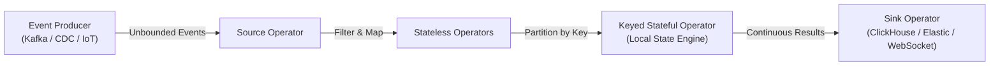
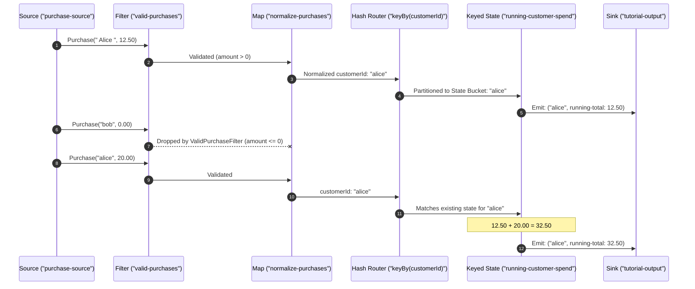
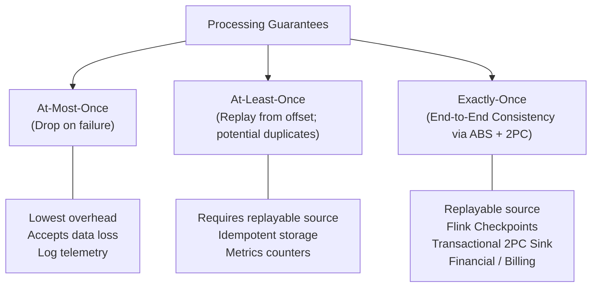

## Before you start

This series is for Java or similar-language programmers who have used a database and maybe a message queue but never built a streaming job; the chapters build on each other, so read them in order.

The usual way to find out "how many orders failed in the last five minutes" is to write rows into a table and run a query every so often. That works until you need the answer within a second, or until many services hammer the same table. Stream processing flips this: the data is treated as an endless sequence of events, and your code runs on each event as it arrives, keeping running totals as it goes. Think of a cashier tallying a till as each sale happens instead of counting the drawer at closing time.

This chapter introduces Flink's model: events flow through a graph of operators, each operator can hold its own state next to the code, and the system promises something specific about how many times each event counts after a failure.

You do not need earlier chapters. Knowing what a message queue like Kafka does helps; the [Kafka storage chapter](/tech/series/middleware-internals/03.kafka-log-storage-and-zero-copy/) gives the basics.

Terms used in this chapter:

- **stream**: a sequence of events that has no defined end.
- **bounded and unbounded data**: bounded data is a finite set such as a file; unbounded data keeps arriving.
- **operator**: one processing step, such as filter, map or aggregate.
- **DAG**: directed acyclic graph, the shape of the job: operators connected by arrows with no loops.
- **state**: data an operator remembers between events, such as a running count per user.
- **at-least-once**: after a failure every event is processed, possibly more than once.
- **exactly-once**: after a failure the results look as if each event was processed once.

## The Paradigm Shift: From Passive State to Continuous Streams

For decades, application architectures treated the relational database as the primary source of truth, with computation acting as an ephemeral visitor.

In a traditional request-response or microservice architecture, when a business event occurs—such as a user placing an order or a sensor reporting a temperature spike—the application writes the record into an indexed table:

```text
[Incoming Request] ──> [Application Server] ──> [Database Table (Passive State)]
```

When downstream consumers need analytics, fraud alerts, or aggregated metrics, they query this passive table. As data volume scales, two persistent architectural failure modes emerge:

1. **Periodic Batch Polling (The Latency Penalty)**: Running hourly or nightly batch jobs (via cron, SQL scripts, or Spark batch jobs) introduces an unavoidable lag of minutes or hours. In scenarios like financial fraud detection or real-time bidding, an alert delivered 15 minutes late is worthless.
2. **Database Contention & Polling Load**: If multiple microservices query the same central database every second to detect new rows, the database index suffers severe read-write lock contention and thread saturation.

Stream processing turns this mental model inside out:

> **Don't bring the streaming data to a passive database; bring continuous, stateful computation to the moving stream.**

In Apache Flink, data is not stored waiting to be inspected; data is an infinite, sequential sequence of immutable facts flowing through a pipeline of stateful operators.



---

## The Unified Batch-Stream Duality

One of Apache Flink's foundational philosophical breakthroughs is the unification of batch and stream processing under a single mathematical model: **Batch is merely a special case of streaming.**

| Dimension | Bounded Stream (Batch) | Unbounded Stream (Streaming) |
| :--- | :--- | :--- |
| **Data Boundary** | Finite, known start and termination. | Infinite, continuous, never ends. |
| **Time Awareness** | Static historical timestamps; processing order is arbitrary. | Dynamic event time; out-of-order events and network delays. |
| **State Evolution** | Ephemeral or accumulated in memory until completion. | Continuously updated, checkpointed, and evicted via TTL. |
| **Output Delivery** | Single final result produced at end of job. | Continuous, incremental emissions with sub-second latency. |

When you process a CSV file or an archival Parquet dataset, the stream has an explicit End-of-Stream token. When reading from an Apache Kafka partition or AWS Kinesis shard, the stream never produces an End-of-Stream token.

Because Flink's core execution runtime was designed from day one around pipelined, non-blocking dataflow execution, it can process both bounded historical logs and live real-time streams with identical API semantics and execution guarantees.

---

## Anatomy of a DataStream Program: The Directed Acyclic Graph (DAG)

In Apache Flink, every streaming program is declared as a Directed Acyclic Graph (DAG) composed of three fundamental building blocks:

1. **Sources**: Connectors that ingest records from external systems (e.g., Kafka topics, Pulsar, socket streams, or memory collections). Sources assign initial offsets and ingest timestamps.
2. **Transformations**: Operators that transform, enrich, split, or aggregate incoming records.
   - *Stateless Transformations*: Transformations like `map()`, `filter()`, or `flatMap()` that evaluate each element independently in isolation.
   - *Keyed & Stateful Transformations*: Operations like `keyBy()`, `window()`, and `reduce()` that partition the stream by a deterministic key hash and maintain persistent local state across records.
3. **Sinks**: Connectors that emit computed results to downstream storage systems, message brokers, or operational dashboards (e.g., ClickHouse, PostgreSQL, Kafka, or stdout).

Let us inspect the minimal, compilable streaming job defined in our companion repository [`flos/modules/flink/operator-lab`](https://github.com/azusachino/flos/tree/main/modules/flink/operator-lab):

```java
package io.github.azusachino.flos.flink.lab;

import io.github.azusachino.flos.flink.operators.NormalizePurchase;
import io.github.azusachino.flos.flink.operators.PurchaseEvent;
import io.github.azusachino.flos.flink.operators.RunningSpend;
import io.github.azusachino.flos.flink.operators.ValidPurchaseFilter;
import java.math.BigDecimal;
import java.time.Instant;
import org.apache.flink.streaming.api.environment.StreamExecutionEnvironment;

public final class OperatorLabJob {

    private static final String JOB_NAME = "flos-flink-operator-lab";

    public static void main(String[] args) throws Exception {
        var environment = StreamExecutionEnvironment.getExecutionEnvironment();

        environment
                .fromData(
                        purchase(" Alice ", "Flink Book", "12.50", "2026-01-01T00:00:00Z"),
                        purchase("alice", "Streaming Course", "20.00", "2026-01-01T00:01:00Z"),
                        purchase("bob", "Notebook", "8.00", "2026-01-01T00:02:00Z"),
                        purchase("bob", "Invalid", "0", "2026-01-01T00:03:00Z"))
                .name("purchase-source")
                .filter(new ValidPurchaseFilter())
                .name("valid-purchases")
                .map(new NormalizePurchase())
                .name("normalize-purchases")
                .keyBy(PurchaseEvent::customerId)
                .reduce(new RunningSpend())
                .name("running-customer-spend")
                .print()
                .name("tutorial-output");

        environment.execute(JOB_NAME);
    }
}
```

### Tracing the Transformation Pipeline

Let's trace how the stream flows through each operator in this DAG:



1. **Filtering Out Noise (`ValidPurchaseFilter`)**:
   Elements with zero or negative amounts (`purchase("bob", "Invalid", "0", ...)`) are rejected immediately, preventing corrupt data from polluting downstream state.
2. **Canonical Normalization (`NormalizePurchase`)**:
   Whitespace is trimmed and case is lowered (`" Alice "` $\to$ `"alice"`), ensuring that subsequent hash partitioning routes all events for the same entity to the exact same physical state partition.
3. **Keyed Partitioning (`keyBy`)**:
   `keyBy(PurchaseEvent::customerId)` hashes each key (a murmur hash of `key.hashCode()`, modulo `maxParallelism`) into a key group, and key groups are assigned to parallel subtasks. This shifts the execution from a linear sequential stream into parallel logical sub-streams where every event for a given `customerId` is always processed by the same subtask, which owns the state for that key (one subtask serves many keys).
4. **Stateful Incremental Reduction (`RunningSpend`)**:
   Instead of storing every raw purchase event and recalculating the sum on every query, the `RunningSpend` operator performs an incremental reduction:

```java
public final class RunningSpend implements ReduceFunction<PurchaseEvent> {
    @Override
    public PurchaseEvent reduce(PurchaseEvent current, PurchaseEvent next) {
        return new PurchaseEvent(
                current.customerId(),
                "running-total",
                current.amount().add(next.amount()),
                next.occurredAt());
    }
}
```

Each new transaction updates the accumulated state in $O(1)$ time and $O(1)$ space.

---

## State as a First-Class Citizen: Co-located Storage

In naive stream processing setups, operators frequently talk to external caching layers (such as Redis, Memcached, or Cassandra) to store intermediate counts, user sessions, or running balances:

```text
[Operator Task] ──(Network RPC: 2-5ms)──> [External Redis / Database]
```

At 100,000 events per second, network roundtrips to an external database will immediately choke throughput and create a distributed deadlock nightmare during network partitions.

Flink avoids this bottleneck through **Co-located Managed State**:

```mermaid
flowchart TD
    subgraph TaskSlot["Flink TaskManager Slot (Local Memory & Disk)"]
        subgraph Operator["Operator Execution Thread"]
            Code["ReduceFunction / ProcessFunction"]
        end
        subgraph LocalState["Managed State Engine"]
            Heap["Heap StateBackend (Fast In-Memory JRE Objects)"]
            Rocks["EmbeddedRocksDB (Off-Heap LSM-Tree on NVMe)"]
        end
        Code <-->|Direct In-Memory Access (Zero Network)| LocalState
    end
    LocalState -.->|Asynchronous Checkpoint Barrier| S3["Durable Storage (S3 / HDFS / MinIO)"]
```

- **Zero-Latency Reads and Writes**: The state resides directly inside the TaskManager process—either as JRE heap objects (for raw microsecond speed) or in an embedded RocksDB instance stored on local NVMe disk (for terabyte-scale state exceeding RAM).
- **Asynchronous Periodic Checkpointing**: While the operator processes events at maximum speed, a background thread periodically writes incremental snapshots of the state to durable object storage (such as Amazon S3, MinIO, or Ceph). If a node fails, the state is rehydrated into a replacement worker without losing a single transaction.

---

## Processing Guarantees Demystified

When building real-time pipelines, engineers must reason clearly about failure semantics:



1. **At-Most-Once (Best Effort)**: If a worker crashes, events in flight are discarded. Suitable for non-critical high-frequency sensor readings where a lost metric is harmless.
2. **At-Least-Once (Guaranteed Delivery)**: The source records consumer offsets. If a failure occurs, the engine rewinds to the last acknowledged offset and replays the stream. Downstream systems may see duplicated records unless they implement idempotent upserts.
3. **End-to-End Exactly-Once**: Every record reflects in the final state and downstream storage exactly once, even in the presence of machine crashes, network partitions, and JVM out-of-memory errors. Flink achieves this by orchestrating two distinct components:
   - **Internal Consistency**: Coordinated Asynchronous Barrier Snapshotting (ABS / Chandy-Lamport variant) that preserves a globally consistent snapshot of operator states.
   - **External Consistency**: The **Two-Phase Commit (2PC)** sink protocol, where downstream mutations remain in a *pre-committed* state until the distributed checkpoint completes, at which point the transaction is formally committed.

---

## Verifying in the Workspace

You can run and inspect this exact pipeline in [`flos`](https://github.com/azusachino/flos):

```sh
# Compile the operator module and run the deterministic test suite
mvn test -pl modules/flink/operators
```

The job itself lives in `modules/flink/operator-lab`; the operators it uses (`ValidPurchaseFilter`, `NormalizePurchase`, `RunningSpend`) live in `modules/flink/operators`.

When `OperatorLabJob` executes, stdout shows the stream progression (a real run prefixes each line with the subtask number, such as `3> `):

```text
PurchaseEvent[customerId=alice, product=Flink Book, amount=12.50, occurredAt=2026-01-01T00:00:00Z]
PurchaseEvent[customerId=alice, product=running-total, amount=32.50, occurredAt=2026-01-01T00:01:00Z]
PurchaseEvent[customerId=bob, product=Notebook, amount=8.00, occurredAt=2026-01-01T00:02:00Z]
```

Notice how `alice`'s first purchase emits with amount `12.50`, and her second transaction immediately reduces to `32.50`, while `bob` maintains an isolated state partition of `8.00`, and the invalid purchase with `0.00` is silently dropped at the filter stage.

---

## Summary & Next Step

The stream processing paradigm transforms our thinking from static, passive data tables to active, continuous dataflow graphs. By co-locating managed state with the computation, Flink delivers both sub-second processing latency and enterprise-grade resilience.

However, in the real world, distributed networks introduce latency, mobile devices disconnect and reconnect, and events arrive out of order. How does a stream processor compute hourly analytics when an event from 10:05 AM arrives at 10:45 AM?

In **Chapter 02: Event Time, Watermarks & Late Data**, we will explore the three clocks of distributed systems, watermark propagation mechanics, and how Flink handles late-arriving data with mathematical determinism.
