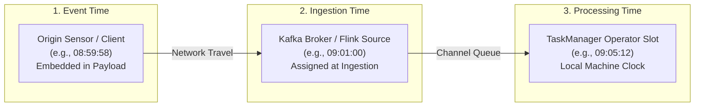
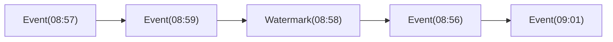
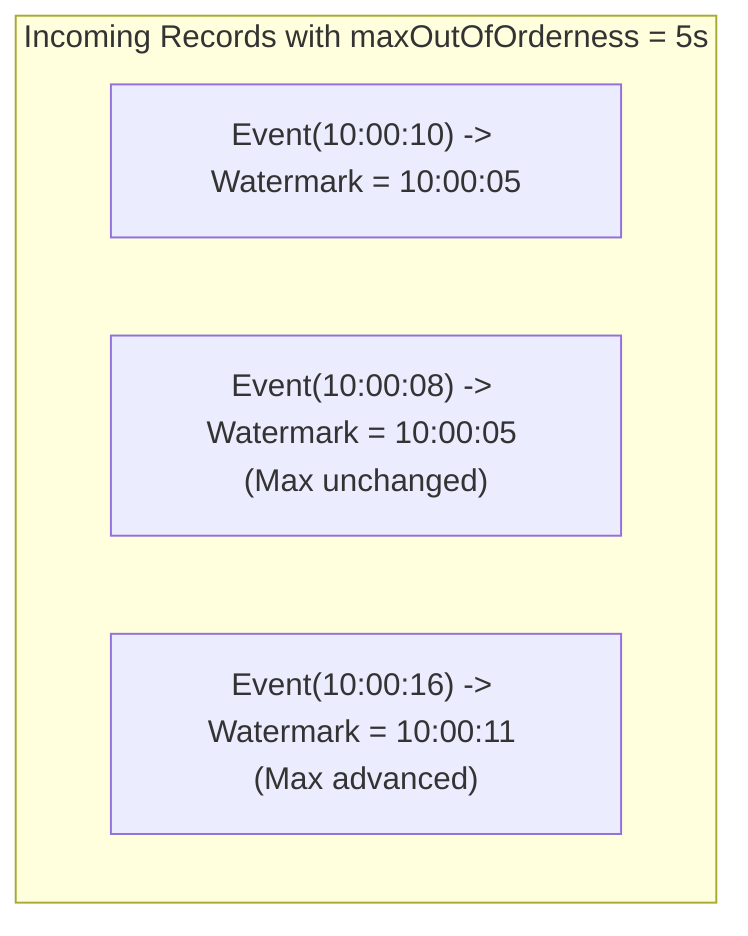
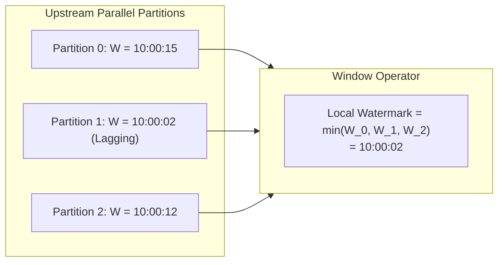
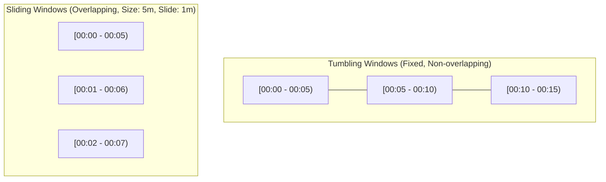
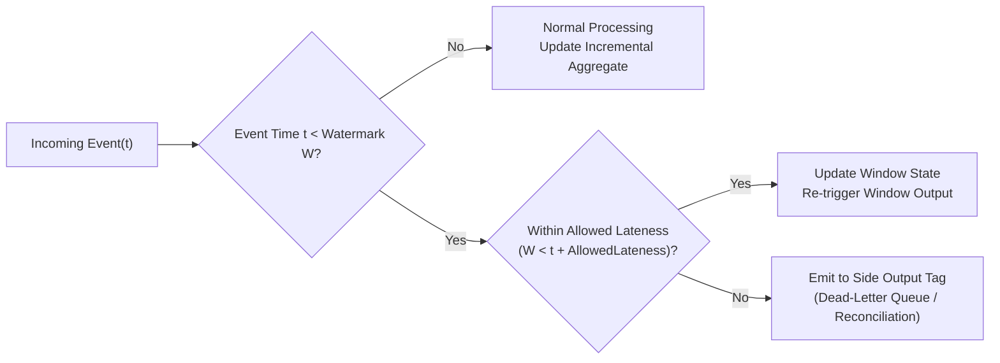

## The Illusion of Wall-Clock Time in Distributed Systems

In single-node systems, determining when an event occurred is trivial: call `System.currentTimeMillis()`.

In distributed stream processing, relying on wall-clock time leads to catastrophic analytical errors. Consider a mobile payment app where a user pays for coffee at 08:59:58 AM on a subway train. As the train enters a tunnel, cellular connectivity drops. The phone buffers the transaction locally and finally retransmits it when the user emerges from the tunnel at 09:05:12 AM.

If your stream processor groups transactions into hourly windows using the machine's local clock:

```text
[Real Event: 08:59:58] ──(Network Tunnel Delay: 5m 14s)──> [Server Arrival: 09:05:12]
```

- If you process by server arrival time, the payment is misattributed to the `09:00 - 10:00` window.
- If you ever replay the Kafka topic from midnight to recover from a bug, every historical transaction will be assigned today's timestamp, completely corrupting your financial ledgers.

To achieve deterministic, repeatable computation, Apache Flink strictly decouples **system progress** from the wall clock.

---

## The Three Clocks of Stream Processing

Flink formalizes three distinct notions of time:



1. **Event Time**: The timestamp attached to the record at its point of origin (e.g., the timestamp generated by a mobile device or sensor). Event time is completely independent of the execution speed of the cluster.
2. **Ingestion Time**: The timestamp assigned when the record enters the Flink cluster at the Source operator. It is monotonic per source instance, eliminating timestamp skew between client devices.
3. **Processing Time**: The local system clock of the TaskManager executing the operator. It offers the lowest latency and zero buffering overhead, but results are non-deterministic and irreproducible upon replay.

> **Rule of Thumb**: Production financial ledgers, billing engines, and fraud analytics must **always** run on **Event Time**. Processing Time is reserved only for operational telemetry where sub-second latency matters more than strict chronological correctness.

---

## What is a Watermark?

If events arrive out of order due to network jitter, how does an operator processing a 5-minute window (`[08:55, 09:00)`) know when all events for that window have arrived so it can safely compute and emit the final sum?

If it closes the window immediately at 09:00:00 wall-clock time, it will miss delayed events. If it waits forever, the pipeline stalls with infinite latency and unbounded memory consumption.

The mathematical solution is a **Watermark**:

> **Definition**: A Watermark $W(t)$ is a special, in-band stream punctuation element carrying timestamp $t$. When an operator receives $W(t)$, it receives an assertion:  
> *"No subsequent record with an event timestamp $t' \le t$ will arrive on this stream."*



When a watermark $W(09:00)$ reaches a window operator, the operator knows that the `[08:55, 09:00)` window is complete. It fires the trigger, evaluates the window reduction, emits the result downstream, and cleans up the state.

---

## Bounded Out-of-Orderness Strategy

In practice, network latency exhibits an upper bound. Flink's canonical watermark generator is `forBoundedOutOfOrderness(Duration maxOutOfOrderness)`:

$$W(t) = \max_{e \in \text{seen}}(e.\text{timestamp}) - \Delta t_{\text{delay}}$$



- When `Event(10:00:10)` arrives, the current maximum timestamp is `10:00:10`. With a 5-second buffer, Flink emits $W(10:00:05)$.
- If an out-of-order `Event(10:00:08)` arrives next, the maximum observed timestamp does not increase, so the watermark does not regress (watermarks are strictly monotonic: $W_2 \ge W_1$).
- When `Event(10:00:16)` arrives, the watermark advances to $W(10:00:11)$.

---

## Multi-Channel Watermark Propagation: The Minimum Rule

In a real cluster, operators have multiple parallel inputs (e.g., reading from 4 Kafka partitions across 4 TaskManager slots).

How does an operator calculate its local watermark when channel 1 reports $W=10:00:15$ but channel 2 is lagging and reports $W=10:00:02$?



> **The Minimum Rule**: An operator's local watermark is the **minimum** of the watermarks across all its active input channels:
> $$W_{\text{operator}} = \min(W_1, W_2, \dots, W_k)$$

### The Idle Partition Trap

Notice the immediate consequence of the Minimum Rule: **If a single upstream partition becomes idle (produces zero events), the operator's watermark stops advancing altogether!**

If partition 1 receives no events for 30 minutes, its watermark never increases, causing downstream windows across the entire cluster to hang indefinitely.

To prevent this deadlock, Flink provides the **Idleness Detection** API:

```java
WatermarkStrategy
    .<OrderEvent>forBoundedOutOfOrderness(Duration.ofSeconds(30))
    .withIdleness(Duration.ofMinutes(1)) // Marks partition idle if quiet for 60s
```

When an idle timeout expires, Flink temporarily removes that channel from the $\min(\dots)$ calculation, allowing the other active channels to advance the pipeline watermark smoothly.

---

## Window Semantics: Tumbling vs Sliding

Windows slice infinite streams into finite buckets over which stateful aggregations are calculated:



- **Tumbling Windows**: Fixed size, strictly non-overlapping (`TumblingEventTimeWindows.of(Duration.ofMinutes(5))`). Every event belongs to exactly one window bucket:
  $$\text{window\_start} = t - (t \bmod \text{window\_size})$$
- **Sliding Windows**: Fixed size, periodic sliding interval (`SlidingEventTimeWindows.of(Duration.ofMinutes(5), Duration.ofMinutes(1))`). An event belongs to multiple concurrent window buckets $(\text{size} / \text{slide})$.

---

## Handling Late Data: Grace Periods & Side Outputs

Even with a 30-second bounded out-of-orderness buffer, what happens if an event arrives **after** the watermark has already advanced past its window boundary?

By default, Flink considers such events **late data** and silently drops them. In financial pipelines, silently dropping transactions is an unacceptable compliance failure.

Flink provides a multi-tiered defense against late data:



1. **Allowed Lateness**: Keeps the internal window state alive for an additional grace period (e.g., `.allowedLateness(Duration.ofMinutes(10))`). If a late event arrives during this grace window, Flink updates the state and emits a revised window result.
2. **Side Outputs (Dead-Letter Queue)**: After the allowed lateness expires, Flink routes the hopelessly late event to an isolated side-channel (`.sideOutputLateData(lateTag)`). The main stream continues without interruption, while the late records are written to a Dead-Letter Queue (DLQ) in Kafka or ClickHouse for automated reconciliation.

---

## Verifying in Companion Code (`flos`)

Let us inspect the implementation in [`flos/modules/flink/event-time-lab`](https://github.com/azusachino/flos/tree/main/modules/flink/event-time-lab):

```java
// Define Watermark Strategy with 30-second bounded out-of-orderness
var watermarks = WatermarkStrategy
        .<OrderEvent>forBoundedOutOfOrderness(Duration.ofSeconds(30))
        .withTimestampAssigner((event, previousTimestamp) ->
                event.occurredAt().toEpochMilli());

var lateEventsTag = new OutputTag<OrderEvent>("late-orders") {};

SingleOutputStreamOperator<FeeReport> feeStream = environment
        .fromData(events)
        .assignTimestampsAndWatermarks(watermarks)
        .keyBy(OrderEvent::customerId)
        .window(TumblingEventTimeWindows.of(Duration.ofMinutes(5)))
        .allowedLateness(Duration.ofMinutes(2))
        .sideOutputLateData(lateEventsTag)
        .aggregate(new FeeAggregate(), new FeeWindow());

// Extract late data side output without disrupting the primary stream
DataStream<OrderEvent> lateStream = feeStream.getSideOutput(lateEventsTag);
```

You can execute the unit test that verifies this exact out-of-order window aggregation in [`flos`](https://github.com/azusachino/flos):

```sh
mvn test -pl modules/flink/event-time-lab
```

The test in `EventTimeConceptsTest.java` verifies that:

1. Records with timestamps `00:01:00`, `00:03:00`, and `00:04:59` are grouped into `[00:00:00, 00:05:00)`.
2. Even when delivered in reverse order, the final aggregated sum matches the mathematical truth.
3. Records arriving beyond the watermark trigger the side output cleanly.

---

## Summary & Next Step

Watermarks are the pulse of streaming systems. They provide a sound mathematical basis for reasoning about time in distributed environments without depending on synchronized wall clocks.

However, accumulating events across 5-minute or 24-hour windows requires memory. Where does this state live? What happens when a cluster node crashes halfway through an 8-hour window?

In **Chapter 03: Stateful Computing & Distributed Snapshots**, we will dive into Flink's State Backends (Heap vs EmbeddedRocksDB) and dissect the elegant **Asynchronous Barrier Snapshotting (ABS / Chandy-Lamport)** algorithm that achieves zero-latency distributed checkpoints.
