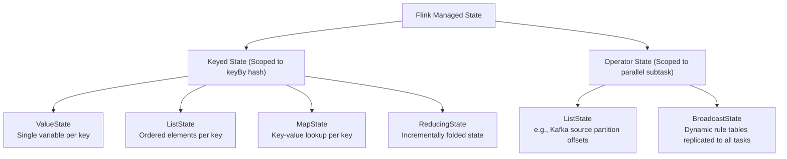
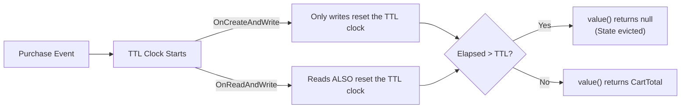
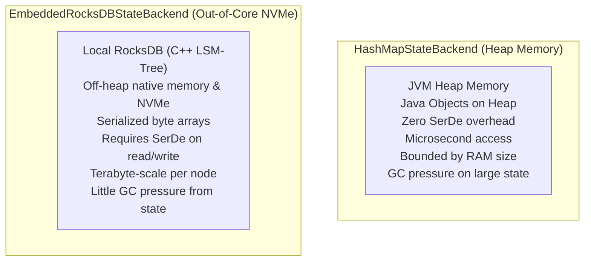
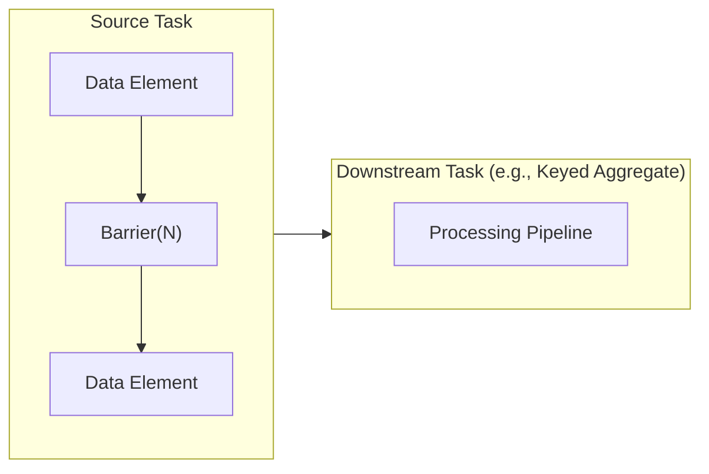
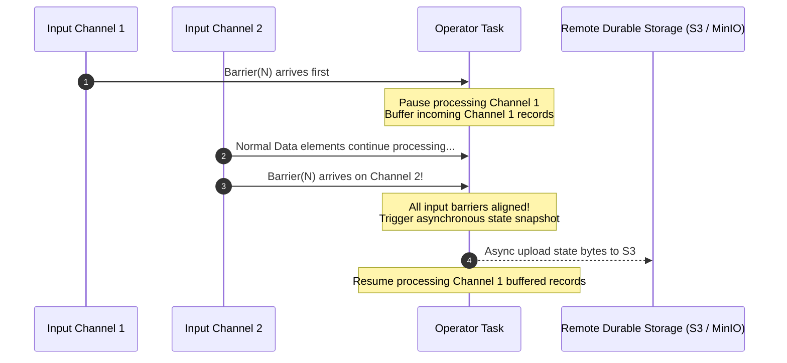
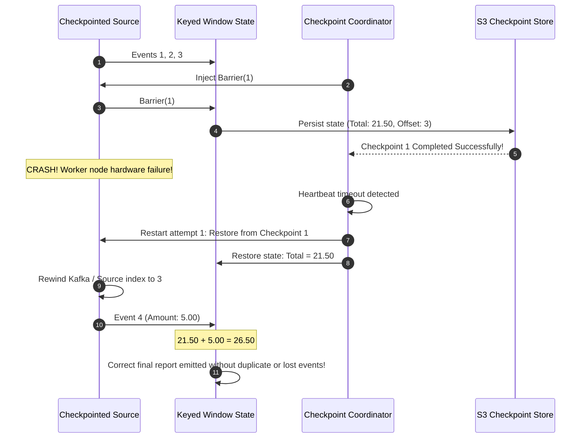

## Before you start

Suppose a job must reject a payment if the user has already spent over a daily limit. The job needs to remember each user's total. You could look it up in Redis for every event, but at hundreds of thousands of events per second the round trips dominate, and a crash between updating Redis and acknowledging the message can count a payment twice. Flink instead keeps the total in memory or on local disk right next to the code, and periodically saves a consistent copy of all state to durable storage. After a crash it restores that copy and replays the input from the matching position.

This chapter covers the kinds of state, how to stop state growing forever, the two ways to store it, and the snapshot algorithm that makes the copies consistent without stopping the job.

Read [chapter 02 on time and watermarks](/tech/series/flink/02.time-and-watermarks/) first; windows are themselves kept as state.

Terms used in this chapter:

- **keyed state**: state scoped to one key, such as one user's total, available after a `keyBy`.
- **operator state**: state scoped to a parallel instance of an operator, such as the offsets a source has read.
- **state TTL**: a time-to-live after which old state entries are dropped.
- **state backend**: the component that stores state, either as Java objects on the heap or in embedded RocksDB on local disk.
- **checkpoint**: a consistent snapshot of all operator state plus input positions, saved for recovery.
- **checkpoint barrier**: a marker injected into the stream that separates events before a snapshot from events after it.
- **Asynchronous Barrier Snapshotting (ABS)**: Flink's algorithm that snapshots state as barriers pass through, without halting processing.

## Why External Databases Fail in High-Throughput Streaming

When building real-time applications, engineers often start with a familiar instinct: whenever an event requires state (such as checking whether a user exceeded their daily spending limit), query an external cache like Redis or a database like PostgreSQL:

```text
[Incoming Event] ──> [Worker Thread] ──(RPC: 2ms)──> [Redis / PostgreSQL]
```

At 1,000 events per second, this architecture works. At 100,000 events per second across a 32-node cluster, it collapses:

1. **Network Latency & Thread Starvation**: 100,000 network roundtrips per second introduce massive connection pool contention, thread context-switching overhead, and tail-latency spikes.
2. **Double-Applied Updates**: If a worker node crashes immediately after updating Redis but before acknowledging the incoming Kafka message, the Kafka partition rewinds and replays the message. Redis state is now incremented twice—corrupting the balance.

Apache Flink solves this by making **state local and co-located** with the operator, backed by **Asynchronous Barrier Snapshotting (ABS)** to ensure mathematical consistency.

---

## Flink's State Taxonomy

Flink categorizes state along two orthogonal dimensions:



### 1. Keyed State

Keyed state is only available after a `keyBy()` call. Flink automatically partitions the state across the key space:

- `ValueState<T>`: Stores a single value per key (e.g., current account balance).
- `ListState<T>`: Stores an append-only list of items per key (e.g., historical user interactions within a session).
- `MapState<UK, UV>`: Stores key-value entries per key (e.g., product counts inside an active shopping cart).
- `ReducingState<T>` & `AggregatingState<IN, OUT>`: Stores an incrementally aggregated value, combining new records immediately upon arrival without buffering raw inputs.

### 2. Operator State

Operator state belongs to a specific parallel subtask rather than a domain key:

- **Source Offsets**: A Kafka consumer subtask reading partitions 0 and 2 keeps a `ListState<Long>` recording the current consumed offset for each partition.
- **Broadcast State**: Used in dynamic rule engines (e.g., real-time fraud rules). When a compliance officer updates a fraud rule, the rule is broadcast to **every** parallel task in the cluster, ensuring all workers share the exact same configuration table.

---

## State TTL: Preventing Unbounded Memory Growth

In unbounded streaming, if you store state for every user who ever visited your website, your cluster will eventually run out of memory. Real applications require automatic state expiration.

In [`flos/modules/flink/state-ttl-lab`](https://github.com/azusachino/flos/tree/main/modules/flink/state-ttl-lab), we configure state expiration via `StateTtlConfig`:



```java
var ttlConfig = StateTtlConfig.newBuilder(Duration.ofMinutes(30))
        .setUpdateType(StateTtlConfig.UpdateType.OnCreateAndWrite)
        .setStateVisibility(StateTtlConfig.StateVisibility.NeverReturnExpired)
        .cleanupInRocksdbCompactFilter(1000)
        .build();

var stateDescriptor = new ValueStateDescriptor<>("cart-state", CartTotal.class);
stateDescriptor.enableTimeToLive(ttlConfig);
```

### Key Behavioral Nuances

1. **Lazy Expiration on Access**: Calling `cartState.value()` is not a passive memory read. Flink checks the timestamp of the state entry against `System.currentTimeMillis()`. If the entry has expired, it returns `null` on the spot.
2. **`NeverReturnExpired` vs `ReturnExpiredIfNotCleanedUp`**: `NeverReturnExpired` guarantees that the application never sees stale data, even if physical garbage collection has not yet removed the bytes from disk.
3. **Background Cleanup**: For heap memory, expired entries are removed when they are read, when a full snapshot is taken, or incrementally if you enable `cleanupIncrementally`. For RocksDB, Flink hooks into RocksDB's native C++ background compaction filters (`cleanupInRocksdbCompactFilter`), deleting expired keys without incurring JVM overhead.

---

## State Backends: HashMap vs EmbeddedRocksDB

Where do the state bytes physically live during operator execution? Flink offers two primary engines:



| Dimension | `HashMapStateBackend` | `EmbeddedRocksDBStateBackend` |
| :--- | :--- | :--- |
| **Storage Medium** | JVM Heap Memory (RAM) | Out-of-Core Local NVMe SSD & Off-Heap RAM |
| **Data Format** | Raw Java Objects (No serialization on access) | Serialized Byte Arrays (`byte[]`) |
| **Read / Write Latency** | **Sub-microsecond** ($\approx 100 \text{ ns}$) | **Sub-millisecond** ($\approx 0.1 - 1.0 \text{ ms}$) |
| **State Size Limit** | Bounded by TaskManager JVM Heap ($\le 32 \text{ GB}$) | Bounded only by local NVMe disk space ($\ge 10 \text{ TB}$) |
| **GC Impact** | High GC overhead during major collections | **Low GC pressure from state** (held in native C++ memory, though serialization still allocates on the heap) |
| **Incremental Checkpoints**| Not supported natively (Full snapshots) | **Native Incremental Checkpoints** (SST file hardlinks) |

> **Production Recommendation**:
>
> - Use **`HashMapStateBackend`** for low-latency pipelines with small state windows (e.g., 1-minute tumbling aggregates, simple anomaly detectors).
> - Use **`EmbeddedRocksDBStateBackend`** for large state workloads (e.g., 30-day user profiles, heavy joins, multi-gigabyte session windows).

---

## Asynchronous Barrier Snapshotting (ABS)

How does Flink capture a globally consistent snapshot of distributed state across dozens of nodes without stopping the execution of incoming streams?

Flink implements the **Asynchronous Barrier Snapshotting (ABS)** algorithm, an evolution of the classic **Chandy-Lamport** distributed snapshot protocol.

### 1. Barrier Injection

The JobManager's central `CheckpointCoordinator` periodically triggers a checkpoint by injecting a `CheckpointBarrier(ID = N)` into the output queues of all Source operators:



Barriers flow in-band alongside normal records. They strictly separate the stream into two logical epochs:

- Records preceding `Barrier(N)` belong to snapshot $N$.
- Records following `Barrier(N)` belong to snapshot $N+1$.

### 2. Barrier Alignment (Exactly-Once)

When an operator receives data from multiple parallel input channels, barriers will arrive at slightly different times due to channel skew:



1. **Alignment**: When `Barrier(N)` arrives on Channel 1, the task pauses consumption of Channel 1 and buffers any new records arriving on it.
2. Channel 2 continues processing normal records until `Barrier(N)` arrives on Channel 2 as well.
3. Once **all** input channels deliver `Barrier(N)`, the operator takes a synchronous memory handle of its local state and immediately forwards `Barrier(N)` downstream.
4. **Asynchronous Snapshot**: A background thread writes the state snapshot to remote storage (e.g., S3 or MinIO). The operator thread resumes processing the buffered records **immediately** without waiting for the upload to complete.

---

## Failure Recovery in Action

What happens when an operator crashes? Let us inspect the lifecycle implemented in [`flos/modules/flink/checkpoint-recovery-lab`](https://github.com/azusachino/flos/tree/main/modules/flink/checkpoint-recovery-lab):



1. During normal execution, Checkpoint 1 successfully persists both the source offset (`index = 3`) and the window state (`total = 21.50`).
2. An artificial hardware fault terminates the source process.
3. The cluster restarts the failed task, fetches metadata for Checkpoint 1 from durable storage, rehydrates the window accumulator with `21.50`, and rewinds the source stream to offset `3`.
4. Event 4 is consumed, completing the window with the exact correct balance (`26.50`).

You can execute this exact recovery demonstration in [`flos`](https://github.com/azusachino/flos):

```sh
mvn test -pl modules/flink/checkpoint-recovery-lab
```

The integration test in `CheckpointRecoveryLabTest.java` spins up a local Flink MiniCluster, injects a failure on attempt 0, and asserts that attempt 1 resumes and produces the mathematically exact fee report.

---

## Summary & Next Step

Managed state gives streaming operators long-term memory, while Asynchronous Barrier Snapshotting provides consistent recovery without a global stop-the-world pause.

However, in a physical cluster with limited CPU cores and RAM, how does Flink assign dozens of parallel operator tasks to physical worker machines? What prevents a single heavy operator from starving the rest of the cluster?

In **Chapter 04: Execution Graph, Slots & Parallelism**, we will dismantle the Flink runtime scheduler, discover how **Slot Sharing Groups** co-locate pipeline subtasks to maximize hardware efficiency, and explore operator chaining.
