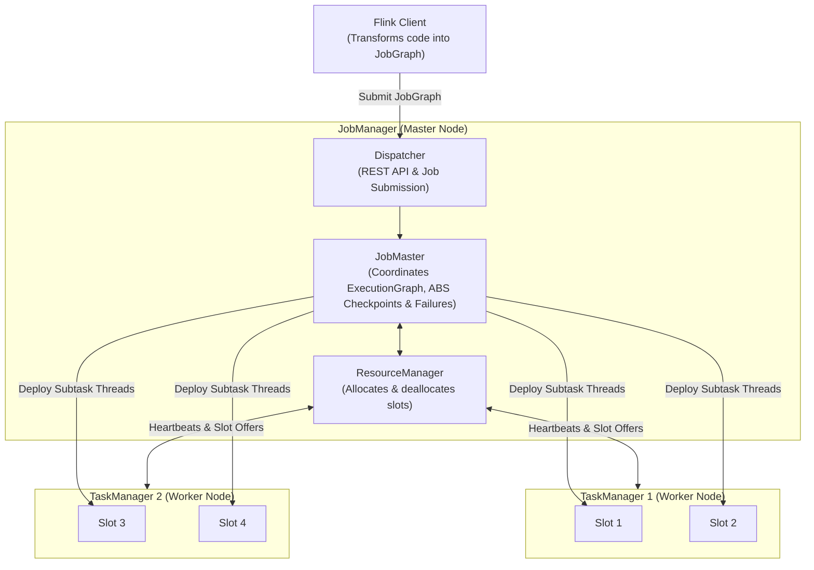
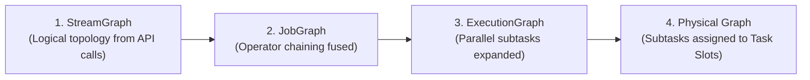
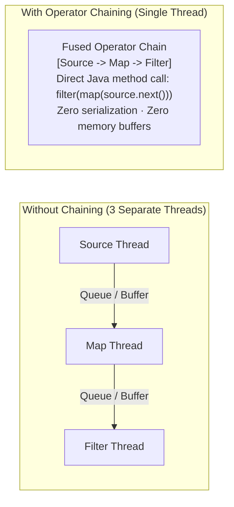
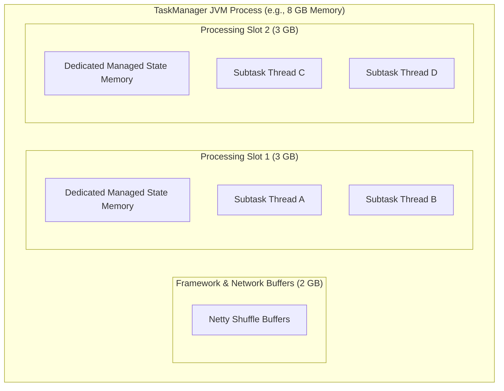
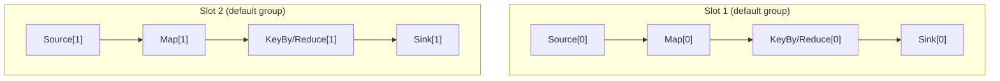

## Before you start

You write a Flink job as a short chain of operations. To run it on a cluster, Flink has to decide how many copies of each operation to run, which machines they go on, and which operations can be fused into one thread so data does not travel between them. Think of an assembly line: you choose how many workers stand at each station, and two neighbouring stations can be merged into one worker when the hand-off is trivial.

This chapter follows a job from your code to running tasks. It covers the cluster roles, the graphs Flink builds on the way, operator chaining, what a task slot is, how slot sharing packs a whole pipeline into one slot, and the three places you set parallelism.

Chapter 03's [state and checkpoints](/tech/series/flink/03.state-and-checkpointing/) are not needed in detail, but chapter 01's [operator and DAG vocabulary](/tech/series/flink/01.stream-fundamentals/) is.

Terms used in this chapter:

- **JobManager**: the coordinating process that schedules the job and drives checkpoints.
- **TaskManager**: a worker process that runs tasks.
- **task slot**: a fixed share of a TaskManager's resources that can run one parallel pipeline.
- **parallelism**: how many parallel instances of an operator run at once.
- **subtask**: one parallel instance of an operator.
- **operator chaining**: fusing adjacent operators into one task so records pass by method call instead of over a network or queue.
- **JobGraph**: the graph submitted to the cluster, after chaining has fused operators.
- **slot sharing group**: a set of operators allowed to share slots; by default all operators of a job share one group.

## The Distributed Runtime Hierarchy

To run a streaming dataflow at scale, Apache Flink decomposes the application into a distributed master-worker cluster architecture:



1. **Client**: Compiles user code, validates syntax, generates the `JobGraph`, and submits it to the JobManager via REST.
2. **JobManager (Master)**:
   - **Dispatcher**: Exposes the REST interface and provides the Flink Web UI.
   - **ResourceManager**: Tracks cluster slot availability and interfaces with the underlying resource manager (Kubernetes, YARN, or standalone).
   - **JobMaster**: Governs the live execution of a single `JobGraph`. It schedules subtasks, triggers periodic checkpoints, coordinates barrier alignment, and supervises fault recovery.
3. **TaskManager (Worker)**: Long-running JVM processes that execute the actual tasks. Each TaskManager provides one or more **Processing Slots**.

---

## The Four Graph Transformations

When you call `environment.execute("my-job")`, Flink does not immediately launch threads. The program transforms through four distinct graph representations:



1. **`StreamGraph`**: The initial client-side DAG reflecting exact DataStream transformations (`fromData -> filter -> map -> keyBy -> reduce -> sink`).
2. **`JobGraph`**: Flink fuses eligible adjacent operators into **Operator Chains**, drastically reducing inter-operator communication boundaries. This graph is serialized and shipped over the network to the JobManager.
3. **`ExecutionGraph`**: The JobMaster expands every operator into its parallel subtask instances according to configured parallelism ($P = 4 \implies \text{Task}_0, \text{Task}_1, \text{Task}_2, \text{Task}_3$).
4. **Physical Graph**: The JobMaster negotiates with the ResourceManager to deploy concrete threads into physical TaskManager slots.

---

## Operator Chaining: Microsecond In-Memory Execution

In distributed computing, passing a record from one operator to another traditionally incurs significant penalties:

- Serializing the object into a byte buffer.
- Enqueuing it into a network ring buffer.
- Processing TCP loopback or socket writes.
- Deserializing the object in the next operator thread.

Flink eliminates this overhead through **Operator Chaining**:



### Chaining Rules

Flink automatically chains two adjacent operators if and only if:

1. They share the exact same **parallelism**.
2. They are connected via a **Forward partitioner** (no reshuffling, rebalancing, or `keyBy`).
3. They belong to the same **Slot Sharing Group**.
4. Chaining is not explicitly forbidden by code (`.disableChaining()` or `.startNewChain()`).

Inside a chained operator, data handoff occurs via **direct Java method invocation** (`target.processElement(source.produce())`). A CPU core never context-switches, and memory never copies.

---

## What is a Task Slot?

A TaskManager is a single JVM process. To manage concurrency, Flink divides a TaskManager's resources into **Processing Slots**:



> **Crucial Insight**: A slot is **not** an operating system thread, and it is **not** a dedicated CPU core.  
> A slot is **a slice of managed memory** allocated to prevent TaskManagers from starving each other's off-heap state buffers.

Multiple threads execute concurrently inside a single slot, sharing the slot's managed memory quota.

---

## Slot Sharing Groups: The Mathematics of Colocation

In a naive scheduler, each parallel subtask of each operator occupies its own slot:
$$\text{Slots Required} = \sum_{\text{op}} \text{Parallelism}(\text{op})$$

If you have a pipeline with 6 operators (Source, Filter, Map, Window, Aggregate, Sink), each running at parallelism 10, a naive scheduler demands $6 \times 10 = 60$ slots.

Furthermore, streaming pipelines experience uneven resource consumption:

- The Source is usually I/O bound.
- The Map and Filter are lightweight CPU operations.
- The Window Aggregate is memory and CPU intensive.

If operators ran in isolated slots, the Window slots would run at 100% CPU while the Source slots sat 95% idle.

Flink resolves this via **Slot Sharing Groups**:



### The Slot Sharing Invariant

> **The Slot Sharing Rule**: Subtasks of **different** operators belonging to the same Slot Sharing Group can share the same slot, provided that no two subtasks of the **same** operator share a slot.

Consequently, when all operators belong to the `default` group:

$$\text{Total Slots Required} = \max_{\text{op}} \text{Parallelism}(\text{op})$$

Our 6-operator pipeline with parallelism 10 requires **only 10 slots**, not 60! Every slot holds an entire slice of the pipeline from source to sink. When the source is idle waiting for network packets, the aggregate operator in the same slot consumes the CPU cycles.

---

## Isolating Workloads: Custom Slot Sharing Groups

What if an operator performs heavy ML inference (e.g., calling an ONNX model or heavy cryptographic hashing) and you want to prevent it from degrading other operators?

You can assign it to an isolated Slot Sharing Group (operators downstream of it inherit the group unless they set their own):

```java
DataStream<Result> predictions = inputStream
        .map(new HeavyModelPredictor())
        .name("heavy-inference")
        .slotSharingGroup("isolated-ml-workers");
```

Now, calculate the new slot requirement:

$$\text{Total Slots} = \max_{\text{op} \in \text{default}} P(\text{op}) + \max_{\text{op} \in \text{isolated}} P(\text{op})$$

In [`flos/modules/flink/slot-sharing-lab`](https://github.com/azusachino/flos/tree/main/modules/flink/slot-sharing-lab), we prove this exact mechanic:

```java
// Default configuration: 1 slot sharing group
// Total slots needed = max(2, 2, 2) = 2 slots.
source.setParallelism(2);
map.setParallelism(2);
sink.setParallelism(2);

// Isolated configuration:
sink.slotSharingGroup("isolated-sink");
// Total slots needed = 2 (default) + 2 (isolated) = 4 slots!
```

If your local cluster provides only 2 slots, the default pipeline deploys successfully, while the isolated configuration throws a `NoResourceAvailableException`!

You can run the deterministic test proving this slot contention in [`flos`](https://github.com/azusachino/flos):

```sh
mvn test -pl modules/flink/slot-sharing-lab
```

The test in `SlotSharingLabTest.java` verifies that:

1. When all operators share `default`, a 2-slot cluster runs the job cleanly.
2. When the sink is isolated, the job fails to schedule until additional TaskManager slots are provisioned.

---

## The Three Parallelism Knobs

When tuning Flink performance, engineers encounter three distinct parallelism settings:

```java
// 1. Job-wide default: inherited by every operator unless overridden
environment.setParallelism(8);

// 2. Operator override: specific operator gets custom throughput
source.setParallelism(2);

// 3. Max Parallelism: defines the total number of Key Groups (fixed permanently)
environment.setMaxParallelism(128);
```

- **Runtime Parallelism ($P$)**: Negotiable on every deployment or rescale. You can stop a job with a savepoint at $P=4$ and restore it at $P=16$.
- **Max Parallelism ($P_{\max}$)**: Determines the number of **Key Groups** into which keyed state is sliced. It is **baked permanently into the savepoint format**. If you change $P_{\max}$ after launching in production, previous savepoints become incompatible and cannot be restored.

---

## Summary & Next Step

Slot Sharing Groups and Operator Chaining turn what could be a resource-starved, high-latency distributed graph into a tightly packed, hardware-efficient execution engine.

However, distributed systems inevitably encounter failures: worker JVMs crash, network switches drop packets, and external databases temporarily reject connections. How does Flink decide when to retry a failed subtask, and when does it declare defeat?

In **Chapter 05: Fault Tolerance & Restart Strategies**, we will examine TaskManager heartbeat failure detection, explore exponential backoff retry algorithms, and configure High Availability (HA) with Kubernetes or ZooKeeper.
