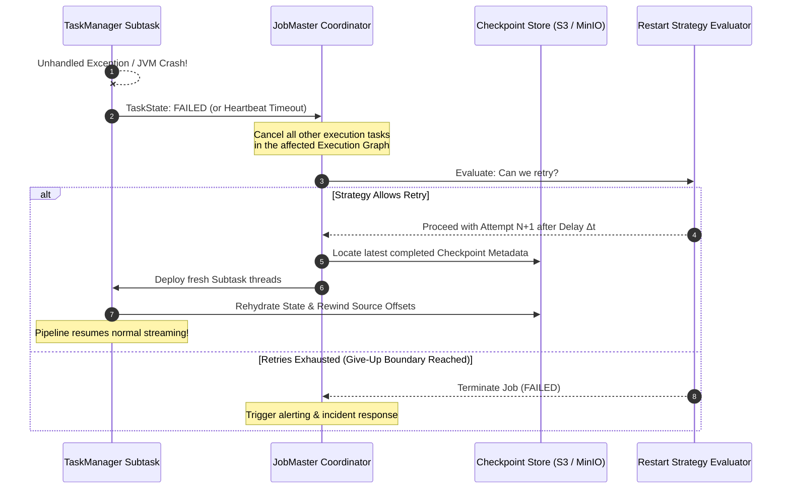
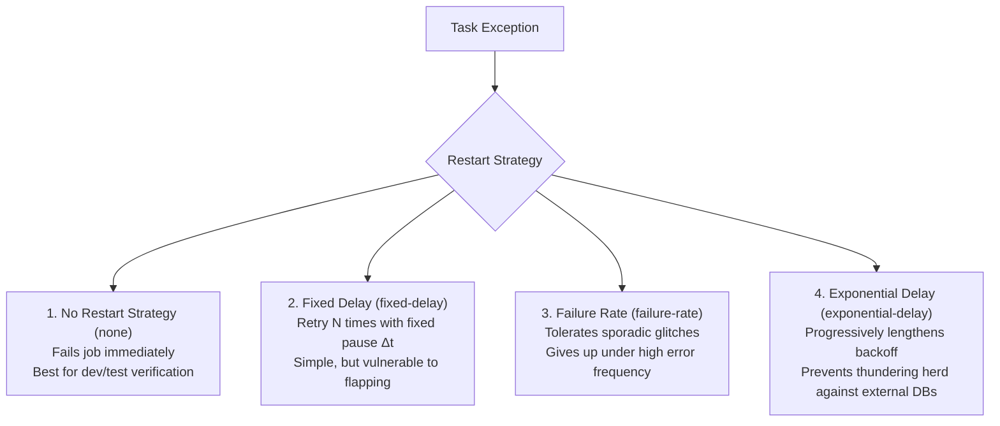
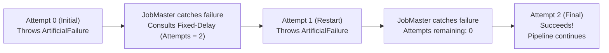
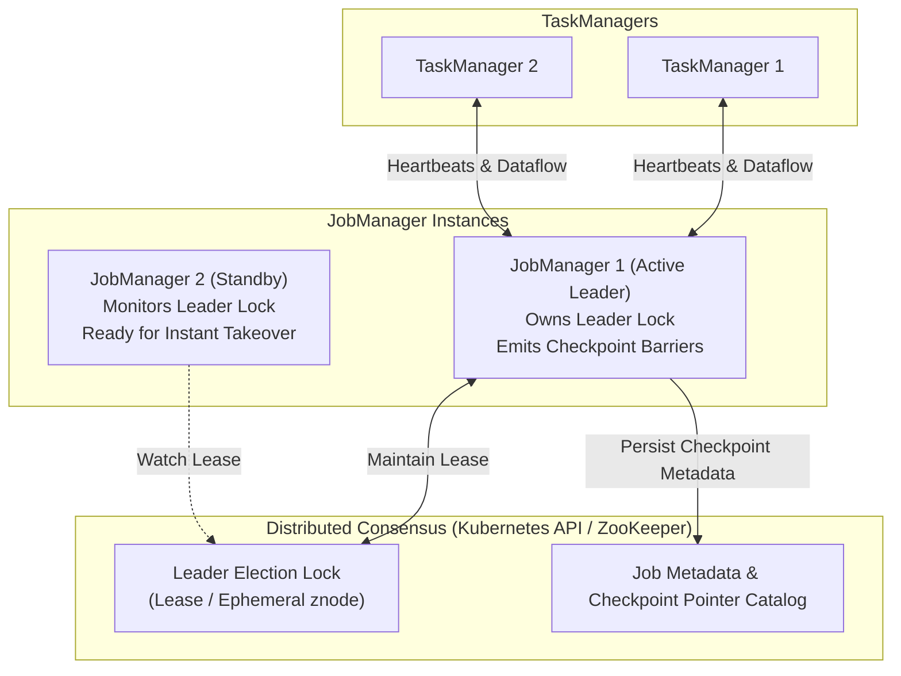

## Before you start

A batch job that dies can be run again. A streaming job is meant to run for months, so something will go wrong along the way: a machine disappears, a garbage-collection pause makes a healthy worker look dead, a database it writes to hits its connection limit. Flink has to notice the failure, restore state from the last checkpoint, and try again, but not forever. If the cause is permanent, retrying in a tight loop only hammers the broken dependency, so a restart strategy decides when to give up and mark the job failed.

The chapter walks through failure detection, the four restart strategies and where each stops retrying, and how to keep the JobManager itself from being a single point of failure.

[Chapter 03](/tech/series/flink/03.state-and-checkpointing/) explains the checkpoints that recovery depends on, so read it first.

Terms used in this chapter:

- **heartbeat**: a periodic "I'm alive" message; missing several in a row marks a node as lost.
- **restart strategy**: the rule that sets how many times, and with what delay, a failed job is retried.
- **fixed-delay**: a restart strategy that waits the same time between a limited number of attempts.
- **failure-rate**: a strategy that allows restarts as long as failures stay under a rate within a time window.
- **exponential backoff**: a strategy that doubles the wait after each failure up to a cap.
- **high availability (HA)**: running a standby JobManager so a failed one can be replaced without losing the job.
- **leader election**: the process by which standbys use a lock, such as a Kubernetes Lease or a ZooKeeper node, to pick one active JobManager.

## The Reality of Failure in Streaming Systems

In batch processing, if a 4-hour job crashes at minute 3:55 due to a spot instance termination, you re-run the entire script.

In stream processing, jobs are designed to run continuously for months or years. Over that lifecycle, failure is not an anomaly; failure is a statistical certainty:

- Network switches temporarily drop packets between racks.
- JVM workers experience prolonged Garbage Collection (GC) pauses that trigger false-positive heartbeat timeouts.
- Upstream Kafka brokers rebalance.
- Downstream databases suffer connection pool exhaustion under sudden traffic spikes.

A robust streaming engine requires two distinct recovery layers:

1. **Task-Level Fault Tolerance**: How individual failed operator subtasks are retried and recovered from checkpoints.
2. **Cluster-Level High Availability (HA)**: How the master coordinator (`JobManager`) recovers when its physical host dies.

---

## Anatomy of a Failure: Detection to Recovery

When an uncaught exception occurs inside an operator thread or a TaskManager JVM terminates abruptly, Flink initiates a multi-stage recovery protocol:



1. **Failure Notification**: The JobMaster receives a `TaskStateChanged` RPC with state `FAILED`, or the ResourceManager's periodic heartbeat ($T_{\text{heartbeat}} = 10 \text{s}$) detects a silent TaskManager timeout.
2. **Subtask Cancellation**: To preserve global consistency, the JobMaster cancels all interconnected subtasks in the dataflow.
3. **Restart Strategy Evaluation**: The JobMaster consults the configured **Restart Strategy**. If retries are allowed, it waits for the configured backoff duration.
4. **State Rehydration**: The JobMaster queries durable storage (`high-availability.storageDir` or `execution.checkpointing.dir`), locates the metadata for the latest successful checkpoint, deploys new subtask threads across available slots, restores their local state, and resumes processing.

---

## The Four Restart Strategies & The Give-Up Boundary

A common misconception among junior engineers is that a resilient job should retry forever.

> **The Infinite Retry Pitfall**: If an operator throws a `NullPointerException` due to a malformed JSON payload, retrying infinitely every 1 second will never fix the bug. It will simply burn CPU, saturate log aggregators, and mask the outage from on-call alerting systems.

Every production job must define an explicit **Give-Up Boundary**:



### 1. No Restart Strategy (`none`)

```java
var config = new Configuration();
config.set(RestartStrategyOptions.RESTART_STRATEGY, "none");
```

The job terminates immediately upon the first failure. This is ideal during local development and integration unit testing to expose regressions instantly.

### 2. Fixed-Delay Strategy (`fixed-delay`)

```java
var config = new Configuration();
config.set(RestartStrategyOptions.RESTART_STRATEGY, "fixed-delay");
config.set(RestartStrategyOptions.RESTART_STRATEGY_FIXED_DELAY_ATTEMPTS, 3);
config.set(RestartStrategyOptions.RESTART_STRATEGY_FIXED_DELAY_DELAY, Duration.ofSeconds(10));
```

Flink attempts up to $N$ restarts, pausing for a static duration between each attempt. If the $(N+1)$-th failure occurs, the job gives up.

*Vulnerability*: If a job encounters one transient network glitch every 8 hours, it will exhaust its 3 attempts within a day and a third and permanently shut down on the fourth failure, even though each failure was hours apart and the job recovered cleanly every time!

### 3. Failure-Rate Strategy (`failure-rate`)

To support long-running streaming applications, Flink introduces the **Failure-Rate** strategy:

```java
var config = new Configuration();
config.set(RestartStrategyOptions.RESTART_STRATEGY, "failure-rate");
config.set(RestartStrategyOptions.RESTART_STRATEGY_FAILURE_RATE_MAX_FAILURES_PER_INTERVAL, 3);
config.set(RestartStrategyOptions.RESTART_STRATEGY_FAILURE_RATE_FAILURE_RATE_INTERVAL, Duration.ofMinutes(10));
config.set(RestartStrategyOptions.RESTART_STRATEGY_FAILURE_RATE_DELAY, Duration.ofSeconds(5));
```

The job is permitted to retry indefinitely as long as failures occur sporadically. However, if the cluster experiences **more than 3 failures within a rolling 10-minute window**, Flink recognizes a chronic, unrecoverable incident and declares the job `FAILED`.

### 4. Exponential-Backoff Strategy

When downstream sinks (like ClickHouse or PostgreSQL) experience high load, restarting a streaming job immediately with full parallel throughput creates a **thundering herd** that knocks the database down again.

The `exponential-delay` strategy multiplies the delay after each failure by a backoff multiplier (default 1.2, configurable) up to a maximum, optionally with jitter, and resets the delay once the job has run stably for a threshold period:
$$\Delta t_k = \min(\Delta t_{\text{initial}} \cdot m^{k-1}, \Delta t_{\max})$$

---

## Proving the Give-Up Boundary in Companion Code

In [`flos/modules/flink/restart-strategy-lab`](https://github.com/azusachino/flos/tree/main/modules/flink/restart-strategy-lab), we prove this boundary with `FlakySource`, a test source that interrogates Flink's runtime context:

```java
int attempt = getRuntimeContext().getTaskInfo().getAttemptNumber();
if (succeedOnAttempt < 0 || attempt < succeedOnAttempt) {
    throw new ArtificialFailureException("attempt " + attempt + " fails on purpose");
}
```



You can execute the deterministic test suite verifying both recovery and give-up boundaries in [`flos`](https://github.com/azusachino/flos):

```sh
mvn test -pl modules/flink/restart-strategy-lab
```

The tests in `RestartStrategyLabTest.java` prove that:

1. When configured with `fixed-delay(attempts = 2)`, a task failing twice successfully recovers on attempt 2.
2. A task failing 3 times crosses the give-up boundary and throws `JobExecutionException`.
3. When configured with `failure-rate`, burst failures trigger termination while spaced failures recover seamlessly.

---

## Cluster-Level High Availability (HA)

Task-level restart strategies assume that the master `JobManager` remains alive. But what happens if the physical server hosting the JobManager experiences kernel panic or hardware failure?

Without High Availability, all TaskManagers lose their coordinator, in-flight checkpoints stall, and the entire cluster dies.

### The JobManager HA Architecture

To remove the JobManager as a single point of failure, Flink clusters run in an **Active-Standby** topology coordinated by a consensus engine (Kubernetes ConfigMaps or Apache ZooKeeper):



1. **Leader Election**: All JobManager instances race to acquire a distributed lock (a Kubernetes Lease resource or a ZooKeeper ephemeral znode). The winner becomes the Active Leader; other instances become passive standbys.
2. **Durable Metadata Persistence**: Whenever a checkpoint completes, the active JobManager writes the checkpoint ID and storage pointer into the HA metadata store (`high-availability.storageDir`).
3. **Failover Takeover**: If JobManager 1 crashes, its lease expires. JobManager 2 detects the expired lock, acquires leadership, reads the last checkpoint metadata from storage, and recovers the job from the last completed checkpoint instead of re-reading the original stream from scratch.

---

## Summary & Next Step

By combining intelligent restart strategies with active-standby JobManager high availability, Flink applications withstand hardware reboots, network glitches, and external outages.

However, a stream processor does not live in isolation. It ingests data from messaging brokers and writes outputs to transactional databases. If a crash occurs between the internal checkpoint and the external database write, how do you prevent duplicated rows?

In **Chapter 06: End-to-End Exactly-Once & Connectors**, we will uncover the **Two-Phase Commit (2PC)** sink protocol and build an end-to-end streaming pipeline from Kafka to ClickHouse.
