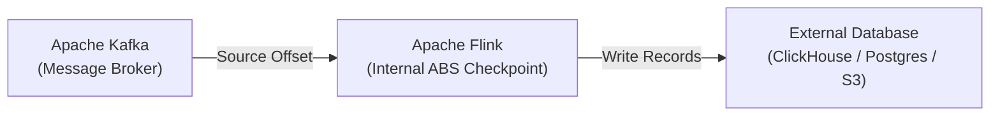
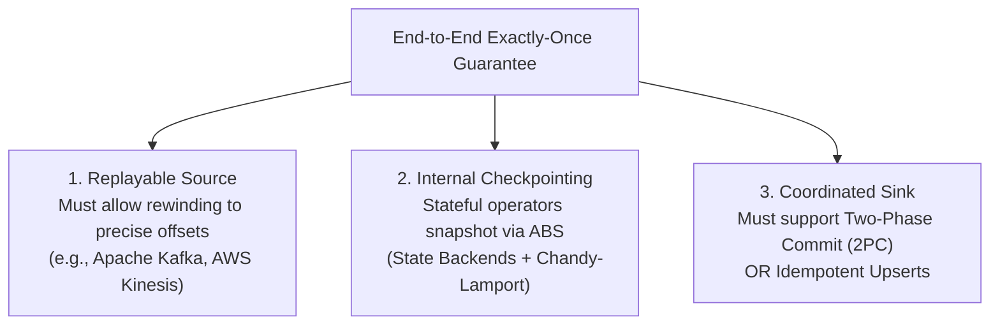
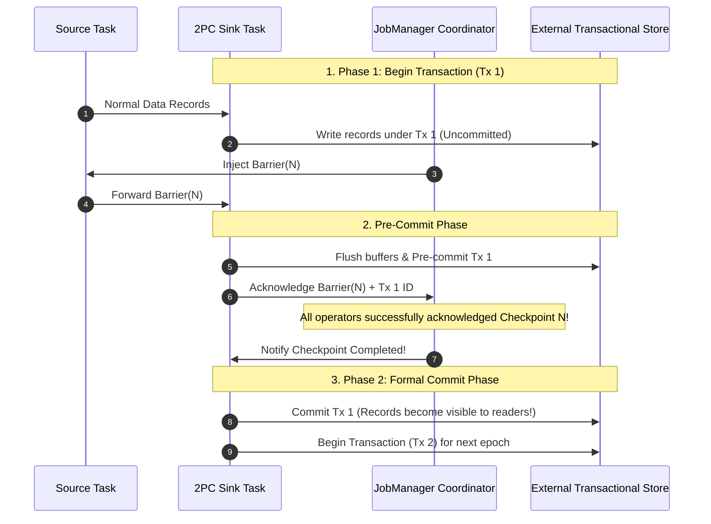
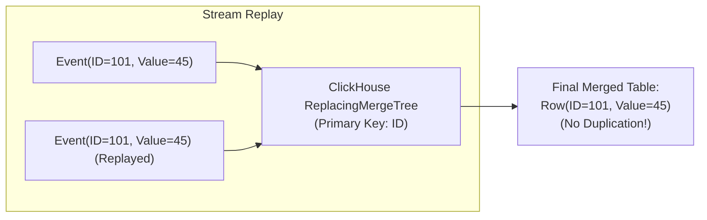

## The Boundary of Internal Checkpoints

In Chapter 03, we explored how Flink's Asynchronous Barrier Snapshotting (ABS) guarantees internal consistency: if an operator fails, it reloads its state from the latest checkpoint, rewinds the source offset, and resumes.

However, an enterprise streaming application does not operate in a vacuum. It reads from message brokers and writes to external databases, search engines, and data lakes:



Consider what happens if an operator writes 100 rows directly into an external database, but the physical host crashes **before** the matching Flink checkpoint completes:

1. The JobMaster detects the crash and restores the previous checkpoint.
2. The Source rewinds to the last checkpointed offset.
3. The Source replays the 100 records through the pipeline.
4. The Sink operator writes those 100 records into the database **a second time**.

The database now contains **duplicate rows**. Internal exactly-once processing does not automatically mean **end-to-end exactly-once processing**.

To achieve true end-to-end exactly-once semantics, the external systems at both ends must participate in Flink's checkpointing protocol.

---

## The Prerequisites of End-to-End Exactly-Once

Achieving end-to-end consistency requires three interlocking guarantees across the entire data journey:



1. **Replayable Source**: The source must expose deterministic offset addressing (like Kafka partition offsets or AWS Kinesis sequence numbers). Standard HTTP webhooks or ephemeral UDP sockets cannot support exactly-once because discarded packets cannot be replayed.
2. **Internal Checkpointing**: Flink must have checkpointing enabled (`env.enableCheckpointing(...)`).
3. **Coordinated Sink**: The sink must either support **Two-Phase Commit (2PC)** or **Idempotent Writes**.

---

## The Two-Phase Commit (2PC) Sink Protocol

For transactional sinks (such as Kafka transactions or ACID relational databases), Flink implements the `TwoPhaseCommitSinkFunction`:



### The 4 Lifecycle Hooks

1. **`beginTransaction()`**: Initiates a new pending transaction on the target database (or opens a temporary file on S3).
2. **`invoke()`**: Writes incoming streaming elements into the current transaction. Downstream readers querying the database with `READ_COMMITTED` isolation cannot see these records yet.
3. **`preCommit()`**: Triggered when `CheckpointBarrier(N)` reaches the sink. The sink flushes its network buffers, finishes writing to the transaction, marks the transaction as *pre-committed*, and persists the transaction ID into Flink's checkpoint state.
4. **`commit()`**: When the JobMaster receives successful checkpoint acknowledgments from **all** operators in the graph, it broadcasts a `notifyCheckpointComplete(N)` message. The sink calls `commit()` on the external store, instantly making the batch of rows visible to external consumers.

If a failure occurs anywhere during steps 1 through 3, Flink aborts the pre-committed transaction (`abort()`) and rolls back the external database without leaving orphan records.

---

## The Alternative: Idempotent Upserts

While 2PC provides mathematical elegance, not all high-throughput storage engines support distributed transactions. Analytical OLAP engines like **ClickHouse** are optimized for massive append-only batch inserts rather than ACID multi-phase transactions.

In such architectures, we achieve effectively exactly-once through **Idempotency**:

$$\text{Operation } f \text{ is idempotent if } f(f(x)) = f(x)$$



- When using ClickHouse's `ReplacingMergeTree`, inserting the same row with identical primary keys (`customer_id`, `event_id`) multiple times during a Flink restart does not alter the deduplicated analytical state.
- Upserting to Redis or Elasticsearch using deterministic document IDs (`SET key value` or `PUT /index/_doc/id`) ensures that replaying a stream produces identical output without phantom duplicates.

---

## Streaming to ClickHouse in Practice

Let us examine the ClickHouse streaming pipeline implemented in [`vendor/flos/modules/flink/clickhouse-sink-lab`](file:///home/haru/Projects/project-github/harus-workstation/vendor/flos/modules/flink/clickhouse-sink-lab):

```java
var clickHouseSink = ClickHouseSink.<PurchaseEvent>builder()
        .setUrl("http://localhost:18123")
        .setDatabase("learning")
        .setTable("sink_events")
        .setBatchSize(5000)
        .setFlushInterval(Duration.ofSeconds(2))
        .setMaxRetries(3)
        .build();

stream
    .filter(new ValidPurchaseFilter())
    .map(new NormalizePurchase())
    .sinkTo(clickHouseSink)
    .name("clickhouse-olap-sink");
```

### High-Throughput Buffering Strategy

Writing individual records directly to ClickHouse one by one generates thousands of small file parts, resulting in the dreaded `Too many parts in all data parts in table` error.

The Flink ClickHouse connector buffers records in memory and executes bulk inserts when either:

1. The buffer hits the size threshold (e.g., `5,000` rows), or
2. The flush timeout expires (e.g., `2,000 ms`), ensuring predictable real-time latency.

You can run the end-to-end ClickHouse smoke test in [`vendor/flos`](file:///home/haru/Projects/project-github/harus-workstation/vendor/flos):

```sh
cd vendor/flos
make clickhouse-sink-smoke
```

The lab launches a local ClickHouse container, writes 5 typed events, deliberately replays the bounded job, and asserts that the replay behavior is visible and predictable:

```text
clickhouse sink smoke: inserted 5 rows, replay produced 10 append-only rows
```

---

## Summary & Next Step

End-to-end exactly-once turns stream processing into a reliable ledger system. By coordinating replayable sources with Two-Phase Commit sinks or idempotent storage engines, applications survive worker crashes and network partitions without dropping or duplicating a single penny.

Now that our code, event-time semantics, state backends, and connectors are proven, how do we ship this streaming application to production?

In the final chapter, **Chapter 07: Production Operations — Flink on Kubernetes**, we will explore standalone vs cloud-native application modes, deploy declarative `FlinkDeployment` CRDs via the **Flink Kubernetes Operator**, and perform zero-downtime rolling upgrades using Savepoints.
