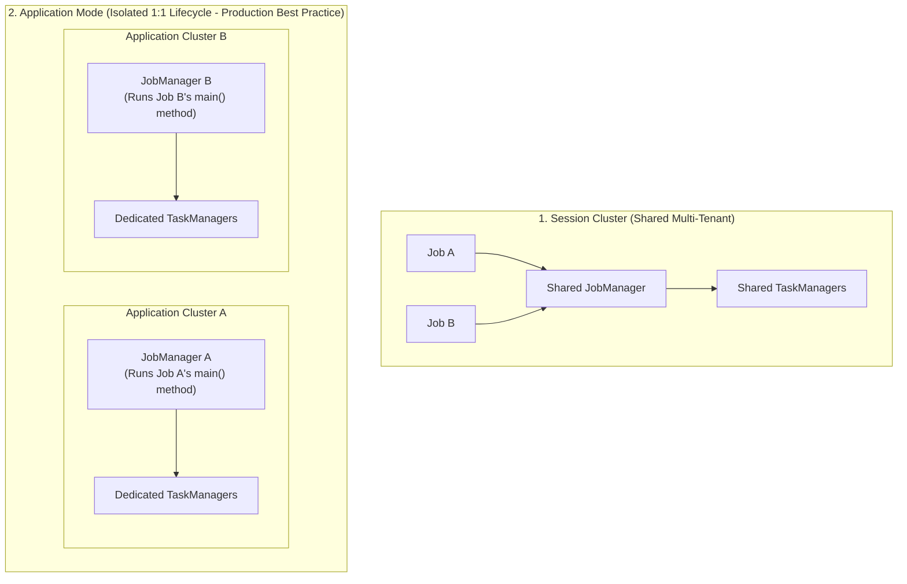
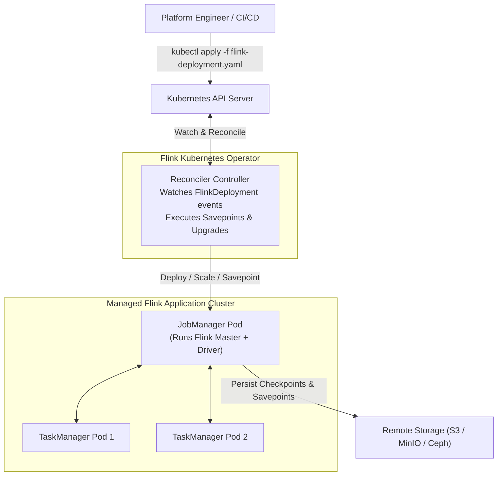
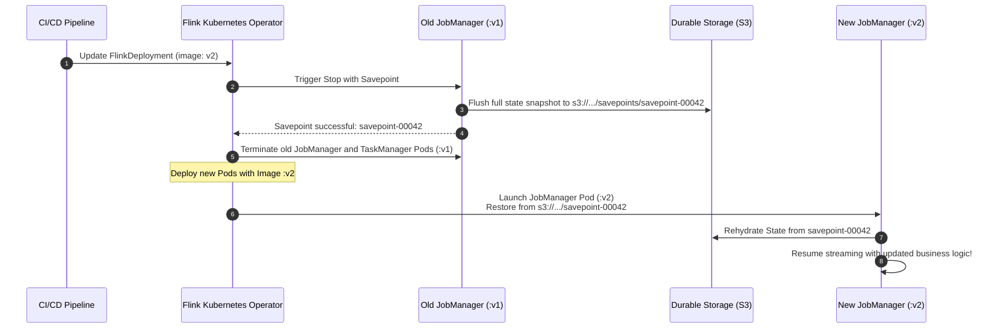
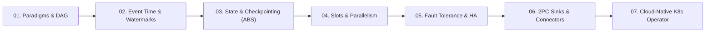

## Before you start

Running a Flink job on Kubernetes with ordinary Deployment manifests goes wrong in ways a stateless web app does not. Change the container image with `kubectl set image` and the pods restart, in-memory state disappears, and the job restarts from nothing unless someone first saved a snapshot. The Flink Kubernetes Operator is a controller that knows this. You describe the cluster and job in a YAML file, and it creates the pieces, takes a snapshot before an upgrade and restores from it afterwards.

The chapter compares session and application clusters, walks through a `FlinkDeployment` manifest, follows the upgrade loop step by step, and compares the available upgrade modes.

Basic Kubernetes knowledge (pods, YAML manifests, `kubectl apply`) is assumed. Flink-wise, read [chapter 03 on state and checkpointing](/tech/series/flink/03.state-and-checkpointing/) and [chapter 05 on fault tolerance and HA](/tech/series/flink/05.fault-tolerance-and-ha/) first.

Terms used in this chapter:

- **session cluster**: a long-running Flink cluster that accepts many jobs submitted to it.
- **application cluster**: a cluster started for exactly one job and torn down with it.
- **operator (Kubernetes)**: a controller that manages an application by watching custom resources and acting on them.
- **CRD**: custom resource definition, which adds a new resource kind, here `FlinkDeployment`, to the Kubernetes API.
- **reconciliation**: the loop that compares the declared state with the actual state and fixes the difference.
- **savepoint**: a manually or operator-triggered snapshot of job state, meant for planned stops and upgrades.
- **upgrade mode**: the setting that chooses how a running job is stopped and resumed, such as `savepoint` or `last-state`.

## The Evolution of Flink Deployments

Running Apache Flink on bare metal or static virtual machines with manual shell scripts (`bin/start-cluster.sh`) is a relic of the past. In modern cloud-native infrastructure, streaming applications run on **Kubernetes**.

However, managing distributed stateful streaming workloads on Kubernetes via vanilla `StatefulSet` or `Deployment` manifests is notoriously difficult:

- If a Kubernetes rolling update terminates a TaskManager pod while a checkpoint barrier is in flight, the checkpoint fails.
- If you update a container image using standard `kubectl set image`, the pods restart with empty local disk storage—erasing in-memory state and corrupting stream continuity.

To bridge the gap between Kubernetes reconciliation and Flink's stateful execution model, the Apache Flink community built the **Flink Kubernetes Operator**.

---

## Deployment Modes: Session vs Application Mode

Before deploying manifests, architects must choose the appropriate cluster topology:



| Dimension | Session Mode | Application Mode (Recommended) |
| :--- | :--- | :--- |
| **Cluster Lifecycle** | Long-running, static infrastructure. | Ephemeral; created and destroyed with the job. |
| **Resource Isolation** | Shared TaskManagers; noisy neighbor risk. | Dedicated CPU, RAM, and Pods per job. |
| **`main()` Execution** | Client-side (requires client node with fat JAR). | Server-side inside the JobManager Pod. |
| **Blast Radius** | A JVM OOM crash in Job A can kill Job B. | Isolated per job; a crash stays inside that job's cluster. |
| **Use Case** | Quick ad-hoc development, interactive SQL queries. | **All production 24/7 streaming pipelines.** |

---

## The Flink Kubernetes Operator Architecture

The **Flink Kubernetes Operator** acts as an autonomous site reliability engineer (SRE) running inside your Kubernetes cluster. It watches custom resources (`FlinkDeployment`) and continuously reconciles the desired state against live pods:



---

## Declarative Production Manifest: `FlinkDeployment`

Here is an illustrative application-mode `FlinkDeployment` custom resource targeting the Apache Flink 2.2.1 and Operator 1.15 baseline used in [`flos`](https://github.com/azusachino/flos) (the repo itself ships only a minimal session-mode manifest, so the image and paths below are placeholders):

```yaml
apiVersion: flink.apache.org/v1beta1
kind: FlinkDeployment
metadata:
  name: flos-streaming-pipeline
  namespace: streaming
spec:
  image: registry.example.com/streaming/flos-flink-app:v2.2.1-1
  imagePullPolicy: IfNotPresent
  flinkVersion: v2_2
  flinkConfiguration:
    # State & Checkpoint durable storage
    state.backend.type: rocksdb
    execution.checkpointing.dir: s3://flink-checkpoints/flos-streaming/checkpoints
    execution.checkpointing.savepoint-dir: s3://flink-checkpoints/flos-streaming/savepoints
    execution.checkpointing.interval: 30s
    execution.checkpointing.min-pause: 10s
    execution.checkpointing.timeout: 2m
    # High Availability on Kubernetes
    high-availability.type: kubernetes
    high-availability.storageDir: s3://flink-checkpoints/flos-streaming/ha
    # Memory tuning
    taskmanager.memory.process.size: 4096m
    taskmanager.numberOfTaskSlots: "2"
  jobManager:
    resource:
      memory: "2048m"
      cpu: 1.0
  taskManager:
    resource:
      memory: "4096m"
      cpu: 2.0
  job:
    jarURI: local:///opt/flink/usrlib/flos-flink-pipeline.jar
    entryClass: io.github.azusachino.flos.flink.lab.OperatorLabJob
    parallelism: 4
    upgradeMode: savepoint
    state: running
```

---

## Stateful Upgrades: The Savepoint Reconciliation Loop

When you release a new version of your streaming job (e.g., updating the container image tag from `:v1` to `:v2`), how does the Operator perform the upgrade without losing state? The job is stopped and restarted, so there is a pause while the new pods start; what you avoid is data loss.

Because `upgradeMode: savepoint` is configured, the Operator executes an automated 5-step reconciliation loop:



1. **Stop with Savepoint**: The Operator issues an RPC to the running JobManager to pause the pipeline and write a complete, self-contained **Savepoint** to object storage.
2. **Graceful Teardown**: The Operator terminates the old `:v1` pods cleanly.
3. **New Pod Launch**: The Operator provisions the new `:v2` JobManager and TaskManager pods.
4. **State Rehydration**: The Operator points the new JobManager at `s3://.../savepoint-00042` as the initial savepoint path, restoring all keyed window states and source offsets.
5. **Continuous Stream Resume**: The pipeline resumes consumption from the source offsets stored in the savepoint, so no records are skipped; duplicates at the sink are avoided only if the sink is transactional or idempotent (chapter 06).

---

## Upgrade Modes Compared

| `upgradeMode` | Mechanism | Data Loss Risk | Use Case |
| :--- | :--- | :--- | :--- |
| **`savepoint`** | Stops job with savepoint, restarts from it. | **Zero** | **Recommended for production upgrades** (the operator default is `stateless`, so set it explicitly). |
| **`last-state`** | Kills pods immediately; restarts from the last completed checkpoint. | **Zero** (replays from last CP) | Use when a hung operator prevents a clean savepoint. |
| **`stateless`** | Kills pods and boots up with completely empty state. | **Full state wipe** | Disposable staging environments and ad-hoc jobs. |

---

## Series Conclusion: The Complete Stream Architecture

The seven chapters, in order:



1. **Chapter 01**: Transformed our mental model from passive database polling to continuous dataflow DAGs.
2. **Chapter 02**: Solved the distributed clock illusion with Watermarks and late-data side outputs.
3. **Chapter 03**: Uncovered managed state and the Asynchronous Barrier Snapshotting (ABS) algorithm.
4. **Chapter 04**: Maximized hardware efficiency using Slot Sharing Groups and Operator Chaining.
5. **Chapter 05**: Defined the give-up boundary of failure recovery and active-standby High Availability.
6. **Chapter 06**: Achieved end-to-end exactly-once semantics using Two-Phase Commit sinks and idempotent OLAP streaming.
7. **Chapter 07**: Packaged the entire runtime into declarative, self-healing cloud-native deployments with the Flink Kubernetes Operator.

The companion labs live in [`flos`](https://github.com/azusachino/flos).
