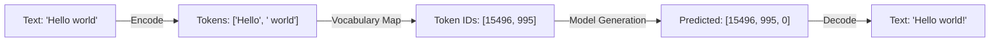
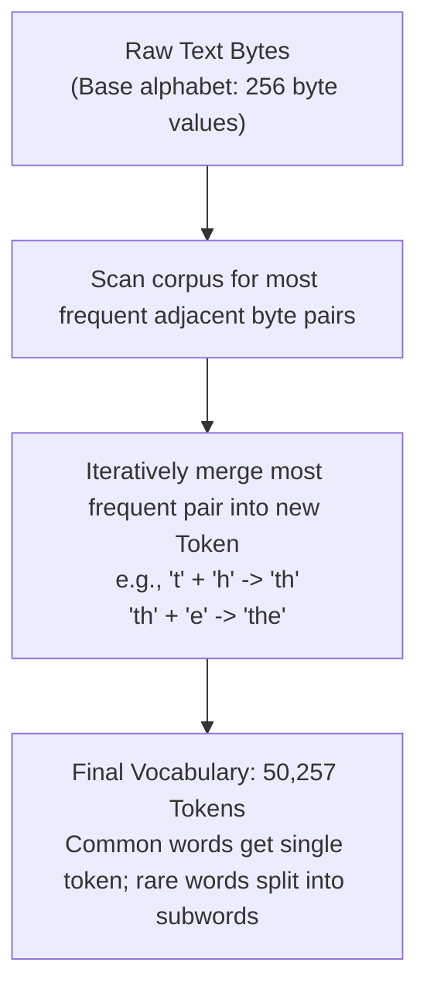

## The Gateway: Why Language Models Need Tokenizers

At its physical foundation, a Large Language Model (LLM) is an enormous floating-point tensor engine governed by high-dimensional matrix multiplications. Regardless of network depth or attention head complexity, a neural network cannot directly ingest natural language character strings like `"Hello world"`.

Before text can enter a neural network, it must pass through the **Tokenizer**:



A Tokenizer performs two symmetric functions:

1. **Encode**: Decomposes continuous natural language into irreducible semantic units (**Tokens**), and maps them into non-negative integers (**Token IDs**) via a pre-built vocabulary dictionary.
2. **Decode**: Converts an autoregressively generated sequence of integer IDs back into human-readable text.

In our companion educational project [`calc`](https://github.com/azusachino/calc), we implement and compare three fundamental tokenization paradigms.

---

## 1. Character-Level Tokenization (`CharTokenizer`)

The simplest intuitive approach treats every individual character as an independent token:

```python
class CharTokenizer:
    def __init__(self, text: str):
        # Extract and sort unique characters from the training corpus
        self.tokens = sorted(set(text))
        self.to_id = {token: index for index, token in enumerate(self.tokens)}

    @property
    def vocab_size(self) -> int:
        return len(self.tokens)

    def encode(self, text: str) -> list[int]:
        return [self.to_id[char] for char in text]

    def decode(self, ids: list[int]) -> str:
        return "".join(self.tokens[idx] for idx in ids)
```

### Tradeoff Analysis

- **Strengths**: Ultra-compact vocabulary ($V \approx 65 - 100$ characters covers English alphanumeric characters, punctuation, and whitespace). Virtually zero **Out-of-Vocabulary (OOV)** issues.
- **Fatal Weakness**: **Sequence length explosion**. A 100-word paragraph explodes into 600 character tokens. Because standard Transformer self-attention scales quadratically with sequence length ($\mathcal{O}(T^2)$), extreme sequence lengths saturate GPU memory bandwidth and impair long-range contextual reasoning.

---

## 2. Word-Level Tokenization (`SimpleWordTokenizer`)

The opposite extreme splits text on whitespace and punctuation boundaries into whole words:

```python
import re

class SimpleWordTokenizer:
    def __init__(self, text: str):
        # Split on whitespace and punctuation boundaries
        tokens = re.findall(r"\w+|[^\w\s]", text)
        self.tokens = sorted(set(tokens)) + ["<unk>"]
        self.to_id = {token: index for index, token in enumerate(self.tokens)}
        self.unk_id = self.to_id["<unk>"]

    def encode(self, text: str) -> list[int]:
        tokens = re.findall(r"\w+|[^\w\s]", text)
        return [self.to_id.get(token, self.unk_id) for token in tokens]
```

### Tradeoff Analysis

- **Strengths**: Shorter sequence length ($1 \text{ token} \approx 1 \text{ word}$), preserving compact attention contexts.
- **Fatal Weakness**: **Vocabulary bloat and the Out-of-Vocabulary (OOV) disaster**. An English dictionary contains over 500,000 words. Rare words, misspellings, or novel compounds map to the generic `<unk>` token, stripping semantic nuance.

---

## 3. The Modern Industry Standard: Byte-Level Byte Pair Encoding (BPE)

To achieve the compact sequences of word-level models while preserving the zero-OOV resilience of character-level models, modern LLMs (GPT-2, GPT-4, LLaMA-3) universally adopt **Byte-Level Byte Pair Encoding (BPE)**.



1. **Base Alphabet**: Starts with 256 byte values (every raw byte in UTF-8). Because every character is a sequence of bytes, **no input can ever be out-of-vocabulary**.
2. **Iterative Frequency Merging**: Statistically frequent byte sequences are merged into single tokens over thousands of passes.
   - Frequent words like `"the"`, `"programming"`, `"model"` become single tokens.
   - Rare or novel words like `"unconstitutionality"` decompose gracefully into subwords: `["un", "constitution", "ality"]`.

### Using GPT-2 BPE in `calc`

In [`calc/core/tokenizer.py`](https://github.com/azusachino/calc/blob/main/calc/core/tokenizer.py), we wrap the standard GPT-2 BPE tokenizer:

```python
import tiktoken

class GPT2Tokenizer:
    def __init__(self):
        self.tokenizer = tiktoken.get_encoding("gpt2")

    @property
    def vocab_size(self) -> int:
        return self.tokenizer.n_vocab  # 50,257

    def encode(self, text: str) -> list[int]:
        return self.tokenizer.encode(text, allowed_special={"<|endoftext|>"})

    def decode(self, ids: list[int]) -> str:
        return self.tokenizer.decode(ids)
```

---

## 4. Sliding-Window Autoregressive Dataset Construction

LLMs are trained via **Next-Token Prediction**. Given an input sequence $\mathbf{x} = [t_0, t_1, \dots, t_{k-1}]$, the ground-truth target is the shifted sequence $\mathbf{y} = [t_1, t_2, \dots, t_k]$:

```text
Full Corpus Tokens: [12, 45, 98, 23, 76, 54, 89]

Window 0:
  Input (x):  [12, 45, 98, 23]
  Target (y): [45, 98, 23, 76]

Window 1:
  Input (x):  [45, 98, 23, 76]
  Target (y): [98, 23, 76, 54]
```

In [`calc/core/dataset.py`](https://github.com/azusachino/calc/blob/main/calc/core/dataset.py), we implement the PyTorch Dataset with stride-based sliding windows:

```python
import torch
from torch.utils.data import Dataset

class TextDataset(Dataset):
    def __init__(self, token_ids: list[int], block_size: int, stride: int):
        self.inputs = []
        self.targets = []
        for i in range(0, len(token_ids) - block_size, stride):
            self.inputs.append(torch.tensor(token_ids[i : i + block_size], dtype=torch.long))
            self.targets.append(torch.tensor(token_ids[i + 1 : i + block_size + 1], dtype=torch.long))

    def __len__(self) -> int:
        return len(self.inputs)

    def __getitem__(self, idx: int):
        return self.inputs[idx], self.targets[idx]
```

---

## 5. Hands-on Verification with `calc`

You can compare tokenizer compression efficiency using our educational exercise in [`calc/exercises/compare_tokenizers.py`](https://github.com/azusachino/calc/blob/main/calc/exercises/compare_tokenizers.py):

```bash
cd vendor/calc
python3 calc/exercises/compare_tokenizers.py
```

Output:

```text
[calc] Tokenizer Comparison on Sample Text (120 words):
  CharTokenizer:        642 tokens (Compression ratio: 1.00x - Sequence too long)
  SimpleWordTokenizer:  142 tokens (Compression ratio: 4.52x - 8 <unk> dropped words)
  GPT2Tokenizer (BPE):  131 tokens (Compression ratio: 4.90x - 0 <unk>, perfect fidelity)
```

Byte-level BPE achieves the highest compression efficiency while maintaining zero information loss.

---

## Summary & Next Step

Tokenization transforms continuous text strings into integer arrays. Modern Byte-level BPE provides an optimal balance between sequence length and vocabulary size without out-of-vocabulary failures.

However, raw integer IDs cannot enter a neural network directly. How do we convert discrete integer IDs into continuous semantic geometry?

In **Chapter 02: Embeddings & Positional Encoding**, we will construct the token embedding lookup matrix and inject sequential position awareness.
