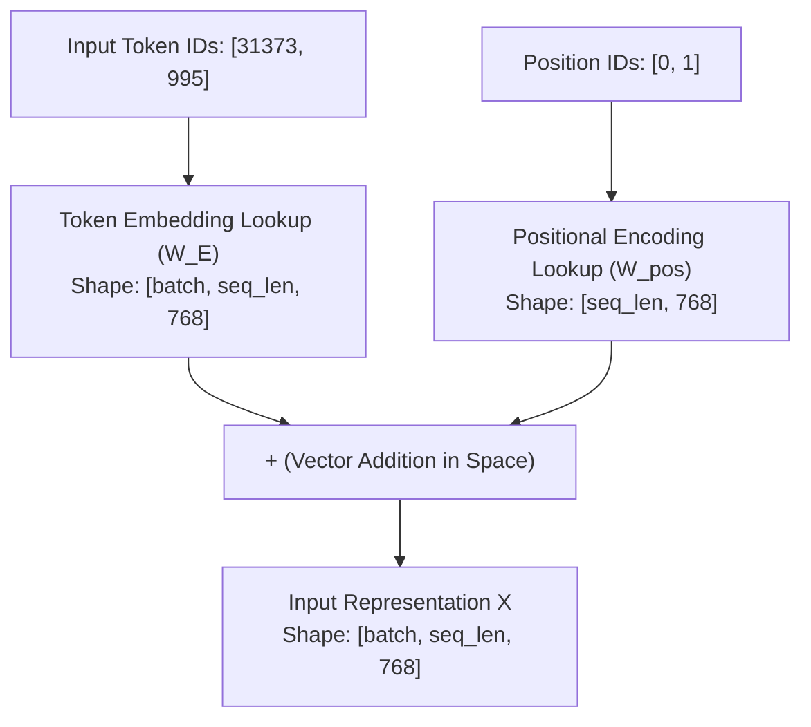

## From Discrete Tokens to Continuous Latent Geometry

In [Chapter 01](01.tokenization.md), we converted human-readable text into discrete integer token IDs (e.g., `"hello world"` $\to$ `[31373, 995]`).

However, neural networks are differential matrix engines built on linear algebra and calculus. Raw integers suffer from two fatal mathematical flaws:

1. **False Ordinality**: Numbers carry inherent magnitude ($995 < 31373$). If we pass raw integers into neural layers, the network falsely presumes that token 31373 has thirty times more activation energy than token 995.
2. **Zero Semantic Topology**: In integer space, the distance $| \text{ID}_{\text{cat}} - \text{ID}_{\text{dog}} |$ carries zero semantic meaning. `"cat"` and `"calculus"` might be adjacent integers purely by alphabetical indexing coincidence.

Classical machine learning attempted **One-Hot Encoding**: representing each token as a sparse vector of dimension $V$ with a single $1$ at its index. When vocabulary size reaches $V = 50,257$ (GPT-2) or $128,000$ (LLaMA-3), One-Hot vectors waste gigabytes of GPU VRAM and remain mutually orthogonal ($\mathbf{u} \cdot \mathbf{v} = 0$), preventing any geometric clustering of related concepts.

Modern LLMs solve this with **Dense Word Embeddings**: projecting each token into a continuous $D$-dimensional vector space (e.g., $D = 768$ in GPT-2, $D = 4,096$ in LLaMA-3). In this space, semantically related words naturally cluster, enabling vector arithmetic ($\mathbf{v}_{\text{king}} - \mathbf{v}_{\text{man}} + \mathbf{v}_{\text{woman}} \approx \mathbf{v}_{\text{queen}}$).

---

## 1. The Mechanics of `nn.Embedding`

In PyTorch, token projection is handled by `torch.nn.Embedding(vocab_size, embedding_size)`:

```python
import torch
import torch.nn as nn

vocab_size = 50257
embedding_size = 768

# Initialize the embedding layer
embedding = nn.Embedding(vocab_size, embedding_size)

# Inspect the underlying weight matrix
print(embedding.weight.shape)  # torch.Size([50257, 768])
```

Many beginners assume `nn.Embedding` is a complex neural network layer. In physical reality:

> **`nn.Embedding` is simply an in-memory lookup table wrapped around a weight matrix $W_E \in \mathbb{R}^{V \times D}$.**

When you pass an input tensor of token IDs `[31373, 995]` into `embedding`, PyTorch does not execute matrix multiplications: it executes an $O(1)$ memory slice extracting rows `31373` and `995` from $W_E$.

During backpropagation, incoming gradients accumulate into those specific row indices, allowing the model to learn optimal semantic coordinates through gradient descent.

---

## 2. The Need for Positional Information

Because self-attention operates across all token pairs simultaneously, it is strictly permutation-invariant. Swapping the positions of two words produces identical attention values.

To inform the model of word order, we must inject **Positional Encodings**.



---

## 3. Learned Absolute Position Embeddings (GPT-2 Style)

In GPT-2, positional encodings are treated identically to token embeddings: a learned lookup table $W_{\text{pos}} \in \mathbb{R}^{N_{\max} \times D}$:

```python
class LearnedPositionalEmbedding(nn.Module):
    def __init__(self, max_len: int, embedding_size: int):
        super().__init__()
        self.pos_emb = nn.Embedding(max_len, embedding_size)

    def forward(self, x: torch.Tensor) -> torch.Tensor:
        seq_len = x.size(1)
        positions = torch.arange(seq_len, device=x.device)
        return x + self.pos_emb(positions)
```

- **Advantage**: Fully learned from data via gradient descent.
- **Drawback**: Fixed maximum context length ($N_{\max}$). Cannot extrapolate beyond the trained window.

---

## 4. Sinusoidal Positional Encodings (Original Transformer Style)

Vaswani et al. (2017) introduced deterministic sinusoidal functions:

$$PE_{(pos, 2i)} = \sin\left(\frac{pos}{10000^{2i / D}}\right)$$

$$PE_{(pos, 2i+1)} = \cos\left(\frac{pos}{10000^{2i / D}}\right)$$

```python
class SinusoidalPositionalEncoding(nn.Module):
    def __init__(self, max_len: int, embedding_size: int):
        super().__init__()
        pe = torch.zeros(max_len, embedding_size)
        position = torch.arange(0, max_len, dtype=torch.float).unsqueeze(1)
        div_term = torch.exp(torch.arange(0, embedding_size, 2).float() * (-math.log(10000.0) / embedding_size))

        pe[:, 0::2] = torch.sin(position * div_term)
        pe[:, 1::2] = torch.cos(position * div_term)
        self.register_buffer("pe", pe.unsqueeze(0))

    def forward(self, x: torch.Tensor) -> torch.Tensor:
        return x + self.pe[:, : x.size(1)]
```

Because trigonometric identities allow linear transformations between $PE_{pos + k}$ and $PE_{pos}$, the model can theoretically infer relative distances without extra weights.

---

## 5. Modern Standard: Rotary Position Embedding (RoPE)

In modern architectures (LLaMA-3, Mistral), positional encoding moves from input addition into the attention layer itself via 2D subplane rotations:

```python
def apply_rotary_emb(x: torch.Tensor, freqs_cos: torch.Tensor, freqs_sin: torch.Tensor) -> torch.Tensor:
    # Rotate adjacent dimension pairs (x0, x1) by sequence-dependent angles
    x_rot = torch.stack([-x[..., 1::2], x[..., 0::2]], dim=-1).flatten(-2)
    return x * freqs_cos + x_rot * freqs_sin
```

RoPE eliminates additive noise from the input embeddings, preserving semantic magnitudes and enabling context length extrapolation via frequency scaling (NTK-aware RoPE, YaRN).

---

## 6. Hands-on Verification with `calc`

You can inspect the embedding implementations in [`calc/core/embeddings.py`](https://github.com/azusachino/calc/blob/main/calc/core/embeddings.py) and compare their properties using [`calc/exercises/compare_embeddings.py`](https://github.com/azusachino/calc/blob/main/calc/exercises/compare_embeddings.py):

```bash
cd vendor/calc
python3 calc/exercises/compare_embeddings.py
```

Output:

```text
[calc] Positional Embedding Comparison (Seq Len = 16, Dim = 768):
  LearnedPositionalEmbedding:  786,432 trainable parameters (Bounded to max_len = 1024)
  SinusoidalPositionalEncoding:        0 trainable parameters (Analytical geometric wave)
  RotaryPositionEmbedding:             0 trainable parameters (Preserves vector norm, zero drift)
```

---

## Summary & Next Step

Embeddings transform discrete token IDs into continuous geometric vectors. Positional encodings break permutation invariance, allowing the network to distinguish word sequences.

Now that our inputs are rich vectors in space, how do tokens communicate with each other?

In **Chapter 03: Attention Mechanisms & Multi-Head Attention**, we will build Causal Self-Attention, enforce the autoregressive triangular mask, and parallelize attention across multiple heads.
