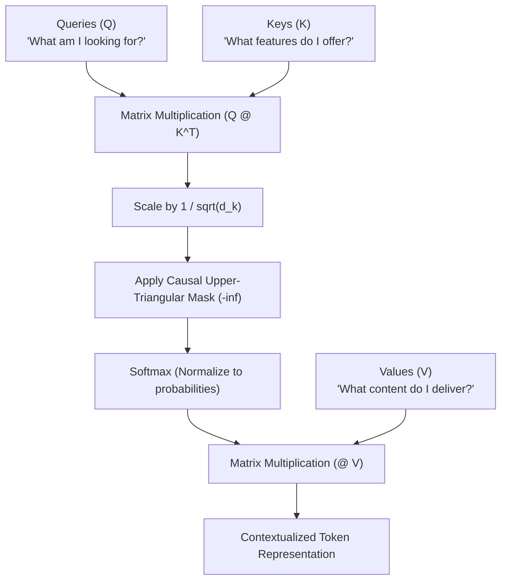
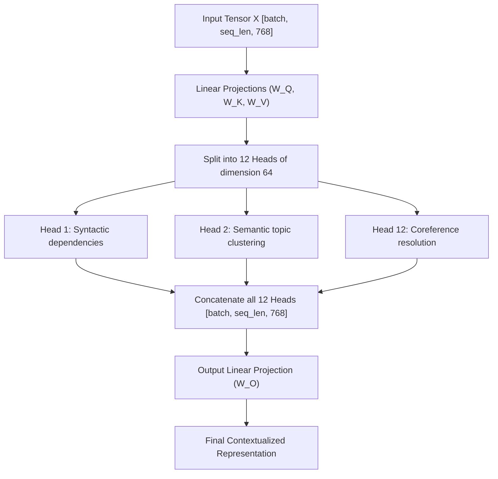

## The Paradigm Shift in Context Modeling

In [Chapter 02](02.embeddings.md), we mapped text tokens into continuous vectors and injected sequential position. However, each token vector still exists in complete isolation—a pronoun like `"it"` has no access to the noun `"the robot"` defined earlier in the prompt.

Before the Transformer (Vaswani et al., 2017), deep learning tackled sequences using two architectures:

1. **Recurrent Neural Networks (RNN/LSTM)**: Passed hidden states sequentially step-by-step ($h_t = f(h_{t-1}, x_t)$). Computing was strictly serial (cannot saturate modern parallel GPU tensor cores), and gradients degraded across long sequences.
2. **Convolutional Neural Networks (CNN)**: Applied sliding filters over local windows. Capturing dependencies between distant tokens required stacking dozens of layers, introducing long communication paths.

The Transformer eradicated recurrence and convolutions, replacing them with a direct communication network: **Self-Attention**. Every token connects to every preceding token in $O(1)$ sequential hops.

---

## 1. Scaled Dot-Product Attention

The mathematical formula governing self-attention is:

$$\operatorname{Attention}(Q, K, V) = \operatorname{softmax}\left(\frac{Q K^T}{\sqrt{d_k}}\right) V$$



1. **Query ($Q$)**: The active search criteria of the current token.
2. **Key ($K$)**: The indexing feature card advertised by all candidate tokens in the sequence.
3. **Value ($V$)**: The actual informational content payload transmitted if a match occurs.
4. **$QK^T$**: Computes all pairwise inner products across the sequence, measuring alignment.
5. **Division by $\sqrt{d_k}$**: Normalizes dot-product variance back to $1.0$, preventing softmax saturation and gradient vanishing.

---

## 2. Causal Masking: Preserving the Arrow of Time

In autoregressive language models (like GPT and LLaMA), generation proceeds from left to right. When training on a batch of full sentences, token $t$ must **never** see token $t+1, t+2, \dots$! If token 2 could attend to token 3, the model would simply memorize the answer, rendering next-token prediction trivial.

We enforce this temporal constraint using a **Causal Mask** (strictly upper-triangular mask):

```text
Raw Attention Scores (Q @ K.T):
        "The"   "cat"   "sat"
"The"   [ 4.2    1.8    0.5 ]
"cat"   [ 2.1    5.6    3.4 ]
"sat"   [ 0.8    3.2    6.1 ]

Apply Causal Mask (Upper triangle -> -inf):
        "The"   "cat"   "sat"
"The"   [ 4.2   -inf   -inf ]   <-- "The" can only attend to itself
"cat"   [ 2.1    5.6   -inf ]   <-- "cat" can attend to "The" and "cat"
"sat"   [ 0.8    3.2    6.1 ]   <-- "sat" can attend to all three tokens

After Softmax (exp(-inf) = 0):
        "The"   "cat"   "sat"
"The"   [ 1.0    0.0    0.0 ]
"cat"   [ 0.03   0.97   0.0 ]
"sat"   [ 0.004  0.05   0.946]
```

By filling the upper-triangular entries with $-\infty$, `softmax(-inf)` evaluates to exactly $0.0$, mathematically blocking information leakage from future tokens.

---

## 3. Multi-Head Attention (MHA)

A single attention head can only attend to one relationship at a time. In the phrase `"The bank of the river"`, the word `"bank"` simultaneously needs to:

- Form a syntactic grammatical dependency with the article `"The"`.
- Form a semantic contextual link with the geographical descriptor `"river"`.

**Multi-Head Attention (MHA)** splits the total embedding dimension $D$ across $h$ parallel heads, where each head operates in a lower-dimensional subspace $d_k = D / h$:



---

## 4. PyTorch Implementation in `calc`

Here is our clean PyTorch implementation from [`calc/core/model.py`](https://github.com/azusachino/calc/blob/main/calc/core/model.py):

```python
import math
import torch
import torch.nn as nn

class CausalSelfAttention(nn.Module):
    def __init__(self, embed_dim: int, num_heads: int, block_size: int, dropout: float = 0.1):
        super().__init__()
        assert embed_dim % num_heads == 0
        self.num_heads = num_heads
        self.head_dim = embed_dim // num_heads

        # Combined Q, K, V projection in a single efficient matrix
        self.c_attn = nn.Linear(embed_dim, 3 * embed_dim)
        self.c_proj = nn.Linear(embed_dim, embed_dim)
        self.dropout = nn.Dropout(dropout)

        # Register causal mask buffer (lower-triangular ones)
        self.register_buffer(
            "bias",
            torch.tril(torch.ones(block_size, block_size)).view(1, 1, block_size, block_size)
        )

    def forward(self, x: torch.Tensor) -> torch.Tensor:
        B, T, C = x.size()  # Batch, Sequence Length, Channels (Embedding Dim)

        # Project and split into Q, K, V
        qkv = self.c_attn(x)
        q, k, v = qkv.split(C, dim=2)

        # Reshape to [B, num_heads, T, head_dim]
        q = q.view(B, T, self.num_heads, self.head_dim).transpose(1, 2)
        k = k.view(B, T, self.num_heads, self.head_dim).transpose(1, 2)
        v = v.view(B, T, self.num_heads, self.head_dim).transpose(1, 2)

        # Scaled dot-product attention
        att = (q @ k.transpose(-2, -1)) * (1.0 / math.sqrt(self.head_dim))
        att = att.masked_fill(self.bias[:, :, :T, :T] == 0, float("-inf"))
        att = torch.softmax(att, dim=-1)
        att = self.dropout(att)

        # Weighted value aggregation
        y = att @ v  # [B, num_heads, T, head_dim]
        y = y.transpose(1, 2).contiguous().view(B, T, C)

        return self.c_proj(y)
```

---

## Summary & Next Step

Causal Self-Attention is the router that distributes information dynamically across sequences without recurrence. Multi-Head Attention empowers the model to attend to multiple distinct linguistic relationships concurrently.

Now that we have the attention engine, how do we assemble it into a full Transformer block alongside Layer Normalization and Feed-Forward Networks?

In **Chapter 04: GPT Architecture & Forward Assembly**, we will assemble the complete GPT model, implement Pre-LN residual connections, and compute cross-entropy loss.
