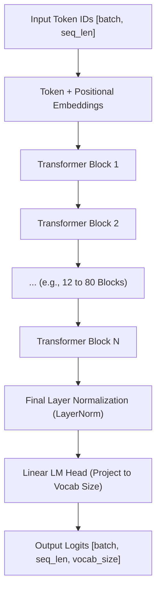
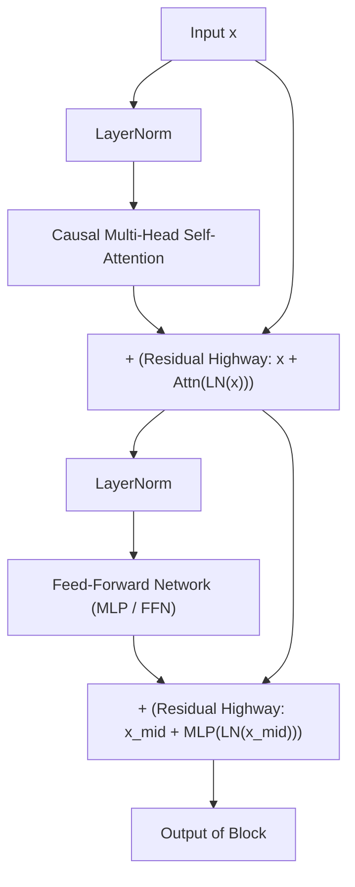

## The Complete Architectural Blueprint

In [Chapter 03](03.attention.md), we built the Causal Multi-Head Attention module. However, attention by itself only **mixes information between tokens**; it does not process or transform individual token features.

To build a complete autoregressive language model (such as OpenAI's GPT-2, GPT-3, or Meta's LLaMA), we assemble attention alongside non-linear **Feed-Forward Networks (MLPs)**, **Layer Normalization**, and **Residual Connections** into a unified repeating stack:



---

## 1. Anatomy of a Transformer Block

Each repeating Transformer block consists of two primary sublayers wrapped in residual connections:



### Pre-LN vs Post-LN Architecture

In the original 2017 Transformer paper, Layer Normalization was applied **after** the residual addition (Post-LN):
$$\mathbf{x}_{l+1} = \operatorname{LayerNorm}(\mathbf{x}_l + \operatorname{Sublayer}(\mathbf{x}_l))$$

In deep networks (beyond 12 layers), Post-LN causes gradients to degrade near the output, requiring delicate learning rate warmup schedules to avoid training divergence.

GPT-2 and all modern LLMs adopt **Pre-LN**:
$$\mathbf{x}_{l+1} = \mathbf{x}_l + \operatorname{Sublayer}(\operatorname{LayerNorm}(\mathbf{x}_l))$$

Pre-LN preserves an uninterrupted, clean identity gradient highway through the residual connection, ensuring stable training across hundreds of layers.

---

## 2. Feed-Forward Network (MLP)

While attention acts as a communication router across the sequence dimension ($T$), the **Feed-Forward Network (MLP)** processes each token's feature vector ($C$) independently in isolation:

```python
class MLP(nn.Module):
    def __init__(self, embed_dim: int, dropout: float = 0.1):
        super().__init__()
        # Standard GPT convention: expand by a factor of 4, then project back
        self.c_fc = nn.Linear(embed_dim, 4 * embed_dim)
        self.gelu = nn.GELU()
        self.c_proj = nn.Linear(4 * embed_dim, embed_dim)
        self.dropout = nn.Dropout(dropout)

    def forward(self, x: torch.Tensor) -> torch.Tensor:
        x = self.c_fc(x)
        x = self.gelu(x)
        x = self.c_proj(x)
        return self.dropout(x)
```

### Why Expand by $4 \times$?

Expanding the hidden dimension to $4 \times D$ (e.g., $768 \to 3072 \to 768$) provides an expansive non-linear manifold for memorizing factual associations and semantic transformations. Research shows that factual knowledge in LLMs is predominantly stored within these feed-forward weight matrices.

### The GELU Activation Function

Unlike classical ReLU ($\max(0, x)$), which abruptly zeroes out all negative values, the **Gaussian Error Linear Unit (GELU)** introduces smooth probabilistic gating:

$$\operatorname{GELU}(x) = x \cdot \Phi(x) = x \cdot P(X \le x), \quad X \sim \mathcal{N}(0, 1)$$

GELU allows small negative gradients to flow, avoiding the "dead neuron" failure mode of ReLU during large-scale pretraining.

---

## 3. Weight Tying (Weight Sharing)

In our model, the input Token Embedding matrix has shape $[V, D]$ ($50,257 \times 768 \approx 38.6 \text{M parameters}$).

The final Language Model Head projection matrix also maps $[D \to V]$, with shape $[768, 50,257]$ ($\approx 38.6 \text{M parameters}$).

If treated independently, these two matrices consume nearly half of a 124M parameter model's capacity on vocabulary projections alone!

Following Press & Wolf (2017) and OpenAI's GPT-2, we apply **Weight Tying**:

```python
# Bind the output projection weights directly to the input embedding matrix
self.lm_head.weight = self.token_embedding.weight
```

- **Saves Memory**: Eliminates 38.6 million redundant parameters.
- **Improves Generalization**: The representations learned for looking up words directly reinforce the representations used for predicting words.

---

## 4. Full PyTorch Architecture in `calc`

Here is the complete assembled model from [`calc/core/model.py`](https://github.com/azusachino/calc/blob/main/calc/core/model.py):

```python
class Block(nn.Module):
    def __init__(self, embed_dim: int, num_heads: int, block_size: int, dropout: float = 0.1):
        super().__init__()
        self.ln_1 = nn.LayerNorm(embed_dim)
        self.attn = CausalSelfAttention(embed_dim, num_heads, block_size, dropout)
        self.ln_2 = nn.LayerNorm(embed_dim)
        self.mlp = MLP(embed_dim, dropout)

    def forward(self, x: torch.Tensor) -> torch.Tensor:
        x = x + self.attn(self.ln_1(x))
        x = x + self.mlp(self.ln_2(x))
        return x

class GPTLanguageModel(nn.Module):
    def __init__(self, vocab_size: int, embed_dim: int, num_heads: int, num_layers: int, block_size: int, dropout: float = 0.1):
        super().__init__()
        self.block_size = block_size
        self.token_embedding = nn.Embedding(vocab_size, embed_dim)
        self.position_embedding = nn.Embedding(block_size, embed_dim)
        self.dropout = nn.Dropout(dropout)

        self.blocks = nn.ModuleList([
            Block(embed_dim, num_heads, block_size, dropout) for _ in range(num_layers)
        ])
        self.ln_f = nn.LayerNorm(embed_dim)
        self.lm_head = nn.Linear(embed_dim, vocab_size, bias=False)

        # Weight tying
        self.lm_head.weight = self.token_embedding.weight

    def forward(self, idx: torch.Tensor, targets: torch.Tensor = None):
        B, T = idx.size()
        pos = torch.arange(0, T, dtype=torch.long, device=idx.device)

        tok_emb = self.token_embedding(idx)
        pos_emb = self.position_embedding(pos)
        x = self.dropout(tok_emb + pos_emb)

        for block in self.blocks:
            x = block(x)
        x = self.ln_f(x)
        logits = self.lm_head(x)

        loss = None
        if targets is not None:
            loss = nn.functional.cross_entropy(logits.view(-1, logits.size(-1)), targets.view(-1))

        return logits, loss
```

---

## Summary & Next Step

We have assembled the full GPT decoder: Pre-LN Transformer blocks, Multi-Head Causal Attention, $4\times$ GELU Feed-Forward layers, and weight tying.

Now that the neural architecture is built, how do we train it?

In **Chapter 05: Pre-Training & Optimization Dynamics**, we will implement the training loop, configure AdamW weight decay, schedule learning rates with cosine decay, and track validation perplexity.
