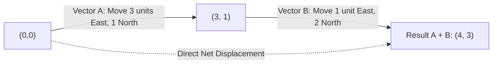
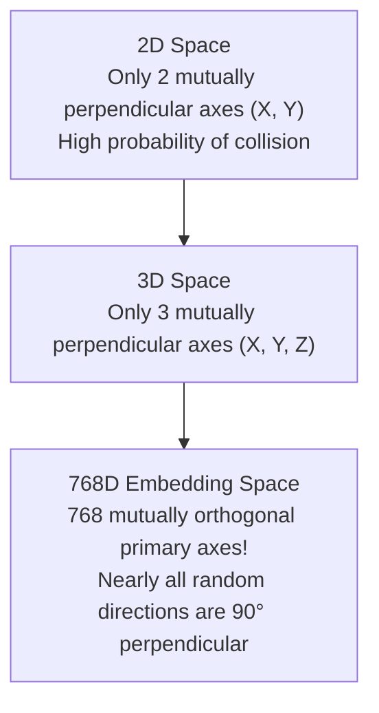
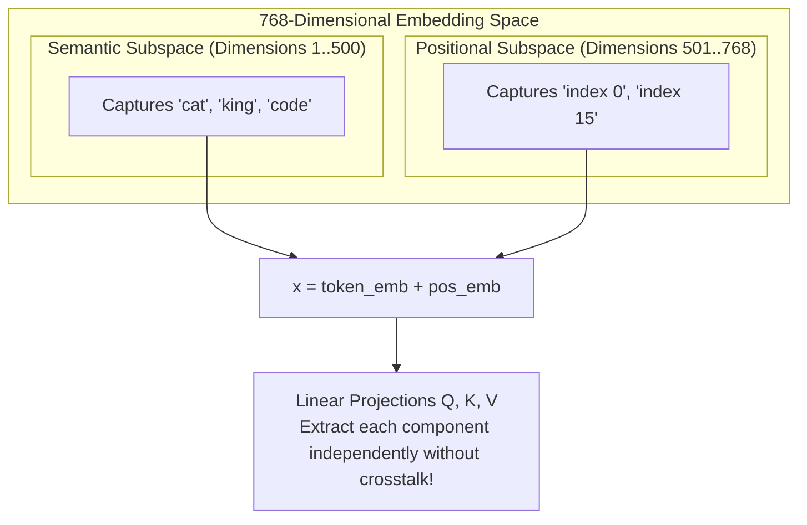

## The Cognitive Gap Between Code and Geometry

Software engineers learning the internal architecture of Large Language Models (LLMs) often experience an immediate cognitive disconnect.

At the very front of the Transformer architecture, the input token and positional preparation consists of two deceptively simple lines of code:

```python
# Look up semantic token embeddings and positional encodings
token_emb = self.token_embedding(tokens)        # Shape: [batch, seq_len, 768]
pos_emb = self.position_embedding(positions)    # Shape: [seq_len, 768]

# Forward pass combination
x = token_emb + pos_emb
```

To someone trained on classical procedural or object-oriented programming, this addition looks absurd:

> *"The token embedding encodes the semantic meaning of a word, while the positional embedding encodes its sequential order. Why are they directly added together using `+`? In traditional software, adding an attribute to an entity means either assigning a new field or overwriting existing values. Why doesn't adding a position vector to a token vector completely destroy the semantic meaning of the word?"*

If you view tensors merely as contiguous arrays of floating-point numbers in RAM, this addition will always feel like an arbitrary hack.

To truly understand why Transformers work, you must switch your mental model from **in-memory array overwriting** to **geometric displacement in high-dimensional space**. As Grant Sanderson (3Blue1Brown) and Gilbert Strang emphasize: **geometry is the native language of machine learning**.

---

## 1. Rethinking Vectors: From Lists to Arrows in Space

In computer science, we are accustomed to treating a vector as an ordered list of floats:

```python
vec = [3.0, 2.0]
```

In physics and geometry, however, a vector is an **arrow anchored at the origin $(0, 0)$ with a definite magnitude and direction**:

```text
       y ▲
         │           • (3, 2)
       2 ┼─ ─ ─ ─ ─ ↗ 
         │         /  Vector = Directed displacement from origin
       1 ┼        /
         │       /
─────────┴────┴───┴────► x
        0     1   2   3
```

- The numbers `[3.0, 2.0]` are simply the **navigation coordinates** of this arrow: take 3 steps along basis axis $\hat{i}$ (the X-axis), and 2 steps along basis axis $\hat{j}$ (the Y-axis).
- In modern LLMs, every word or subword token is an arrow pointing to a specific location in an ambient 768-dimensional (or 4,096-dimensional) semantic vector space. Semantically related words (like `"cat"` and `"kitten"`) correspond to arrows pointing in nearly the identical direction.

---

## 2. Vector Addition: Composing Journeys, Not Mutating State

In traditional programming, assignment mutates memory:

```python
score = 100
score = score + 5   # The original value 100 is replaced by 105
```

Vector addition does not overwrite anything. It **chains displacements tip-to-tail**:



1. You start at the origin $(0, 0)$ and travel along vector $\mathbf{u}$.
2. From the **tip** of $\mathbf{u}$, you travel along vector $\mathbf{v}$.
3. The resulting vector $\mathbf{u} + \mathbf{v}$ is the **net displacement** from the origin to your final destination.

When an LLM executes `x = token_emb + pos_emb`, it is saying:
> *"Start at the semantic concept of 'bank' ($\mathbf{u}$), then take a step in the direction that denotes 'standing at position 4' ($\mathbf{v}$). The resulting vector captures both the word identity and its location in the sentence."*

---

## 3. The Mystery of 768 Dimensions: Why Don't They Collide?

In 2D or 3D space, adding two arbitrary vectors drastically changes your direction. If $\mathbf{u} = [1, 0]$ (facing East) and $\mathbf{v} = [0, 1]$ (facing North), their sum $\mathbf{u} + \mathbf{v} = [1, 1]$ points North-East, shifting your heading by a massive $45^\circ$.

Why doesn't `pos_emb` corrupt `token_emb` in an LLM like GPT-2 (768 dimensions) or LLaMA-3 (4,096 dimensions)?

The answer lies in the counter-intuitive properties of **high-dimensional geometry**:

### Two Random Vectors in High Dimensions Are Almost Always Orthogonal

In $d$-dimensional space, consider two random unit vectors $\mathbf{u}$ and $\mathbf{v}$. Their dot product (cosine similarity) satisfies:

$$\mathbb{E}[\cos \theta] = 0$$

$$\operatorname{Var}(\cos \theta) = \frac{1}{d} \implies \sigma = \frac{1}{\sqrt{d}}$$



- In **2 dimensions**, $\sigma = 1 / \sqrt{2} \approx 0.707$. Angles between vectors vary wildly.
- In **768 dimensions**, $\sigma = 1 / \sqrt{768} \approx 0.036$.
- In **4,096 dimensions**, $\sigma = 1 / \sqrt{4096} \approx 0.0156$.

In 768 dimensions, the probability that two independently initialized vectors point in the same direction is virtually zero. **High-dimensional space is unimaginably vast and almost entirely empty.**

### Subspace Decomposition

Because 768 dimensions provide so many independent directions, the model naturally organizes information into **orthogonal subspaces**:

$$\mathbb{R}^{768} = \mathcal{S}_{\text{syntax}} \oplus \mathcal{S}_{\text{semantics}} \oplus \mathcal{S}_{\text{position}} \oplus \dots$$



Downstream linear transformation matrices ($W_Q, W_K, W_V$) easily project out the positional subspace without disturbing semantic dimensions, just as a software engineer accesses `object.position` and `object.name` without field collisions.

---

## 4. Hands-on Verification with `calc`

You can verify this geometric phenomenon directly using the exploratory script in our companion project [`calc/math/vectors.py`](https://github.com/azusachino/calc/blob/main/calc/math/vectors.py):

```bash
cd vendor/calc
python3 calc/math/vectors.py
```

The script samples 10,000 random unit vectors across various dimensions and measures their pairwise angular distributions:

```text
[calc] High-dimensional orthogonality experiment (10,000 pairs):
  Dimension   2: Mean Cosine = +0.0012, Std = 0.7041 (Spread: wide)
  Dimension   3: Mean Cosine = -0.0008, Std = 0.5762
  Dimension  64: Mean Cosine = +0.0001, Std = 0.1248
  Dimension 768: Mean Cosine = -0.0000, Std = 0.0361 (Spread: ultra-tight at 90°)
  Dimension 4096: Mean Cosine = +0.0000, Std = 0.0156 (Pure orthogonality)
```

As the dimensions scale to 768 and 4,096, the distribution of cosines collapses into an ultra-sharp spike centered at $0.000$ ($90^\circ$ perpendicularity).

---

## Summary & Next Step

Tokens in large language models are not static database records; they are directional arrows traversing a 768-dimensional geometric manifold. Vector addition preserves both token meaning and sequential position because high-dimensional space provides ample orthogonal room for both signals to coexist without interference.

Now that we understand how individual arrows exist in space, how does the model measure relationship and relevance between two arrows?

In **Chapter 02: Dot Products & Attention**, we will explore how projecting one arrow onto another forms the mathematical foundation of Transformer Self-Attention.
