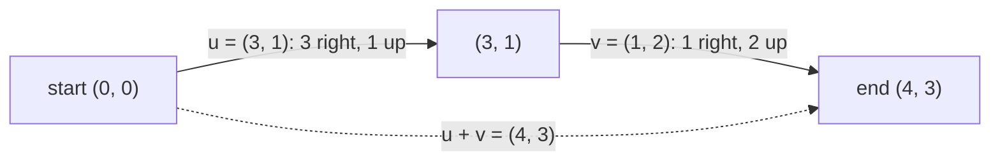

This chapter answers a question that bothers many programmers on first reading a Transformer: why can the model simply add a "position" vector to a "word" vector? An LLM needs the answer because every word it reads is stored as a vector, and everything else in the series is arithmetic on vectors. You only need to know Python and high-school algebra. Everything else is defined as we go.

## The puzzle

The first lines of a Transformer's forward pass look like this:

```python
token_emb = self.token_embedding(tokens)        # one list of 768 numbers per token
pos_emb = self.position_embedding(positions)    # one list of 768 numbers per position

x = token_emb + pos_emb
```

A token is a chunk of text (a word or part of a word) that the model treats as one unit. An embedding is a list of numbers the model has learned for that token. Position embeddings are the same idea, one list per position in the sentence (0, 1, 2, ...).

If you think of a list of numbers as a record, adding two records makes no sense: `+` on a record would either overwrite a field or fail. The word's meaning and the word's position share one list of numbers, so why doesn't the second one smear the first?

The answer needs a different picture of what a list of numbers is.

## 1. A vector is a list of numbers, or an arrow

A **vector** is an ordered list of numbers. The count of numbers is its **dimension**. `[3, 2]` is a 2-dimensional vector; a GPT-2 embedding is 768-dimensional.

For two numbers you can draw it. Put the origin (0, 0) on a sheet of paper, go 3 steps right and 2 steps up, and draw an arrow from the origin to that point. The numbers are the arrow's coordinates. The arrow has a **direction** (where it points) and a **length**, which you get from Pythagoras:

$$\text{length of } (3, 2) = \sqrt{3^2 + 2^2} = \sqrt{13} \approx 3.61$$

We write the length of a vector $\mathbf{u}$ as $\|\mathbf{u}\|$. For a vector with $d$ numbers it is the square root of the sum of the squares of all of them.

You cannot draw 768 axes, but the same definitions still apply: 768 coordinates, one direction, one length. Treating an embedding as an arrow is a way to borrow intuition from the 2D drawing. The model's learned embeddings put words with related meanings in similar directions, so `"cat"` and `"kitten"` point roughly the same way.

## 2. Adding vectors

Adding two vectors means adding them position by position:

```python
u = [3, 1]
v = [1, 2]
u_plus_v = [a + b for a, b in zip(u, v)]   # [4, 3]
```

As arrows, this is a walk in two legs. Start at the origin, follow $\mathbf{u}$, then from where you ended up, follow $\mathbf{v}$. The sum is the straight arrow from the origin to where you finish.



Compare this with `score = score + 5`, where the old value is gone. When you add vectors, the old position is still there as the first leg of the walk. If someone tells you the answer is (4, 3) and that the first leg was (3, 1), you can recover the second leg by subtracting. Nothing was destroyed. It only got harder to read each part off the sum by eye.

So `x = token_emb + pos_emb` says: start at the point for the word, then take a step that says "this is position 4". The result still contains both pieces. The question is whether, in 768 dimensions, the pieces stay separable. That depends on how much the two arrows get in each other's way, which brings us to angles.

## 3. Pointing the same way, pointing apart

Two arrows can point the same way, point at right angles (perpendicular), or point in opposite directions. A common way to turn that into one number is **cosine similarity**: it is 1 when they point the same way, 0 when they are perpendicular, and -1 when they point opposite ways. Vectors that are perpendicular are also called **orthogonal**; the word means exactly that.

You compute it from the **dot product**, which is "multiply matching entries and add them up". For $\mathbf{u} = (1, 0)$ and $\mathbf{w} = (1, 1)$:

$$\mathbf{u} \cdot \mathbf{w} = 1 \cdot 1 + 0 \cdot 1 = 1$$

and then divide by both lengths: $\cos\theta = \dfrac{1}{1 \cdot \sqrt{2}} \approx 0.71$, which is the cosine of 45 degrees. For $(1, 0)$ and $(0, 1)$ the dot product is $0$, so they are perpendicular. Chapter 02 explains why this works; here we only need the idea that cosine similarity measures "how aligned".

## 4. Why adding position does not erase the word

Take the smallest possible case. Let the word be $\text{cat} = (1, 0)$ and a position vector be $(0, 0.5)$, which is perpendicular to it and half as long. The sum is $(1, 0.5)$. Its cosine similarity with $\text{cat}$ is

$$\frac{1}{\sqrt{1^2 + 0.5^2}} = \frac{1}{\sqrt{1.25}} \approx 0.894$$

The sum still points mostly at "cat". In two dimensions, though, there is almost no room. Another word's arrow can easily land close to $(1, 0.5)$ and be confused with "cat plus a position".

Now the surprising fact about high dimensions: **two randomly chosen directions are almost always nearly perpendicular**, and the more dimensions, the more so. The cosine between two random directions averages around 0 with a spread of about $1/\sqrt{d}$, where $d$ is the dimension:

| dimension $d$ | typical spread of cosine ($1/\sqrt{d}$) |
| --- | --- |
| 2 | 0.71 |
| 32 | 0.18 |
| 768 | 0.036 |
| 4,096 | 0.016 |

In 768 dimensions, a random pair of directions has a cosine within a few hundredths of zero. A position arrow added to a word arrow therefore barely resembles any other word, and the sum stays close to the original word. High-dimensional space has a lot of room for many directions that do not interfere.

This explains why addition is plausible. It is not a proof that a trained model keeps token and position cleanly separate; the model learns both vectors, and training decides what works.

## 5. Check it with `calc`

The companion repo [`calc`](https://github.com/azusachino/calc) has [`calc/math/vectors.py`](https://github.com/azusachino/calc/blob/main/calc/math/vectors.py). It generates random vector pairs in several dimensions, measures cosine similarity (`cosine_similarity` is the same formula as section 3), and compares the spread to $1/\sqrt{d}$:

```bash
uv run python -m calc.math.vectors
```

```text
Dimension (d)   | Mean |cos θ|   | Empirical σ    | 1/√d (Theory)
2               | 0.6422         | 0.7109         | 0.7071
8               | 0.2873         | 0.3477         | 0.3536
32              | 0.1437         | 0.1804         | 0.1768
128             | 0.0697         | 0.0866         | 0.0884
768             | 0.0283         | 0.0359         | 0.0361
4096            | 0.0120         | 0.0152         | 0.0156

Similarity between 'cat' and ('cat' + pos_0):     0.8948
Similarity between 'cat' and other distinct words:  0.0055
```

"Empirical σ" is the measured spread over 1,000 random pairs. It matches $1/\sqrt{d}$ closely. The second block is section 4 at scale: a random unit "cat" plus a random position vector of length 0.5 still has cosine 0.895 with "cat" (the same $1/\sqrt{1.25}$ as above) and about 0 with unrelated words. The position vectors here are random, so this shows the geometry, not what a trained model does.

## Going deeper (optional)

You can skip this section; later chapters do not depend on it.

**Why the spread is $1/\sqrt{d}$.** Take a random unit vector and look at its $d$ coordinates. By symmetry, no coordinate is special, so each squared coordinate has the same average. The squares add up to 1 (the vector has length 1), so each averages $1/d$. The cosine with a fixed direction, say the first axis, is just the first coordinate, so its variance is $1/d$.

**More directions than dimensions.** In $d$ dimensions you can have only $d$ exactly perpendicular directions. With "nearly perpendicular" allowed, you can pack in many more, and that is why embeddings can hold far more distinct features than they have coordinates.

**Subspaces.** People often say the model puts word and position in separate subspaces. That is a useful picture, but with learned embeddings there is no fixed rule such as "dimensions 1 to 500 are semantics". Where the information sits is whatever training finds.

## Try it

1. Add $\mathbf{u} = (2, 1)$ and $\mathbf{v} = (-1, 3)$, then compute the length of the sum. (Answer: $(1, 4)$, length $\sqrt{17} \approx 4.12$.)
2. In section 4, make the position vector as long as the word, $(0, 1)$. What is the cosine of the sum with $\text{cat}$? (Answer: $1/\sqrt{2} \approx 0.71$, so a bigger position signal drags the sum further from the word.)

## Recap and next step

A vector is a list of numbers that you can picture as an arrow with a direction and a length. Adding vectors chains arrows tip to tail, and in a high-dimensional space two unrelated arrows are nearly perpendicular, so adding a position arrow to a word arrow leaves the word recognizable. We used the dot product and cosine similarity without explaining them properly.

In **[Chapter 02: Dot Products & Attention](/tech/series/math-for-ai/02.dot-products-and-attention/)**, we look at the dot product in detail and see how attention uses it to decide which words matter to which.
