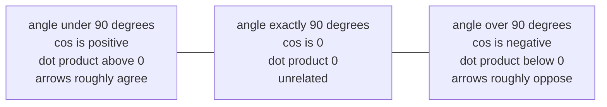

This chapter answers two questions. How does a model decide that one word is relevant to another? And why does the attention formula divide by $\sqrt{d_k}$? An LLM needs the first because the meaning of a word depends on its neighbors, and the second because the model would not train without it. From [Chapter 01](/tech/series/math-for-ai/01.vectors-and-spaces/) you should know what a vector is, what its length is, and that cosine similarity measures alignment. Everything else is defined here.

## 1. The problem: fuzzy matching

A Python dict matches exactly or not at all:

```python
database = {"cat": "feline animal", "dog": "canine animal"}
database.get("kitten")   # None: no exact match
```

Language does not work that way. `"kitten"` shares no letters with `"cat"` and means nearly the same thing. A pronoun like `"it"` has to find the noun it refers to, and `"bank"` means something different near `"river"` than near `"deposit"`. We want a match score that is a smooth number rather than yes or no, and one that learning algorithms can adjust gradually. The dot product is that score.

## 2. The dot product by hand

Multiply the vectors entry by entry, then add:

$$\mathbf{u} \cdot \mathbf{v} = u_1 v_1 + u_2 v_2 + \dots + u_d v_d$$

Here $u_1$ means "the first number in $\mathbf{u}$", and $d$ is how many numbers each vector has. For $\mathbf{u} = (3, 4)$ and $\mathbf{v} = (5, 0)$:

$$\mathbf{u} \cdot \mathbf{v} = 3 \cdot 5 + 4 \cdot 0 = 15$$

In Python this is `sum(a * b for a, b in zip(u, v))`.

## 3. The geometric view: a shadow

The same number has a second formula that uses the angle $\theta$ between the arrows:

$$\mathbf{u} \cdot \mathbf{v} = \|\mathbf{u}\| \, \|\mathbf{v}\| \cos\theta$$

Check it on the example. $\|\mathbf{u}\| = 5$, $\|\mathbf{v}\| = 5$, and the angle between $(3, 4)$ and $(5, 0)$ has $\cos\theta = 3/5 = 0.6$. So $5 \cdot 5 \cdot 0.6 = 15$. Both formulas agree.

Here is a way to picture it. Lay $\mathbf{v}$ flat along a table and shine a light straight down on $\mathbf{u}$. Its shadow on the table has length $\|\mathbf{u}\|\cos\theta$, which is 3 in our case: the first coordinate of $(3, 4)$. The dot product is that shadow length times $\|\mathbf{v}\|$.



Two things follow. The dot product is large when two arrows point the same way, zero when they are perpendicular, and negative when they point apart. And it grows with the lengths, so it is cosine similarity multiplied by $\|\mathbf{u}\|\|\mathbf{v}\|$. Attention uses the raw dot product, lengths included.

The [`calc`](https://github.com/azusachino/calc) function `dot_product_and_projection` in [`calc/math/attention.py`](https://github.com/azusachino/calc/blob/main/calc/math/attention.py) returns the dot product, the shadow length and the angle. For the example above it gives a dot product of 15, a shadow length of 3 and an angle of about 53.1 degrees.

## 4. From scores to attention weights

In attention, each word produces two vectors, a **query** $\mathbf{q}$ ("what am I looking for?") and a **key** $\mathbf{k}$ ("what do I offer?"). How the model computes them from the word is the subject of Chapter 03. For now, take them as given. The score for word $i$ looking at word $j$ is

$$S_{i,j} = \mathbf{q}_i \cdot \mathbf{k}_j$$

Suppose one query $\mathbf{q} = (1, 1)$ and three keys: $(2, 1)$, $(0, 1)$ and $(-1, -1)$. The scores are $3$, $1$ and $-2$. Raw scores are awkward to use, so we turn them into weights that are positive and add up to 1 with the **softmax** function: raise $e \approx 2.718$ to each score, then divide each result by the total.

$$e^3 \approx 20.09,\quad e^1 \approx 2.72,\quad e^{-2} \approx 0.14,\quad \text{total} \approx 22.94$$

The weights are $20.09/22.94 \approx 0.876$, $0.118$ and $0.006$. The query pays 88% of its attention to the first key. (Chapter 06 looks at softmax in detail.) The full formula from the 2017 paper *Attention Is All You Need* is

$$\operatorname{Attention}(Q, K, V) = \operatorname{softmax}\!\left( \frac{Q K^T}{\sqrt{d_k}} \right) V$$

where $Q$ and $K$ stack all queries and keys as rows, $QK^T$ is a table of all the dot products, $V$ holds the content that gets mixed (Chapter 03), and $d_k$ is the length of a key vector. That division by $\sqrt{d_k}$ is what the rest of this chapter explains.

## 5. Why divide by $\sqrt{d_k}$

Start with the problem in one line: when the scores get large, softmax goes all-or-nothing. With scores $(1, 0, 0)$ it gives weights near $0.58, 0.21, 0.21$. With $(10, 0, 0)$ it gives $0.9999, 0.00005, 0.00005$.

An all-or-nothing softmax is bad for training. Training (Chapter 05) works by asking how the output changes when you nudge an input, and a softmax that is already at $0.9999$ barely moves when you nudge a score. Its slope is close to zero, so the learning signal is close to zero too.

Do raw dot products get large? Picture a query and key whose entries are random with typical size 1. Each product $q_i k_i$ is a random number of typical size 1, sometimes positive, sometimes negative. Adding $d_k$ of those up is like a random walk of $d_k$ steps, which on average ends about $\sqrt{d_k}$ away from zero, not $d_k$ away, because the ups and downs partly cancel. For $d_k = 64$, a typical raw score is around 8 either way. For $d_k = 768$ it is around 28. Dividing by $\sqrt{d_k}$ brings the typical size back to about 1, whatever $d_k$ is.

Here is the evidence from `calc`, run with 10,000 random pairs per dimension:

```bash
uv run python -m calc.math.attention
```

```text
Key Dim (d_k)  | Raw Var (≈ d_k)  | Raw Std (≈ √d_k)   | Scaled Std (1/√d_k)
16             | 16.20            | 4.02               | 1.01
64             | 64.05            | 8.00               | 1.00
128            | 126.97           | 11.27              | 1.00
768            | 762.25           | 27.61              | 1.00

Raw Attention (No 1/√d_k):      Peak Prob: 84.5%  | Entropy: 0.404
Scaled Attention (With 1/√d_k): Peak Prob: 25.2%  | Entropy: 2.345
```

"Std" is the typical spread of the score (standard deviation), and "Var" is its square. In the second block, 16 keys compete for one query. Without scaling the top key takes 84.5% of the weight on average; with scaling, 25.2%. Entropy is a measure of how spread out the weights are (Chapter 06); the maximum for 16 keys is 2.773.

This experiment uses random queries and keys, which is how a freshly initialized model looks. Trained vectors have other statistics, but the scaling is chosen for the start of training, when this problem would otherwise stop learning before it begins.

## Going deeper (optional)

You can skip this; the rest of the series does not depend on it.

**The variance calculation.** Suppose each $q_i$ and $k_i$ is independent with mean 0 and variance 1. Variance measures squared spread; for independent quantities, variances add. Then $\mathbb{E}[q_i k_i] = 0$, and $\operatorname{Var}(q_i k_i) = \mathbb{E}[q_i^2]\,\mathbb{E}[k_i^2] = 1$. Summing $d_k$ independent terms gives $\operatorname{Var}(\mathbf{q} \cdot \mathbf{k}) = d_k$, so the standard deviation is $\sqrt{d_k}$. Dividing by $\sqrt{d_k}$ divides the variance by $d_k$, leaving 1.

**The softmax slope.** If $p_i$ is the softmax output for score $z_i$, then $\partial p_i / \partial z_i = p_i(1 - p_i)$, and $\partial p_i / \partial z_j = -p_i p_j$ for $j \ne i$. When one $p$ is close to 1, all of these are close to 0. The slope is small rather than exactly zero, which is still small enough to stall training in floating point.

## Try it

1. Compute the dot product of $(2, 1, 0)$ and $(1, 3, 5)$. (Answer: $2 + 3 + 0 = 5$.)
2. For scores $(2, 0, 0)$, compute the softmax weights. (Hint: $e^2 \approx 7.39$, and the total is $7.39 + 1 + 1$. Answer: about $0.787, 0.106, 0.106$.)
3. Using the random-walk argument, what is the typical size of a raw score for $d_k = 256$? (Answer: about 16, matching the table.)

## Recap and next step

The dot product multiplies matching entries and adds them up. Geometrically it says how far two arrows point the same way, scaled by their lengths. Attention scores every query against every key with dot products, turns the scores into weights with softmax, and divides by $\sqrt{d_k}$ so that the scores do not grow with the vector size and flatten softmax's slope.

One loose end: so far, a word's query and key came out of nowhere, and if they were just the word's own vector, the score between two words would be the same in both directions. In **[Chapter 03: Matrices & Linear Transformations](/tech/series/math-for-ai/03.matrices-and-transformations/)**, we see how a matrix produces queries, keys and values from a word, and why that breaks the symmetry.
