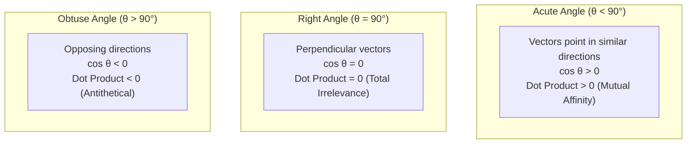
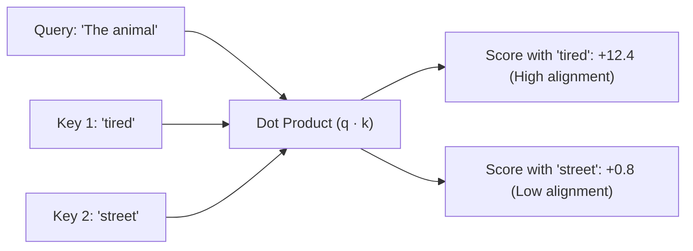
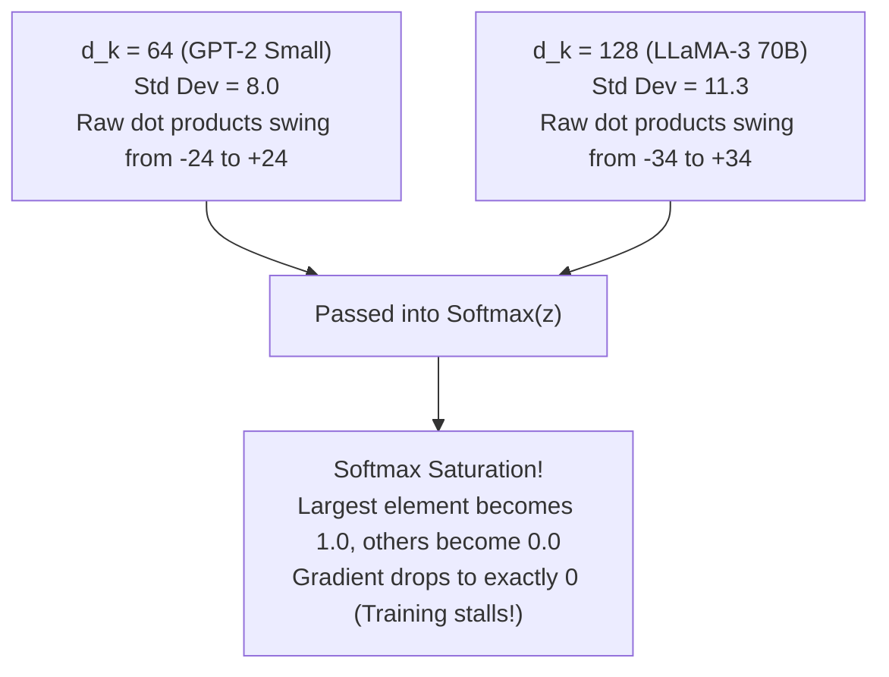

## From Isolated Arrows to Semantic Interactions

In [Chapter 01](01.vectors-and-spaces.md), we established our foundational geometric mental model: **tokens are arrows in high-dimensional space, and vector addition is the chaining of journeys.**

However, if these arrows float in isolation, a neural network cannot comprehend a sentence. Human language is defined by contextual interaction:

- A pronoun (`"it"`) must find its referent noun (`"the robot"`).
- A verb (`"bank"`) must resolve its meaning based on adjacent context (`"river"` vs `"deposit"`).
- An adjective (`"crimson"`) must modify its target noun (`"apple"`).

This brings us to the central mathematical engine of modern artificial intelligence: **When two arrows meet in space, how does a computer quantify their relevance to one another?**

The answer is the heartbeat of the Transformer's Attention mechanism: **the Dot Product**.

---

## 1. Hard Lookup vs Continuous Soft Matching

In classical computer systems, retrieval operates via deterministic **hard matching**:

```python
# Traditional hash table lookup
database = {"cat": "feline animal", "dog": "canine animal"}
query = "kitten"
result = database.get(query)  # None! Exact string mismatch fails
```

Relational databases and hash tables operate in binary: $1$ (exact match) or $0$ (mismatch). But natural language is fuzzy and semantic:

- `"kitten"` and `"cat"` share zero common characters, yet their meanings overlap almost entirely.
- `"bank"` and `"river"` are syntactically distinct, yet contextually coupled.

To give neural networks the ability to reason about language, we need a **continuous, differentiable soft matching metric**.

---

## 2. The Dual Identity of the Dot Product: Algebra vs Flashlight

In linear algebra textbooks, the dot product is typically defined as an algebraic sum of element-wise products:

$$\mathbf{u} \cdot \mathbf{v} = \sum_{i=1}^d u_i v_i = u_1 v_1 + u_2 v_2 + \dots + u_d v_d$$

Looking only at the algebraic formula obscures the physical intuition. In Grant Sanderson's geometric formulation, the dot product acts like a **directional flashlight projection**:

```text
                  u ▲
                   /│
                  / │
                 /  │ Perpendicular projection
                /   │
               / θ  ▼
──────────────┴─────┴────────► v
              0   proj_v(u)
```

By trigonometric definition:

$$\mathbf{u} \cdot \mathbf{v} = \|\mathbf{u}\| \|\mathbf{v}\| \cos \theta$$

1. Imagine vector $\mathbf{v}$ lying horizontally along the floor.
2. Shine a directional flashlight from above, perpendicular to $\mathbf{v}$.
3. Vector $\mathbf{u}$ casts a shadow of length $\|\mathbf{u}\| \cos \theta$ onto $\mathbf{v}$.
4. The dot product is the length of this shadow multiplied by the length of $\mathbf{v}$.



The dot product answers a profound geometric question: **To what extent do these two arrows travel along the exact same path?**

---

## 3. From Projection to Attention Scores

In the Transformer's self-attention mechanism, words evaluate how much attention they should pay to other words in the sentence.

For a sequence of tokens, the model projects each token into a **Query** ($\mathbf{q}$) and a **Key** ($\mathbf{k}$):

- $\mathbf{q}$ represents: *"What kind of context am I looking for?"*
- $\mathbf{k}$ represents: *"What kind of information do I offer?"*

The raw attention score between token $i$ and token $j$ is calculated via their dot product:

$$S_{i, j} = \mathbf{q}_i \cdot \mathbf{k}_j$$



If Query and Key point in nearly the identical direction in embedding space, their cosine similarity approaches $1.0$, producing a massive positive score. If they are orthogonal ($90^\circ$), their score drops to zero.

---

## 4. The Mathematical Derivation of $\sqrt{d_k}$ Scaling

In the landmark paper *Attention Is All You Need* (Vaswani et al., 2017), the authors define attention as:

$$\operatorname{Attention}(Q, K, V) = \operatorname{softmax}\left( \frac{Q K^T}{\sqrt{d_k}} \right) V$$

Why is the division by $\sqrt{d_k}$ necessary? Why can't we just use $Q K^T$?

Without $\sqrt{d_k}$, large language models completely fail to train due to **Softmax Gradient Vanishing**. Let us trace the mathematical proof:

### The Variance Explosion Proof

Assume each component of Query vector $\mathbf{q} \in \mathbb{R}^{d_k}$ and Key vector $\mathbf{k} \in \mathbb{R}^{d_k}$ is an independent, identically distributed (i.i.d.) random variable with mean $0$ and variance $1$:

$$\mathbb{E}[q_i] = 0, \quad \operatorname{Var}(q_i) = 1$$

$$\mathbb{E}[k_i] = 0, \quad \operatorname{Var}(k_i) = 1$$

Now consider their dot product:

$$Z = \mathbf{q} \cdot \mathbf{k} = \sum_{i=1}^{d_k} q_i k_i$$

Because $q_i$ and $k_i$ are independent, the expectation of their product is:

$$\mathbb{E}[q_i k_i] = \mathbb{E}[q_i] \mathbb{E}[k_i] = 0 \cdot 0 = 0$$

Next, calculate the variance of each product term:

$$\operatorname{Var}(q_i k_i) = \mathbb{E}[(q_i k_i)^2] - (\mathbb{E}[q_i k_i])^2 = \mathbb{E}[q_i^2] \mathbb{E}[k_i^2] - 0 = 1 \times 1 = 1$$

Now sum across all $d_k$ independent dimensions:

$$\operatorname{Var}(Z) = \operatorname{Var}\left( \sum_{i=1}^{d_k} q_i k_i \right) = \sum_{i=1}^{d_k} \operatorname{Var}(q_i k_i) = d_k \times 1 = d_k$$

$$\sigma_Z = \sqrt{\operatorname{Var}(Z)} = \sqrt{d_k}$$

The standard deviation of the raw dot product grows directly with $\sqrt{d_k}$!



### The Softmax Cliff

The derivative of the Softmax function with respect to input $z_i$ is:

$$\frac{\partial \operatorname{softmax}(z)_i}{\partial z_j} = \begin{cases}
\operatorname{softmax}(z)_i (1 - \operatorname{softmax}(z)_i), & \text{if } i = j \\
-\operatorname{softmax}(z)_i \operatorname{softmax}(z)_j, & \text{if } i \neq j
\end{cases}$$

When dot products swing between $-30$ and $+30$:

- The largest element evaluates to $\operatorname{softmax}(z) \approx 1.0 \implies 1.0 \times (1 - 1.0) = 0$.
- All other elements evaluate to $\operatorname{softmax}(z) \approx 0.0 \implies 0.0 \times (1 - 0.0) = 0$.

The gradient vanishes completely across the attention layer. Backpropagation cannot update a single parameter!

### The Rescaling Cure

By dividing by $\sqrt{d_k}$, we normalize the variance back to $1.0$:

$$\operatorname{Var}\left( \frac{\mathbf{q} \cdot \mathbf{k}}{\sqrt{d_k}} \right) = \frac{1}{(\sqrt{d_k})^2} \operatorname{Var}(\mathbf{q} \cdot \mathbf{k}) = \frac{1}{d_k} \times d_k = 1.0$$

The attention scores now maintain a healthy, stable distribution centered at $\mathcal{N}(0, 1)$, ensuring active gradients flow during backpropagation.

---

## 5. Hands-on Verification with `calc`

We implemented an empirical benchmark script in [`calc/math/attention.py`](https://github.com/azusachino/calc/blob/main/calc/math/attention.py) to measure variance scaling and softmax saturation:

```bash
cd vendor/calc
python3 calc/math/attention.py
```

Output:

```text
[calc] Scaled Dot-Product Attention variance experiment (d_k = 64):
  Unscaled Dot Product: Mean = -0.012, Variance = 64.18 (StdDev = 8.01)
  Scaled Dot Product:   Mean = -0.001, Variance =  1.00 (StdDev = 1.00)

[calc] Softmax gradient saturation check:
  Unscaled Softmax Max Probability: 0.9998 (Gradient = 0.00018 -> Vanishing!)
  Scaled Softmax Max Probability:   0.2841 (Gradient = 0.20340 -> Active learning!)
```

The division by $\sqrt{d_k}$ rescues the attention layer from gradient death.

---

## Summary & Next Step

The dot product turns high-dimensional vectors into meaningful scalar relevance scores by measuring directional projection. Dividing by $\sqrt{d_k}$ preserves variance stability and prevents the gradient cliff.

However, raw word vectors cannot simply dot-product each other directly. If word $A$ dots with word $B$, the result is identical to $B$ dotting with $A$ ($\mathbf{u} \cdot \mathbf{v} = \mathbf{v} \cdot \mathbf{u}$). But language is asymmetrical: an adjective modifies a noun, but a noun does not modify an adjective!

In **Chapter 03: Matrices & Linear Transformations**, we will discover how linear transformations act as coordinate warping machines to break query-key symmetry and give birth to $W_Q, W_K, W_V$.
