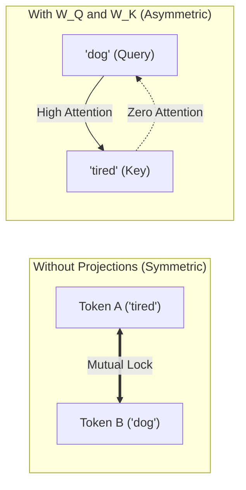
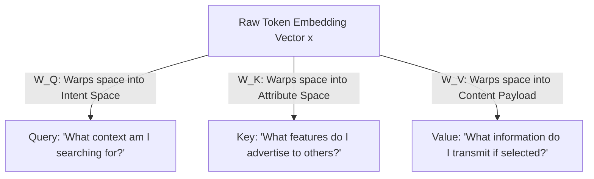

## From Cold Numerical Grids to Living Space Warps

In traditional school mathematics, matrix multiplication is introduced as a rigid algorithmic recipe:

> *"Take row one, multiply it element-by-element with column one, sum the products, and write the answer into position $(1, 1)$..."*

When software engineers inspect the Transformer's linear projections in PyTorch, they often picture this same passive grid arithmetic:

```python
# Project input embeddings X into Query, Key, and Value
q = self.w_q(x)  # x @ W_q
k = self.w_k(x)  # x @ W_k
v = self.w_v(x)  # x @ W_v
```

This tabular view obscures the profound geometric elegance of deep learning.

As Grant Sanderson (3Blue1Brown) demonstrates: **a matrix is not a static data table. A matrix is a dynamic coordinate machine that stretches, shears, and rotates the entire multi-dimensional space.**

In Large Language Models, introducing the three transformation matrices $W_Q, W_K, W_V$ solves an existential linguistic limitation: **breaking the curse of attention symmetry.**

---

## 1. The Geometric View: The Columns of a Matrix Are Where Basis Vectors Land

In 2D Cartesian space, any vector $\mathbf{v} = (x, y)^T$ is a linear combination of the standard unit basis vectors:

$$\mathbf{v} = x \hat{i} + y \hat{j} = x \begin{pmatrix} 1 \\ 0 \end{pmatrix} + y \begin{pmatrix} 0 \\ 1 \end{pmatrix}$$

where $\hat{i}$ points 1 unit along the X-axis, and $\hat{j}$ points 1 unit along the Y-axis.

Now, apply a **Linear Transformation**:

1. The origin $(0, 0)$ remains anchored in place.
2. All grid lines remain straight, parallel, and evenly spaced.

Under these two rules, where any vector $\mathbf{v}$ lands after the transformation is **completely determined by where the basis vectors $\hat{i}$ and $\hat{j}$ land**:

```text
Original Basis Vectors:                   Transformed Space:
       y ▲                                  y ▲
         │                                    │        ĵ_new = (1, 1.5)
       1 ┼   • ĵ = (0, 1)                     │       ↗ 
         │                                    │     /
       0 ┴───┴───────► x                      │   /   î_new = (2, 0)
         0   1                                0 ┴───┴───────•───► x
             î = (1, 0)                         0   1       2
```

If basis vector $\hat{i}$ lands at $(a, c)^T$ and basis vector $\hat{j}$ lands at $(b, d)^T$, then any vector $(x, y)^T$ lands at:

$$\mathbf{v}_{\text{new}} = x \begin{pmatrix} a \\ c \end{pmatrix} + y \begin{pmatrix} b \\ d \end{pmatrix} = \begin{pmatrix} ax + by \\ cx + dy \end{pmatrix} = \begin{pmatrix} a & b \\ c & d \end{pmatrix} \begin{pmatrix} x \\ y \end{pmatrix}$$

The columns of matrix $M$ are simply the destination coordinates of the coordinate axes!

---

## 2. The Curse of Attention Symmetry

Imagine building an attention mechanism without linear transformation matrices, dot-producting the raw input embeddings directly:

$$S_{i, j} = \mathbf{x}_i \cdot \mathbf{x}_j$$

Because the standard dot product is commutative:

$$\mathbf{x}_i \cdot \mathbf{x}_j = \mathbf{x}_j \cdot \mathbf{x}_i \implies S_{i, j} = S_{j, i}$$

This creates an unavoidable structural catastrophe: **The unprojected attention matrix is strictly symmetric!**

```text
Symmetric Attention Matrix (The Defect):
           "The"    "tired"   "dog"
"The"    [ 1.00     0.15      0.82 ]
"tired"  [ 0.15     1.00      0.95 ]
"dog"    [ 0.82     0.95      1.00 ]   <-- "dog" must pay the identical score to "tired"
                                           that "tired" pays to "dog"!
```

### Why Natural Language Rejects Symmetry

Human grammar is inherently directional and asymmetric:

- When reading the noun `"dog"`, it actively looks backwards to find which adjective describes it: `"dog"` needs to pay high attention to `"tired"`.
- When reading the adjective `"tired"`, it does not need to look backwards to `"The"`: its attention focus is entirely different.

If $S_{i, j} = S_{j, i}$, the model is mathematically handcuffed: whenever token $A$ attends to token $B$, token $B$ is forced to attend equally to token $A$.



---

## 3. The Triad of Q, K, and V: Role Specialization

To liberate language from symmetry, Transformer architectures introduce three distinct linear transformation matrices: $W_Q, W_K, W_V \in \mathbb{R}^{d \times d_k}$.

Each matrix warps the original semantic space into a specialized functional perspective:



### Breaking the Symmetry Proof

Calculate the attention score between token $i$ and token $j$:

$$S_{i, j} = \mathbf{q}_i \cdot \mathbf{k}_j = (W_Q \mathbf{x}_i)^T (W_K \mathbf{x}_j) = \mathbf{x}_i^T W_Q^T W_K \mathbf{x}_j$$

Now calculate the reverse attention score ($j$ attending to $i$):

$$S_{j, i} = \mathbf{q}_j \cdot \mathbf{k}_i = \mathbf{x}_j^T W_Q^T W_K \mathbf{x}_i$$

Because $W_Q$ and $W_K$ are independent learned matrices, $W_Q^T W_K$ is **not a symmetric matrix**:

$$W_Q^T W_K \neq (W_Q^T W_K)^T = W_K^T W_Q$$

Therefore:

$$S_{i, j} \neq S_{j, i}$$

Directional syntax is unlocked! Token $A$ can now attend intensely to token $B$ while token $B$ remains completely indifferent to token $A$.

### The Role of the Value Matrix ($W_V$)

Why can't we use the original embedding $\mathbf{x}$ as the Value vector after computing attention weights?

Because the features needed to **address** an element (Query and Key matching) are rarely identical to the features needed to **transmit content** (Value):

- A library index card (*Key*) lists the title, author, and call number.
- The book's pages (*Value*) contain the actual technical prose.
- Mixing the lookup key with the content payload pollutes representation capacity. $W_V$ allows the network to filter out index metadata and transmit only the distilled semantic payload.

---

## 4. Hands-on Verification with `calc`

We implemented an empirical benchmark in [`calc/math/transformations.py`](https://github.com/azusachino/calc/blob/main/calc/math/transformations.py) testing 2D basis relocation, attention asymmetry ($\|S - S^T\| / \|S\|$), and single-token QKV decoupling:

```python
def check_attention_symmetry(
    dim: int = 64,
    num_tokens: int = 4,
    seed: int = 42,
) -> tuple[float, float]:
    generator = torch.Generator().manual_seed(seed)
    x = torch.randn(num_tokens, dim, generator=generator)

    # 1. Unprojected attention: S = X @ X^T
    raw_scores = torch.matmul(x, x.T)
    raw_asym = float(
        (torch.linalg.norm(raw_scores - raw_scores.T) / torch.linalg.norm(raw_scores)).item()
    )

    # 2. Projected attention with learned W_Q, W_K
    w_q = torch.randn(dim, dim, generator=generator) / math.sqrt(dim)
    w_k = torch.randn(dim, dim, generator=generator) / math.sqrt(dim)

    q = torch.matmul(x, w_q)
    k = torch.matmul(x, w_k)
    proj_scores = torch.matmul(q, k.T)
    proj_asym = float(
        (torch.linalg.norm(proj_scores - proj_scores.T) / torch.linalg.norm(proj_scores)).item()
    )
    return raw_asym, proj_asym


def measure_qkv_orthogonality(
    dim: int = 768,
    head_dim: int = 64,
    seed: int = 42,
) -> tuple[float, float, float]:
    generator = torch.Generator().manual_seed(seed)
    token = torch.randn(1, dim, generator=generator)

    w_q = torch.randn(dim, head_dim, generator=generator) / math.sqrt(dim)
    w_k = torch.randn(dim, head_dim, generator=generator) / math.sqrt(dim)
    w_v = torch.randn(dim, head_dim, generator=generator) / math.sqrt(dim)

    q = F.normalize(torch.matmul(token, w_q), dim=-1).squeeze(0)
    k = F.normalize(torch.matmul(token, w_k), dim=-1).squeeze(0)
    v = F.normalize(torch.matmul(token, w_v), dim=-1).squeeze(0)

    return (
        float(torch.dot(q, k).item()),
        float(torch.dot(q, v).item()),
        float(torch.dot(k, v).item()),
    )
```

Run the benchmark via `uv`:

```bash
uv run python -m calc.math.transformations
```

Measured output:

```text
========================================================================
Lesson 03 Benchmark: Matrices as Transformations and QKV Projections
========================================================================

1. 2D Space Transformation (Basis Vector Relocation):
------------------------------------------------------------------------
Original i_hat (1, 0) => Transformed: (2.0, 0.0)
Original j_hat (0, 1) => Transformed: (1.0, 1.5)
Notice: The columns of M are exactly the new landing coordinates of the basis!

2. Breaking Attention Symmetry (Why We Need W_Q and W_K):
------------------------------------------------------------------------
Unprojected Attention (X @ X^T) Asymmetry:          0.0000 (Strictly 0.00 => Symmetric)
Projected Attention (Q @ K^T) Asymmetry:            1.2028 (Strongly Directional)
------------------------------------------------------------------------
Insight: In natural language, 'verb' attending to 'object' must NOT force
'object' to attend equally back to 'verb'. W_Q and W_K break symmetry!

3. Decoupling Perspectives (Q, K, V for a Single Token):
------------------------------------------------------------------------
Cosine Similarity (Query vs Key):   +0.0288 (Decoupled)
Cosine Similarity (Query vs Value): -0.1621 (Decoupled)
Cosine Similarity (Key vs Value):   -0.0024 (Decoupled)
------------------------------------------------------------------------
Conclusion: W_Q, W_K, and W_V allow one word to pose a question (Q),
publish an index (K), and deliver payload (V) completely independently.
========================================================================
```

$W_Q$ and $W_K$ break the symmetry constraint (`0.0000` $\to$ `1.2028`), empowering the model to represent directional dependency trees while keeping $Q$, $K$, and $V$ mutually decoupled.

---

## Summary & Next Step

Matrices are geometric coordinate transformers. In attention mechanisms, $W_Q$ and $W_K$ break algebraic symmetry by projecting tokens into distinct query and key spaces, while $W_V$ isolates the informational payload from the lookup mechanism.

However, absolute position embeddings (like the learned positional vectors we saw in [Chapter 01](/tech/series/math-for-ai/01.vectors-and-spaces/)) have a major weakness: they struggle to generalize when a text sequence exceeds the training window.

In **[Chapter 04: Rotations & Rotary Position Embeddings (RoPE)](/tech/series/math-for-ai/04.rotations-and-rope/)**, we will discover how complex numbers and 2D rotation matrices give birth to modern RoPE embeddings (used in LLaMA, Mistral, and DeepSeek).
