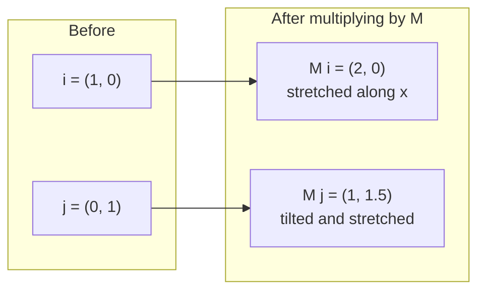
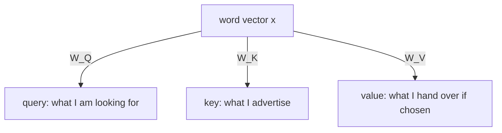

This chapter answers the question left open in [Chapter 02](/tech/series/math-for-ai/02.dot-products-and-attention/): where do queries, keys and values come from, and why do they exist at all? An LLM needs matrices because every learned step in the network is one, from attention to the feed-forward layers. From earlier chapters you should know vectors, the dot product, and the shape of the attention formula. Matrices are introduced from scratch.

## 1. A matrix is a grid, and multiplying is a recipe

A **matrix** is a rectangular grid of numbers. Multiplying a matrix by a vector gives a new vector. The recipe from school: for each row of the matrix, take its dot product with the vector.

$$\begin{pmatrix} 2 & 1 \\ 0 & 1.5 \end{pmatrix} \begin{pmatrix} 3 \\ 2 \end{pmatrix} = \begin{pmatrix} 2 \cdot 3 + 1 \cdot 2 \\ 0 \cdot 3 + 1.5 \cdot 2 \end{pmatrix} = \begin{pmatrix} 8 \\ 3 \end{pmatrix}$$

In numpy: `M @ v`. This is a function: vector in, vector out. The rest of the chapter is about what that function does to space.

## 2. The columns tell you where the axes land

Any 2D vector is a combination of two basic steps: $\hat{i} = (1, 0)$ (one step right) and $\hat{j} = (0, 1)$ (one step up). The vector $(3, 2)$ means "3 of $\hat{i}$ plus 2 of $\hat{j}$".

Now multiply those two basic steps by our matrix $M$:

- $M \hat{i} = (2, 0)$, which is the first column of $M$.
- $M \hat{j} = (1, 1.5)$, which is the second column.

So the columns of a matrix are where the two axis steps land. And everything else follows, because $M$ keeps combinations intact. The vector $(3, 2)$ lands at $3 \cdot (2, 0) + 2 \cdot (1, 1.5) = (8, 3)$, exactly the answer in section 1.



Picture the whole grid of a sheet of graph paper being stretched and tilted so that its lines stay straight and evenly spaced and the origin stays put. That is what "linear transformation" means: a matrix is a way of warping space, and a transformation that keeps lines straight and the origin fixed can always be written as one. This holds for any number of dimensions.

## 3. Matrices that change dimension

A matrix does not have to be square. A grid with 3 rows and 2 columns takes a 2-number vector and returns a 3-number vector:

$$\begin{pmatrix} 1 & 0 \\ 0 & 1 \\ 1 & 1 \end{pmatrix} \begin{pmatrix} 3 \\ 2 \end{pmatrix} = \begin{pmatrix} 3 \\ 2 \\ 5 \end{pmatrix}$$

The rule: a matrix with $r$ rows and $c$ columns takes a vector of $c$ numbers and returns one of $r$ numbers. In a Transformer, a matrix can take a 768-number word vector and return a 64-number one. That is a projection: it looks at the word through a narrower lens.

A note on conventions, since it trips people up. This post writes $W\mathbf{x}$, with the vector as a column on the right. PyTorch layers and the `calc` code write `x @ W`, with the vector as a row on the left and the matrix stored transposed. The two describe the same computation.

## 4. The symmetry problem

Suppose attention scored words straight from their own vectors: $S_{i,j} = \mathbf{x}_i \cdot \mathbf{x}_j$. The dot product does not care about order, since $\mathbf{x}_i \cdot \mathbf{x}_j = \mathbf{x}_j \cdot \mathbf{x}_i$. The score table would be **symmetric**: reading across row $i$ and column $j$ gives the same number as row $j$ and column $i$. If word A attends to word B with strength 0.8, B must attend to A with 0.8.

Language is often one-directional. A noun may need to find its adjective, and the adjective may not care about the noun. In a model that reads left to right the attention mask already limits who can look at whom, but within the allowed pairs we still want "what I look for" to differ from "what I offer". That needs two different vectors per word.

## 5. Query, key and value

The model learns three matrices, $W_Q$, $W_K$ and $W_V$, and applies each to every word vector $\mathbf{x}$:

$$\mathbf{q} = W_Q \mathbf{x}, \qquad \mathbf{k} = W_K \mathbf{x}, \qquad \mathbf{v} = W_V \mathbf{x}$$



Their names come from a library lookup. The query is your search request, the key is the index card, and the value is the book's text. The score between word $i$ and word $j$ is the dot product of $i$'s query and $j$'s key.

A tiny example shows the symmetry breaking. Take two words $\mathbf{x}_a = (1, 0)$ and $\mathbf{x}_b = (0, 1)$. Without matrices, $\mathbf{x}_a \cdot \mathbf{x}_b = 0$ in both directions. Now let $W_Q$ be the identity (it changes nothing) and let $W_K = \begin{pmatrix} 0 & -1 \\ 1 & 0 \end{pmatrix}$, which turns every vector a quarter-turn counterclockwise (Chapter 04 is about this). The queries are $\mathbf{q}_a = (1, 0)$ and $\mathbf{q}_b = (0, 1)$; the keys are the columns of $W_K$: $\mathbf{k}_a = (0, 1)$ and $\mathbf{k}_b = (-1, 0)$. Then

$$S_{a,b} = \mathbf{q}_a \cdot \mathbf{k}_b = -1, \qquad S_{b,a} = \mathbf{q}_b \cdot \mathbf{k}_a = +1$$

Same two words, different scores in each direction. A is repelled by B; B is drawn to A. Learned matrices are not rotations, yet the same effect appears whenever $W_Q$ and $W_K$ are different matrices.

## 6. The value vector

Once the weights from softmax are known (Chapter 02), the output for a word is a weighted sum of the values. With the weights $0.876, 0.118, 0.006$ from the previous chapter and values $(1, 0)$, $(0, 1)$ and $(1, 1)$, the output is

$$0.876 \cdot (1, 0) + 0.118 \cdot (0, 1) + 0.006 \cdot (1, 1) = (0.882, 0.124)$$

Why a separate $W_V$ rather than reusing the word vector? Matching and carrying are different jobs. The features that make a word easy to find do not have to be the features you want to pass on, and a third matrix lets the network choose each independently. This is the standard motivation; it is a design choice that works well in practice rather than a theorem.

## 7. Check it with `calc`

[`calc/math/transformations.py`](https://github.com/azusachino/calc/blob/main/calc/math/transformations.py) has `transform_2d_grid` for the 2D warp and `check_attention_symmetry`, which builds a table of scores with and without $W_Q$ and $W_K$ and measures how far it is from symmetric, as $\|S - S^T\| / \|S\|$. Zero means perfectly symmetric.

```bash
uv run python -m calc.math.transformations
```

```text
Original i_hat (1, 0) => Transformed: (2.0, 0.0)
Original j_hat (0, 1) => Transformed: (1.0, 1.5)

Unprojected Attention (X @ X^T) Asymmetry:   0.0000
Projected Attention (Q @ K^T) Asymmetry:     1.2028
```

The first block is section 2 (the matrix there is the same $M$). The second shows that the unprojected table is exactly symmetric and the projected one is not. The matrices in this test are random, not trained. The script also prints a third block with cosine similarities between a token's query, key and value; those are near zero because the random matrices are unrelated, which says little about trained models.

## Going deeper (optional)

You can skip this; the next chapters do not need it.

**Why the score table is asymmetric.** Substituting the definitions, $S_{i,j} = (W_Q \mathbf{x}_i)^T (W_K \mathbf{x}_j) = \mathbf{x}_i^T (W_Q^T W_K) \mathbf{x}_j$. The middle matrix $W_Q^T W_K$ plays the role of a single "compatibility" matrix. The table is symmetric for every pair of words only if this matrix equals its own transpose, which a generic product of two independent matrices does not.

**Low rank.** With 64-dimensional queries and keys and 768-dimensional words, $W_Q^T W_K$ has rank at most 64: all the compatibility the head can express passes through a 64-dimensional bottleneck. That is why models use many heads, each with its own $W_Q$, $W_K$ and $W_V$.

## Try it

1. Multiply $\begin{pmatrix} 1 & 2 \\ 3 & 4 \end{pmatrix}$ by $(1, 1)$. (Answer: $(3, 7)$.) Where does it send $\hat{i}$? (Answer: to its first column, $(1, 3)$.)
2. Keep $W_Q$ as the identity and use $W_K = \begin{pmatrix} 2 & 1 \\ 0 & 1 \end{pmatrix}$ with $\mathbf{x}_a = (1, 0)$ and $\mathbf{x}_b = (1, 1)$. Compute $S_{a,b}$ and $S_{b,a}$. (Hint: the keys are $\mathbf{k}_a = (2, 0)$ and $\mathbf{k}_b = (3, 1)$. Answer: $S_{a,b} = 3$ and $S_{b,a} = 2$.)

## Recap and next step

A matrix is a recipe that sends vectors to vectors; its columns show where the axes land. Attention applies three learned matrices to each word to get a query, a key and a value, which lets the score from word A to word B differ from the score from B to A and separates "what I match on" from "what I carry".

There is still no sense of word order in any of this. Chapter 01 added a position vector to the word; that has weaknesses. In **[Chapter 04: Rotations & Rotary Position Embeddings (RoPE)](/tech/series/math-for-ai/04.rotations-and-rope/)**, we use one particular kind of matrix, rotation, to encode position in a different way (used in LLaMA, Mistral and DeepSeek).
