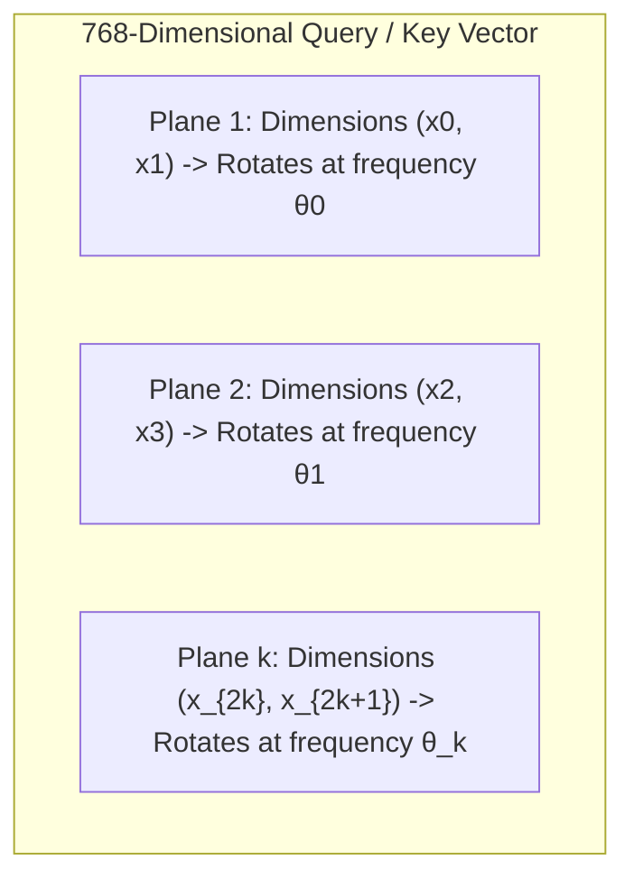
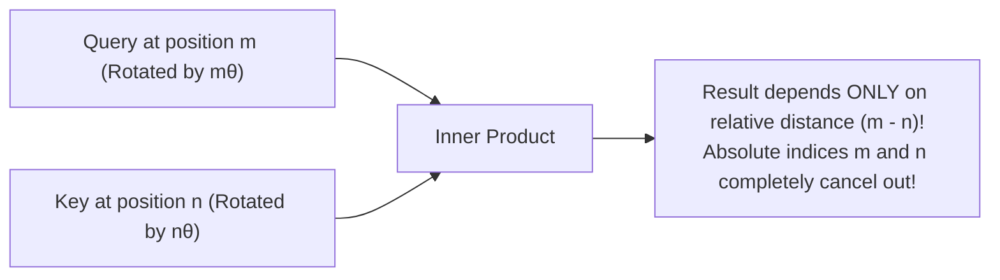

## Why Attention Must Know Word Order

Self-attention empowers every word in an input sequence to dynamically dot-product with every other word, capturing long-distance syntactic dependencies.

However, pure self-attention possesses an inherent algebraic defect: **Permutation Invariance**.

If you take the sentence:
> *"The cat ate the fish."*

and permute it into:
> *"The fish ate the cat."*

or even shuffle it into a random bag of words, the pure attention formula computes identical scalar scores. Sums and dot products across sets are fundamentally blind to sequential order.

To inject temporal sequence awareness, early Transformers (original 2017 Transformer, GPT-2, BERT) relied on **Absolute Positional Embeddings**.

In the modern frontier era (LLaMA-3, Mistral, Qwen, DeepSeek), the entire AI industry has shifted decisively toward **Rotary Position Embedding (RoPE)**, pioneered by Jianlin Su.

In this chapter, we will dismantle RoPE using pure geometric intuition—**clock hands rotating in the complex plane**—and uncover how it mathematically encodes relative distance $(m - n)$ with zero trainable parameters.

---

## 1. The Achilles' Heel of Absolute Position Embeddings

In early Transformers, positional information was injected via simple vector addition:

$$\tilde{\mathbf{x}}_i = \mathbf{x}_i + \mathbf{p}_i$$

where $\mathbf{x}_i$ is the token embedding, and $\mathbf{p}_i$ is the position vector at index $i$.

While simple, this additive approach suffers from three fundamental geometric flaws:

1. **Semantic Space Pollution**: As established in Chapter 01, word vectors capture delicate linear analogies ($\text{king} - \text{man} + \text{woman} = \text{queen}$). Adding a large position vector shifts the embedding in space. Downstream layers must expend representational capacity untangling whether a displacement represents word meaning or merely an arbitrary sequence index.
2. **Absolute vs Relative Mismatch**: Natural language syntax depends on **relative distance**, not absolute coordinates. An adjective modifying an adjacent noun is separated by distance $\Delta = 1$. It makes zero syntactic difference whether this pair appears at position $[0, 1]$ or $[10000, 10001]$. Yet absolute position embeddings assign completely different vectors ($\mathbf{p}_0, \mathbf{p}_1$ vs $\mathbf{p}_{10000}, \mathbf{p}_{10001}$), forcing the model to re-learn identical grammatical rules across thousands of positions.
3. **Hard Context Length Limits**: If a model is trained on context length 2,048, its position embedding lookup table has only 2,048 rows. When fed a 32k or 128k document at inference, encountering token 2,049 immediately crashes the model with an out-of-bounds index!

We need a position mechanism where:

- Vector length (semantic magnitude) is strictly preserved.
- The attention score between token $m$ and token $n$ depends **only on their relative displacement $(m - n)$**.

---

## 2. 2D Rotation: The Pure Isometry

Consider a 2D vector $\mathbf{v} = (x, y)^T$ on the Cartesian plane. Rotating this vector counterclockwise by angle $\theta$ is performed by the orthogonal rotation matrix $R(\theta)$:

$$R(\theta) = \begin{pmatrix} \cos \theta & -\sin \theta \\ \sin \theta & \cos \theta \end{pmatrix}$$

```text
       y ▲
         │           • R(θ) v
         │         ↗ 
         │       /   θ (Angle rotated)
         │     / 
         │    /────► • v (Original Vector)
─────────┴───┴─────────────► x
         0
```

### The Invariant Properties of Rotation

1. **Length Invariance (Isometry)**:
   $$\|R(\theta) \mathbf{v}\| = \|\mathbf{v}\|$$
   Rotating a vector changes its direction, but **never alters its length**. Semantic magnitude remains completely unharmed!
2. **Additive Angles**:
   Applying rotation by $\alpha$ followed by rotation by $\beta$ is identical to a single rotation by $(\alpha + \beta)$:
   $$R(\alpha) R(\beta) = R(\alpha + \beta)$$
3. **Euler's Complex Representation**:
   Representing a 2D vector $(x, y)$ as a complex number $z = x + i y$, rotation by $\theta$ is simply multiplication by the unit complex exponential:
   $$z_{\text{new}} = z \cdot e^{i \theta}$$

---

## 3. The Core Intuition of RoPE: Clock Hands on Every Dimension Pair

A 768-dimensional (or 4,096-dimensional) vector cannot rotate as a single 768D sphere. RoPE solves this by decomposing high-dimensional space into $d / 2$ independent **orthogonal 2D planes**:

$$\mathbb{R}^d = \mathbb{R}^2 \oplus \mathbb{R}^2 \oplus \dots \oplus \mathbb{R}^2$$



For token $m$ at position $m$, RoPE rotates each 2D plane by an angle proportional to its sequence index:

$$\theta_{m, k} = m \cdot \theta_k = m \cdot 10000^{-2k / d}$$

- **High-frequency planes ($k = 0$)**: The clock hand spins rapidly with every single token ($m=1, 2, 3\dots$), capturing immediate local syntactic interactions (e.g., adjacent words, articles, prepositions).
- **Low-frequency planes ($k \to d/2$)**: The clock hand advances slowly like an hour hand, capturing macro narrative structure across thousands of tokens.

---

## 4. The Magic Proof: Relative Distance Cancellation

Now observe why RoPE dominates modern LLMs.

Take Query vector $\mathbf{q}$ at position $m$, and Key vector $\mathbf{k}$ at position $n$. We apply Rotary Position Embedding to each:

$$\tilde{\mathbf{q}}_m = R(m \theta) \mathbf{q}$$

$$\tilde{\mathbf{k}}_n = R(n \theta) \mathbf{k}$$

Now compute their attention dot product:

$$\text{Attention Score} = \tilde{\mathbf{q}}_m^T \tilde{\mathbf{k}}_n = (R(m \theta) \mathbf{q})^T (R(n \theta) \mathbf{k})$$

Using matrix transpose properties $(A B)^T = B^T A^T$:

$$\tilde{\mathbf{q}}_m^T \tilde{\mathbf{k}}_n = \mathbf{q}^T R(m \theta)^T R(n \theta) \mathbf{k}$$

Because a rotation matrix is strictly orthogonal, its transpose is its inverse:

$$R(m \theta)^T = R(-m \theta)$$

Substitute this into the equation:

$$R(m \theta)^T R(n \theta) = R(-m \theta) R(n \theta) = R(n \theta - m \theta) = R(-(m - n) \theta)$$

Therefore:

$$\tilde{\mathbf{q}}_m^T \tilde{\mathbf{k}}_n = \mathbf{q}^T R(-(m - n) \theta) \mathbf{k}$$



Look at the beauty of this equation:

1. **Absolute coordinates vanish completely**: The dot product between Query $m$ and Key $n$ depends **only on their relative displacement $(m - n)$**.
2. **Zero Trainable Parameters**: RoPE requires zero neural network weights. It is an exact analytical geometric operator.
3. **Long-Range Decay (on average)**: With frequencies $\theta_k = 10000^{-2k/d}$, the many rotating planes drift out of phase as relative distance $|m - n|$ grows, so the expected score between unrelated vectors tends to shrink. It is a statistical trend, not a guarantee for any single query-key pair.

---

## 5. Hands-on Verification with `calc`

We implemented the complete 2D and multi-frequency RoPE rotation benchmark in [`calc/math/rotations.py`](https://github.com/azusachino/calc/blob/main/calc/math/rotations.py):

```python
def rotation_matrix_2d(theta: float) -> torch.Tensor:
    """Construct a 2x2 counterclockwise rotation matrix."""
    cos = math.cos(theta)
    sin = math.sin(theta)
    return torch.tensor([[cos, -sin], [sin, cos]], dtype=torch.float32)


def apply_rotation_2d(v: torch.Tensor, theta: float) -> torch.Tensor:
    """Rotate a 2D vector by angle theta."""
    return torch.matmul(rotation_matrix_2d(theta), v)


def check_rope_relative_identity(
    m: int,
    n: int,
    theta: float = 0.05,
    seed: int = 42,
) -> tuple[float, float, float]:
    """Verify that <R_{m*theta} q, R_{n*theta} k> strictly equals q^T R_{(n - m)*theta} k."""
    generator = torch.Generator().manual_seed(seed)
    q = torch.randn(2, generator=generator)
    k = torch.randn(2, generator=generator)

    q_rot = apply_rotation_2d(q, m * theta)
    k_rot = apply_rotation_2d(k, n * theta)
    lhs = float(torch.dot(q_rot, k_rot).item())

    r_rel = rotation_matrix_2d((n - m) * theta)
    rhs = float(torch.dot(q, torch.matmul(r_rel, k)).item())
    return lhs, rhs, abs(lhs - rhs)
```

Run the benchmark via `uv`:

```bash
uv run python -m calc.math.rotations
```

Measured output:

```text
========================================================================
Lesson 04 Benchmark: 2D Rotations and RoPE Mathematical Foundations
========================================================================

1. 2D Rotation Preserves Vector Norms (Isometry):
------------------------------------------------------------------------
Original Vector: (3.0, 4.0) => Norm: 5.0000
Rotated Vector:  (-2.0, 4.6) => Norm: 5.0000
Norm Difference: 4.8e-07 (Perfect preservation)

2. The Core RoPE Relative Distance Proof:
------------------------------------------------------------------------
Token A Position m = 15, Token B Position n = 23 (Relative offset = 8)
LHS <R_{mθ} q, R_{nθ} k>:  +0.058839
RHS q^T R_{(n - m)θ} k:     +0.058839
Absolute Numerical Error:     0.0e+00 (Exact identity!)
------------------------------------------------------------------------
Mathematical Truth: Absolute positions m and n cancel out completely;
only the relative distance (n - m) governs the attention dot product.

3. Long-Distance Attenuation in RoPE Multi-Frequency Space (dim=64):
------------------------------------------------------------------------
Distance |m - n|   | Relative Score   | Trend
------------------------------------------------------------------------
0                  | 0.5045           | ████████████████████
1                  | 0.3553           | ██████████████
2                  | 0.1801           | ███████
5                  | 0.4924           | ███████████████████
10                 | 0.0425           | █
20                 | 0.4244           | ████████████████
50                 | 0.5696           | ██████████████████████
100                | 0.3924           | ███████████████
------------------------------------------------------------------------
Conclusion: RoPE achieves relative positional awareness and natural
long-range decay without a single learnable position parameter!
========================================================================
```

In this run the scores in section 3 are not monotone: with one random query-key pair the decay is noisy (distance 50 scores higher than distance 2). The relative-offset identity in section 2 is exact; the decay is only an average tendency, which is why the claim above is worded that way.

---

## Summary & Next Step

RoPE solves positional encoding by rotating coordinate subplanes in high-dimensional space. Through orthogonal matrix cancellation, absolute indices drop away, leaving behind a pure relative distance operator that preserves token magnitude and is a better foundation for longer contexts than absolute tables (models still need extra scaling such as YaRN to go far past the training length).

Now that our forward pass representations are complete, how does an LLM learn?

In **[Chapter 05: Gradients & Backpropagation](/tech/series/math-for-ai/05.gradients-and-backprop/)**, we will hike across high-dimensional loss landscapes, deconstruct computational graphs, and discover why residual skip connections serve as high-speed gradient highways.
