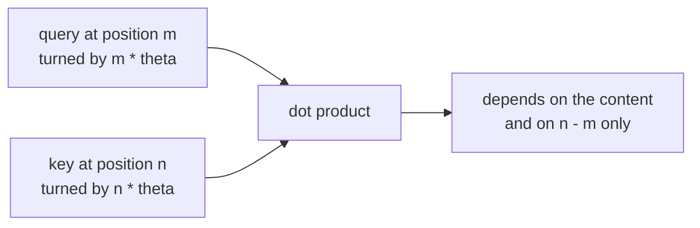

This chapter answers: how does a model that scores words with dot products know the order of the words, and why do most recent models do it with rotations? An LLM needs this because "the cat ate the fish" and "the fish ate the cat" contain the same words. From earlier chapters you should know vectors, the dot product, and that queries and keys are made by matrices. You also need sine and cosine from school; the rest is defined below.

## 1. The problem: attention does not see order

In Chapter 02, the score between two words is the dot product of a query and a key, and each of those is computed from the word alone. Move a word to a different place in the sentence and its query and key do not change, so neither do its scores. A model built only from this would treat a sentence like a bag of words, with no way to tell who ate whom.

So position information must be added somewhere. Early Transformers (the original 2017 model, GPT-2, BERT) did what Chapter 01 described: look up a learned position vector and add it to the word vector. That works, but it has two weak spots:

- Language mostly cares about **relative** position. An adjective right before its noun is at distance 1 whether it appears at positions 3 and 4 or at 10,000 and 10,001. With absolute position vectors, the model has to learn that pattern again for every position.
- A learned position table has one row per position it saw in training. A table with 2,048 rows has nothing to offer token 2,049.

RoPE (rotary position embedding, from Jianlin Su and colleagues) is used in LLaMA, Mistral, Qwen and DeepSeek. It changes the dot product itself so that it depends only on the **distance** between two words. The trick is to rotate vectors.

## 2. Rotating a vector

To rotate a 2D vector counterclockwise by an angle $\theta$, use sine and cosine. Start with the two basic steps from Chapter 03. Turning the step $(1, 0)$ by $\theta$ puts it at $(\cos\theta, \sin\theta)$ on the unit circle, and turning $(0, 1)$ puts it at $(-\sin\theta, \cos\theta)$. As a matrix, those two results are the columns:

$$R(\theta) = \begin{pmatrix} \cos\theta & -\sin\theta \\ \sin\theta & \cos\theta \end{pmatrix}$$

A concrete case: rotate $(3, 4)$ by 90 degrees. Then $\cos\theta = 0$ and $\sin\theta = 1$, so

$$R(90^\circ) \begin{pmatrix} 3 \\ 4 \end{pmatrix} = \begin{pmatrix} 0 \cdot 3 - 1 \cdot 4 \\ 1 \cdot 3 + 0 \cdot 4 \end{pmatrix} = \begin{pmatrix} -4 \\ 3 \end{pmatrix}$$

The arrow turned a quarter-turn and has the same length: $\sqrt{3^2 + 4^2} = \sqrt{(-4)^2 + 3^2} = 5$. Two facts about rotations carry the rest of the chapter:

1. A rotation never changes a vector's length. So rotating a query or key does not change how big its dot products are.
2. Rotating by $\alpha$ and then by $\beta$ is the same as rotating by $\alpha + \beta$. Angles add.

Angles in this chapter are in **radians**, where a full turn is $2\pi \approx 6.28$ and one radian is about 57.3 degrees. This is only the unit that `math.cos` and `math.sin` expect.

## 3. Why rotating by position gives relative distance

Now the idea. Take a query $\mathbf{q}$ at position $m$ and a key $\mathbf{k}$ at position $n$. Rotate the query by $m$ times some fixed small angle $\theta$ and the key by $n$ times the same angle. Then take their dot product.

A dot product depends on the two lengths and the angle between the arrows (Chapter 02). Rotation does not change lengths. As for the angle between them: the query turned by $m\theta$ and the key turned by $n\theta$ end up with a gap that is the original gap plus $(n - m)\theta$. The positions $m$ and $n$ appear only through their difference.

A check by hand with $\theta = 90^\circ$ and $\mathbf{q} = \mathbf{k} = (1, 0)$:

- $m = 1$, $n = 3$: the query turns once to $(0, 1)$, the key turns three times to $(0, -1)$. Dot product: $-1$.
- $m = 2$, $n = 4$: the query turns twice to $(-1, 0)$, the key turns four times (a full circle) back to $(1, 0)$. Dot product: $-1$.

Both pairs are two positions apart and give the same score, although the absolute positions differ. This is the point of RoPE: the score is a function of the content and of $n - m$, nothing else.



There are no learned parameters in the rotation itself. The angles are fixed by a formula, the next section.

## 4. Many clock hands

A query vector has far more than two numbers, so RoPE cuts it into consecutive pairs and rotates each pair as its own 2D arrow. A 768-number vector becomes 384 pairs. Pair number $k$ (counting from 0) turns by $m \cdot \theta_k$ at position $m$, where

$$\theta_k = 10000^{-2k/d}$$

and $d$ is the vector length. A tiny case with $d = 4$ has two pairs: $\theta_0 = 10000^0 = 1$ and $\theta_1 = 10000^{-1/2} = 0.01$. At position 3, the first pair has turned 3 radians and the second only 0.03.

Think of a clock with many hands. The first hand turns fast and can tell near neighbors apart. The last turns slowly and still points in nearly the same direction after hundreds of tokens, so it can distinguish distances only at large scale. Together they give the model a ruler with fine and coarse markings.

## 5. What the scores look like

RoPE is applied to queries and keys, not to values. Because only relative distance enters the score, the identity from section 3 can be tested exactly.

One honest caveat: people often say RoPE makes attention fade with distance. With random vectors the average score does tend to shrink as the clock hands drift out of phase, but for one particular query and key it can wander up and down. The model is free to learn query and key vectors that use the positions as it likes. Models using RoPE still need extra tricks (for example YaRN-style rescaling) to work well beyond the context length they were trained on.

## 6. Check it with `calc`

[`calc/math/rotations.py`](https://github.com/azusachino/calc/blob/main/calc/math/rotations.py) has `rotation_matrix_2d`, `apply_rotation_2d`, `check_rope_relative_identity` and `simulate_multi_head_rope_decay`. The first three cover sections 2 and 3:

```bash
uv run python -m calc.math.rotations
```

```text
Original Vector: (3.0, 4.0) => Norm: 5.0000
Rotated Vector:  (-2.0, 4.6) => Norm: 5.0000

Token A Position m = 15, Token B Position n = 23 (Relative offset = 8)
LHS <R_{mθ} q, R_{nθ} k>:  +0.058839
RHS q^T R_{(n - m)θ} k:     +0.058839
```

The left side rotates by the absolute positions 15 and 23; the right side uses only the offset 8. They agree. The last block of the output averages the score over many pairs of dimensions at growing distances:

```text
Distance |m - n|   | Relative Score
0                  | 0.5045
1                  | 0.3553
2                  | 0.1801
5                  | 0.4924
10                 | 0.0425
50                 | 0.5696
```

This is not a smooth decline. That is the caveat from section 5: the relative-offset identity is exact, but "decay with distance" is only a tendency.

To see the identity without any library, this runs in plain Python:

```python
import math

def rotate(v, angle):
    c, s = math.cos(angle), math.sin(angle)
    return (c * v[0] - s * v[1], s * v[0] + c * v[1])

def dot(a, b):
    return a[0] * b[0] + a[1] * b[1]

q, k, theta = (1.0, 2.0), (3.0, -1.0), 0.5
for m, n in [(2, 5), (10, 13), (100, 103)]:
    print(m, n, round(dot(rotate(q, m * theta), rotate(k, n * theta)), 6))
```

All three lines print the same value, 7.053202, because each pair is 3 apart.

## Going deeper (optional)

You can skip this; Chapters 05 and 06 do not depend on it.

**The matrix proof.** The dot product of the rotated vectors is $(R(m\theta)\mathbf{q})^T (R(n\theta)\mathbf{k}) = \mathbf{q}^T R(m\theta)^T R(n\theta)\,\mathbf{k}$. A rotation's transpose is its inverse, $R(m\theta)^T = R(-m\theta)$, and angles add, so $R(-m\theta)R(n\theta) = R((n - m)\theta)$. The result is $\mathbf{q}^T R((n - m)\theta)\,\mathbf{k}$.

**Complex numbers.** Write a 2D vector $(x, y)$ as the complex number $z = x + iy$. Rotating by $\theta$ is multiplication by $e^{i\theta} = \cos\theta + i\sin\theta$. RoPE is often described this way: each pair of numbers is one complex number, multiplied by $e^{im\theta_k}$. It is the same operation written more compactly.

## Try it

1. Rotate $(1, 0)$ by 180 degrees. What do you get? (Answer: $(-1, 0)$, since $\cos 180^\circ = -1$ and $\sin 180^\circ = 0$.)
2. With $\mathbf{q} = \mathbf{k} = (1, 0)$ and $\theta = 90^\circ$, what is the score when $n - m = 1$? When $n - m = 2$? (Answer: the key is turned one extra quarter-turn so the score is $0$; with two extra quarter-turns, $-1$.)

## Recap and next step

A rotation turns a vector without changing its length, and angles add. RoPE rotates each pair of numbers in a query or key by an angle proportional to the word's position, so the dot product between two words depends on their content and on how far apart they are, with no learned position parameters. The decay with distance is a tendency, not a guarantee.

Everything so far describes the forward pass: how a model turns text into scores. We have not said how its matrices, such as $W_Q$, got their numbers. In **[Chapter 05: Gradients & Backpropagation](/tech/series/math-for-ai/05.gradients-and-backprop/)**, we see how training adjusts them.
