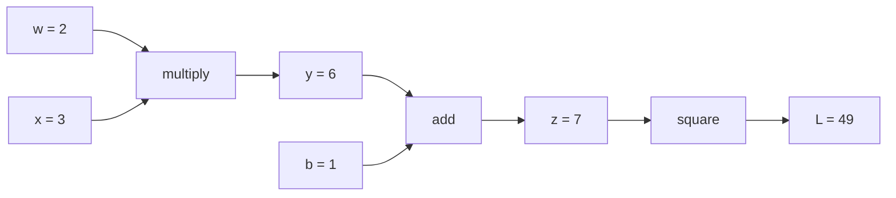
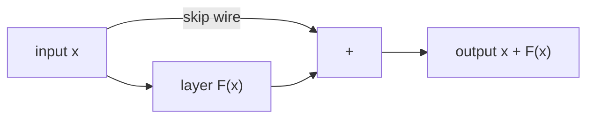

This chapter answers: how does a model with billions of numbers in it learn, and why do you never have to differentiate anything by hand? An LLM is trained by repeatedly nudging all of its numbers in a direction that lowers its error, and that direction comes from calculus. From earlier chapters you should know vectors and that a model's matrices ($W_Q$, $W_K$, ...) are full of adjustable numbers. No calculus is assumed; we define the derivative from scratch and work every example by hand.

## 1. The setup: a loss to push down

The numbers inside a model are its **parameters** (or weights). A 7-billion-parameter model has 7 billion of them. Given some text, the model predicts the next token, and we compare the prediction with the real next token. That comparison is squeezed into a single number called the **loss**: bigger means more wrong, and training tries to make it small.

Picture the loss as the height of terrain, where every parameter is one direction you can walk in. Training is a walk downhill in a space with billions of directions. You cannot see the terrain, but you can feel the slope under your feet.

Two tempting alternatives do not work. Trying combinations of parameter values (a grid search) explodes: ten values for each of 7 billion parameters gives $10^{7{,}000{,}000{,}000}$ combinations. Measuring the slope one parameter at a time by nudging it (a **finite difference**) is exact enough, but every nudge needs a full forward pass of the model, so one step would cost 7 billion passes. We need all the slopes at once for about the price of a couple of passes.

## 2. The derivative is a slope

Take $f(x) = x^2$. Nudge $x$ from 3 to 3.001 and see how much $f$ changes:

$$\frac{f(3.001) - f(3)}{0.001} = \frac{9.006001 - 9}{0.001} = 6.001$$

The ratio "change in output over change in input" is the slope, and as the nudge shrinks it settles at 6. That limit is the **derivative** of $f$ at 3, written $f'(3) = 6$. A derivative is the slope of the curve at one point. In general the derivative of $x^2$ is $2x$, which at 3 is 6. If it is positive, increasing $x$ raises $f$; if negative, it lowers $f$.

With many parameters, take the slope in each direction separately, holding the others fixed. Each is a **partial derivative**. Collect them into a vector and you have the **gradient**. For $L(x, y) = x^2 + 4y^2$ the partial derivatives are $2x$ and $8y$, so at the point $(3.5, -2)$ the gradient is $(7, -16)$.

The gradient points in the direction in which the loss rises fastest. The way down is the opposite direction, and one step of **gradient descent** is

$$\text{new position} = \text{old position} - \eta \times \text{gradient}$$

where $\eta$ (eta) is the **learning rate**, a small number you choose that sets the step size. From $(5, 3)$ the gradient is $(10, 24)$. With $\eta = 0.1$ we land at $(5 - 1, 3 - 2.4) = (4, 0.6)$, and the loss falls from $61$ to $17.44$. The $y$ direction is steeper, so $y$ shrinks faster than $x$.

## 3. Check it with `calc`

[`calc/math/gradients.py`](https://github.com/azusachino/calc/blob/main/calc/math/gradients.py) has `quadratic_loss_and_analytical_grad`, which uses the formulas above, and `compute_autograd`, which asks PyTorch for the same gradient. `run_gradient_descent` repeats the step:

```bash
uv run python -m calc.math.gradients
```

```text
Position (x, y): (3.5, -2.0) on surface L(x, y) = 1.0x^2 + 4.0y^2
Analytical: Loss = 28.2500, Grad = (7.0000, -16.0000)
Autograd:   Loss = 28.2500, Grad = (7.0000, -16.0000)

Step   | x          | y          | Loss L(x, y)
0      | 5.0000     | 3.0000     | 61.0000
1      | 4.0000     | 0.6000     | 17.4400
2      | 3.2000     | 0.1200     | 10.2976
3      | 2.5600     | 0.0240     | 6.5559
```

The hand numbers match the formulas, the formulas match PyTorch, and the first step matches the table.

## 4. The chain rule

A real model is a long pipeline of small functions. The **chain rule** says how to get the slope of a pipeline: multiply the slopes of its pieces. If $L$ depends on $z$, $z$ on $y$, and $y$ on $w$, then

$$\frac{\partial L}{\partial w} = \frac{\partial L}{\partial z} \cdot \frac{\partial z}{\partial y} \cdot \frac{\partial y}{\partial w}$$

A tiny pipeline: $y = w x$, then $z = y + b$, then $L = z^2$, with $w = 2$, $x = 3$, $b = 1$.



Going forward gives $y = 6$, $z = 7$, $L = 49$. Now go backward and ask each step for its local slope:

- Squaring: $dL/dz = 2z = 14$.
- Adding: $dz/dy = 1$ and $dz/db = 1$, so $dL/db = 14$.
- Multiplying: $dy/dw = x = 3$ and $dy/dx = w = 2$.

Multiplying along the path gives $dL/dw = 14 \cdot 1 \cdot 3 = 42$ and $dL/dx = 14 \cdot 2 = 28$. Check with a nudge: $w = 2.001$ gives $L = 7.003^2 = 49.042$, a change of $0.042$ over $0.001$, which is 42.

Each step only needs its own local slope and the number handed back from the step after it. That is **backpropagation**, and a library that records the forward steps and applies this rule in reverse is doing **automatic differentiation** (autograd). A PyTorch check:

```python
import torch

w = torch.tensor(2.0, requires_grad=True)
b = torch.tensor(1.0, requires_grad=True)
x = torch.tensor(3.0)

L = (w * x + b) ** 2
L.backward()
print(w.grad, b.grad)   # tensor(42.) tensor(14.)
```

One backward pass produces the slope for every parameter, at a cost of roughly the same order as the forward pass. This is why 7 billion slopes are affordable.

## 5. Residual connections

In a deep network, the backward pass multiplies many local slopes together, one per layer. If each is a bit under 1, the product shrinks fast. With a slope of 0.1 per layer and 10 layers the product is $0.1^{10} = 10^{-10}$, so the early layers get almost no learning signal. That is the **vanishing gradient** problem; the opposite case, products that blow up, is the exploding gradient.

A **residual connection** (or skip connection, from Kaiming He's ResNet) changes a layer from $x \mapsto F(x)$ to

$$x_{\text{out}} = x + F(x)$$



The slope of $x + F(x)$ is $1 + F'(x)$, not just $F'(x)$. With the same $F'= 0.1$ in each of 10 layers the product is $1.1^{10} \approx 2.6$, not $10^{-10}$. The "1" is a direct wire for the learning signal. Transformers use a residual connection around each attention and feed-forward block.

`calc` measures this on a 10-layer chain of random 16-by-16 matrices (see `measure_residual_gradient_highway`; it sums the outputs to get one loss number):

```text
Chain Depth: 10 layers
Plain Sequential Input Gradient Norm:    0.026159
Residual Network (ResNet/Transformer):  28.916286
```

The plain chain delivers a gradient of size 0.026 to the input; with skip wires it is 28.9, about 1,100 times larger for this seed. Exact numbers depend on the random weights, and a big gradient is not automatically a good one. The plain chain's collapse is typical.

## Going deeper (optional)

You can skip this; Chapter 06 does not need it.

**Matrices instead of single numbers.** For vector-valued layers, the "slope" is a grid of partial derivatives called the Jacobian. Backpropagating through a plain chain multiplies one Jacobian per layer, and what matters is how much each one shrinks or stretches vectors: if every stage shrinks them by a factor like 0.9, then $0.9^{80} \approx 0.0002$ after 80 layers. With a residual connection the Jacobian is $I + \partial F / \partial x$, where $I$ is the identity (the matrix that changes nothing), so the product contains a path that passes straight through.

**Why backward is cheap.** Computing slopes from the loss backward lets one sweep share work across all parameters. Computing forward-mode slopes would need one sweep per parameter. The backward pass is usually a small multiple of the forward cost, though it must keep intermediate values in memory.

## Try it

1. Find the derivative of $f(x) = x^2$ at $x = 5$ and take one gradient descent step from $x = 5$ with $\eta = 0.1$. (Answer: slope $10$, new $x = 5 - 1 = 4$.)
2. In the section 4 pipeline, what is $dL/db$? (Answer: 14, since $dz/db = 1$ and $dL/dz = 14$.)
3. A layer has slope $0.5$ and there are 10 layers. What is the product without a skip connection, and with one (slope $1.5$ each layer)? (Answer: $0.5^{10} \approx 0.001$ versus $1.5^{10} \approx 57.7$. Skip connections can make gradients bigger as well as preserve them.)

## Recap and next step

Training means lowering a single loss number by repeatedly stepping against its gradient. The derivative is a slope, the gradient collects the slopes for all parameters, the chain rule combines local slopes along a pipeline, and autograd runs that rule backward so that every parameter gets its slope from one extra pass. Residual connections add a "+1" to each layer's slope so that the signal survives many layers.

So far the model's final output has been a list of raw scores. In **[Chapter 06: Probability Distributions & Sampling Strategies](/tech/series/math-for-ai/06.probability-and-sampling/)**, we turn those scores into probabilities and pick the next token.
