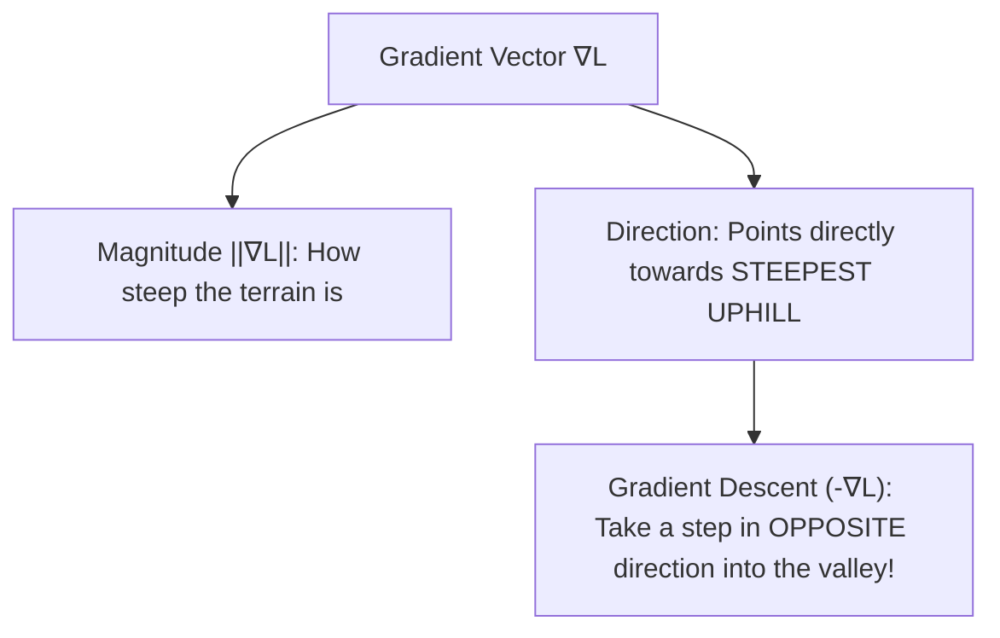
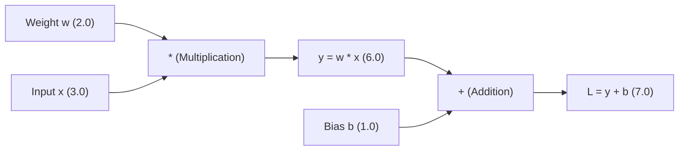
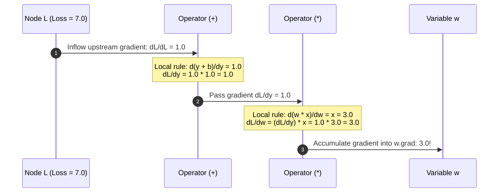
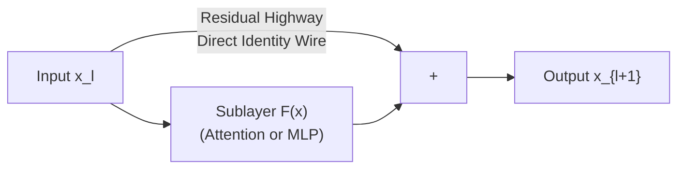

## From Classroom Calculus Nightmares to Billion-Parameter Engines

Many software engineers remember university calculus as an ordeal of memorized derivative lookup tables, tedious integration by parts, and trigonometric substitution tricks.

When deciding to study Large Language Models (LLMs) from first principles, seeing textbooks filled with Jacobian matrices and nested partial differential equations often triggers immediate resistance:
> *"Do I really need to hand-derive hundreds of lines of calculus formulas to build and train a neural network?"*

The answer is an emphatic **no**.

In modern engineering practice, developers almost never hand-calculate partial derivatives. Decades ago, applied mathematicians and computer scientists distilled the essence of differential calculus into an elegant data structure: **Reverse-Mode Automatic Differentiation on a Directed Acyclic Graph (DAG)**.

To master machine learning, what you need is not raw human calculation power, but a vivid geometric mental image: **a fog-shrouded mountain range in 7 billion dimensions, and a trekking pole that senses the local slope beneath your feet.**

---

## 1. How Billions of Floating-Point Knobs Sense Direction

A 7-billion parameter language model (7B) is, at its physical core, a colossal mathematical function governed by 7 billion floating-point weights and biases:

$$\hat{\mathbf{y}} = f(\mathbf{x}; \mathbf{w}_1, \mathbf{w}_2, \dots, \mathbf{w}_D)$$

Every time a text sequence is ingested, the model generates output probability distributions. The discrepancy between these predictions and the ground-truth next token is collapsed via Cross-Entropy loss into a single scalar: **the Loss ($\mathcal{L}$)**.

- The lower the loss $\mathcal{L}$, the more accurate the model's predictions.
- **The sole objective of training**: Adjust all 7 billion floating-point knobs so that $\mathcal{L}$ reaches the bottom of the valley.

### Why Grid Search and Numerical Differences Fail

Why can't we adjust weights using traditional algorithmic heuristics?

1. **Grid Search / Random Probing**: If each parameter is tested on just 10 discrete values, 7 billion parameters create $10^{7,000,000,000}$ possible combinations—vastly exceeding the number of atoms in the observable universe.
2. **Finite Differences (Numerical Differentiation)**:
   $$\frac{\partial \mathcal{L}}{\partial w_i} \approx \frac{\mathcal{L}(w_i + \epsilon) - \mathcal{L}(w_i)}{\epsilon}$$
   To compute partial derivatives numerically for 7 billion weights, you must execute a full forward pass of the model for **each individual parameter**. Calculating a single gradient update would require 7 billion forward passes—exhausting all the GPU compute on Earth for a single step.

We need an exact analytical shortcut: **a single forward pass followed by a single backward pass that computes exact partial derivatives for all 7 billion parameters simultaneously, at a cost comparable to a couple of forward passes.**

---

## 2. The Geometric Landscape of Gradients

### 1D Derivative: The Local Magnifying Glass

As Grant Sanderson notes in *Essence of Calculus*: **a derivative is not an arcane symbol; it is a local magnifying glass that reveals sensitivity.**

$$f'(x) = \lim_{\Delta x \to 0} \frac{f(x + \Delta x) - f(x)}{\Delta x}$$

When you zoom in closely on any smooth curve at point $x_0$, the curve looks like a straight line. The slope of that line is the derivative:

- If $f'(x) > 0$: Increasing $x$ causes $f(x)$ to climb uphill.
- If $f'(x) < 0$: Increasing $x$ causes $f(x)$ to slide downhill.

### High-Dimensional Gradient: Steepest Uphill Vector

When expanding from 1 variable to $N$ variables, the collection of all partial derivatives forms the **Gradient Vector** ($\nabla \mathcal{L}$):

$$\nabla \mathcal{L}(\mathbf{w}) = \left( \frac{\partial \mathcal{L}}{\partial w_1}, \frac{\partial \mathcal{L}}{\partial w_2}, \dots, \frac{\partial \mathcal{L}}{\partial w_D} \right)^T$$



> **The Fundamental Rule of Optimization**: The gradient vector $\nabla \mathcal{L}$ always points in the direction of **steepest ascent**. To minimize loss, we take a step in the exact opposite direction:
> $$\mathbf{w}_{\text{new}} = \mathbf{w}_{\text{old}} - \eta \nabla \mathcal{L}(\mathbf{w}_{\text{old}})$$
> where $\eta$ is the learning rate.

---

## 3. The Autograd Engine: Computational DAGs

How does a framework like PyTorch calculate $\nabla \mathcal{L}$ without symbolic math software?

It records operations into a **Computational Graph (Directed Acyclic Graph, DAG)** during the forward pass:



During the forward pass:

1. Every mathematical operation creates a Node in the graph.
2. The node saves its forward value and registers its local derivative formula (its **backward closure**).

### The Chain Rule in Reverse

To compute how the final loss $\mathcal{L}$ changes with respect to the initial weight $w$, we trace backwards from $\mathcal{L}$ to $w$ using Leibniz's **Chain Rule**:

$$\frac{\partial \mathcal{L}}{\partial w} = \frac{\partial \mathcal{L}}{\partial y} \cdot \frac{\partial y}{\partial w}$$



Every operator in the graph needs to know only its **immediate local derivative**. It multiplies its local derivative by the incoming upstream gradient and passes the result to its parents.

In a single backward traversal, all parameter gradients are resolved in $O(N)$ time.

---

## 4. Residual Connections: The Loss Highway

In deep Transformer models (such as GPT-2 with 12 to 48 layers, or modern LLMs with 80+ layers), repeated multiplication by weight matrices across backward passes introduces the dreaded **Vanishing / Exploding Gradient problem**:

$$\frac{\partial \mathcal{L}}{\partial \mathbf{x}_0} = \frac{\partial \mathcal{L}}{\partial \mathbf{x}_L} \prod_{l=1}^L W_l^T$$

If eigenvalues of $W_l$ are less than $1.0$, multiplying 80 matrices together shrinks the gradient exponentially to zero ($0.9^{80} \approx 0.0002$). The earliest layers learn nothing.

Kaiming He's **Residual Connection (Skip Connection)** provides an architectural cure:

$$\mathbf{x}_{l+1} = \mathbf{x}_l + F(\mathbf{x}_l)$$



Now compute the gradient of the output with respect to the input:

$$\frac{\partial \mathbf{x}_{l+1}}{\partial \mathbf{x}_l} = I + \frac{\partial F(\mathbf{x}_l)}{\partial \mathbf{x}_l}$$

Notice the identity matrix $I$! Even if the weights inside sublayer $F$ vanish to zero, the $+ I$ term ensures that an unattenuated, clean gradient copy flows backward directly to the very first layer without degradation.

---

## 5. Hands-on Verification with `calc`

We implemented analytical vs. autograd verification, anisotropic valley descent, and a 10-layer residual gradient highway benchmark in [`calc/math/gradients.py`](https://github.com/azusachino/calc/blob/main/calc/math/gradients.py):

```python
def quadratic_loss_and_analytical_grad(
    x: float,
    y: float,
    a: float = 1.0,
    b: float = 4.0,
) -> tuple[float, tuple[float, float]]:
    """Compute L(x, y) = a*x^2 + b*y^2 and its analytical gradient [2*a*x, 2*b*y]."""
    loss = a * (x**2) + b * (y**2)
    return loss, (2.0 * a * x, 2.0 * b * y)


def measure_residual_gradient_highway(depth: int = 8) -> tuple[float, float]:
    """Compare gradient norm reaching the input with and without residual connections."""
    torch.manual_seed(42)

    # 1. Plain chain: x_{l+1} = W_l * x_l
    x_plain = torch.ones(1, 16, requires_grad=True)
    curr = x_plain
    for _ in range(depth):
        w = torch.randn(16, 16) * 0.15
        curr = torch.matmul(curr, w)
    curr.sum().backward()
    plain_norm = float(torch.linalg.norm(x_plain.grad).item())

    # 2. Residual chain: x_{l+1} = x_l + F(x_l)
    x_res = torch.ones(1, 16, requires_grad=True)
    curr = x_res
    for _ in range(depth):
        w = torch.randn(16, 16) * 0.15
        curr = curr + torch.matmul(curr, w)
    curr.sum().backward()
    res_norm = float(torch.linalg.norm(x_res.grad).item())

    return plain_norm, res_norm
```

Run the benchmark via `uv`:

```bash
uv run python -m calc.math.gradients
```

Measured output:

```text
========================================================================
Lesson 05 Benchmark: Gradients, Loss Surfaces, and Backpropagation
========================================================================

1. Analytical Gradient vs. PyTorch Autograd Equivalence:
------------------------------------------------------------------------
Position (x, y): (3.5, -2.0) on surface L(x, y) = 1.0x^2 + 4.0y^2
Analytical: Loss = 28.2500, Grad = (7.0000, -16.0000)
Autograd:   Loss = 28.2500, Grad = (7.0000, -16.0000)
Max Gradient Error: 0.0e+00 (Reverse-mode exactness)

2. Descent Trajectory Down the Anisotropic Valley (lr=0.1):
------------------------------------------------------------------------
Step   | x          | y          | Loss L(x, y)   | Convergence Bar
------------------------------------------------------------------------
0      | 5.0000     | 3.0000     | 61.0000        | ██████████████████████████████
1      | 4.0000     | 0.6000     | 17.4400        | ████████
2      | 3.2000     | 0.1200     | 10.2976        | █████
3      | 2.5600     | 0.0240     | 6.5559         | ███
4      | 2.0480     | 0.0048     | 4.1944         | ██
5      | 1.6384     | 0.0010     | 2.6844         | █
6      | 1.3107     | 0.0002     | 1.7180         | █
7      | 1.0486     | 0.0000     | 1.0995         | █
8      | 0.8389     | 0.0000     | 0.7037         | █
------------------------------------------------------------------------

3. The Gradient Highway: Vanishing Gradient vs. Residual Connection:
------------------------------------------------------------------------
Chain Depth: 10 layers
Plain Sequential Input Gradient Norm:    0.026159 (Severely vanished!)
Residual Network (ResNet/Transformer): 28.916286 (Gradient preserved!)
Gradient Highway Preservation Factor:    1105.4x
========================================================================
```

Across just 10 layers, the plain matrix chain attenuates the input gradient norm down to `0.026159`, whereas the residual skip connection (`curr = curr + curr @ w`) keeps a norm of `28.916286`, a roughly `1,105x` difference on this seed.

---

## Summary & Next Step

Training a large language model is a guided descent across a high-dimensional terrain. Automatic differentiation decomposes the chain rule into local graph nodes, while residual skip connections provide unimpeded gradient highways across deep layers.

Once gradients are updated, the model produces raw output scores (logits). How do we turn continuous logits into coherent text generation?

In the final chapter, **[Chapter 06: Probability Distributions & Sampling Strategies](/tech/series/math-for-ai/06.probability-and-sampling/)**, we will explore numerically stable Softmax, Boltzmann temperature distributions, Shannon entropy, and Top-p nucleus geometry.
