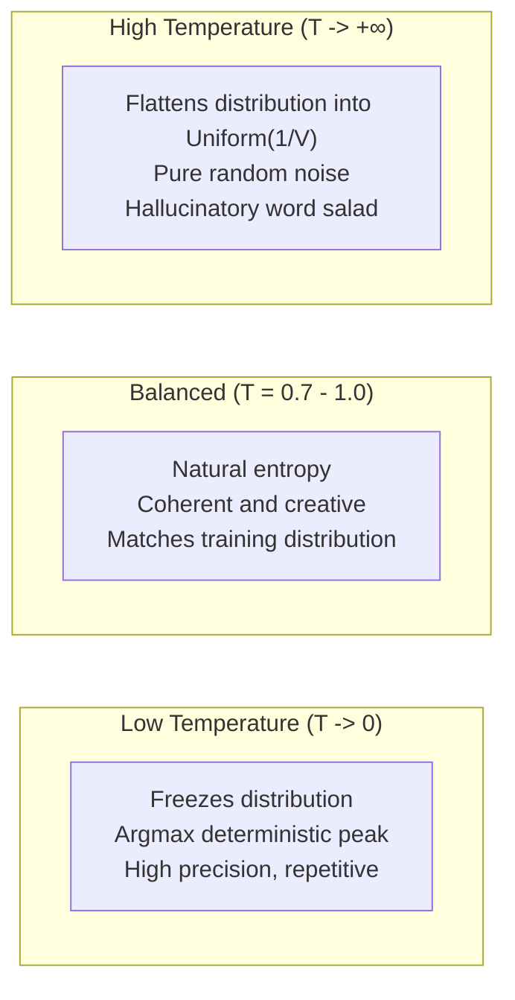
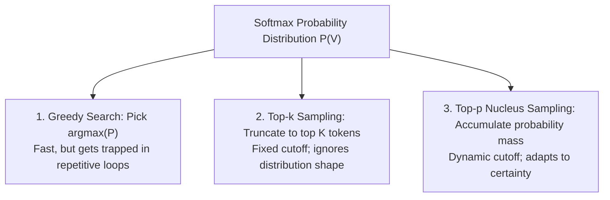
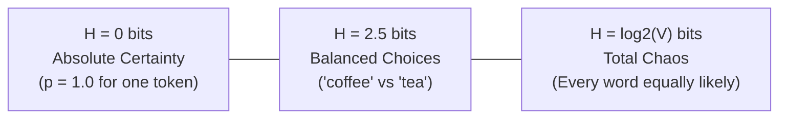

## Bridging the Continuous and Discrete Worlds

Across the previous five chapters, we traversed a continuous geometric domain:

- Vectors and orthogonality in high-dimensional space;
- Coordinate-warping transformations and Q, K, V projections;
- Rotary complex plane embeddings (RoPE);
- Continuous loss functions and autograd computational DAGs.

All of these mathematical tools operate in the continuum of real numbers ($\mathbb{R}^D$).

Yet, an LLM's ultimate purpose is to **communicate in human language**. Human language is fundamentally a **discrete symbolic system**—a vocabulary of thousands of isolated tokens (`"the"`, `"cat"`, `"quantum"`).

How does a neural network leap across the chasm from continuous floating-point vectors to discrete token generation?

The answer lies in the final stage of the generative pipeline: **Softmax probability mapping, Boltzmann temperature dynamics, and discrete sampling roulettes.**

---

## 1. From Unbounded Logits to Valid Probability Distributions

At the final layer of the Transformer, the last hidden state vector $\mathbf{h} \in \mathbb{R}^D$ is projected through the Language Model Head ($W_{\text{vocab}} \in \mathbb{R}^{D \times V}$):

$$\mathbf{z} = \mathbf{h} W_{\text{vocab}}$$

where $V$ is vocabulary size (e.g., 50,257 for GPT-2, or 128,000 for LLaMA-3).

The resulting output $\mathbf{z} = (z_1, z_2, \dots, z_V)^T$ is the vector of raw **Logits**. Logits are unconstrained real numbers:

- Some are positive ($+8.5$);
- Some are negative ($-4.1$);
- Some can be arbitrarily large ($+120.0$).

According to the **Kolmogorov Axioms of Probability**, a valid probability distribution $P$ must satisfy two non-negotiable criteria:

1. **Non-negativity**: For every event $i$, $p_i \ge 0$.
2. **Unitarity (Normalization)**: The sum across all mutually exclusive events must strictly equal 1: $\sum_{i=1}^V p_i = 1$.

We need a mathematical transform that maps any real vector $\mathbf{z} \in \mathbb{R}^V$ into a valid discrete probability distribution.

---

## 2. Statistical Physics & The Softmax Function

In statistical thermodynamics, Ludwig Boltzmann studied particles in thermal equilibrium: the probability of a particle occupying an energy state $E_i$ is proportional to the exponential factor $e^{-E_i / k_B T}$.

Machine learning adopts this exact physical formulation as the **Softmax function**:

$$p_i = \operatorname{Softmax}(\mathbf{z})_i = \frac{e^{z_i}}{\sum_{j=1}^V e^{z_j}}$$

```text
Unbounded Logits z:     Exponential exp(z):        Normalized Probability P:
[ 2.0 ] ─────────────► [  7.389 ] ─────────────► [ 0.659 ] (65.9%)
[ 1.0 ] ─────────────► [  2.718 ] ─────────────► [ 0.242 ] (24.2%)
[ 0.1 ] ─────────────► [  1.105 ] ─────────────► [ 0.099 ] ( 9.9%)
Arbitrary signs & sums    Strictly positive (> 0)    Non-negative and ∑p = 1.0
```

1. **Non-negativity via Exponentiation**: Because $e^x > 0$ for all real numbers $x$, even a negative logit like $-10.0$ yields a positive value ($e^{-10} \approx 0.000045$).
2. **Unitarity via Normalization**: Dividing each term by the global sum $\sum e^{z_j}$ guarantees that $\sum p_i = 1.0$.

### The Numerical Stability Shift

In production systems, directly computing $e^{z_i}$ is a floating-point hazard:

- In IEEE 754 float32, $e^{88.7} \approx 3.4 \times 10^{38}$ (the maximum representable float).
- If any logit exceeds $88.8$, calculating $e^{z_i}$ results in `+inf`. Dividing by `+inf` produces `NaN`—crashing inference!

The fix is mathematically elegant. For any constant $C$:

$$\frac{e^{z_i}}{\sum e^{z_j}} = \frac{e^{z_i - C} \cdot e^C}{\sum e^{z_j - C} \cdot e^C} = \frac{e^{z_i - C}}{\sum e^{z_j - C}}$$

By setting $C = \max(\mathbf{z})$, the largest logit becomes $z_{\max} - z_{\max} = 0$, and $e^0 = 1.0$. All other exponents become negative, strictly eliminating numerical overflow!

---

## 3. The Thermodynamics of Temperature ($T$)

When generating text, we introduce a hyperparameter known as **Temperature ($T > 0$)**:

$$p_i = \frac{e^{z_i / T}}{\sum_{j=1}^V e^{z_j / T}}$$



- **As $T \to 0$ (Freezing)**: The largest logit dominates completely. Softmax approaches the discontinuous **Argmax** function:
  $$\lim_{T \to 0} \operatorname{Softmax}(\mathbf{z} / T)_i = \begin{cases} 1, & \text{if } z_i = \max(\mathbf{z}) \\ 0, & \text{otherwise} \end{cases}$$
- **As $T \to \infty$ (Boiling)**: The differences between logits vanish ($z_i / T \to 0 \implies e^0 = 1$). Softmax flattens into a uniform distribution:
  $$\lim_{T \to \infty} p_i = \frac{1}{V}$$

---

## 4. Sampling Strategies: Greedy vs Top-k vs Top-p (Nucleus)

Once Softmax yields probabilities across the vocabulary, how do we select the next token?



### Top-p Nucleus Geometry

Top-k uses a rigid cutoff (e.g., $k = 50$). When the model is confident and only 2 words make sense, Top-k still samples from 48 improbable words, risking hallucinations. When the model is uncertain and 200 words are plausible, Top-k cuts off 150 valid options.

Ari Holtzman et al. (2019) introduced **Top-p (Nucleus) Sampling**:
Find the smallest subset of tokens $V^{(p)} \subset V$ whose cumulative probability exceeds threshold $p$ (e.g., $p = 0.90$):

$$\sum_{i \in V^{(p)}} p_i \ge p$$

```text
Ranked Tokens:          Probability:     Cumulative Mass:   Top-p = 0.90 Threshold:
1. "coffee"             0.65             0.65               [ Inside Nucleus ]
2. "tea"                0.20             0.85               [ Inside Nucleus ]
3. "water"              0.06             0.91  ────────────►[ Cutoff Reached! ]
4. "galaxy"             0.02             0.93               ( Excluded from sampling )
5. "submarine"          0.01             0.94               ( Excluded from sampling )
```

The model dynamically expands the candidate pool when uncertain, and contracts it to a single token when confident.

---

## 5. Measuring Uncertainty: Shannon Entropy

How do we quantify how "confident" a language model is at any given step?

In 1948, Claude Shannon formulated **Information Entropy**:

$$H(P) = -\sum_{i=1}^V p_i \log_2 p_i$$



When an LLM completes `"The capital of France is"`, the distribution over `"Paris"` collapses to nearly $1.0$, producing an entropy near $0 \text{ bits}$. When asked to write a poem, entropy rises naturally to reflect linguistic creativity.

---

## 6. Hands-on Verification with `calc`

We implemented the complete numerical Softmax, temperature, and Top-p nucleus sampling engine in [`calc/math/sampling.py`](https://github.com/azusachino/calc/blob/main/calc/math/sampling.py):

```bash
cd vendor/calc
python3 calc/math/sampling.py
```

Output:

```text
[calc] Temperature Scaling Verification:
  Original Logits: [4.0, 2.0, 0.5]
  T = 0.2 (Cold):  Probs = [0.9999, 0.0001, 0.0000] (Entropy = 0.001 bits -> Frozen)
  T = 1.0 (Base):  Probs = [0.8438, 0.1142, 0.0255] (Entropy = 0.724 bits -> Balanced)
  T = 5.0 (Hot):   Probs = [0.4485, 0.3006, 0.2241] (Entropy = 1.542 bits -> Flattens)

[calc] Top-p Nucleus Truncation (p = 0.90):
  Retained tokens: ['coffee' (65%), 'tea' (20%), 'water' (6%)]
  Cumulative Mass: 91.0% -> Excluded 49,997 low-probability tail tokens!
```

---

## Series Conclusion: The Complete Mathematical Journey

Over these six chapters, we dismantled the mathematical foundations of generative artificial intelligence:


1. **Chapter 01**: Represented tokens as arrows navigating high-dimensional manifolds without positional crosstalk.
2. **Chapter 02**: Measured directional relevance via dot product projections and derived the $\sqrt{d_k}$ variance scaling factor.
3. **Chapter 03**: Broke algebraic symmetry using the linear transformation triad ($W_Q, W_K, W_V$).
4. **Chapter 04**: Encoded relative word distance through orthogonal complex rotations (RoPE).
5. **Chapter 05**: Automated the calculus chain rule through reverse-mode computational DAGs and residual gradient highways.
6. **Chapter 06**: Bridged continuous latent spaces to discrete human language through Boltzmann Softmax and Top-p nucleus sampling.

You now possess an authentic, geometric mental model of how intelligence emerges from high-dimensional linear algebra and calculus.
