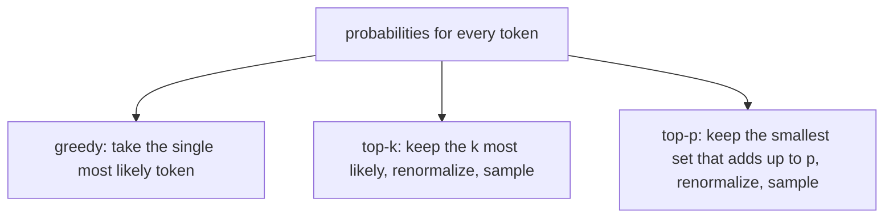
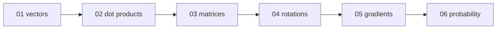

This chapter answers: how does a pile of real numbers become one chosen word, and what do the settings `temperature` and `top_p` do? An LLM needs this at every single step of generation, since the output of the network is not a word but a list of scores. From earlier chapters you should know vectors and matrices (Chapters 01 and 03) and the softmax function in brief (Chapter 02). Probability is introduced here from scratch.

## 1. From a vector to scores

At the end of the network, the last hidden vector $\mathbf{h}$ for the current position is multiplied by one more matrix, with one column per token in the vocabulary (50,257 for GPT-2, around 128,000 for LLaMA-3). The result is one number per possible next token. These raw scores are called **logits**. They can be any real number: $+8.5$, $-4.1$, $+120$.

To choose a token, we want probabilities. A **probability distribution** over the possible tokens is a list of numbers with two properties: no entry is negative, and all entries add up to 1. Then entry $i$ reads as "the chance that token $i$ comes next". Raw logits fail both tests, so we need a transformation that fixes them while keeping the order: the bigger the logit, the bigger the probability.

## 2. Softmax

Softmax does it in two moves: exponentiate each score, then divide by the total.

$$p_i = \frac{e^{z_i}}{\sum_j e^{z_j}}$$

Here $z_i$ is the logit for token $i$, $e \approx 2.718$, and $\sum_j$ means "add up over all tokens". By hand, with logits $(2, 1, 0.1)$:

| logit $z$ | $e^{z}$ | probability |
| --- | --- | --- |
| 2.0 | 7.389 | 0.659 |
| 1.0 | 2.718 | 0.242 |
| 0.1 | 1.105 | 0.099 |
| | total 11.212 | total 1.000 |

Exponentiating makes everything positive, since $e^x > 0$ even when $x$ is negative ($e^{-10} \approx 0.000045$). Dividing by the total makes it add to 1. And $e^x$ always grows with $x$, so the order of the tokens is unchanged.

One practical trap: in 32-bit floats, $e^{z}$ overflows to infinity once $z$ is above about 88.7, and `inf / inf` is `nan`. Softmax is unchanged if you subtract the same number $C$ from every logit, because $e^{z_i - C} = e^{z_i} e^{-C}$ and the common factor cancels in the ratio. Choosing $C$ as the largest logit leaves the biggest entry at $e^0 = 1$ and all others below it. For logits $(1000, 1001)$, subtract 1001 to get $(-1, 0)$, then $e^{-1} \approx 0.368$ and $e^0 = 1$, giving probabilities $0.269$ and $0.731$. Every production implementation does this.

## 3. Temperature

Divide the logits by a number $T > 0$ before softmax:

$$p_i = \frac{e^{z_i / T}}{\sum_j e^{z_j / T}}$$

$T$ is the **temperature**. Redo the table with $T = 0.5$, which turns the logits into $(4, 2, 0.2)$:

$$e^4 \approx 54.6,\quad e^2 \approx 7.39,\quad e^{0.2} \approx 1.22,\quad \text{total} \approx 63.2$$

Probabilities: $0.864$, $0.117$, $0.019$. The leader grew from 0.66 to 0.86. With $T = 2$ the logits become $(1, 0.5, 0.05)$ and the probabilities $0.50$, $0.30$, $0.19$. The distribution flattened.

- Low $T$ sharpens: as $T \to 0$ all the probability goes to the largest logit (that choice is called argmax). The model becomes close to deterministic.
- High $T$ flattens: as $T \to \infty$ every token approaches probability $1/V$, where $V$ is the vocabulary size. The output becomes noise.
- $T = 1$ leaves the model's own distribution unchanged.

The name comes from statistical physics, where the same formula gives the probability of a particle being in a state of a given energy at temperature $T$. Real APIs usually treat $T = 0$ as a request for argmax, since you cannot divide by zero.

## 4. Choosing a token

With probabilities in hand, there are three common ways to pick.



**Greedy** always takes the top token. It is repeatable but can fall into loops. To **sample** means to pick randomly in proportion to the probabilities, like a roulette wheel with wider slots for likelier tokens.

**Top-k** first discards everything except the $k$ likeliest tokens, divides the survivors by their new total so they add to 1 again (renormalizing), then samples. Its weakness is the fixed $k$: when the model is certain, $k = 50$ still allows 49 poor candidates; when many words fit, it cuts valid ones.

**Top-p** (nucleus sampling, from Holtzman et al., 2019) lets the data decide. Sort the tokens by probability and keep going until the running total reaches $p$. Example with $p = 0.9$:

| token | probability | running total | kept? |
| --- | --- | --- | --- |
| coffee | 0.60 | 0.60 | yes |
| tea | 0.25 | 0.85 | yes |
| water | 0.08 | 0.93 | yes (first to pass 0.9) |
| juice | 0.04 | 0.97 | no |
| milk | 0.02 | 0.99 | no |
| galaxy | 0.01 | 1.00 | no |

Renormalize the three survivors by dividing by 0.93: $0.645$, $0.269$, $0.086$. If the model had been sure, say with "Paris" at 0.97, the nucleus would have been one token. If it were unsure, it would stretch to many.

## 5. Entropy: how unsure is the model

**Entropy** is one number for how spread out a distribution is:

$$H = -\sum_i p_i \log_2 p_i$$

$\log_2$ is the logarithm base 2: $\log_2 8 = 3$ because $2^3 = 8$. The result is in bits. Three reference points:

- One token has probability 1: $H = 0$ bits, total certainty.
- Two tokens at $0.5$ each: $H = 1$ bit, like a fair coin. A distribution of $(0.9, 0.1)$ gives about 0.47 bits.
- $V$ tokens all equally likely: $H = \log_2 V$, about 15.6 bits for a 50,257-token vocabulary. This is the maximum.

After "The capital of France is", most of the probability sits on one token and entropy is near 0. At the start of a poem it is higher. Temperature moves entropy directly, as the next section shows. (Chapter 02 mentioned entropy when comparing attention weights; it is the same quantity.)

## 6. Check it with `calc`

[`calc/math/sampling.py`](https://github.com/azusachino/calc/blob/main/calc/math/sampling.py) has `stable_softmax(logits, temperature)`, `shannon_entropy`, `top_k_filter`, `top_p_filter` and `sample_categorical`. They chain like this:

```python
import torch
from calc.math.sampling import stable_softmax, top_p_filter, sample_categorical

logits = torch.tensor([8.0, 6.5, 5.0, 1.2, 0.5, 0.1])   # the, a, cat, quantum, banana, galaxy
probs = stable_softmax(logits, temperature=0.7)
token_id = sample_categorical(top_p_filter(probs, p=0.9))
```

The benchmark prints the effect of temperature on those six tokens:

```bash
uv run python -m calc.math.sampling
```

```text
Token      | Logit    | T=0.2 (Cold)   | T=1.0 (Normal) | T=3.0 (Hot)
the        | 8.0      | 0.9994         | 0.7843         | 0.4480
a          | 6.5      | 0.0006         | 0.1750         | 0.2717
cat        | 5.0      | 0.0000         | 0.0391         | 0.1648
quantum    | 1.2      | 0.0000         | 0.0009         | 0.0464
banana     | 0.5      | 0.0000         | 0.0004         | 0.0368
galaxy     | 0.1      | 0.0000         | 0.0003         | 0.0322
Entropy (bits)        | 0.01           | 0.91           | 2.00
```

At $T = 0.2$ almost everything sits on "the" and the entropy is 0.01 bits. At $T = 3$ the probabilities are spread out and the entropy is 2.00 bits. At $T = 1$, top-p with $p = 0.9$ keeps "the" and "a" (their total, 0.9593, passes 0.9) and top-k with $k = 2$ does the same here, giving $0.8176$ and $0.1824$ after renormalizing. They differ when the distribution is flatter.

## Going deeper (optional)

You can skip this section.

**Why exponentials.** Softmax is not the only way to make positive numbers that add to 1, but it has a clean property: the ratio of two probabilities is $e^{z_i - z_j}$, so only differences between logits matter, which is exactly why subtracting a constant is harmless. It is also the form that pairs naturally with cross-entropy loss, the quantity the model is trained on: for the correct token the loss is $-\ln p_{\text{correct}}$, and the gradient of softmax followed by cross-entropy with respect to the logits is simply $p - \text{(one-hot target)}$.

**Temperature and entropy.** Raising $T$ never lowers entropy, and entropy goes to $\log_2 V$ as $T \to \infty$.

## Try it

1. Compute softmax of $(0, 0, \ln 2)$, where $\ln 2 \approx 0.693$ and $e^{\ln 2} = 2$. (Answer: weights $1, 1, 2$ over a total of 4, so $0.25, 0.25, 0.5$.)
2. For the distribution in step 1, what does top-p with $p = 0.4$ keep? (Answer: just the 0.5 token, since its running total already passes 0.4.)
3. What is the entropy of four equally likely tokens? (Answer: $2$ bits.)

## Recap and series wrap-up

Softmax turns logits into a probability distribution; temperature stretches or squeezes it; greedy, top-k and top-p decide how to draw from it; and entropy says how unsure the model is. That closes the path from text to next token, and the series ties together like this:



1. **[Chapter 01: Vectors & Spaces](/tech/series/math-for-ai/01.vectors-and-spaces/)**: words as arrows, and why high dimensions leave room for added signals.
2. **[Chapter 02: Dot Products & Attention](/tech/series/math-for-ai/02.dot-products-and-attention/)**: the dot product as a match score, and the $\sqrt{d_k}$ scaling.
3. **[Chapter 03: Matrices & Linear Transformations](/tech/series/math-for-ai/03.matrices-and-transformations/)**: queries, keys and values as three learned warps.
4. **[Chapter 04: Rotations & RoPE](/tech/series/math-for-ai/04.rotations-and-rope/)**: position through rotation.
5. **[Chapter 05: Gradients & Backpropagation](/tech/series/math-for-ai/05.gradients-and-backprop/)**: how the numbers in all those matrices get trained.
6. **[Chapter 06: Probability & Sampling](/tech/series/math-for-ai/06.probability-and-sampling/)**: how scores become a chosen token.

Each of these is a small piece of arithmetic that you can run in a few lines. The companion code in [`calc`](https://github.com/azusachino/calc) is the place to go next.
