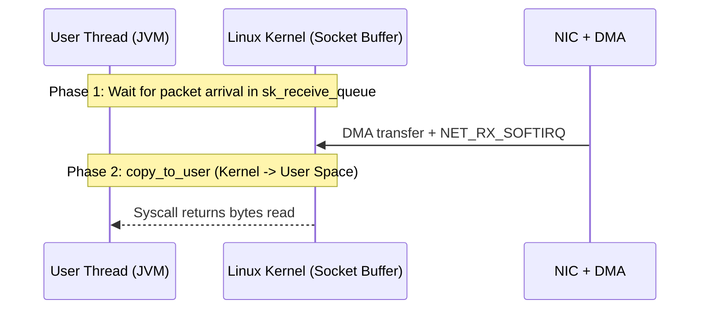
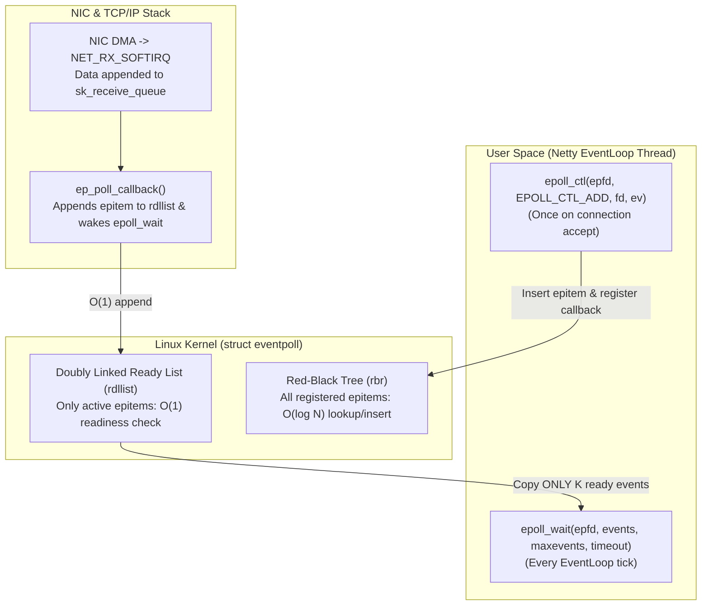

## The C10K Wall: Why Thread-per-Connection Collapses

Before writing a single line of Netty code, we must understand what happens inside the Linux kernel when a server accepts ten thousand—or one million—concurrent TCP connections.

In classic Java Blocking I/O (`java.net.ServerSocket` and `Socket`), a server dedicates one operating system thread to each connected client:

```text
[Client 1] ──> [Socket fd=4] ──> [OS Thread 1 (1 MB Stack)] ──> blocked in read()
[Client 2] ──> [Socket fd=5] ──> [OS Thread 2 (1 MB Stack)] ──> blocked in read()
   ...
[Client N] ──> [Socket fd=N] ──> [OS Thread N (1 MB Stack)] ──> blocked in read()
```

At fifty connections, this model is simple and fast. At 10,000 concurrent connections (the classic **C10K problem**) or 100,000 connections, two hardware and kernel limits break the system simultaneously:

1. **Virtual and Resident Memory Exhaustion**: On 64-bit Linux JVMs, each thread allocates a default `1 MB` native call stack (`-Xss1m`). Ten thousand threads consume `10 GB` of virtual memory before allocating a single application object.
2. **Scheduler Context-Switch Thrashing**: Most network connections are idle 99% of the time waiting for the next client packet. Whenever a packet arrives, the Linux Completely Fair Scheduler (CFS) must wake the sleeping thread (`TASK_INTERRUPTIBLE` $\to$ `TASK_RUNNING`), save CPU registers, flush translation lookaside buffers (TLBs), and pollute L1/L2 CPU caches. Above a few thousand runnable threads, the CPU spends more cycles switching between threads than executing application code.

---

## The Two Phases of a Network Read

To reason rigorously about I/O models (as defined in W. Richard Stevens' *UNIX Network Programming*), every network `read()` operation must be split into two distinct kernel phases:

1. **Phase 1 — Waiting for Data Readiness**: Packets arrive at the physical Network Interface Card (NIC), transfer into kernel memory (`sk_buff`) via Direct Memory Access (DMA), pass through the hardware interrupt and `NET_RX_SOFTIRQ` TCP/IP stack, and land in the socket's receive queue (`sk_receive_queue`).
2. **Phase 2 — Copying Data to User Space**: The kernel copies the ready payload bytes from the kernel socket buffer (`sk_buff`) into the user-space buffer supplied by the application (`copy_to_user`), and the system call returns.



Every I/O paradigm is defined by how it handles Phase 1 and Phase 2:

| I/O Model | Phase 1 (Waiting for Data) | Phase 2 (`copy_to_user`) | POSIX / Linux Classification |
| :--- | :--- | :--- | :--- |
| **Blocking I/O (BIO)** | Thread sleeps (`TASK_INTERRUPTIBLE`) until data arrives | Thread blocks while kernel copies bytes to user buffer | **Synchronous Blocking** |
| **Non-Blocking I/O (`O_NONBLOCK`)** | Returns `-EAGAIN` / `-EWOULDBLOCK` immediately if empty | Thread blocks while kernel copies bytes to user buffer | **Synchronous Non-Blocking** |
| **I/O Multiplexing (`select`/`poll`/`epoll`)** | Single thread waits on readiness across $N$ descriptors | Thread calls non-blocking `read()` and copies bytes | **Synchronous Non-Blocking** (Event-Driven) |
| **Asynchronous I/O (`io_uring`)** | Kernel waits without blocking user thread | Kernel copies data into user ring buffer and posts completion | **True Asynchronous** |

Notice a critical distinction that trips up many engineers: **`epoll` is synchronous I/O, not asynchronous I/O.** Even when `epoll_wait` notifies your thread that a socket is readable, your thread must still issue the `read()` syscall and wait for `copy_to_user` to finish copying the bytes from kernel space to user space. Linux only gained general-purpose asynchronous I/O for sockets with `io_uring` (the older kernel AIO covers little beyond `O_DIRECT` files), where both waiting and copying are performed by the kernel via shared submission and completion ring buffers.

---

## Linux VFS & File Descriptor Topology

In Linux, "everything is a file" is implemented by the **Virtual File System (VFS)**. Whether your Java process opens an `ext4` disk file or a TCP `SocketChannel`, it receives an integer **file descriptor (`fd`)**.

Inside the kernel, a process resolves that integer `fd` through a four-level pointer chain:

```mermaid
flowchart LR
    Task["task_struct\n(Process Descriptor)"] -->|files| Files["files_struct\n(Open File Table)"]
    Files -->|fd_array[fd]| File["struct file\n(f_op, f_pos, f_flags, private_data)"]
    File -->|Socket File| Sock["struct socket -> struct sock\n(sk_receive_queue, sk_write_queue, sk_wq)"]
    File -->|Regular Disk File| Addr["struct address_space\n(XArray / Radix-Tree Page Cache)"]
```

1. **`task_struct` $\to$ `files_struct`**: Every process has a `files` pointer referencing its open file table.
2. **`fdtable` (`fd_array`)**: The integer `fd` returned by `socket(2)` or `open(2)` is literally the array index into `fd_array[]`.
3. **`struct file`**: Holds the current file offset (`f_pos`), status flags (`O_NONBLOCK`), and a function pointer table `f_op` (`struct file_operations`).
   - For a **regular disk file**, `f_op` points to filesystem routines (e.g., `ext4_file_operations`), and `f_mapping` points to `struct address_space`, which indexes cached 4 KB physical memory pages (`Page Cache`) in an XArray / Radix Tree.
   - For a **network socket**, `f_op` points to `socket_file_ops`, and `private_data` points to `struct socket` and the underlying network-layer `struct sock` (which owns `sk_receive_queue`, `sk_write_queue`, and the wait queue `sk_wq`).

### Why JDK `FileChannel` Cannot Register with a `Selector`

In Java NIO, `SocketChannel` extends `SelectableChannel` and can register with a `Selector`, whereas `FileChannel` does not. Why?

Because in the Linux VFS contract, regular disk files do not have network arrival queues: `select()` / `poll()` report a regular file as **immediately ready** (and `epoll_ctl` refuses it with `EPERM`), even when the target blocks are still on SSD/NVMe platters and `read()` will block the calling thread waiting for block-layer DMA.

---

## The Evolution of Linux I/O Multiplexing: `select` $\to$ `poll` $\to$ `epoll`

Setting `O_NONBLOCK` (`fcntl(fd, F_SETFL, O_NONBLOCK)`) on 10,000 sockets prevents threads from sleeping when no data is available, but calling `read()` in a user-space `while` loop across 10,000 sockets burns 100% CPU executing pointless user-to-kernel syscall transitions that return `-EAGAIN`.

**I/O Multiplexing** delegates readiness monitoring across thousands of descriptors to the kernel in a single syscall. Over three decades of Unix/Linux history, the multiplexing kernel subsystem evolved through three generations:

### 1. `select(2)` — Fixed Bitmap & Triple $\mathcal{O}(N)$ Scans

```c
int select(int nfds, fd_set *readfds, fd_set *writefds, fd_set *exceptfds, struct timeval *timeout);
```

- **Hard 1,024 Descriptor Ceiling**: `fd_set` is a fixed-size bit array (`__FD_SETSIZE = 1024`). A single `select` call cannot monitor file descriptors $\ge 1024$.
- **Destructive Full Bitmap Copy**: On every single call, the entire `fd_set` bitmap must be copied from user space into kernel space (`copy_from_user`). Because the kernel mutates the bitmap in place to mark ready bits, the application must rebuild the bitmap before the next loop iteration.
- **Triple $\mathcal{O}(N)$ Linear Traversal**:
  1. The kernel scans all $N$ bits up to `nfds` to register the calling thread on each socket's wait queue.
  2. When a packet wakes the thread, the kernel scans all $N$ sockets again to set ready bits and count ready descriptors.
  3. After `select` returns to user space, the application must scan all $N$ bits a third time using `FD_ISSET(fd, &readfds)` to discover which sockets actually have data.

### 2. `poll(2)` — Dynamic Array, Same $\mathcal{O}(N)$ Bottleneck

```c
struct pollfd {
    int   fd;         /* file descriptor */
    short events;     /* requested events (POLLIN, POLLOUT) */
    short revents;    /* returned events */
};
int poll(struct pollfd *fds, nfds_t nfds, int timeout);
```

`poll` replaces the fixed 1024-bit `fd_set` with a variable-length `pollfd` array and separates input (`events`) from output (`revents`). This lifts the 1024 descriptor limit, **but the fundamental $\mathcal{O}(N)$ scaling bottleneck remains**: at 100,000 connections where only 5 sockets are active, every `poll()` call still copies 100,000 `pollfd` structs into the kernel and scans all 100,000 descriptors linearly.

### 3. `epoll(7)` — Decoupled Control/Data Plane & Callback-Driven Ready List

<Archify src="./diagrams/linux-epoll-readiness.sequence.json" />

Introduced in Linux 2.5.44, `epoll` eliminates per-call descriptor copying and linear scanning by separating **registration (control plane)** from **harvesting (data plane)** inside an in-kernel `struct eventpoll` context:



1. **`epoll_create1(int flags)`**: Allocates a persistent `struct eventpoll` object in kernel memory containing two core data structures:
   - **`rbr` (Red-Black Tree)**: Stores every monitored file descriptor (`struct epitem`). Adding, modifying, or removing a connection costs $\mathcal{O}(\log N)$ and happens **only once per connection lifecycle**, never on every read loop.
   - **`rdllist` (Doubly Linked Ready List)**: Holds pointers only to `epitem` nodes that currently have ready I/O events.
2. **`epoll_ctl(epfd, op, fd, event)`**: Inserts the descriptor into the Red-Black Tree and attaches **`ep_poll_callback`** to the socket's kernel wait queue (`sk_wq`).
3. **Interrupt-Driven Callback (`ep_poll_callback`)**: When the NIC receives packets and `NET_RX_SOFTIRQ` places segments into `sk_receive_queue`, the kernel invokes `ep_poll_callback`, which appends that socket's `epitem` to `rdllist` in $\mathcal{O}(1)$ time and wakes any thread sleeping in `epoll_wait`.
4. **`epoll_wait(epfd, events, maxevents, timeout)`**: Checks whether `rdllist` is empty in $\mathcal{O}(1)$ time. If $K$ sockets are ready out of $1,000,000$ registered connections, `epoll_wait` copies **only those $K$ events** to user space.

| Multiplexer | Max Connections | Per-Call Copy Overhead | Kernel Readiness Complexity | User-Space Scan Complexity |
| :--- | :--- | :--- | :--- | :--- |
| **`select`** | `1024` (`__FD_SETSIZE`) | Full bitmap every call | $\mathcal{O}(N)$ linear poll | $\mathcal{O}(N)$ bit scan |
| **`poll`** | Unlimited (`ulimit -n`) | Full `pollfd[]` every call | $\mathcal{O}(N)$ linear poll | $\mathcal{O}(N)$ array scan |
| **`epoll`** | Unlimited (`ulimit -n`) | Zero registration copy on wait | $\mathcal{O}(1)$ callback append | $\mathcal{O}(K)$ ready events only |

---

## Level-Triggered (LT) vs. Edge-Triggered (ET) Semantics

`epoll` supports two event notification modes that directly shape how network frameworks drain socket buffers:

### 1. Level-Triggered (`LT`, Default)

As long as unread bytes remain inside the socket's kernel `sk_receive_queue`, `epoll_wait` continues to report `EPOLLIN` on every subsequent call.

- **Advantage**: Harder to lose events if a handler reads only part of the buffer.
- **Drawback**: If you read only 1 KB of an 8 KB buffer, `epoll_wait` must re-insert the `epitem` back into `rdllist` on the next tick, incurring extra syscall and spin overhead. JDK's standard `Selector` (`sun.nio.ch.EPollSelectorImpl`) uses Level-Triggered mode.

### 2. Edge-Triggered (`EPOLLET`)

`epoll_wait` notifies the application **only once** when the socket transitions from "unreadable" to "readable" (or when new packets arrive from the NIC).

- If 8 KB arrives in `sk_receive_queue` and your application reads only 4 KB, **`epoll_wait` will never notify you again** for the remaining 4 KB unless a new packet arrives from the peer.
- Therefore, Edge-Triggered mode mandates **non-blocking sockets (`O_NONBLOCK`) paired with a drain loop** that calls `read()` repeatedly until it returns `-EAGAIN` / `-EWOULDBLOCK` (or hits a fairness cap like Netty's `MAX_MESSAGES_PER_READ = 16`). Netty's native Linux transport (`EpollIoHandler`) uses Edge-Triggered mode to minimize `epoll_ctl` and `epoll_wait` wakeups.

---

## Netty 4.2's Unified `IoHandlerFactory` Abstraction

Historically, switching Netty between portable JDK NIO (`Selector`), native Linux `epoll` (JNI), macOS `kqueue`, and Linux `io_uring` required changing both the `EventLoopGroup` implementation (`NioEventLoopGroup` vs. `EpollEventLoopGroup`) and the channel classes.

In **Netty 4.2**, event-loop thread management is cleanly decoupled from the kernel I/O mechanism via `MultiThreadIoEventLoopGroup` and `IoHandlerFactory`:

```java
// Portable JDK NIO Selector (Level-Triggered epoll on Linux, kqueue on macOS)
EventLoopGroup workerGroup = new MultiThreadIoEventLoopGroup(NioIoHandler.newFactory());

// Native Linux epoll JNI (Edge-Triggered EPOLLET, eventfd wakeup, TCP_CORK/SO_REUSEPORT)
// EventLoopGroup workerGroup = new MultiThreadIoEventLoopGroup(EpollIoHandler.newFactory());

// Native Linux io_uring (Shared SQ/CQ ring buffers, zero-syscall batch submission)
// EventLoopGroup workerGroup = new MultiThreadIoEventLoopGroup(IoUringIoHandler.newFactory());
```

In our companion repository [`azusachino/flos`](https://github.com/azusachino/flos/tree/main/modules/netty/event-loop-lab), [`EventLoopLabServer.java`](https://github.com/azusachino/flos/blob/main/modules/netty/event-loop-lab/src/main/java/io/github/azusachino/flos/netty/eventloop/EventLoopLabServer.java) uses `MultiThreadIoEventLoopGroup` with `NioIoHandler.newFactory()` so that every lab compiles and passes deterministically on both Linux (`x86_64`/`aarch64`) and macOS (`arm64`) without platform-specific JNI flags.

---

## Hands-On Kernel Inspection: Watching `epoll` Live

When you start the first Netty lab from [`flos`](https://github.com/azusachino/flos) (`make netty-event-loop`), you can inspect the exact `epoll` instances and registered file descriptors that the JVM creates in the Linux kernel using `/proc/<pid>/fdinfo/`:

```bash
# 1. Start the Netty event-loop lab on port 9000
$ make netty-event-loop &
event-loop-lab echo server listening on port 9000

# 2. Find the Java process PID and list its open file descriptors
$ PID=$(pgrep -f EventLoopLabServer)
$ ls -l /proc/$PID/fd | grep -E "anon_inode:\[event(poll|fd)\]|socket:"
lrwx------ 1 user user 64 Nov  4 23:55 4 -> 'anon_inode:[eventpoll]'   # Boss EventLoop epoll instance
lrwx------ 1 user user 64 Nov  4 23:55 5 -> 'anon_inode:[eventfd]'     # Boss wakeup eventfd
lrwx------ 1 user user 64 Nov  4 23:55 8 -> 'socket:[1489201]'         # Listening ServerSocketChannel (:9000)

# 3. Inspect the Boss epoll Red-Black Tree entries via /proc/<pid>/fdinfo/4
$ cat /proc/$PID/fdinfo/4
pos:	0
flags:	02
mnt_id:	15
ino:	1041
tfd:        5 events:       19 data:                0  pos:0 ino:409 sdev:e
tfd:        8 events:       19 data:                0  pos:0 ino:16b9a1 sdev:8
```

Look closely at `/proc/$PID/fdinfo/4`:

- **`tfd: 5`**: The `eventfd` descriptor that Netty uses to wake the `EventLoop` thread out of `epoll_wait` when an external thread submits a non-I/O task via `eventLoop.execute(Runnable)`.
- **`tfd: 8`**: The listening `ServerSocketChannel` (`socket:[1489201]`) registered in the Boss `epoll` Red-Black Tree watching for incoming TCP three-way handshakes (`EPOLLIN` / `OP_ACCEPT`).

In [Chapter 02](/tech/series/netty/02.zero-copy-and-buffers/), we move from Phase 1 (waiting for readiness) to Phase 2 (memory movement)—exploring why standard I/O copies bytes four times, how Linux Page Cache, `mmap`, and `sendfile` eliminate CPU copies, and how Netty's `ByteBuf` and pooled off-heap allocator work under the hood.
