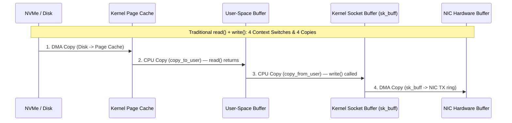
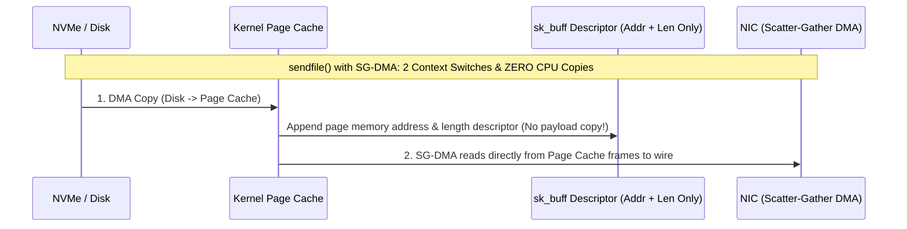
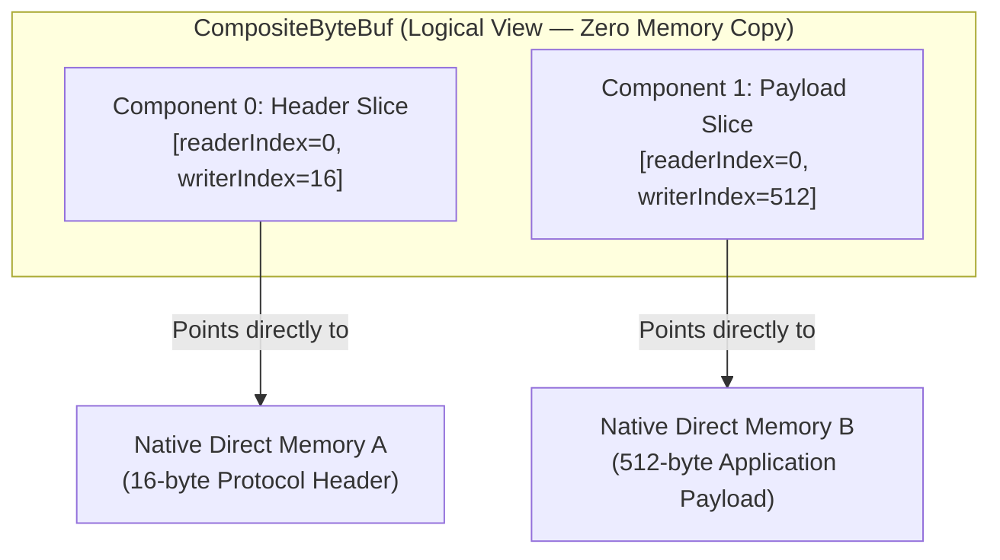
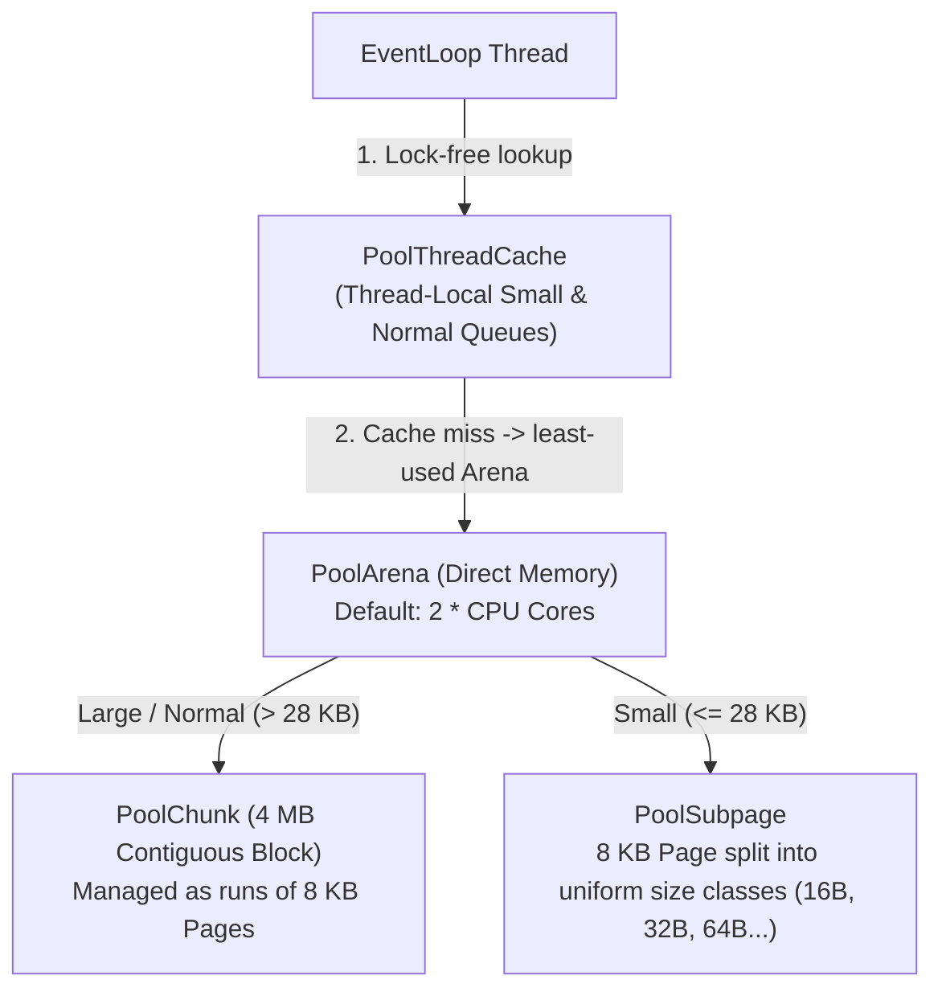

## The Hidden Tax of Memory Movement

In [Chapter 01](/tech/series/netty/01.linux-io-models/), we saw how `epoll` reduces readiness detection across 100,000 sockets to $\mathcal{O}(1)$ callback notifications. Yet once a socket is ready, high-throughput network servers hit a second wall: **memory bandwidth and CPU cache pollution from redundant data copies**.

Consider a standard file server or message broker reading bytes from disk (`read(2)`) and writing them to a network socket (`write(2)`):



A single `read()` + `write()` round-trip incurs:

- **4 user/kernel mode context switches** (`sys_read` entry/exit + `sys_write` entry/exit).
- **4 data copies**: 2 handled asynchronously by Direct Memory Access (DMA) controllers, and **2 performed synchronously by the CPU** (`copy_to_user` and `copy_from_user`), burning CPU cycles just to shuttle identical bytes out of the kernel and immediately back into the kernel.

---

## Why JDK `HeapByteBuffer` Adds a Fifth Copy

In Java, if you allocate a standard on-heap buffer (`ByteBuffer.allocate(8192)` $\to$ `HeapByteBuffer`) and pass it to `SocketChannel.write(buf)` or `FileChannel.read(buf)`, the JVM actually performs **an extra user-space memory copy** before invoking the OS system call!

Why can't the Linux kernel copy directly from a `byte[]` inside the JVM heap?

1. **Moving Garbage Collectors**: The `read(fd, buf_ptr, len)` and `write(fd, buf_ptr, len)` C system calls require a stable virtual memory pointer (`void *buf_ptr`). While the native system call is executing, a JVM garbage collection pause (G1, ZGC, or Shenandoah) can compact the heap and **relocate the `byte[]` to a completely different physical/virtual address**. If the kernel or DMA controller writes to the old address, it corrupts arbitrary JVM heap memory.
2. **Thread-Local Temporary Direct Buffer (`sun.nio.ch.IOUtil`)**: To prevent heap corruption without pinning the entire garbage collector, OpenJDK's `IOUtil.write()` inspects the buffer type:
   - If the buffer is a `DirectByteBuffer` (allocated off-heap via `unsafe.allocateMemory`), it passes the raw native memory address directly to the syscall.
   - If the buffer is a `HeapByteBuffer`, OpenJDK grabs a thread-local temporary `DirectByteBuffer`, **copies the `byte[]` from the JVM heap into off-heap native memory**, and only then invokes the kernel syscall:

```java
// Simplified from OpenJDK sun.nio.ch.IOUtil.write()
static int write(FileDescriptor fd, ByteBuffer src, long position, NativeDispatcher nd) throws IOException {
    if (src instanceof DirectBuffer) {
        return writeFromNativeBuffer(fd, src, position, nd);
    }
    // Hidden user-space copy: JVM Heap (byte[]) -> Temporary ThreadLocal DirectByteBuffer
    ByteBuffer bb = Util.getTemporaryDirectBuffer(rem);
    try {
        bb.put(src);
        bb.flip();
        return writeFromNativeBuffer(fd, bb, position, nd);
    } finally {
        Util.offerFirstTemporaryDirectBuffer(bb);
    }
}
```

This is why Netty defaults to allocating **off-heap Direct `ByteBuf`s** for all socket I/O.

---

## Linux Page Cache, `mmap`, `sendfile`, and `splice` Zero-Copy

Before bypassing or optimizing kernel copies, we need to understand how Linux manages file I/O through the **Page Cache** (`struct address_space`):

- **Buffered Read (`vfs_read`)**: Checks the file's XArray/Radix-Tree `address_space` for the requested 4 KB page index. On a cache miss, the block layer issues a DMA read and triggers **heuristic readahead** to prefetch sequential pages into the Page Cache, then executes `copy_to_user`.
- **Buffered Write (`vfs_write`)**: `copy_from_user` writes into the Page Cache page, marks it dirty (`PG_dirty`), and returns immediately. Kernel background `flusher` threads flush dirty pages to disk asynchronously based on `vm.dirty_background_ratio` (default 10%), or stall writing processes synchronously if dirty pages cross `vm.dirty_ratio` (default 20%).
- **Direct I/O (`O_DIRECT`)**: Bypasses the Page Cache completely; DMA transfers data directly between the storage controller and user-space memory aligned to 512 B / 4 KB sector boundaries. Used by self-caching database engines (`InnoDB`, `RocksDB`), not general network servers.

To eliminate redundant CPU copies between disk files and network sockets, Linux provides two kernel zero-copy primitives:

### 1. `mmap(2)` + `write(2)` (4 Context Switches, 1 CPU Copy)

Calling `FileChannel.map()` invokes `mmap(2)`, mapping the kernel Page Cache physical pages directly into the process's virtual address space (`vm_area_struct`).

- Reading the file no longer calls `read(2)` or `copy_to_user`; accessing the mapped pointer triggers a minor **Page Fault** that wires the page table entry (PTE).
- When `write(socket_fd, mmap_ptr, len)` runs, the CPU copies bytes directly from the Page Cache to the kernel socket buffer (`sk_buff`).

### 2. `sendfile(2)` + Scatter-Gather DMA (2 Context Switches, 0 CPU Copies)

Introduced in Linux 2.1 and enhanced with Scatter-Gather DMA (`SG-DMA`) in Linux 2.4 (`FileChannel.transferTo()` in Java, wrapped by Netty's **`DefaultFileRegion`**):



1. A single `sendfile(out_socket_fd, in_file_fd, offset, count)` syscall switches into kernel mode.
2. DMA loads the file into the Page Cache (if not already cached).
3. Instead of copying the payload bytes into `sk_buff`, the kernel appends **only a tiny descriptor** containing the Page Cache physical memory address and byte length into the socket buffer.
4. The NIC's **Scatter-Gather DMA engine** gathers the TCP/IP header from `sk_buff` and the payload bytes directly from the Page Cache frames in a single hardware pass. **Zero bytes are copied by the CPU.**

| Transfer Mechanism | Context Switches | DMA Copies | CPU Copies | Netty / JDK API |
| :--- | :--- | :--- | :--- | :--- |
| **`read()` + `write()` (`HeapByteBuffer`)** | 4 | 2 | **3** (includes JVM heap $\leftrightarrow$ direct copy) | `SocketChannel.write(heapBuf)` |
| **`read()` + `write()` (`DirectByteBuffer`)** | 4 | 2 | **2** (`copy_to_user` + `copy_from_user`) | `SocketChannel.write(directBuf)` |
| **`mmap()` + `write()`** | 4 | 2 | **1** (Page Cache $\to$ `sk_buff`) | `FileChannel.map()` $\to$ `MappedByteBuffer` |
| **`sendfile()` + SG-DMA** | **2** | 2 | **0** | `DefaultFileRegion` / `FileChannel.transferTo()` |

---

## Netty `ByteBuf` vs. JDK `ByteBuffer`

Even when data must be inspected or transformed in user space (such as TLS decryption, HTTP parsing, or Protobuf serialization), JDK's `java.nio.ByteBuffer` suffers from three design flaws that Netty's `ByteBuf` solves:

### 1. Dual Index Pointers (`readerIndex` and `writerIndex`)

JDK `ByteBuffer` uses a single `position` pointer shared between reading and writing. Switching from writing to reading requires calling `flip()` (`limit = position; position = 0`); forgetting to call `flip()` or `compact()` silently reads garbage or overwrites unread bytes.

Netty's `ByteBuf` maintains two independent pointers (`0 <= readerIndex <= writerIndex <= capacity`), dividing the buffer into three clean regions without mode-switching:

```text
+-------------------+------------------+------------------+
| Discardable Bytes |  Readable Bytes  |  Writable Bytes  |
|   (Already read)  |     (Content)    |   (Free space)   |
+-------------------+------------------+------------------+
0      <=      readerIndex   <=   writerIndex    <=    capacity
```

- Reading advances `readerIndex`; writing advances `writerIndex`.
- Calling `discardReadBytes()` reclaims the `[0, readerIndex)` prefix when compacting long-lived cumulation buffers.
- If a write exceeds `capacity` (up to `maxCapacity`), `ByteBuf` dynamically expands its backing memory automatically, whereas JDK `ByteBuffer` has a fixed capacity and throws `BufferOverflowException`.

### 2. User-Space Logical Zero-Copy (`slice`, `duplicate`, `CompositeByteBuf`)

When framing or routing packets in user space, copying byte arrays to split a header from a body or to prepend a length prefix wastes memory bandwidth. `ByteBuf` provides three logical zero-copy views that share the same underlying native memory:



- **`buf.slice(index, length)` / `buf.retainedSlice(...)`**: Creates a new `ByteBuf` header with its own independent `readerIndex` and `writerIndex` pointing to a sub-range of the same backing memory.
- **`CompositeByteBuf`**: Presents multiple discontiguous `ByteBuf` instances (for example, a 4-byte protocol header buffer and a 4 KB payload buffer) as a single unified `ByteBuf`. When written to a channel, Netty passes the underlying component pointers directly to the kernel's **vectored I/O (`writev(2)` / gather write)** syscall.

---

## Jemalloc-Inspired Pooled Allocation (`PooledByteBufAllocator`)

<Archify src="./diagrams/netty-pooled-bytebuf-jemalloc.workflow.json" />

Allocating and freeing raw off-heap memory (`malloc` / `free` via `ByteBuffer.allocateDirect`) on every network packet is expensive and causes severe native memory fragmentation and global lock contention under high concurrency.

Netty's pooled allocator (`PooledByteBufAllocator`, the long-time default of 4.1) implements a **jemalloc-style hierarchical memory pool**. Netty 4.2 may default to `AdaptiveByteBufAllocator` instead; check the release notes for your version and select the pooled one explicitly with `-Dio.netty.allocator.type=pooled` if you want the behavior described here:



1. **`PoolThreadCache` (Zero Lock Contention)**: Because a Netty `EventLoop` is a single permanent thread, each `EventLoop` holds a thread-local `PoolThreadCache`. When a handler allocates and releases a buffer on the same `EventLoop`, the memory block goes straight back into the thread-local ring buffer—**zero atomic CAS operations, zero mutex locks, and zero JNI calls**.
2. **`PoolArena` Stripes**: When a thread-local cache misses, it falls back to one of $2 \times \text{CPU}$ `PoolArena` instances, bound to threads on a least-assigned basis to minimize cross-thread contention.
3. **`PoolChunk` & `PoolSubpage`**: The arena requests large contiguous chunks (`4 MB` in modern Netty 4.1+/4.2 `SizeClasses`) from the OS once, subdividing them into `8 KB` pages for medium buffers and slab-allocated `PoolSubpage` size classes (`16 B`, `32 B`, `64 B`, ...) for tiny headers.

---

## Reference Counting (`ReferenceCounted`) & Leak Detection

Because off-heap memory lives outside the JVM garbage collector's heap graph, relying on Java's `Cleaner` / `PhantomReference` to free direct memory is dangerous: if heap usage is low, the GC may not run even as off-heap memory hits `-XX:MaxDirectMemorySize`, triggering `OutOfMemoryError: Direct buffer memory`.

Netty tracks every `ByteBuf` deterministically via **explicit reference counting (`ReferenceCounted`)**:

- A newly allocated `ByteBuf` starts with **`refCnt() == 1`**.
- Calling **`buf.retain()`** increments `refCnt` by 1 (required whenever you store a buffer reference beyond the current handler invocation or pass a slice to an asynchronous callback).
- Calling **`buf.release()`** decrements `refCnt` by 1. The instant `refCnt` reaches **`0`**, the memory is immediately returned to `PoolThreadCache` / `PoolArena`. Accessing a buffer with `refCnt == 0` throws `IllegalReferenceCountException`.

### Who Owns `release()` in a Pipeline?

> **The Last-Consumer Rule**: Whichever component is the **final consumer** of a `ByteBuf` is responsible for calling `release()`.

Look at how [`UppercaseInboundHandler.java`](https://github.com/azusachino/flos/blob/main/modules/netty/event-loop-lab/src/main/java/io/github/azusachino/flos/netty/eventloop/UppercaseInboundHandler.java) in [`flos/modules/netty/event-loop-lab`](https://github.com/azusachino/flos/tree/main/modules/netty/event-loop-lab) obeys this contract:

```java
public class UppercaseInboundHandler extends ChannelInboundHandlerAdapter {

    @Override
    public void channelRead(ChannelHandlerContext ctx, Object msg) {
        if (msg instanceof ByteBuf buf) {
            String text = buf.toString(StandardCharsets.UTF_8).toUpperCase(Locale.ROOT);
            // 1. We consumed `buf` and are NOT forwarding `buf` downstream — release it now!
            buf.release();
            // 2. Allocate a new outbound buffer (refCnt = 1); downstream EchoServerHandler
            //    passes it to writeAndFlush(), where HeadContext releases it after socket write.
            ctx.fireChannelRead(Unpooled.copiedBuffer(text, StandardCharsets.UTF_8));
        } else {
            ctx.fireChannelRead(msg);
        }
    }
}
```

- **Inbound path**: If a handler consumes a `ByteBuf` without passing it to `ctx.fireChannelRead(buf)` (or replaces it with a new buffer/POJO), that handler **must** call `buf.release()` (or extend `SimpleChannelInboundHandler<ByteBuf>`, which calls `ReferenceCountUtil.release(msg)` in a `finally` block). If the buffer reaches the end of the pipeline untouched, `TailContext` logs a warning and releases it.
- **Outbound path**: When a handler calls `ctx.writeAndFlush(buf)`, Netty's `ChannelOutboundBuffer` and `HeadContext` automatically call `buf.release()` once the bytes have been flushed to the kernel socket.

### Catching Leaks in Tests and Production

Netty's `ResourceLeakDetector` samples buffer allocations using `WeakReference` phantom queues and records stack traces of recent buffer touches (`buf.touch("stage-name")`):

| Level (`-Dio.netty.leakDetection.level=...`) | Sampling Rate | Overhead & Use Case |
| :--- | :--- | :--- |
| **`DISABLED`** | `0%` | Zero overhead; not recommended even in production. |
| **`SIMPLE`** *(Default)* | `~1%` (every 128th buffer) | Negligible overhead; reports that a leak occurred in production logs. |
| **`ADVANCED`** | `~1%` (every 128th buffer) | Records the exact allocation and `touch()` call stack of leaked buffers. |
| **`PARANOID`** | **`100%`** (every buffer) | High overhead; run in **CI and unit test suites** to guarantee zero leaks on every branch. |

In [Chapter 03](/tech/series/netty/03.reactor-and-event-loop/), we wire these kernel multiplexers and buffers into Netty's **Master-Worker Reactor architecture**, walking line by line through `EventLoopLabServer` and proving how a single-threaded `EventLoop` eliminates concurrency locks.
