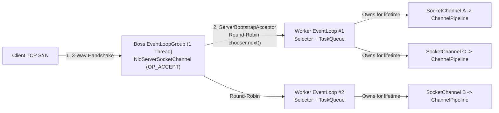
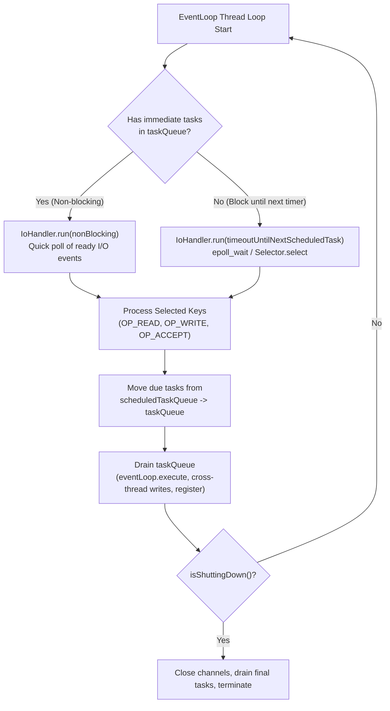
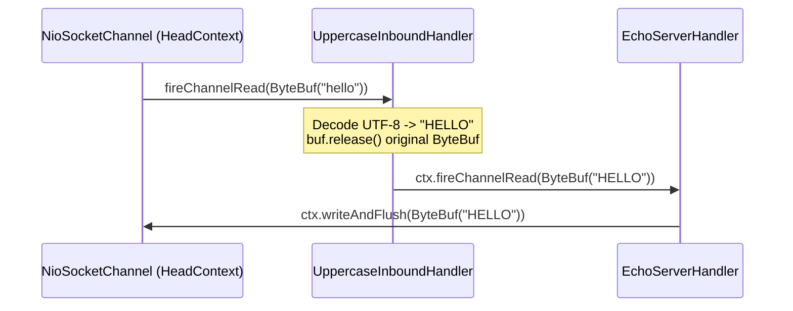

## Before you start

A server that uses one thread per connection needs locks as soon as connections share data, and locks are where subtle bugs live. Netty takes a different route. Each connection is assigned to one thread for its whole life, and that thread loops: ask the kernel which of its connections are ready, handle them, then run any queued tasks. Because only one thread ever touches a given connection, handlers need no locking for connection state. It resembles a waiter who owns a fixed set of tables: nobody else serves them, so no two waiters collide. The catch is that one slow handler stalls every other connection on that thread, so you must never block inside it.

[Chapter 1](/tech/series/netty/01.linux-io-models/) covers the `epoll` call this loop is built on.

Terms used in this chapter:

- **Reactor pattern**: a design where one loop waits for I/O events and dispatches each to a handler.
- **`EventLoop`**: Netty's single thread that runs the loop for the channels assigned to it.
- **`EventLoopGroup`**: a pool of `EventLoop` threads.
- **boss group / worker group**: the boss group accepts new connections; the worker group handles the I/O of accepted ones.
- **`Channel`**: Netty's object for one connection (or listening socket).
- **`ServerBootstrap`**: the helper class that configures and starts a Netty server.
- **`EmbeddedChannel`**: a test channel that runs a pipeline in memory without real sockets.

## The Concurrency Dilemma in High-Throughput Servers

Even after replacing blocking threads with `epoll` ([Chapter 01](/tech/series/netty/01.linux-io-models/)) and eliminating redundant buffer copies ([Chapter 02](/tech/series/netty/02.zero-copy-and-buffers/)), a multi-core server faces a critical architectural question:

> **When packets arrive on a TCP connection, which thread executes the protocol decoder, connection state machine, and outbound writes?**

If a general thread pool picks up whatever packet arrives next, two packets from the **same** TCP connection can execute concurrently on Thread A and Thread B. Immediately, every piece of per-connection state—the partial frame buffer, the sequence counter, the TLS cipher state, the session attributes—must be guarded by `synchronized` blocks or `ReentrantLock`. Under heavy load, lock contention and cache-line bouncing across CPU cores destroy throughput.

Netty solves this by implementing Doug Lea's **Multiple Reactors (Boss-Worker)** pattern with one strict invariant:

> **A `Channel` is registered to exactly one `EventLoop` for its entire lifetime, and every `EventLoop` is driven by a single dedicated thread.**

Because all I/O events, timers, and pipeline handlers for a given connection always run on that connection's assigned `EventLoop` thread, **your handler code never needs mutex locks for per-connection state**.

---

## Boss and Worker `EventLoopGroup` Topology

In [`flos/modules/netty/event-loop-lab`](https://github.com/azusachino/flos/tree/main/modules/netty/event-loop-lab), [`EventLoopLabServer.java`](https://github.com/azusachino/flos/blob/main/modules/netty/event-loop-lab/src/main/java/io/github/azusachino/flos/netty/eventloop/EventLoopLabServer.java) declares two separate `EventLoopGroup` instances:

```java
private final EventLoopGroup bossGroup = new MultiThreadIoEventLoopGroup(1, NioIoHandler.newFactory());
private final EventLoopGroup workerGroup = new MultiThreadIoEventLoopGroup(NioIoHandler.newFactory());
```

Each group has a distinct job in the connection lifecycle:



| Group | Thread Count | Registered Channel Type | Watched Kernel Event | Responsibility |
| :--- | :--- | :--- | :--- | :--- |
| **`bossGroup`** | `1` (per bound port) | `NioServerSocketChannel` | `OP_ACCEPT` (`EPOLLIN` on listen socket) | Calls `accept()` to harvest completed TCP handshakes and hands the child `SocketChannel` to `workerGroup`. |
| **`workerGroup`** | Default `2 * CPU cores` | Child `NioSocketChannel` | `OP_READ` / `OP_WRITE` | Executes all reads, codec framing, pipeline handlers, scheduled timers, and socket writes for assigned channels. |

### The 5-Step Connection Birth Sequence Inside Netty

<Archify src="./diagrams/netty-boss-worker-reactor.sequence.json" />

When a client connects to port `9000`, how does a socket move from the Boss thread to a Worker thread without race conditions?

1. **Boss Detects `OP_ACCEPT`**: The Boss `EventLoop` wakes from `epoll_wait` / `Selector.select()`, calls `ServerSocketChannel.accept()`, and wraps the accepted OS descriptor in a child `NioSocketChannel`.
2. **`ServerBootstrapAcceptor` Dispatches**: The Boss pipeline runs an internal handler called `ServerBootstrapAcceptor`. It applies your `childOption`s and `childHandler` (`ChannelInitializer`) to the child channel and calls `workerGroup.register(childChannel)`.
3. **Round-Robin Worker Selection**: `EventExecutorChooser` selects the next Worker `EventLoop` (using bitmask `& (length - 1)` when the worker count is a power of two).
4. **Thread-Safe Handoff via `eventLoop.execute()`**: Because the Boss thread is currently executing—not the chosen Worker thread—`AbstractUnsafe.register()` checks `eventLoop.inEventLoop()`. Since it is `false`, it enqueues a registration task onto the **Worker `EventLoop`'s `taskQueue`**, ensuring that selector registration (`javaChannel().register(selector, 0, this)`) and `ChannelInitializer.initChannel()` run **exclusively on the Worker thread**.
5. **`fireChannelActive()` Enables `OP_READ`**: Note that step 4 registers the channel with interest ops `0` (not `OP_READ`) so no packets can fire before `ChannelInitializer` finishes building the pipeline! Only after `initChannel()` completes does Netty fire `pipeline.fireChannelActive()`, which reaches `HeadContext.channelActive()` and enables `OP_READ` (when `AUTO_READ` is `true`).

---

## Inside a Single `EventLoop` Tick

Each Worker `EventLoop` (`SingleThreadIoEventLoop` in Netty 4.2) runs an infinite loop that balances three queues on a single thread:



1. **I/O Readiness Processing**: Invokes `NioIoHandler` (or `EpollIoHandler`) to process ready sockets (`unsafe.read()` for `OP_READ`, `unsafe.forceFlush()` for `OP_WRITE`). To prevent a single chatty socket from starving thousands of other connections sharing the same `EventLoop`, Netty caps consecutive reads per channel per tick via **`MAX_MESSAGES_PER_READ` (default `16`)**.
2. **Scheduled Timers (`scheduledTaskQueue`)**: A min-heap priority queue of delayed tasks submitted via `ctx.executor().schedule(...)` (used by `IdleStateHandler` timeouts and reconnect backoffs). Due tasks are transferred into `taskQueue`.
3. **Non-I/O Task Queue (`taskQueue`)**: A Multi-Producer Single-Consumer (**MPSC**) lock-free queue (`PlatformDependent.newMpscQueue()`). Whenever an external application thread calls `channel.writeAndFlush(msg)` or `eventLoop.execute(task)`, Netty sees `!eventLoop.inEventLoop()`, wraps the call into a task on the MPSC queue, and wakes the `EventLoop` thread.

> **The Golden Rule of Netty**: **Never block the `EventLoop` thread.** If one handler calls `Thread.sleep(500)`, runs a synchronous JDBC query, or performs a blocking HTTP call on the `EventLoop` thread, it freezes I/O reading, writing, and heartbeats for **every other `Channel` multiplexed onto that `EventLoop`**. Offload blocking work to a separate `EventExecutorGroup` or virtual/worker pool, then write results back via `ctx.writeAndFlush(result)` (which safely hops back to the `EventLoop` via the MPSC `taskQueue`).

---

## Companion Lab Walkthrough: `flos/modules/netty/event-loop-lab`

Let us inspect the complete, runnable implementation in [`azusachino/flos/modules/netty/event-loop-lab`](https://github.com/azusachino/flos/tree/main/modules/netty/event-loop-lab), which answers one foundational question:

> *When a client sends bytes, which piece of code touches them, in what order, and on which thread?*

### 1. Wiring `ServerBootstrap` (`EventLoopLabServer.java`)

```java
package io.github.azusachino.flos.netty.eventloop;

import io.netty.bootstrap.ServerBootstrap;
import io.netty.channel.Channel;
import io.netty.channel.ChannelInitializer;
import io.netty.channel.EventLoopGroup;
import io.netty.channel.MultiThreadIoEventLoopGroup;
import io.netty.channel.nio.NioIoHandler;
import io.netty.channel.socket.SocketChannel;
import io.netty.channel.socket.nio.NioServerSocketChannel;
import java.net.InetSocketAddress;
import java.util.concurrent.atomic.AtomicInteger;

public final class EventLoopLabServer {

    private final EventLoopGroup bossGroup = new MultiThreadIoEventLoopGroup(1, NioIoHandler.newFactory());
    private final EventLoopGroup workerGroup = new MultiThreadIoEventLoopGroup(NioIoHandler.newFactory());
    private final AtomicInteger activeConnections = new AtomicInteger();
    private Channel serverChannel;

    public int start(int port) throws InterruptedException {
        ServerBootstrap bootstrap =
                new ServerBootstrap()
                        .group(bossGroup, workerGroup)
                        .channel(NioServerSocketChannel.class)
                        .childHandler(
                                new ChannelInitializer<SocketChannel>() {
                                    @Override
                                    protected void initChannel(SocketChannel channel) {
                                        channel
                                                .pipeline()
                                                .addLast(
                                                        new UppercaseInboundHandler(),
                                                        new EchoServerHandler(activeConnections));
                                    }
                                });
        serverChannel = bootstrap.bind(port).sync().channel();
        return ((InetSocketAddress) serverChannel.localAddress()).getPort();
    }

    public int activeConnections() {
        return activeConnections.get();
    }

    public void stop() throws InterruptedException {
        if (serverChannel != null) {
            serverChannel.close().sync();
        }
        workerGroup.shutdownGracefully().sync();
        bossGroup.shutdownGracefully().sync();
    }
}
```

Notice two production-grade details in `start(int port)`:

- Passing `port = 0` in tests lets the OS kernel assign an **ephemeral free port**, which `((InetSocketAddress) serverChannel.localAddress()).getPort()` retrieves after `bind(port).sync()` completes. This eliminates port collisions in parallel CI runs.
- `activeConnections` is an `AtomicInteger` because it is shared **across multiple `Channel`s** (which may live on different Worker `EventLoop` threads), whereas each `UppercaseInboundHandler` is instantiated per channel inside `initChannel`.

### 2. Composable Inbound Transformation (`UppercaseInboundHandler.java`)

```java
package io.github.azusachino.flos.netty.eventloop;

import io.netty.buffer.ByteBuf;
import io.netty.buffer.Unpooled;
import io.netty.channel.ChannelHandlerContext;
import io.netty.channel.ChannelInboundHandlerAdapter;
import java.nio.charset.StandardCharsets;
import java.util.Locale;

public class UppercaseInboundHandler extends ChannelInboundHandlerAdapter {

    @Override
    public void channelRead(ChannelHandlerContext ctx, Object msg) {
        if (msg instanceof ByteBuf buf) {
            String text = buf.toString(StandardCharsets.UTF_8).toUpperCase(Locale.ROOT);
            buf.release();
            ctx.fireChannelRead(Unpooled.copiedBuffer(text, StandardCharsets.UTF_8));
        } else {
            ctx.fireChannelRead(msg);
        }
    }
}
```

### 3. Lifecycle Tracking & Echo Terminal (`EchoServerHandler.java`)

```java
package io.github.azusachino.flos.netty.eventloop;

import io.netty.channel.ChannelHandlerContext;
import io.netty.channel.ChannelInboundHandlerAdapter;
import java.util.concurrent.atomic.AtomicInteger;

public class EchoServerHandler extends ChannelInboundHandlerAdapter {

    private final AtomicInteger activeConnections;

    public EchoServerHandler(AtomicInteger activeConnections) {
        this.activeConnections = activeConnections;
    }

    @Override
    public void channelActive(ChannelHandlerContext ctx) {
        activeConnections.incrementAndGet();
        ctx.fireChannelActive();
    }

    @Override
    public void channelInactive(ChannelHandlerContext ctx) {
        activeConnections.decrementAndGet();
        ctx.fireChannelInactive();
    }

    @Override
    public void channelRead(ChannelHandlerContext ctx, Object msg) {
        ctx.writeAndFlush(msg);
    }

    @Override
    public void exceptionCaught(ChannelHandlerContext ctx, Throwable cause) {
        ctx.close();
    }
}
```



What if you swapped the order in `addLast(new EchoServerHandler(activeConnections), new UppercaseInboundHandler())`?
`EchoServerHandler` would call `ctx.writeAndFlush(msg)`—sending `"hello"` straight back toward `HeadContext` and the socket—and **never** call `ctx.fireChannelRead(msg)`. `UppercaseInboundHandler` would never execute a single line! Pipeline ordering is executable control flow, not passive configuration.

---

## Verification: What `EmbeddedChannel` Proves vs. What Real Sockets Prove

In [`EventLoopPipelineTest.java`](https://github.com/azusachino/flos/blob/main/modules/netty/event-loop-lab/src/test/java/io/github/azusachino/flos/netty/eventloop/EventLoopPipelineTest.java), we separate unit semantics from runtime transport verification:

```java
class EventLoopPipelineTest {

    @Test
    void pipelineOrderUppercasesBeforeEchoing() {
        var activeConnections = new AtomicInteger();
        var channel =
                new EmbeddedChannel(
                        new UppercaseInboundHandler(), new EchoServerHandler(activeConnections));

        channel.writeInbound(Unpooled.copiedBuffer("hello", StandardCharsets.UTF_8));

        ByteBuf outbound = channel.readOutbound();
        assertThat(outbound.toString(StandardCharsets.UTF_8)).isEqualTo("HELLO");
        outbound.release();
    }

    @Test
    void channelActiveAndInactiveTrackConnectionCount() {
        var activeConnections = new AtomicInteger();
        var channel = new EmbeddedChannel(new EchoServerHandler(activeConnections));

        assertThat(activeConnections.get()).isEqualTo(1);

        channel.close();

        assertThat(activeConnections.get()).isEqualTo(0);
    }

    @Test
    void realSocketRoundTripProvesTheEventLoopAcceptsAndEchoes() throws Exception {
        var server = new EventLoopLabServer();
        int port = server.start(0);
        try (var socket = new Socket("localhost", port)) {
            socket.getOutputStream().write("hi".getBytes(StandardCharsets.UTF_8));
            socket.getOutputStream().flush();

            byte[] response = socket.getInputStream().readNBytes(2);

            assertThat(new String(response, StandardCharsets.UTF_8)).isEqualTo("HI");
            assertThat(server.activeConnections()).isEqualTo(1);
        } finally {
            server.stop();
        }
    }
}
```

- **`EmbeddedChannel`**: Drives the pipeline synchronously on the JUnit thread with zero sockets or thread pools. It proves handler ordering, lifecycle counter transitions, and `ByteBuf` reference release in sub-millisecond time.
- **Real `Socket` against `EventLoopLabServer`**: Proves that `ServerBootstrap`, the Boss/Worker `MultiThreadIoEventLoopGroup` handoff, and actual OS TCP sockets are wired together end to end.

### Run the Lab Locally

```bash
# Terminal 1: Start the event-loop echo server on port 9000
$ make netty-event-loop
event-loop-lab echo server listening on port 9000

# Terminal 2: Send a payload over netcat
$ printf 'hello' | nc localhost 9000
HELLO
```

This lab made one simplifying assumption: that `"hello"` arrived in a single `channelRead` call. On a real network, TCP makes no such promise. In [Chapter 04](/tech/series/netty/04.pipeline-and-framing/), we dissect `DefaultChannelPipeline` internals, prove why TCP coalesces and fragments messages, and solve it with `ByteToMessageDecoder` and length-prefixed framing.
