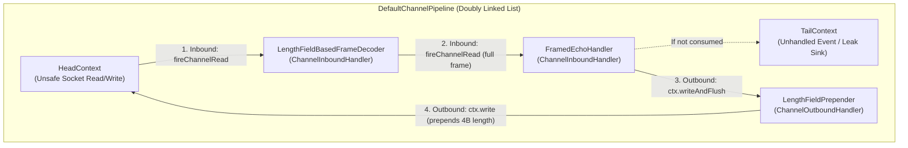

## Why TCP Has No Message Boundaries

In [Chapter 03](/tech/series/netty/03.reactor-and-event-loop/), our echo server treated every `channelRead(ctx, msg)` invocation as one complete application message. On localhost with a 5-byte payload, that illusion usually holds. In production, it breaks immediately.

**TCP (`SOCK_STREAM`) is a continuous, unstructured byte stream—not a message queue.** Between a sender calling `write()` and a receiver's `epoll_wait` waking up, four kernel and hardware mechanisms split or merge your writes:

1. **Nagle's Algorithm (`TCP_NODELAY`)**: Unless disabled, the sender's TCP stack holds small writes in `sk_write_queue` waiting for either a full Maximum Segment Size (MSS) or an `ACK` from the peer, coalescing multiple small application messages into one TCP segment.
2. **MSS Segmentation & MTU Fragmentation**: If an application writes a 16 KB message over an Ethernet link with a standard 1,500-byte MTU (`MSS = 1460` bytes), the sender's kernel slices that single write into 12 separate TCP segments.
3. **In-Flight Packet Reordering & Retransmission**: If segment #3 drops on a router while segments #4 and #5 arrive, the receiver's kernel holds #4 and #5 in the out-of-order queue and delivers only #1 and #2 to the first `read()` call.
4. **Receiver Socket Buffer Coalescing (`SO_RCVBUF`)**: If a sender transmits three small messages back-to-back before the receiver's `EventLoop` runs its next `read()` syscall, all three messages sit contiguous inside `sk_receive_queue` and are harvested into a single `ByteBuf`.

```text
Sender writes two messages:   [   "first"   ] [   "second"   ]

Case A (Coalesced / "Sticky"): [ "firstsecond" ]                  (1 channelRead)
Case B (Split / "Half-Frame"): [ "fir" ] + [ "stsec" ] + [ "ond" ] (3 channelReads)
Case C (Mid-Header Split):     [ 2 bytes of 4B length ] + [ rest ] (2 channelReads)
```

---

## Inside `DefaultChannelPipeline`: The Doubly Linked List

Before examining how Netty codecs reassemble frames, let us look at how events propagate through a `ChannelPipeline`.

Every `Channel` owns a `DefaultChannelPipeline`, implemented as a **doubly linked list of `AbstractChannelHandlerContext` nodes** bookended by two sentinel nodes: **`HeadContext`** (closest to the OS socket) and **`TailContext`** (the terminal sink):



- **Inbound Events (`channelActive`, `channelRead`, `channelReadComplete`, `channelInactive`, `exceptionCaught`)**: Start at `HeadContext` and propagate **forward (`Head` $\to$ `Tail`)** whenever a handler calls `ctx.fireChannelRead(msg)`.
- **Outbound Operations (`bind`, `connect`, `write`, `flush`, `close`)**: Propagate **backward (`Tail` $\to$ `Head`)**.
  - **Crucial Distinction (`ctx.write` vs. `ctx.channel().write`)**: Calling **`ctx.writeAndFlush(msg)`** inside `FramedEchoHandler` starts walking backward from `FramedEchoHandler`'s own `ChannelHandlerContext` node directly to `LengthFieldPrepender` and `HeadContext`. Calling **`ctx.channel().writeAndFlush(msg)`** starts at the very end of the pipeline (`TailContext`) and traverses every outbound handler in the entire pipeline.
- **Execution Bitmask Optimization (`executionMask`)**: When a handler is added to the pipeline, Netty inspects which methods the class actually overrides (excluding methods annotated with `@Skip`) and precomputes an integer bitmask (`MASK_CHANNEL_READ`, `MASK_WRITE`, etc.). When walking the linked list, `findContextInbound()` and `findContextOutbound()` test the bitmask with a single bitwise `&`, jumping straight over handlers that do not intercept that event.

---

## How `ByteToMessageDecoder` Solves Partial Frames

Netty's foundational framing base class is **`ByteToMessageDecoder`**, which extends `ChannelInboundHandlerAdapter` and maintains an internal per-connection **`cumulation` `ByteBuf`**.

Because `cumulation` stores unread partial bytes belonging to **one specific TCP connection** across multiple `channelRead` calls, **`ByteToMessageDecoder` and its subclasses are stateful and must NEVER be annotated with `@Sharable`**.

Look at the exact memory lifecycle inside `ByteToMessageDecoder.MERGE_CUMULATOR`:

```java
public static final Cumulator MERGE_CUMULATOR = new Cumulator() {
    @Override
    public ByteBuf cumulate(ByteBufAllocator alloc, ByteBuf cumulation, ByteBuf in) {
        if (!cumulation.isReadable() && in.isContiguous()) {
            // Fast path: previous cumulation is empty, so adopt `in` directly (Zero copy!)
            cumulation.release();
            return in;
        }
        try {
            final int required = in.readableBytes();
            if (required > cumulation.maxWritableBytes() ||
                (required > cumulation.maxFastWritableBytes() && cumulation.refCnt() > 1) ||
                cumulation.isReadOnly()) {
                // Expand cumulation if capacity is insufficient or if downstream shared a slice (refCnt > 1)
                return expandCumulation(alloc, cumulation, in);
            }
            cumulation.writeBytes(in, in.readerIndex(), required);
            in.readerIndex(in.writerIndex());
            return cumulation;
        } finally {
            // Always release `in` so partial reads never leak off-heap buffers
            in.release();
        }
    }
};
```

Notice the three engineering safeguards built into `MERGE_CUMULATOR`:

1. **Zero-Copy Fast Path**: When no leftover bytes exist from the previous read (`!cumulation.isReadable()`), it releases the empty buffer and adopts the incoming `ByteBuf` directly without copying a single byte.
2. **Copy-on-Write Safety (`cumulation.refCnt() > 1`)**: If a previous frame emitted a zero-copy `retainedSlice()` that is still being processed downstream (`refCnt() > 1`), reallocating the buffer in place could corrupt the shared memory. The cumulator detects `refCnt() > 1` and allocates a fresh cumulation buffer.
3. **Guaranteed `finally { in.release(); }`**: Regardless of whether `decode()` emits zero frames, one frame, or throws an exception, the incoming chunk `in` is always released.

### Choosing the Right Frame Decoder

| Decoder | Wire Format | Best For | Pitfall to Watch |
| :--- | :--- | :--- | :--- |
| **`FixedLengthFrameDecoder`** | Every message is exactly $N$ bytes | Fixed-size telemetry packets | Wastes bandwidth on variable-length payloads |
| **`LineBasedFrameDecoder` / `DelimiterBasedFrameDecoder`** | Text terminated by `\n`, `\r\n`, or custom delimiter | Redis RESP, SMTP, text protocols | Must scan every payload byte ($O(N)$) for the delimiter |
| **`LengthFieldBasedFrameDecoder`** | Explicit binary length header + body | RPC (gRPC, Dubbo), Kafka, custom binary protocols | Always set a strict `maxFrameLength` so a corrupt header cannot exhaust RAM |

---

## Companion Lab Walkthrough: `flos/modules/netty/framing-lab`

Let us examine [`azusachino/flos/modules/netty/framing-lab`](https://github.com/azusachino/flos/tree/main/modules/netty/framing-lab), which first proves the raw TCP coalescing bug in code, and then solves both coalescing and mid-header fragmentation using symmetric length-field codecs.

### 1. Proving the Bug (`rawPipelineCoalescesTwoMessagesIntoOneRead`)

In [`FramingCodecTest.java`](https://github.com/azusachino/flos/blob/main/modules/netty/framing-lab/src/test/java/io/github/azusachino/flos/netty/framing/FramingCodecTest.java), we feed two back-to-back UTF-8 messages (`"first"` and `"second"`) into an unframed pipeline:

```java
@Test
void rawPipelineCoalescesTwoMessagesIntoOneRead() {
    List<ByteBuf> received = new ArrayList<>();
    var channel = new EmbeddedChannel(capturingHandler(received));

    ByteBuf combined =
            Unpooled.wrappedBuffer(
                    "first".getBytes(StandardCharsets.UTF_8),
                    "second".getBytes(StandardCharsets.UTF_8));
    channel.writeInbound(combined);

    assertThat(received).hasSize(1);
    assertThat(received.get(0).toString(StandardCharsets.UTF_8)).isEqualTo("firstsecond");
    received.forEach(ByteBuf::release);
}
```

Without framing, the handler receives a single `ByteBuf` containing `"firstsecond"`.

### 2. Symmetric Length-Prefixed Pipeline (`FramingLabServer.java`)

In [`FramingLabServer.java`](https://github.com/azusachino/flos/blob/main/modules/netty/framing-lab/src/main/java/io/github/azusachino/flos/netty/framing/FramingLabServer.java), we wire `LengthFieldBasedFrameDecoder` on the inbound path and `LengthFieldPrepender` on the outbound path ahead of [`FramedEchoHandler.java`](https://github.com/azusachino/flos/blob/main/modules/netty/framing-lab/src/main/java/io/github/azusachino/flos/netty/framing/FramedEchoHandler.java):

```java
public final class FramingLabServer {

    static final int MAX_FRAME_LENGTH = 1024;
    static final int LENGTH_FIELD_LENGTH = 4;

    // ...
    @Override
    protected void initChannel(SocketChannel channel) {
        channel
                .pipeline()
                .addLast(
                        new LengthFieldBasedFrameDecoder(
                                MAX_FRAME_LENGTH,
                                0,
                                LENGTH_FIELD_LENGTH,
                                0,
                                LENGTH_FIELD_LENGTH),
                        new LengthFieldPrepender(LENGTH_FIELD_LENGTH),
                        new FramedEchoHandler(activeConnections));
    }
}
```

Let us trace all five constructor arguments of `LengthFieldBasedFrameDecoder(1024, 0, 4, 0, 4)`:

```text
Wire Frame Layout:
+------------------------+-----------------------------------+
| Length Header (4B Int) |           Payload Body            |
|      0x0000000B        |           "hello-world"           |
+------------------------+-----------------------------------+
|<-- lengthFieldLength ->|<---------- 11 bytes ------------->|
^                        ^
lengthFieldOffset = 0    initialBytesToStrip = 4 (Downstream sees ONLY "hello-world")
```

| Parameter | Value | Role |
| :--- | :--- | :--- |
| **`maxFrameLength`** | `1024` | Defensive ceiling: if a peer sends a length field $> 1024$, throws `TooLongFrameException` immediately instead of allocating gigabytes. |
| **`lengthFieldOffset`** | `0` | The 4-byte length integer starts at byte offset `0` of the frame. |
| **`lengthFieldLength`** | `4` | The length header is a 32-bit big-endian integer (`writeInt` / `readInt`). |
| **`lengthAdjustment`** | `0` | The length value equals the exact payload byte count (does not include the 4-byte header itself). |
| **`initialBytesToStrip`** | `4` | Strips the 4-byte length header before firing `channelRead`, so `FramedEchoHandler` receives a clean `ByteBuf` containing only the payload. |

When `FramedEchoHandler` echoes the payload via `ctx.writeAndFlush(msg)`, the outbound write passes through `LengthFieldPrepender(4)`, which measures `msg.readableBytes()` and prepends the 4-byte big-endian length header before handing the frame to `HeadContext`.

### 3. Proving Split, Coalesced, and Real-Socket Recovery (`FramingCodecTest.java`)

```java
@Test
void lengthFieldFramingSplitsCoalescedMessages() {
    List<String> received = new ArrayList<>();
    var channel = frameDecodingChannel(received);

    ByteBuf combined = Unpooled.buffer();
    writeFrame(combined, "first");
    writeFrame(combined, "second");
    channel.writeInbound(combined);

    assertThat(received).containsExactly("first", "second");
}

@Test
void lengthFieldFramingBuffersASplitMessage() {
    List<String> received = new ArrayList<>();
    var channel = frameDecodingChannel(received);

    ByteBuf full = Unpooled.buffer();
    writeFrame(full, "hello-world");
    byte[] bytes = new byte[full.readableBytes()];
    full.readBytes(bytes);
    full.release();

    int splitPoint = 6; // 4-byte length header + first 2 bytes of "hello-world"
    channel.writeInbound(Unpooled.wrappedBuffer(bytes, 0, splitPoint));
    assertThat(received).isEmpty();

    channel.writeInbound(Unpooled.wrappedBuffer(bytes, splitPoint, bytes.length - splitPoint));
    assertThat(received).containsExactly("hello-world");
}

@Test
void realSocketRoundTripSurvivesCoalescedWrites() throws Exception {
    var server = new FramingLabServer();
    int port = server.start(0);
    try (var socket = new Socket("localhost", port)) {
        var out = new DataOutputStream(socket.getOutputStream());
        writeFrame(out, "first");
        writeFrame(out, "second");
        out.flush();

        var in = new DataInputStream(socket.getInputStream());
        assertThat(readFrame(in)).isEqualTo("first");
        assertThat(readFrame(in)).isEqualTo("second");
    } finally {
        server.stop();
    }
}
```

### Run the Test Suite

```bash
make check
# Or run framing-lab directly via Maven:
mvn -pl modules/netty/framing-lab test
```

Framing guarantees that business handlers always observe whole, boundary-aligned messages. However, it says nothing about what happens when your server produces messages faster than a slow client or congested network can drain them. In [Chapter 05](/tech/series/netty/05.backpressure-and-flow-control/), we dive into `ChannelOutboundBuffer`, write watermarks, and non-blocking backpressure.
