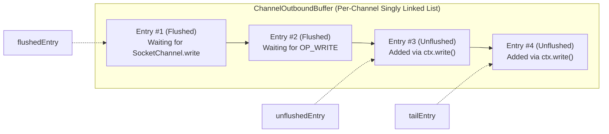
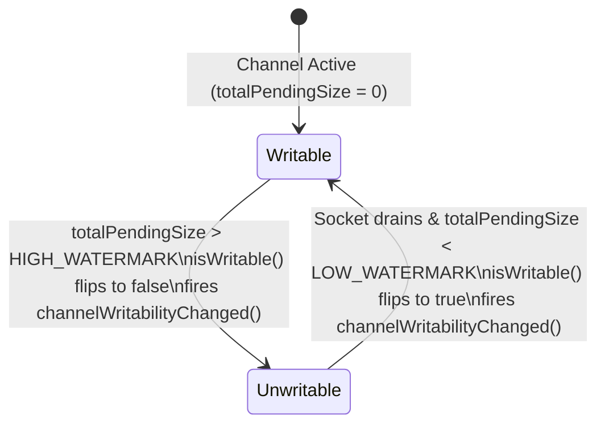

## Before you start

A non-blocking `write()` never waits. If a slow client cannot keep up, the data you handed over has to go somewhere, and in Netty it piles up in memory. Imagine a sink with the tap running and a drain that is too narrow: it fills slowly, then overflows. A server that streams data to a slow reader can run out of heap without any error until it is too late. Backpressure is the habit of noticing the sink is filling and turning the tap down. Netty offers two thresholds on each channel, a high and a low mark, and tells your code when the channel stops and starts being writable.

The chapter builds on the pipeline from [chapter 4](/tech/series/netty/04.pipeline-and-framing/).

Terms used in this chapter:

- **backpressure**: a signal from a slower consumer that makes the producer slow down or pause.
- **`ChannelOutboundBuffer`**: the queue inside a channel that holds written data until the socket accepts it.
- **`write()` vs `flush()`**: `write()` queues data in Netty; `flush()` tries to send the queued data to the socket.
- **`WriteBufferWaterMark`**: the pair of low and high thresholds on the queued byte count.
- **writability**: whether the channel currently considers its queue below the high mark, checked with `isWritable()`.
- **hysteresis**: using two different thresholds for switching off and on, so the state does not flap near one value.

## The Silent Killer of Non-Blocking Servers: Unbounded Outbound Queues

In blocking I/O (`BIO`), flow control happens by accident: if a client stops reading from its socket, the client's TCP receive window (`rwnd`) drops to `0`, the server's kernel socket send buffer (`SO_SNDBUF`) fills up, and the server thread calling `OutputStream.write()` **blocks and goes to sleep**. The producer is physically prevented from generating more data.

In Netty, **every `ctx.write(msg)` and `ctx.writeAndFlush(msg)` call is asynchronous and non-blocking**:

- If a handler loops and writes `8 MB` of chunks to a client over a slow 64 KB/s cellular link, `ctx.write()` **never blocks**.
- Instead, every chunk that cannot fit into the kernel's `SO_SNDBUF` is queued inside Netty's user-space **`ChannelOutboundBuffer`**.
- If 1,000 connected clients stall simultaneously while the producer keeps calling `ctx.write()` blindly, `ChannelOutboundBuffer` accumulates gigabytes of un-flushed `ByteBuf` instances until the JVM crashes with `java.lang.OutOfMemoryError: Direct buffer memory`.

To survive slow consumers without blocking the `EventLoop` thread, a non-blocking server needs explicit **cooperative backpressure**.

---

## Inside `ChannelOutboundBuffer`: `write()` vs. `flush()`

Every Netty `AbstractChannel` owns a `ChannelOutboundBuffer` inside its `Unsafe` inner class. Internally, it is a singly linked list of `Entry` objects partitioned by three pointers:



1. **What `ctx.write(msg)` Does**:
   - Allocates a recycled `Entry` wrapper (via Netty's `ObjectPool` / `Recycler`) pointing to your `ByteBuf`.
   - Appends the `Entry` at `tailEntry` in the **unflushed** segment (`unflushedEntry` $\to$ `tailEntry`).
   - Increments **`totalPendingSize`** by the buffer's readable bytes plus a 96-byte `Entry` overhead (`MESSAGE_SIZE_ESTIMATOR`).
   - **Does NOT touch the OS socket or invoke any system call.**
2. **What `ctx.flush()` Does**:
   - Advances the `flushedEntry` pointer across the queued `unflushedEntry` nodes, marking them ready for the wire.
   - Calls `doWrite(ChannelOutboundBuffer)` on the channel (for example, `NioSocketChannel.doWrite()`), which invokes gathering writes (`SocketChannel.write(ByteBuffer[])`) up to **`WRITE_SPIN_COUNT` (default `16`)** times.
   - As each `Entry` is completely written to the kernel `SO_SNDBUF`, `ChannelOutboundBuffer.remove()` **automatically calls `ReferenceCountUtil.safeRelease(msg)`** and decrements `totalPendingSize`.
   - **What if the Kernel `SO_SNDBUF` Fills Up?**: `SocketChannel.write()` returns `0` bytes written. Netty immediately stops spinning, registers **`OP_WRITE` (`EPOLLOUT`)** on the `EventLoop`'s selector, and returns control to the `EventLoop` so other channels can keep running! When the slow client finally acknowledges packets and frees space in `SO_SNDBUF`, the kernel fires `EPOLLOUT`, and the `EventLoop` flushes the remaining `flushedEntry` nodes.

---

## Hysteresis Watermarks (`WriteBufferWaterMark`)

How does your application handler know when `ChannelOutboundBuffer` is filling up?

Netty tracks `totalPendingSize` against a pair of per-channel thresholds configured via `ChannelOption.WRITE_BUFFER_WATER_MARK` (default: **`low = 32 KB`, `high = 64 KB`**):



- **Crossing the High Watermark (`totalPendingSize > high`)**: Inside `incrementPendingOutboundBytes()`, Netty atomically sets the `unwritable` bit flag (`isWritable()` becomes `false`) and fires **`pipeline.fireChannelWritabilityChanged()`**.
- **Draining Below the Low Watermark (`totalPendingSize < low`)**: As socket flushes release buffers inside `decrementPendingOutboundBytes()`, once pending bytes fall strictly below `low`, Netty clears the `unwritable` bit (`isWritable()` becomes `true`) and fires **`pipeline.fireChannelWritabilityChanged()`** again.

### Why Two Watermarks Instead of One Threshold? (Hysteresis)

Suppose a single threshold of `64 KB` were used. If a producer paused at `64,001` bytes, and the NIC transmitted a single `1,460`-byte TCP segment (`62,541` bytes remaining), `channelWritabilityChanged` would immediately wake the producer to write one `8 KB` chunk (`70,541` bytes), flipping it right back to unwritable! The channel would thrash between writable and unwritable on every single packet.

By separating **`HIGH_WATERMARK`** from **`LOW_WATERMARK`** (the defaults are `64 KB` / `32 KB`; the lab below uses `128 KB` / `64 KB`), the channel drains a full cushion before waking the producer—known in control theory as **hysteresis**.

### Propagating Backpressure End-to-End (Proxy / Gateway Pattern)

What if your Netty server is a gateway or proxy forwarding bytes from an upstream socket `channelA` to a slow downstream socket `channelB`? When `channelB.isWritable()` becomes `false`, you pause reading from `channelA` using `AUTO_READ`:

```java
@Override
public void channelWritabilityChanged(ChannelHandlerContext ctx) {
    boolean writable = ctx.channel().isWritable();
    // Propagate backpressure to the upstream source channel!
    upstreamChannel.config().setAutoRead(writable);
    ctx.fireChannelWritabilityChanged();
}
```

Setting `setAutoRead(false)` removes `OP_READ` (`EPOLLIN`) from `upstreamChannel`'s selector. Kernel receive buffers on `upstreamChannel` fill up, TCP advertises `rwnd = 0` back to the upstream sender, and the entire distributed pipeline slows down gracefully with zero dropped packets and bounded memory.

---

## Companion Lab Walkthrough: `flos/modules/netty/backpressure-lab`

Let us examine the runnable backpressure implementation in [`azusachino/flos/modules/netty/backpressure-lab`](https://github.com/azusachino/flos/tree/main/modules/netty/backpressure-lab), which streams `8 MB` in `8 KB` chunks to any connecting client while strictly obeying `WriteBufferWaterMark(64 KB, 128 KB)`.

### 1. Configuring Watermarks (`BackpressureLabServer.java`)

In [`BackpressureLabServer.java`](https://github.com/azusachino/flos/blob/main/modules/netty/backpressure-lab/src/main/java/io/github/azusachino/flos/netty/backpressure/BackpressureLabServer.java):

```java
public final class BackpressureLabServer {

    static final int CHUNK_SIZE = 8 * 1024;
    static final long TOTAL_BYTES = 8L * 1024 * 1024;
    static final int LOW_WATERMARK = 64 * 1024;
    static final int HIGH_WATERMARK = 128 * 1024;

    private final EventLoopGroup bossGroup = new MultiThreadIoEventLoopGroup(1, NioIoHandler.newFactory());
    private final EventLoopGroup workerGroup = new MultiThreadIoEventLoopGroup(NioIoHandler.newFactory());
    private final AtomicInteger pausedCount = new AtomicInteger();
    private final AtomicInteger resumedCount = new AtomicInteger();
    private Channel serverChannel;

    public int start(int port) throws InterruptedException {
        ServerBootstrap bootstrap =
                new ServerBootstrap()
                        .group(bossGroup, workerGroup)
                        .channel(NioServerSocketChannel.class)
                        .childOption(
                                ChannelOption.WRITE_BUFFER_WATER_MARK,
                                new WriteBufferWaterMark(LOW_WATERMARK, HIGH_WATERMARK))
                        .childHandler(
                                new ChannelInitializer<SocketChannel>() {
                                    @Override
                                    protected void initChannel(SocketChannel channel) {
                                        channel
                                                .pipeline()
                                                .addLast(
                                                        new ThrottledProducerHandler(
                                                                CHUNK_SIZE, TOTAL_BYTES, pausedCount, resumedCount));
                                    }
                                });
        serverChannel = bootstrap.bind(port).sync().channel();
        return ((InetSocketAddress) serverChannel.localAddress()).getPort();
    }
}
```

### 2. Event-Driven Pause and Resume (`ThrottledProducerHandler.java`)

Look at how [`ThrottledProducerHandler.java`](https://github.com/azusachino/flos/blob/main/modules/netty/backpressure-lab/src/main/java/io/github/azusachino/flos/netty/backpressure/ThrottledProducerHandler.java) writes chunks without blocking or polling:

```java
package io.github.azusachino.flos.netty.backpressure;

import io.netty.buffer.Unpooled;
import io.netty.channel.ChannelHandlerContext;
import io.netty.channel.ChannelInboundHandlerAdapter;
import java.util.concurrent.atomic.AtomicInteger;
import java.util.concurrent.atomic.AtomicLong;

public class ThrottledProducerHandler extends ChannelInboundHandlerAdapter {

    private final int chunkSize;
    private final long totalBytes;
    private final AtomicInteger pausedCount;
    private final AtomicInteger resumedCount;
    private final AtomicLong bytesSent = new AtomicLong();
    private ChannelHandlerContext ctx;

    public ThrottledProducerHandler(
            int chunkSize, long totalBytes, AtomicInteger pausedCount, AtomicInteger resumedCount) {
        this.chunkSize = chunkSize;
        this.totalBytes = totalBytes;
        this.pausedCount = pausedCount;
        this.resumedCount = resumedCount;
    }

    @Override
    public void channelActive(ChannelHandlerContext ctx) {
        produce(ctx);
        ctx.fireChannelActive();
    }

    @Override
    public void channelWritabilityChanged(ChannelHandlerContext ctx) {
        if (ctx.channel().isWritable()) {
            resumedCount.incrementAndGet();
            produce(ctx);
        } else {
            pausedCount.incrementAndGet();
        }
        ctx.fireChannelWritabilityChanged();
    }

    private void produce(ChannelHandlerContext ctx) {
        while (ctx.channel().isWritable() && bytesSent.get() < totalBytes) {
            ctx.write(Unpooled.wrappedBuffer(new byte[chunkSize]));
            bytesSent.addAndGet(chunkSize);
        }
        ctx.flush();
    }
}
```

Trace the execution flow carefully:

1. When the connection becomes active (`channelActive`), `produce(ctx)` writes `8 KB` chunks in a `while` loop checking `ctx.channel().isWritable()`.
2. Because `ctx.write()` only stages chunks into `ChannelOutboundBuffer`, after about 16 chunks (16 × (8 KB + 96 B entry overhead) ≈ 130 KB, over the 128 KB `HIGH_WATERMARK`), `incrementPendingOutboundBytes()` synchronously flips `isWritable()` to `false` and fires `channelWritabilityChanged()` (incrementing `pausedCount`).
3. The `while (ctx.channel().isWritable() ...)` condition evaluates to `false` on the very next iteration! `produce(ctx)` calls `ctx.flush()` to push the batch to the socket and exits cleanly.
4. When the socket drains `ChannelOutboundBuffer` below `64 KB LOW_WATERMARK`, Netty fires `channelWritabilityChanged()` with `isWritable() == true`, incrementing `resumedCount` and calling `produce(ctx)` to send the next batch until all `8 MB` have been delivered.

---

## Proving Watermark Hysteresis & Real OS Backpressure (`BackpressureTest.java`)

In [`BackpressureTest.java`](https://github.com/azusachino/flos/blob/main/modules/netty/backpressure-lab/src/test/java/io/github/azusachino/flos/netty/backpressure/BackpressureTest.java), three progressive tests verify the mechanism from isolated buffer accounting to real TCP socket congestion:

```java
class BackpressureTest {

    @Test
    void writabilityFlipsAtTheConfiguredWatermarks() {
        var channel = new EmbeddedChannel();
        channel
                .config()
                .setOption(ChannelOption.WRITE_BUFFER_WATER_MARK, new WriteBufferWaterMark(1024, 2048));

        assertThat(channel.isWritable()).isTrue();

        // Queue 3 x 1024 = 3072 bytes without flushing (crosses 2048 high watermark)
        for (int i = 0; i < 3; i++) {
            channel.write(Unpooled.wrappedBuffer(new byte[1024]));
        }
        assertThat(channel.isWritable()).isFalse();

        // Flushing drains the EmbeddedChannel outbound buffer below 1024 low watermark
        channel.flush();
        assertThat(channel.isWritable()).isTrue();
    }

    @Test
    void throttledProducerPausesAndResumesAcrossTheFullPayload() {
        var pausedCount = new AtomicInteger();
        var resumedCount = new AtomicInteger();
        var handler = new ThrottledProducerHandler(1024, 32 * 1024, pausedCount, resumedCount);
        var channel = new EmbeddedChannel();
        channel
                .config()
                .setOption(ChannelOption.WRITE_BUFFER_WATER_MARK, new WriteBufferWaterMark(4096, 8192));
        channel.pipeline().addLast(handler);

        handler.start();

        assertThat(handler.bytesSent()).isEqualTo(32 * 1024);
        assertThat(pausedCount.get()).isGreaterThan(0);
        assertThat(resumedCount.get()).isEqualTo(pausedCount.get());
        assertThat(channel.isWritable()).isTrue();
    }

    @Test
    void realSocketProducerPausesUnderARealSlowConsumer() throws Exception {
        var server = new BackpressureLabServer();
        int port = server.start(0);
        try (var socket = new Socket("localhost", port)) {
            // Deliberately stall reading for 500ms so OS TCP buffers fill up
            // and the server's ChannelOutboundBuffer crosses HIGH_WATERMARK.
            Thread.sleep(500);

            long totalRead = drainExpected(socket.getInputStream(), BackpressureLabServer.TOTAL_BYTES);

            assertThat(totalRead).isEqualTo(BackpressureLabServer.TOTAL_BYTES);
            assertThat(server.pausedCount()).isGreaterThan(0);
            assertThat(server.resumedCount()).isEqualTo(server.pausedCount());
        } finally {
            server.stop();
        }
    }
}
```

### Run the Lab and Watch Live TCP Backpressure

```bash
# Terminal 1: Start the backpressure producer on port 9002
$ make netty-backpressure
backpressure-lab producer listening on port 9002
Connect and read slowly to observe paused/resumed transitions.

# Terminal 2: Throttle the client read rate to 64 KB/s using pv
$ nc localhost 9002 | pv -L 64K > /dev/null
```

While `pv -L 64K` throttles the receiver in Terminal 2, you can inspect the kernel TCP queues on port `9002` with `ss -tni sport = :9002`: you will see `Send-Q` saturate as the client advertises a near-zero TCP receive window (`rwnd`), while the Netty server's heap and direct memory remain completely flat at $\le 128\text{ KB}$ per connection.

Backpressure keeps a healthy connection within memory bounds. But what happens when a peer silently vanishes without sending a TCP `FIN`, or when a server restarts mid-stream? In [Chapter 06](/tech/series/netty/06.connection-lifecycle/), we complete the connection lifecycle with `IdleStateHandler` heartbeats, race-free graceful closes, virtual-clock testing, reconnecting clients, and multi-arch containerization.
