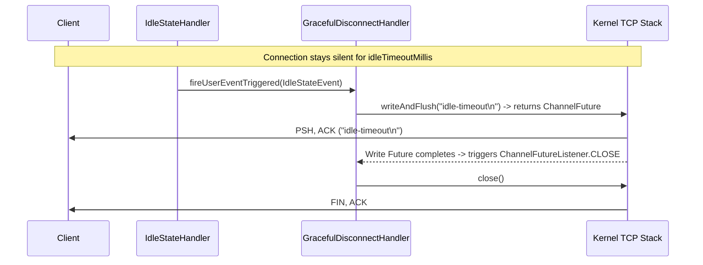

## Before you start

A TCP connection can look open long after the other side is gone. If a phone loses signal or a cable is pulled, no goodbye packet is sent, and your server keeps the socket and its buffers forever. Do that ten thousand times and the server runs out of memory or descriptors. This chapter covers how to notice silence with an idle-state handler, how to close a connection without losing the last message you wrote, how to test timeouts without waiting for real time to pass, and how a client reconnects after a failure. The reconnect advice is the one you have likely met elsewhere: wait a little longer after each failure, and add some randomness.

Read [chapter 5](/tech/series/netty/05.backpressure-and-flow-control/) first, because closing safely means waiting for queued writes to finish.

Terms used in this chapter:

- **half-open connection**: one side believes the connection is alive while the other has already gone, without either having sent a close.
- **`IdleStateHandler`**: a handler that fires an event when a channel has seen no reads, no writes, or neither, for a set time.
- **`ChannelFuture`**: an object representing an I/O operation that will finish later; you attach a listener to run code on completion.
- **graceful shutdown**: stopping a server by finishing in-flight work instead of dropping it.
- **exponential backoff**: doubling the wait between retries up to a limit.
- **jitter**: random variation added to a retry delay so many clients do not retry at the same instant.
- **`EmbeddedChannel`**: a test channel that runs handlers in memory, with a controllable clock.

## The Illusion of an "Open" TCP Connection

In [Chapter 05](/tech/series/netty/05.backpressure-and-flow-control/), we throttled a live connection. Now consider a subtler production failure mode:

> **A client connects to your server, sends two requests, and then its host loses power, its cellular NAT table expires, or an intermediate firewall silently drops the stateful flow.**

If the server is simply waiting for the next request (`OP_READ`) and never writes to the socket:

- The peer never transmitted a `FIN` or `RST` packet.
- Because TCP is a state machine inside the endpoints' kernels—not a physical circuit on the wire—the server's kernel still lists the socket as `ESTABLISHED`.
- What about OS-level `SO_KEEPALIVE`? On Linux, `/proc/sys/net/ipv4/tcp_keepalive_time` defaults to **7,200 seconds (2 hours)** before sending the first keepalive probe, plus 9 probes at 75-second intervals—meaning a dead socket lingers for **2 hours and 11 minutes**, leaking file descriptors, session state, and memory.

Production services therefore implement **application-layer idle detection and heartbeats**, paired with **graceful connection teardown** and **automatic client reconnection**.

---

## Detecting Silence with `IdleStateHandler`

Netty provides `io.netty.handler.timeout.IdleStateHandler`, which schedules lightweight timer tasks directly on the channel's own `EventLoop` (`scheduledTaskQueue` from [Chapter 03](/tech/series/netty/03.reactor-and-event-loop/))—requiring zero background watchdog threads:

```java
public IdleStateHandler(
        long readerIdleTime,
        long writerIdleTime,
        long allIdleTime,
        TimeUnit unit)
```

- **`readerIdleTime`**: Fires `IdleStateEvent(READER_IDLE)` when no inbound `channelRead` has occurred within the window. Typically used by **servers** to disconnect silent/zombie clients.
- **`writerIdleTime`**: Fires `IdleStateEvent(WRITER_IDLE)` when no outbound `write` has occurred within the window. Typically used by **clients** to send a lightweight `PING` heartbeat frame so the server does not consider them idle.
- **`allIdleTime`**: Fires `IdleStateEvent(ALL_IDLE)` when neither reading nor writing has occurred within the window. Passing `0` for any parameter disables that specific timer.

### How `IdleStateHandler` Avoids Timer Churn

Does `IdleStateHandler` cancel and reschedule a timer on every single `channelRead` packet? **No!**

If a connection processes 50,000 packets per second, canceling and inserting into the `scheduledTaskQueue` min-heap 50,000 times per second would degrade throughput. Instead:

1. On every `channelReadComplete`, `IdleStateHandler` simply records a `long lastReadTime = ticksInNanos()` timestamp field (a cheap local variable write on the single-threaded `EventLoop`).
2. When the single scheduled timer wakes up after `allIdleTime`, it computes `long nextDelay = allIdleTimeNanos - (ticksInNanos() - lastReadTime)`.
3. If `nextDelay <= 0`, the connection truly stayed silent for the entire window, so it fires `ctx.fireUserEventTriggered(IdleStateEvent)`. If activity occurred in the meantime (`nextDelay > 0`), it simply reschedules itself for `nextDelay`!

---

## Race-Free Graceful Teardown (`ChannelFutureListener.CLOSE`)

When `IdleStateHandler` triggers an `IdleStateEvent`, suppose your server wants to send a final diagnostic message (`"idle-timeout\n"`) before closing the socket.

Consider what happens if a developer writes this naive code:

```java
// BUG: Naive write followed by immediate close()
ctx.writeAndFlush(Unpooled.copiedBuffer("idle-timeout\n", StandardCharsets.UTF_8));
ctx.close(); // RACES with the asynchronous write!
```

Why is that a bug? Because `ctx.writeAndFlush(...)` is asynchronous! If the socket cannot flush the bytes immediately in the same call stack, `ctx.close()` can close the underlying file descriptor before `ChannelOutboundBuffer` finishes draining, causing the client to receive an abrupt EOF or `RST` without ever seeing `"idle-timeout\n"`.

Look at how [`GracefulDisconnectHandler.java`](https://github.com/azusachino/flos/blob/main/modules/netty/lifecycle-lab/src/main/java/io/github/azusachino/flos/netty/lifecycle/GracefulDisconnectHandler.java) in [`flos/modules/netty/lifecycle-lab`](https://github.com/azusachino/flos/tree/main/modules/netty/lifecycle-lab) solves this deterministically:

```java
package io.github.azusachino.flos.netty.lifecycle;

import io.netty.buffer.Unpooled;
import io.netty.channel.ChannelFutureListener;
import io.netty.channel.ChannelHandlerContext;
import io.netty.channel.ChannelInboundHandlerAdapter;
import io.netty.handler.timeout.IdleStateEvent;
import java.nio.charset.StandardCharsets;
import java.util.concurrent.atomic.AtomicInteger;

public class GracefulDisconnectHandler extends ChannelInboundHandlerAdapter {

    private final AtomicInteger idleDisconnectCount;

    public GracefulDisconnectHandler(AtomicInteger idleDisconnectCount) {
        this.idleDisconnectCount = idleDisconnectCount;
    }

    @Override
    public void userEventTriggered(ChannelHandlerContext ctx, Object evt) {
        if (evt instanceof IdleStateEvent) {
            idleDisconnectCount.incrementAndGet();
            ctx.writeAndFlush(Unpooled.copiedBuffer("idle-timeout\n", StandardCharsets.UTF_8))
                    .addListener(ChannelFutureListener.CLOSE);
        } else {
            ctx.fireUserEventTriggered(evt);
        }
    }
}
```

By chaining **`.addListener(ChannelFutureListener.CLOSE)`** onto the `ChannelFuture` returned by `ctx.writeAndFlush(...)`, Netty guarantees that `close()` is invoked **only after** the kernel socket has accepted the `"idle-timeout\n"` bytes.



---

## Deterministic Virtual-Clock Testing (`EmbeddedChannel.freezeTime()`)

How do you unit-test a 10-second or 100-millisecond timeout without adding slow, flaky `Thread.sleep()` calls to your test suite?

`EmbeddedChannel` includes a **controllable virtual clock** (`freezeTime()` and `advanceTimeBy()`). Because `IdleStateHandler` reads time through the channel's `EventLoop` ticker rather than calling `System.currentTimeMillis()` directly, we can advance virtual time by 150 ms in a few microseconds of wall-clock time!

Inspect [`LifecycleTest.java`](https://github.com/azusachino/flos/blob/main/modules/netty/lifecycle-lab/src/test/java/io/github/azusachino/flos/netty/lifecycle/LifecycleTest.java):

```java
@Test
void idleStateHandlerClosesConnectionAfterConfiguredTimeout() {
    var idleDisconnectCount = new AtomicInteger();
    var channel =
            new EmbeddedChannel(
                    new IdleStateHandler(0, 0, 100, TimeUnit.MILLISECONDS),
                    new GracefulDisconnectHandler(idleDisconnectCount));

    // Freeze the virtual clock, jump 150ms into the future, and execute due scheduled tasks
    channel.freezeTime();
    channel.advanceTimeBy(150, TimeUnit.MILLISECONDS);
    channel.runScheduledPendingTasks();

    assertThat(idleDisconnectCount.get()).isEqualTo(1);
    assertThat(channel.isOpen()).isFalse();

    ByteBuf goodbye = channel.readOutbound();
    assertThat(goodbye.toString(StandardCharsets.UTF_8)).isEqualTo("idle-timeout\n");
    goodbye.release();
}

@Test
void realSocketIdleTimeoutClosesTheConnection() throws Exception {
    var server = new LifecycleLabServer();
    int port = server.start(0, 200);
    try (var socket = new Socket("localhost", port)) {
        byte[] response = socket.getInputStream().readNBytes("idle-timeout\n".length());

        assertThat(new String(response, StandardCharsets.UTF_8)).isEqualTo("idle-timeout\n");
        assertThat(socket.getInputStream().read()).isEqualTo(-1); // Confirms clean EOF (FIN)
        assertThat(server.idleDisconnectCount()).isEqualTo(1);
    } finally {
        server.stop();
    }
}
```

---

## Self-Healing Clients: EventLoop-Scheduled Reconnection

When a client loses its connection—whether due to an idle timeout, a rolling server deployment, or a transient network partition—it must reconnect automatically without spawning new thread pools or leaking `EventLoopGroup`s.

In [`ReconnectingClient.java`](https://github.com/azusachino/flos/blob/main/modules/netty/lifecycle-lab/src/main/java/io/github/azusachino/flos/netty/lifecycle/ReconnectingClient.java), both **initial connection failures** (`connect()` future listener) and **mid-session disconnections** (`channelInactive`) route into `group.schedule(this::connect, backoffMillis, TimeUnit.MILLISECONDS)`:

```java
package io.github.azusachino.flos.netty.lifecycle;

import io.netty.bootstrap.Bootstrap;
import io.netty.channel.ChannelHandlerContext;
import io.netty.channel.ChannelInboundHandlerAdapter;
import io.netty.channel.ChannelInitializer;
import io.netty.channel.EventLoopGroup;
import io.netty.channel.MultiThreadIoEventLoopGroup;
import io.netty.channel.nio.NioIoHandler;
import io.netty.channel.socket.SocketChannel;
import io.netty.channel.socket.nio.NioSocketChannel;
import java.util.concurrent.TimeUnit;
import java.util.concurrent.atomic.AtomicInteger;

public final class ReconnectingClient {

    private final EventLoopGroup group = new MultiThreadIoEventLoopGroup(NioIoHandler.newFactory());
    private final AtomicInteger connectAttempts = new AtomicInteger();
    private final AtomicInteger disconnectCount = new AtomicInteger();
    private final String host;
    private final int port;
    private final long backoffMillis;
    private volatile boolean stopping;

    public ReconnectingClient(String host, int port, long backoffMillis) {
        this.host = host;
        this.port = port;
        this.backoffMillis = backoffMillis;
    }

    public void start() {
        connect();
    }

    public void stop() {
        stopping = true;
        group.shutdownGracefully();
    }

    private void connect() {
        if (stopping) {
            return;
        }
        connectAttempts.incrementAndGet();
        var bootstrap =
                new Bootstrap()
                        .group(group)
                        .channel(NioSocketChannel.class)
                        .handler(
                                new ChannelInitializer<SocketChannel>() {
                                    @Override
                                    protected void initChannel(SocketChannel channel) {
                                        channel
                                                .pipeline()
                                                .addLast(
                                                        new ChannelInboundHandlerAdapter() {
                                                            @Override
                                                            public void channelInactive(
                                                                    ChannelHandlerContext ctx) {
                                                                disconnectCount.incrementAndGet();
                                                                scheduleReconnect();
                                                                ctx.fireChannelInactive();
                                                            }
                                                        });
                                    }
                                });
        bootstrap
                .connect(host, port)
                .addListener(
                        future -> {
                            if (!future.isSuccess()) {
                                scheduleReconnect();
                            }
                        });
    }

    private void scheduleReconnect() {
        if (stopping) {
            return;
        }
        group.schedule(this::connect, backoffMillis, TimeUnit.MILLISECONDS);
    }
}
```

### Production Note: Exponential Backoff with Jitter

`ReconnectingClient` uses a fixed `backoffMillis` so `LifecycleTest.reconnectingClientRetriesAfterEachDisconnect` can assert 3+ reconnect cycles rapidly. In a production fleet of 10,000 clients, if a server restarts at $t = 0$, a fixed backoff causes all 10,000 clients to hammer the server in synchronized waves (**thundering herd**). Always pair reconnect scheduling with **capped exponential backoff and full jitter**:

$$\text{delay}_k = \text{Uniform}\Big(0,\; \min\big(\text{maxBackoff},\; \text{baseBackoff} \cdot 2^k\big)\Big)$$

### How `shutdownGracefully()` Drains a Server

Every server in `flos` shuts down via:

```java
workerGroup.shutdownGracefully().sync();
bossGroup.shutdownGracefully().sync();
```

Unlike an abrupt `Thread.interrupt()`, `shutdownGracefully(quietPeriod, timeout, unit)` transitions each `EventLoop` into `ST_SHUTTING_DOWN`:

1. Closes all registered channels and rejects external submissions.
2. Continues running the `EventLoop` tick for a **`quietPeriod`** (default `2s`, configurable down to `100ms` in tests) to ensure that any tasks or `ChannelFutureListener` callbacks triggered by those channel closures finish executing cleanly.
3. If no new tasks are queued during the `quietPeriod` (or once the hard `timeout` expires), the `EventLoop` closes its `Selector`/`epoll` descriptor and terminates the OS thread.

---

## Packaging & Proving a Netty Service in a Container

Running `make netty-lifecycle` (port `9003`) or `make netty-event-loop` (port `9000`) proves the JVM code on the host. In [`flos/environments/netty/`](https://github.com/azusachino/flos/tree/main/environments/netty), we take the final step from library code to a production-ready container image:

1. **Multi-Stage Build ([`environments/netty/event-loop/Dockerfile`](https://github.com/azusachino/flos/blob/main/environments/netty/event-loop/Dockerfile))**:
   - Stage 1 (`maven:3.9-eclipse-temurin-17`) compiles `mvn -pl modules/netty/event-loop-lab -am -DskipTests package`.
   - Stage 2 (`amazoncorretto:17-alpine`, verified multi-arch for both `amd64` and `arm64`) copies only `app.jar`, drops root privileges (`USER flos`), and configures a native TCP health check (`HEALTHCHECK CMD nc -z localhost 9000 || exit 1`).
2. **End-to-End Container Smoke Verification ([`scripts/netty_deployment_smoke.py`](https://github.com/azusachino/flos/blob/main/scripts/netty_deployment_smoke.py))**:

```bash
# Build the multi-arch container image, start it, run the socket smoke test, and tear down
make netty-up
make netty-smoke
make netty-down
```

---

## Series Summary: A Single TCP Connection, End to End

Across these six chapters, we traced a network connection from the physical NIC and Linux kernel all the way to a resilient, containerized Netty 4.2 service:

| Chapter | Layer | Core Takeaway |
| :--- | :--- | :--- |
| **[01. Kernel I/O Models](/tech/series/netty/01.linux-io-models/)** | Linux VFS & `epoll` | `epoll` separates $\mathcal{O}(\log N)$ Red-Black Tree registration (`epoll_ctl`) from $\mathcal{O}(1)$ callback-driven harvesting (`rdllist` in `epoll_wait`). |
| **[02. Zero-Copy & Buffers](/tech/series/netty/02.zero-copy-and-buffers/)** | Page Cache & `ByteBuf` | Direct `ByteBuf` avoids JVM heap-to-native copies; `sendfile` + SG-DMA eliminates CPU copies; `PooledByteBufAllocator` + `ReferenceCounted` manage off-heap memory deterministically. |
| **[03. Reactor & EventLoop](/tech/series/netty/03.reactor-and-event-loop/)** | Concurrency Model | Pinning each `Channel` to a single-threaded `EventLoop` for its lifetime eliminates mutex lock contention (`event-loop-lab`). |
| **[04. Pipeline & Framing](/tech/series/netty/04.pipeline-and-framing/)** | Protocol Boundaries | TCP is a byte stream; `ByteToMessageDecoder` and `LengthFieldBasedFrameDecoder` reassemble split and coalesced packets (`framing-lab`). |
| **[05. Backpressure](/tech/series/netty/05.backpressure-and-flow-control/)** | Memory Protection | `ChannelOutboundBuffer` hysteresis watermarks (`WriteBufferWaterMark`) and `channelWritabilityChanged` bound off-heap memory against slow consumers (`backpressure-lab`). |
| **[06. Lifecycle & Resilience](/tech/series/netty/06.connection-lifecycle/)** | Operational Maturity | `IdleStateHandler`, `ChannelFutureListener.CLOSE`, virtual-clock testing (`freezeTime`), and EventLoop-scheduled reconnects outlive network failures (`lifecycle-lab`). |
